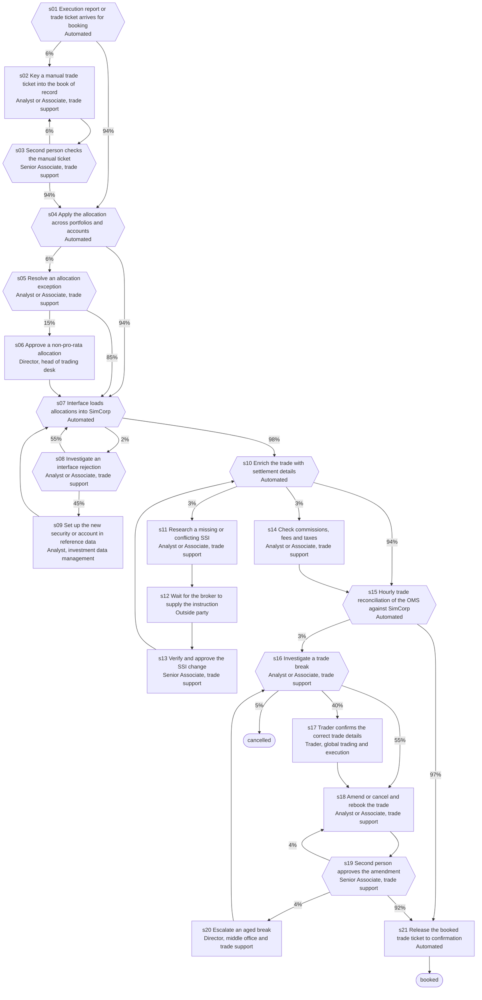

# Book, allocate and enrich executed trades

`pim-mkt-book-allocate` · asset management (public pension fund investment) · investment operations (middle office) · part of `pension-investment-manager`

Trade support turns each executed order into booked trades in the investment book of record, split across the portfolios and custody accounts named on the order and enriched with settlement dates, standing settlement instructions and fees, ready for confirmation with the broker. Most trades flow from the order management system into SimCorp Dimension without anyone touching them; analysts work the exceptions, such as manual tickets for funding and OTC trades, allocations that do not divide cleanly, unknown securities, missing broker instructions and breaks between the order system and the book of record. Every manual booking, amendment and instruction change is checked by a second person, and breaks must be cleared the same day because errors here become confirmation mismatches and settlement fails later.

| | |
|---|---|
| Unit of work | one trade allocation |
| Starts when | An execution report for a completed order arrives from the OMS, or a trader's ticket arrives for a trade executed outside the OMS. |
| Done when | The allocation is booked, enriched and released to confirmation as a trade ticket, or cancelled as a duplicate or busted trade. |
| Organisation | A very large Canadian national pension fund manager with an internal trading desk, an order and execution management system and SimCorp Dimension as its investment book of record. (2,052 employees, 2019-2022) |
| Volume | 40,000 cases a month (range 28,000 to 58,000) |

## Where it sits

- Starts with **execution_report** from mkt-execute-trades (96% of cases)
- Starts with **execution_report** from ci-public-credit-decisions (3% of cases)
- Starts with **trade_ticket** from cmf-short-term-funding (1% of cases)
- Sends **trade_ticket** to mkt-confirm-affirm (outcome: booked)

## Flow

## Roles

| Role | Department | Layer | FTE on this process | Loaded cost per hour | Evidence |
|---|---|---|---:|---:|---|
| Analyst or Associate, trade support | Middle office and trade support | individual contributor | 9 | 81 CAD | B [jobbank_11109] |
| Senior Associate, trade support | Middle office and trade support | senior specialist | 2.5 | 156 CAD | C |
| Director, middle office and trade support | Middle office and trade support | manager | 0.1 | 432 CAD | C |
| Trader, global trading and execution | Global trading and execution | senior specialist | 0.3 | 373 CAD | C |
| Director, head of trading desk | Global trading and execution | manager | 0.2 | 1080 CAD | C |
| Analyst, investment data management | Investment data management | individual contributor | 1 | 81 CAD | C |

## Steps

Hands-on time and the wait before each step show the most common value. Evidence tier A is a sourced number, B a sourced description, C the author's estimate.

| Step | Who | Kind | Hands-on | Wait before | Control | Evidence |
|---|---|---|---:|---:|---|---|
| **s01 Execution report or trade ticket arrives for booking.** When an order is done the OMS sends the execution report with average price, quantity, broker and the pre-allocation by portfolio and account. Credit trades from Credit Investments arrive the same way; funding trades, OTC derivatives and some voice trades arrive as tickets from the trader instead. | Automated | system auto | 0 min | 0 min |  | B [t1report], [dtcc_auto] |
| **s02 Key a manual trade ticket into the book of record.** A trade support analyst reads the trader's ticket, Bloomberg message or term sheet and keys the trade into SimCorp Dimension: instrument, counterparty, portfolio, quantity or notional, price, trade and settlement dates and fees. | Analyst or Associate, trade support | data entry | 6 min | 45 min |  | B [isda_obs] |
| **s03 Second person checks the manual ticket.** A senior associate compares the booked trade field by field with the source ticket or term sheet and approves it in SimCorp, or sends it back with the error marked. | Senior Associate, trade support | review | 3 min | 40 min | Maker-checker on manual bookings: trades authorised and recorded accurately (SOC 1 baseline trading objective) | B [sifma_soc] |
| **s04 Apply the allocation across portfolios and accounts.** The OMS or SimCorp splits the block across the portfolios and custody accounts named on the order at the average price, pro rata for partial fills, and rounds to board lots or minimum bond denominations. | Automated | system auto | 0 min | 2 min |  | B [sifma_soc], [fxgc] |
| **s05 Resolve an allocation exception.** The analyst adjusts allocations that do not divide cleanly (odd lots, bond minimum denominations, a partial fill across several accounts), applying the desk's pro-rata rule, and records the reason. | Analyst or Associate, trade support | validation | 3 min | 1.0 h |  | C |
| **s06 Approve a non-pro-rata allocation.** The head of the trading desk reviews why the allocation departs from pro rata (for example a mandate limit or a minimum holding) and approves or rejects it in writing. | Director, head of trading desk | approval | 5 min | 1.5 h | Fair allocation policy: allocations follow the stated method and departures are approved by management (SOC 1 baseline allocation objective) | B [sifma_soc] |
| **s07 Interface loads allocations into SimCorp.** The interface between the OMS and SimCorp Dimension, the investment book of record, posts each allocation as a trade in the right portfolio. It runs in frequent intraday batches. | Automated | system auto | 0 min | 15 min |  | B [fund_simcorp], [ar21] |
| **s08 Investigate an interface rejection.** The analyst opens the interface error queue, reads the reject reason and checks whether the security, portfolio, account or broker code is missing or mapped wrongly in reference data. | Analyst or Associate, trade support | lookup | 5 min | 45 min |  | C |
| **s09 Set up the new security or account in reference data.** An investment data analyst creates the security master record from Bloomberg (identifiers, currency, conventions, pricing source, settlement market) or maps the new account, and a second person approves it before trades can load. | Analyst, investment data management | data entry | 15 min | 2.0 h | New securities and changes authorised and processed accurately (SOC 1 baseline objective); maker-checker on the security master | B [sifma_soc], [t1report] |
| **s10 Enrich the trade with settlement details.** SimCorp adds the settlement date from the market calendar, the custody account, the place of settlement and the counterparty's standing settlement instructions, and calculates commissions, fees and transaction taxes. | Automated | system auto | 0 min | 1 min |  | B [dtcc_alert], [dtcc_ctm] |
| **s11 Research a missing or conflicting SSI.** The analyst looks up the broker's instructions in ALERT and earlier emails, works out which instruction applies to the market and asset type and asks the broker to update ALERT or confirm the instruction in writing. | Analyst or Associate, trade support | lookup | 5 min | 1.0 h |  | B [dtcc_alert], [t1report] |
| **s12 Wait for the broker to supply the instruction.** The broker's operations team updates its ALERT record or sends the instruction on letterhead or authenticated message. Small or foreign brokers can take longer. | Outside party | external wait | 0 min | 2.0 h |  | C |
| **s13 Verify and approve the SSI change.** A senior associate verifies the new instruction against an independent source (ALERT record or a call-back to a known contact), checks it was not changed by an email request alone, and approves it in the SSI table. | Senior Associate, trade support | approval | 4 min | 1.0 h | SSI changes verified independently and approved by a second person (payment fraud and settlement control); FX Global Code principle 51 on standard settlement instructions | B [fxgc], [sifma_soc] |
| **s14 Check commissions, fees and taxes.** The analyst compares the calculated commission with the broker's agreed rate and checks stamp duty, financial transaction tax or exchange fees for the market, then corrects the trade or asks the broker to correct its figures. | Analyst or Associate, trade support | validation | 3 min | 1.0 h |  | C |
| **s15 Hourly trade reconciliation of the OMS against SimCorp.** An automated control compares executions in the OMS with trades in SimCorp each hour and at end of day by quantity, price, portfolio and broker, and lists missing, duplicate or different trades. | Automated | system auto | 0 min | 40 min |  | C |
| **s16 Investigate a trade break.** The analyst compares the OMS execution, the SimCorp trade and the broker's execution summary to find which side is wrong (missing or duplicate trade, wrong portfolio, price, quantity or broker). | Analyst or Associate, trade support | analysis | 10 min | 1.0 h |  | C |
| **s17 Trader confirms the correct trade details.** The analyst messages the trader, who checks the execution in the EMS or with the broker and confirms the right price, quantity, broker or portfolio. | Trader, global trading and execution | communication | 4 min | 45 min |  | C |
| **s18 Amend or cancel and rebook the trade.** The analyst corrects the SimCorp trade, or cancels it and books it again, with a reason code so that the change is visible downstream to confirmation and settlement. | Analyst or Associate, trade support | data entry | 5 min | 10 min |  | B [t1report] |
| **s19 Second person approves the amendment.** A senior associate checks the amendment against the confirmed details and approves it, or rejects it back to the analyst. | Senior Associate, trade support | review | 3 min | 30 min | Maker-checker on trade amendments and cancellations | B [sifma_soc] |
| **s20 Escalate an aged break.** Breaks not cleared by end of day are reported to the director of trade support with the cause and owner, logged on the daily break report and chased first thing the next morning. | Director, middle office and trade support | approval | 8 min | 10.0 h | Investment operations break management standard: breaks cleared the same day or escalated | C |
| **s21 Release the booked trade ticket to confirmation.** The booked, allocated and enriched trade ticket becomes available to confirmation: SimCorp or the OMS sends the allocation to CTM for broker-matched trades, or queues it for FX and OTC confirmation. | Automated | system auto | 0 min | 5 min |  | B [dtcc_ctm], [dtcc_auto] |

## Exceptions

| Exception | Share of cases | What happens |
|---|---:|---|
| Manual ticket | 6% | Funding, OTC derivative and voice trades are keyed by hand and checked by a second person. |
| Allocation exception | 6% | Odd lots, bond minimum denominations or partial fills need manual adjustment; a few need desk-head approval for a non-pro-rata split. |
| Unknown security or account | 1% | The book of record rejects the trade until reference data sets up the new security or account. |
| Missing or conflicting SSI | 3% | The broker's settlement instruction is missing, out of date or ambiguous and must be obtained, verified and approved. |
| OMS to book of record break | 3% | A missing, duplicate or different trade is investigated, often with the trader, then amended under maker-checker; unresolved breaks are escalated at day end. |

## Benchmarks

| Metric | Value | Unit | Population | Evidence |
|---|---|---|---|---|
| cycle_time_days | p50 0.06, p90 0.25 | calendar days from execution report to trade ticket released to confirmation | Author estimate for a large buy-side middle office using an OMS feeding a book of record | C [t1report] |
| share_of_allocations_made_after_market_close | 0.8 | share of institutional allocations | U.S. institutional trades processed through DTCC, 2021 | A [t1report] |
| otc_trade_records_containing_errors | 0.11 | share of interest rate derivative trade records | ISDA Operations Benchmarking Survey 2011 respondents (dealers) | A [isda_obs] |

## Pain points

- Most allocations arrive after the close in a burst, so exceptions pile up in the evening just when broker operations teams are also busiest. (steps s01, s05, s16; A [t1report])
- Missing or stale broker settlement instructions stop straight-through processing and, if missed, cause settlement fails later. (steps s11, s12, s13; A [dtcc_alert], [t1report])
- Manual re-keying of funding, OTC and unusual trades introduces errors that need a second person to check. (steps s02, s03; B [isda_obs], [ar21])
- Separate order and accounting systems create breaks that must be found and fixed the same day. (steps s15, s16, s18, s20; B [ar21])

## Assumptions

- The unit of work is one allocation (one portfolio or account's share of one broker execution); about 1.6 allocations per order is assumed to reconcile 25,000 orders with 40,000 allocations a month.
- The OMS sends pre-allocated executions to SimCorp Dimension through an interface; SimCorp is the book of record and holds the SSI table, enriched from DTCC ALERT for brokers that use it.
- Exception rates (6% manual tickets, 6% allocation exceptions, 3% SSI exceptions, 3% fee exceptions, 3% OMS to book of record breaks) are author estimates for a large buy-side middle office in 2019 to 2022.
- Non-pro-rata allocation approval is given by the head of the trading desk (cmf_trading_director), a role not listed for this process in the organisation file; new security setup is done by the investment data team (data_ops_analyst), also not listed.
- Trade support analysts and seniors also work on confirmation and affirmation and OTC lifecycle events, so their FTE here is a share of the team.
- Loaded costs come from the organisation file; they include incentive pay and an overhead factor of 1.25.

## Sources

- [ar21] The model fund F2021 Annual Report (fiscal year ended March 31, 2021) (link withheld) (The model fund, 2021). Central trade execution by Financing, Collateral & Trading for all public assets except credit; multi-year Investment Lifecycle Technology & Data project to build an integrated platform for public market trades across the trading life cycle
- [fund_simcorp] The model fund Goes Live with SimCorp to Support Growth (link withheld) (SimCorp via Cision, 2010). SimCorp Dimension used for portfolio accounting, treasury and performance measurement after the fund internalised record keeping
- [t1report] [Accelerating the U.S. Securities Settlement Cycle to T+1](https://www.sifma.org/wp-content/uploads/2021/12/Accelerating-the-U.S.-Securities-Settlement-Cycle-to-T1-December-1-2021.pdf) (SIFMA, ICI and DTCC (with Deloitte), 2021). About 20% of institutional allocations occur during the trading day and 80% after the close; affirmation deadline 11:30 AM ET on T+1 under T+2; confirmation and affirmation can only start once allocations are complete; causes of settlement errors and fails include missing or incorrect SSIs, stale reference data, recalls and cancel and rebill
- [sifma_soc] [Asset Manager's Guide to SOC 1](https://www.sifma.org/wp-content/uploads/2017/08/SIFMA_AMG_asset-managers-guide-soc-2017.pdf) (SIFMA Asset Management Group and Grant Thornton, 2017). Baseline SOC 1 control objectives: trades properly authorised, settled and recorded accurately, completely and timely; block orders allocated according to management methodologies and allocations approved; new securities authorised and processed accurately; cash and positions reconciled to custodians
- [fxgc] [FX Global Code (updated December 2024; first published 2017)](https://www.globalfxc.org/docs/fx_global.pdf) (Global Foreign Exchange Committee, 2024). Principles 46 to 55: confirm trades as soon as practicable using automated matching; review, affirm and allocate block transactions as soon as practicable; resolve confirmation and settlement discrepancies; measure settlement risk and use PVP where practicable; use standard settlement instructions; request direct payments; reconcile accounts and submit compensation claims in a timely manner
- [dtcc_alert] [ALERT: standing settlement instruction platform](https://www.dtcc.com/institutional-trade-processing/itp/alert) (DTCC, 2026). Industry's largest SSI database, shared automatically with counterparties; enrichment with CTM supports straight-through processing; 57% of ALERT SSIs managed by custodians and prime brokers; outdated, incomplete or inaccurate SSI data is a leading cause of trade exceptions and settlement failure
- [dtcc_ctm] [Central Trade Manager (CTM)](https://www.dtcc.com/institutional-trade-processing/itp/central-trade-manager) (DTCC, 2026). Central matching platform automating allocation, confirmation and matching for equities, fixed income and money markets; Match to Instruct workflow with ALERT and TradeSuite ID; optional SSI enrichment; dashboards with same-day match agreed rates
- [dtcc_auto] [Why Automation is Pivotal to Prepare for T+1 in U.S.](https://www.dtcc.com/insights/2022/why-automation-is-pivotal-to-prepare-for-t1-in-us) (DTCC, 2022). Workflow of allocation, confirmation and affirmation; centrally matched trades can be affirmed and instructed automatically; affirmation deadline 11:30 AM ET on T+1; near 100% affirmation by 9 PM on trade date for automated workflows
- [isda_obs] [ISDA Operations Benchmarking Survey 2011](https://www.isda.org/a/ceiDE/obs-2011-final.pdf) (International Swaps and Derivatives Association, 2011). Interest rate derivative trade records containing errors 18% (2009), 14% (2010), 11% (2011), most attributable to the front office; counterparty name and payment dates are top error sources; 83% of electronically eligible interest rate derivative events confirmed electronically in 2011; confirmation backlogs measured in business days outstanding
- [jobbank_11109] [Wages: Credit Counsellor and other financial officers (NOC 11109) in the Toronto Region](https://www.jobbank.gc.ca/marketreport/wages-occupation/296946/geo9219) (Job Bank, Government of Canada, 2025). Toronto Region hourly wages for NOC 11109: low 23.00, median 34.62, high 66.46 (2023-2024)

Written by claude-opus on 2026-11-17.
