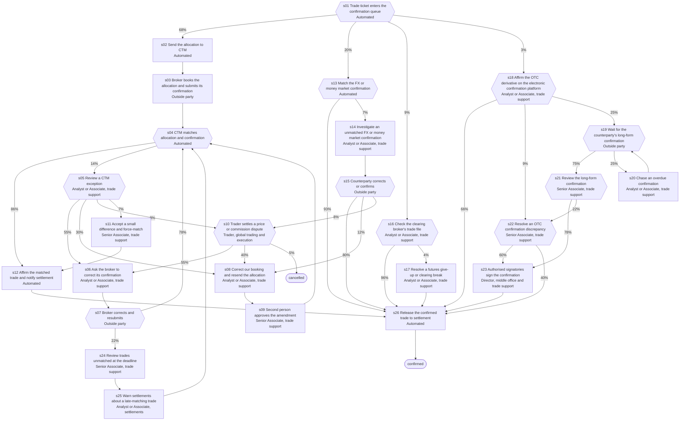

# Confirm and affirm trades with brokers and counterparties

`pim-mkt-confirm-affirm` · asset management (public pension fund investment) · investment operations (middle office) · part of `pension-investment-manager`

Before a trade can settle, the fund and the broker or counterparty must agree its details. Trade support sends each allocation to DTCC's Central Trade Manager, where it is matched automatically against the broker's confirmation, confirms FX and money market trades through electronic matching, checks listed futures against the clearing broker's file and confirms OTC derivatives on an electronic platform or by signed long-form confirmation. Most trades match without anyone touching them; analysts work the mismatches, which are mostly late or wrong broker details, before the noon T+1 matching deadline in Canada and the 11:30 a.m. T+1 affirmation cut-off in the U.S. Paper derivative confirmations take days and need chasing and two signatures.

| | |
|---|---|
| Unit of work | one trade allocation |
| Starts when | A booked trade ticket is released from booking, or a broker or counterparty confirmation arrives for a trade. |
| Done when | The trade is matched and affirmed, or its confirmation signed, and it is released to settlement; or it is cancelled because neither side recognises it. |
| Organisation | A very large Canadian national pension fund manager whose middle office matches trades through DTCC CTM and electronic FX and derivative confirmation services, with SimCorp Dimension as book of record. (2,052 employees, 2019-2022) |
| Volume | 40,000 cases a month (range 28,000 to 58,000) |

## Where it sits

- Starts with **trade_ticket** from mkt-book-allocate (92% of cases)
- Starts with **trade_confirmation** from executing_brokers (5% of cases)
- Starts with **trade_confirmation** from counterparties (3% of cases)
- Sends **trade_confirmation** to mkt-settle-trades (outcome: confirmed)
- Sends **trade_confirmation** to executing_brokers (outcome: confirmed)

## Flow

## Roles

| Role | Department | Layer | FTE on this process | Loaded cost per hour | Evidence |
|---|---|---|---:|---:|---|
| Analyst or Associate, trade support | Middle office and trade support | individual contributor | 10.5 | 81 CAD | B [fund_posting], [jobbank_11109] |
| Senior Associate, trade support | Middle office and trade support | senior specialist | 3 | 156 CAD | C |
| Director, middle office and trade support | Middle office and trade support | manager | 0.2 | 432 CAD | C |
| Trader, global trading and execution | Global trading and execution | senior specialist | 0.3 | 373 CAD | C |
| Analyst or Associate, settlements | Cash, collateral and settlements | individual contributor | 0.3 | 78 CAD | C |

## Steps

Hands-on time and the wait before each step show the most common value. Evidence tier A is a sourced number, B a sourced description, C the author's estimate.

| Step | Who | Kind | Hands-on | Wait before | Control | Evidence |
|---|---|---|---:|---:|---|---|
| **s01 Trade ticket enters the confirmation queue.** A booked and enriched allocation arrives from booking, or an unexpected broker or counterparty confirmation arrives first and is linked to its trade. The queue routes it by product: broker-executed equities and bonds to CTM, FX and money market trades to electronic confirmation matching, listed futures and options to the clearing broker check, and OTC derivatives to bilateral confirmation. | Automated | system auto | 0 min | 0 min |  | C [fund_posting] |
| **s02 Send the allocation to CTM.** SimCorp or the OMS sends the account-level allocation (security, side, quantity, price, commission, settlement date and account SSIs) to DTCC's Central Trade Manager for the executing broker. | Automated | system auto | 0 min | 10 min |  | B [dtcc_ctm], [dtcc_auto] |
| **s03 Broker books the allocation and submits its confirmation.** The executing broker's middle office books the allocation in its own system and submits the trade-level confirmation (price, commission, fees, net amount, settlement date and instructions) to CTM. Brokers working through the post-close peak, and Asian brokers overnight, can take hours. | Outside party | external wait | 0 min | 2.5 h |  | B [t1report], [dtcc_auto] |
| **s04 CTM matches allocation and confirmation.** CTM compares the fund's allocation with the broker's confirmation field by field within agreed tolerances on price, commission and net amount. A match is agreed automatically; otherwise the trade appears as mismatched or unmatched on both parties' dashboards. | Automated | system auto | 0 min | 1 min |  | B [dtcc_ctm], [sifma_aar] |
| **s05 Review a CTM exception.** The analyst opens the CTM exception dashboard, compares the mismatched fields (commission, net amount, settlement date, SSI, account, quantity) with the booking and the trader's execution, and decides which side is wrong. | Analyst or Associate, trade support | analysis | 5 min | 1.5 h |  | B [fund_posting], [dtcc_alert] |
| **s06 Ask the broker to correct its confirmation.** The analyst adds a comment in CTM and emails or calls the broker's middle office with the correct details and the deadline. | Analyst or Associate, trade support | communication | 3 min | 5 min |  | C |
| **s07 Broker corrects and resubmits.** The broker cancels and replaces its confirmation in CTM. Busy or overseas brokers may not act until their next business morning. | Outside party | external wait | 0 min | 3.0 h |  | C |
| **s08 Correct our booking and resend the allocation.** The analyst amends the trade in SimCorp (wrong account, commission or settlement detail), cancels the allocation in CTM and sends the corrected one. | Analyst or Associate, trade support | data entry | 5 min | 15 min |  | C |
| **s09 Second person approves the amendment.** A senior associate checks the amendment against the trader's execution and approves it before the corrected allocation is released to CTM. | Senior Associate, trade support | review | 2 min | 30 min | Maker-checker on trade amendments: trades recorded accurately (SOC 1 baseline trading objective) | B [sifma_soc] |
| **s10 Trader settles a price or commission dispute.** The analyst asks the trader to confirm the agreed price or commission; the trader checks the execution record and agrees the correct figure with the broker's desk, or confirms the trade is not ours. | Trader, global trading and execution | communication | 6 min | 1.0 h |  | C |
| **s11 Accept a small difference and force-match.** A senior associate reviews a difference such as commission rounding or a few cents on the net amount, confirms it is within the force-match authority and matches the trade, recording the reason. | Senior Associate, trade support | approval | 3 min | 30 min | Matching tolerance and force-match authority in the investment operations procedures | C |
| **s12 Affirm the matched trade and notify settlement.** Once the match is agreed the trade is affirmed automatically and the settlement details are sent onward: to the depository's affirmation service for U.S. trades, to CDS for Canadian trades, and to the custodian. | Automated | system auto | 0 min | 2 min | NI 24-101 institutional trade matching: match as soon as practical and by noon on T+1 (trade-matching statement given to dealers); 11:30 AM ET T+1 affirmation cut-off in the U.S. under T+2 | A [ni24101], [t1report], [dtcc_auto] |
| **s13 Match the FX or money market confirmation.** SimCorp sends the fund's confirmation message for the FX or money market trade and the matching service compares it with the counterparty's message on currency pair, amounts, rate, value date and settlement instructions. | Automated | system auto | 0 min | 1.0 h | FX Global Code principle 46: confirm trades as soon as practicable using automated confirmation matching | B [fxgc] |
| **s14 Investigate an unmatched FX or money market confirmation.** The analyst compares the two confirmations with the booking, identifies the wrong field (often value date, amount or SSI) and contacts the counterparty's confirmation desk. | Analyst or Associate, trade support | analysis | 7 min | 1.0 h | FX Global Code principle 48: identify and resolve confirmation discrepancies as soon as practicable | B [fxgc] |
| **s15 Counterparty corrects or confirms.** The counterparty's confirmation desk checks its own booking, then amends and resends its confirmation message or replies that the fund's record is the one that is wrong. | Outside party | external wait | 0 min | 2.0 h |  | C |
| **s16 Check the clearing broker's trade file.** Listed futures and options are not confirmed bilaterally. Each evening or next morning the analyst compares booked trades with the clearing broker's trade and give-up file by contract, quantity, price and account. | Analyst or Associate, trade support | validation | 1.5 min | 10.0 h | Trades recorded accurately and completely (SOC 1 baseline trading objective) | C [sifma_soc] |
| **s17 Resolve a futures give-up or clearing break.** The analyst works with the executing and clearing brokers to fix a missing or misallocated give-up, or with the trader when the price differs, and confirms the corrected position. | Analyst or Associate, trade support | communication | 10 min | 2.0 h |  | C |
| **s18 Affirm the OTC derivative on the electronic confirmation platform.** For swaps and other standard OTC derivatives the counterparty submits the trade on the electronic confirmation platform; the analyst checks the economic terms (notional, dates, rates, fixed and floating legs, fees) against the booking and affirms. Non-standard trades go to paper confirmation instead. | Analyst or Associate, trade support | validation | 6 min | 4.0 h | Derivatives confirmation policy: every OTC trade confirmed with the counterparty under the ISDA master agreement | B [isda_obs] |
| **s19 Wait for the counterparty's long-form confirmation.** For non-standard derivatives the counterparty drafts a long-form confirmation and sends it as a PDF or document, often several business days after the trade. | Outside party | external wait | 0 min | 3.0 d |  | B [isda_obs] |
| **s20 Chase an overdue confirmation.** The analyst emails and calls the counterparty's documentation team about confirmations outstanding beyond the target and records the item on the aged confirmations report. | Analyst or Associate, trade support | communication | 4 min | 1.0 h |  | C |
| **s21 Review the long-form confirmation.** A senior associate compares the confirmation line by line with the booking, the trader's term sheet and the ISDA master agreement and credit support annex, and asks Legal about non-standard language. | Senior Associate, trade support | review | 30 min | 8.0 h | Derivatives confirmation policy and ISDA documentation standards | C |
| **s22 Resolve an OTC confirmation discrepancy.** The senior associate raises the difference with the counterparty and, when the economics are in doubt, with the trader or portfolio manager, until both sides agree the terms and a corrected confirmation is issued. | Senior Associate, trade support | communication | 20 min | 1.0 d |  | C |
| **s23 Authorised signatories sign the confirmation.** Two authorised signatories, the trade support director and another officer on the signing list, sign the confirmation and it is returned to the counterparty and filed. | Director, middle office and trade support | approval | 5 min | 1.0 d | Signing authority policy: two authorised signatories on confirmations | C |
| **s24 Review trades unmatched at the deadline.** Each morning of T+1 a senior associate goes through the report of trades still unmatched before the noon matching deadline and the custodian's instruction cut-offs, assigns owners and escalates brokers that are repeatedly late. | Senior Associate, trade support | review | 2 min | 1.0 h | NI 24-101 matching by noon on T+1 and monitoring of other trade-matching parties' performance (Companion Policy 24-101CP) | A [ni24101], [cibcm_t2] |
| **s25 Warn settlements about a late-matching trade.** The settlement analyst is told which trades will be instructed late, checks the custodian's market deadline and prepares the instruction or a pre-advice so the trade can still settle on time. | Analyst or Associate, settlements | communication | 3 min | 30 min |  | B [fund_posting] |
| **s26 Release the confirmed trade to settlement.** The matched, affirmed or signed trade is marked confirmed in SimCorp and becomes eligible for settlement instruction to the custodian. | Automated | system auto | 0 min | 5 min |  | B [dtcc_auto] |

## Exceptions

| Exception | Share of cases | What happens |
|---|---:|---|
| Broker detail wrong in CTM | 8% | The broker's commission, net amount, settlement date or SSI differs; the broker cancels and resubmits, sometimes not until the next morning. |
| Our booking wrong | 5% | The fund's allocation, account or commission is wrong and is amended under maker-checker before resending. |
| Unmatched at the T+1 deadline | 2% | The trade is still unmatched on the morning of T+1; it is escalated and settlements pre-advise the custodian. |
| Unmatched FX or money market confirmation | 1% | Value date, amount or SSI differs between the two confirmations. |
| Paper OTC confirmation | 1% | Non-standard derivatives need a long-form confirmation that arrives days later, is chased, reviewed and signed by two signatories. |
| Trade not recognised | 0% | Neither the trader nor the broker recognises the trade and it is cancelled. |

## Benchmarks

| Metric | Value | Unit | Population | Evidence |
|---|---|---|---|---|
| cycle_time_days | p50 0.2, p90 0.8 | calendar days from trade ticket release to confirmed trade | Author estimate anchored on Canadian and U.S. matching rules under T+2 | B [ni24101], [sifma_aar] |
| itm_threshold_matched_by_noon_t_plus_1 | 0.9 | share of DAP/RAP trades by value and volume | Canadian registered dealers and advisers under NI 24-101 | A [ni24101] |
| same_day_affirmation_rate_us | 0.73 | share of institutional trades affirmed by 9 PM ET on trade date | U.S. institutional trades, end of January 2024 (still T+2) | A [sifma_aar] |
| electronic_confirmation_rate_interest_rate_derivatives | 0.83 | share of electronically eligible events | ISDA Operations Benchmarking Survey 2011 respondents | A [isda_obs] |

## Pain points

- Broker confirmations arrive late in the evening after the close, so exceptions are worked late or the next morning against the noon T+1 deadline. (steps s03, s05, s07, s24; B [t1report], [ni24101])
- Most mismatches come from brokers' wrong commissions, net amounts or settlement instructions, which the fund can only chase. (steps s05, s06, s07; B [dtcc_alert])
- Non-standard OTC derivatives still rely on paper confirmations that take days, need chasing and two signatures, and stay on aged reports. (steps s19, s20, s21, s23; B [isda_obs])

## Assumptions

- Product mix by allocation (68% CTM-matched equities and bonds, 20% FX and money market, 9% listed derivatives, 3% OTC derivatives) is an author estimate.
- First-pass CTM match rate of 86% is an author estimate for a large, largely automated investor; the U.S. market-wide same-day affirmation rate was 73% at the end of January 2024 and lower earlier in the T+2 period.
- NI 24-101 places the matching obligation on registered dealers and advisers; the fund takes part through trade-matching statements with its dealers and its custodian, so the deadline is treated as fixed by law for the process even though the fund is not the registrant.
- The CTM to affirmation link is modelled as automatic once matched, as in DTCC's Match to Instruct workflow; trades in markets without central matching are folded into the CTM path.
- Trade support analysts also work on booking and OTC lifecycle events, so their FTE here is a share of the team. Settlements are involved only for late-matching trades.
- Loaded costs come from the organisation file; they include incentive pay and an overhead factor of 1.25.

## Sources

- [fund_posting] [Associate, Cash, Collateral & Settlements Operations (job posting)](https://builtintoronto.com/job/associate-cash-collateral-settlements-operations/7434948) (Built In Toronto, 2025). Investment Operations settlements team: affirmation, confirmation and settlement of listed equities, fixed income and repo, money market, FX and securities lending; relationships with brokers, custodians and prime brokers; Bloomberg, SimCorp and affirmation and matching platforms; settlement on time in line with market deadlines and internal policy
- [t1report] [Accelerating the U.S. Securities Settlement Cycle to T+1](https://www.sifma.org/wp-content/uploads/2021/12/Accelerating-the-U.S.-Securities-Settlement-Cycle-to-T1-December-1-2021.pdf) (SIFMA, ICI and DTCC (with Deloitte), 2021). About 20% of institutional allocations occur during the trading day and 80% after the close; affirmation deadline 11:30 AM ET on T+1 under T+2; confirmation and affirmation can only start once allocations are complete; causes of settlement errors and fails include missing or incorrect SSIs, stale reference data, recalls and cancel and rebill
- [sifma_soc] [Asset Manager's Guide to SOC 1](https://www.sifma.org/wp-content/uploads/2017/08/SIFMA_AMG_asset-managers-guide-soc-2017.pdf) (SIFMA Asset Management Group and Grant Thornton, 2017). Baseline SOC 1 control objectives: trades properly authorised, settled and recorded accurately, completely and timely; block orders allocated according to management methodologies and allocations approved; new securities authorised and processed accurately; cash and positions reconciled to custodians
- [fxgc] [FX Global Code (updated December 2024; first published 2017)](https://www.globalfxc.org/docs/fx_global.pdf) (Global Foreign Exchange Committee, 2024). Principles 46 to 55: confirm trades as soon as practicable using automated matching; review, affirm and allocate block transactions as soon as practicable; resolve confirmation and settlement discrepancies; measure settlement risk and use PVP where practicable; use standard settlement instructions; request direct payments; reconcile accounts and submit compensation claims in a timely manner
- [dtcc_alert] [ALERT: standing settlement instruction platform](https://www.dtcc.com/institutional-trade-processing/itp/alert) (DTCC, 2026). Industry's largest SSI database, shared automatically with counterparties; enrichment with CTM supports straight-through processing; 57% of ALERT SSIs managed by custodians and prime brokers; outdated, incomplete or inaccurate SSI data is a leading cause of trade exceptions and settlement failure
- [dtcc_ctm] [Central Trade Manager (CTM)](https://www.dtcc.com/institutional-trade-processing/itp/central-trade-manager) (DTCC, 2026). Central matching platform automating allocation, confirmation and matching for equities, fixed income and money markets; Match to Instruct workflow with ALERT and TradeSuite ID; optional SSI enrichment; dashboards with same-day match agreed rates
- [dtcc_auto] [Why Automation is Pivotal to Prepare for T+1 in U.S.](https://www.dtcc.com/insights/2022/why-automation-is-pivotal-to-prepare-for-t1-in-us) (DTCC, 2022). Workflow of allocation, confirmation and affirmation; centrally matched trades can be affirmed and instructed automatically; affirmation deadline 11:30 AM ET on T+1; near 100% affirmation by 9 PM on trade date for automated workflows
- [sifma_aar] [SIFMA, ICI and DTCC Release T+1 After Action Report (press release)](https://www.sifma.org/resources/news/press-releases/sifma-ici-and-dtcc-release-t1-after-action-report-industry-coordination-led-to-successful-transition-reducing-risk-and-costs-in-the-system) (SIFMA, 2024). Same-day affirmation by 9 PM ET was 73% at the end of January 2024 under T+2 and nearly 95% after T+1; average CNS fail rate 2.12% and DTC non-CNS fail rate 3.31% in July 2024, consistent with T+2 averages
- [ni24101] [CSA Notice and Request for Comment: Proposed Amendments to NI 24-101 Institutional Trade Matching and Settlement](https://asc.ca/-/media/ASC-Documents-part-1/Regulatory-Instruments/2022/12/6054716-Proposed-Amendments-to-NI-24-101.pdf) (Alberta Securities Commission (Canadian Securities Administrators), 2022). NI 24-101 in force since 2007; dealers and advisers trading DAP/RAP for institutional investors must have policies to match trades as soon as practical and by noon on T+1; quarterly exception report if fewer than 90% of trades by value and volume match by the deadline (moratorium from July 1, 2020); CDS and matching utilities report matching data; trade-matching agreements or statements with institutional clients; Companion Policy guidance on best practices and monitoring other parties
- [cibcm_t2] [Shortening the Settlement Cycle: Final CSA Amendments to NI 24-101](https://cibcmellon.com/en/our-thinking/2017/ot201707-csa.jsp) (CIBC Mellon, 2017). Canadian move to T+2 on September 5, 2017 in line with the U.S.; extended noon T+2 matching deadline for non-North-American trades repealed so parties match on T+1
- [isda_obs] [ISDA Operations Benchmarking Survey 2011](https://www.isda.org/a/ceiDE/obs-2011-final.pdf) (International Swaps and Derivatives Association, 2011). Interest rate derivative trade records containing errors 18% (2009), 14% (2010), 11% (2011), most attributable to the front office; counterparty name and payment dates are top error sources; 83% of electronically eligible interest rate derivative events confirmed electronically in 2011; confirmation backlogs measured in business days outstanding
- [jobbank_11109] [Wages: Credit Counsellor and other financial officers (NOC 11109) in the Toronto Region](https://www.jobbank.gc.ca/marketreport/wages-occupation/296946/geo9219) (Job Bank, Government of Canada, 2025). Toronto Region hourly wages for NOC 11109: low 23.00, median 34.62, high 66.46 (2023-2024)

Written by claude-opus on 2026-11-17.
