# Execute public market orders through brokers and venues

`pim-mkt-execute-trades` · asset management (public pension fund investment) · trading and execution · part of `pension-investment-manager`

The central trading desk takes orders that portfolio managers and the balancing team have placed and cleared through pre-trade compliance, and executes them in global equity, government bond, FX and listed derivative markets. Traders choose between broker algorithms, negotiated high-touch orders, program trades for rebalancing baskets and competing dealer quotes, then watch orders until they are filled, carried over or cancelled. Fills are checked against broker summaries and passed to trade support for booking, and the next day transaction cost analysis flags expensive orders for explanation and review. Work is slowed by time zones, by large orders that must be worked over hours or days to limit market impact, and by fill discrepancies and the occasional trade error.

| | |
|---|---|
| Unit of work | one order |
| Starts when | An order that has passed pre-trade compliance and been accepted by a trader appears on the central desk's execution blotter. |
| Done when | The order is fully executed or its residual cancelled, the execution report has gone to booking, and the next-day cost review is closed; or the portfolio manager has withdrawn the order. |
| Organisation | A very large Canadian national pension fund manager that runs one global fund with mostly internal teams and a central trading desk for all public assets except credit. (2,052 employees, 2019-2022) |
| Volume | 25,000 cases a month (range 18,000 to 35,000) |

## Where it sits

- Starts with **trade_order** from mkt-order-capture (100% of cases)
- Sends **trade_order** to executing_brokers (outcome: executed)
- Sends **execution_report** to mkt-book-allocate (outcome: executed)

## Flow

```mermaid
flowchart TD
    s01["s01 Accepted order appears on the execution blotter<br/>Automated"]
    s02{{"s02 Check market conditions and confirm execution approach<br/>Trader, global trading and execution"}}
    s03["s03 Park order until the local market opens or hand it to the regional desk<br/>Automated"]
    s04["s04 Query the order with the portfolio manager<br/>Trader, global trading and execution"]
    s05{{"s05 Portfolio manager amends, confirms or withdraws the order<br/>Principal and portfolio manager, CMF"}}
    s06{{"s06 Choose execution channel for the order<br/>Trader, global trading and execution"}}
    s07{{"s07 Head of desk agrees strategy for a large or sensitive order<br/>Director, head of trading desk"}}
    s08["s08 Select broker algorithm and route the order<br/>Trader, global trading and execution"]
    s09["s09 Negotiate the order with a broker's sales trader<br/>Trader, global trading and execution"]
    s10["s10 Bid the rebalancing basket as a program trade<br/>Trader, global trading and execution"]
    s11["s11 Program desk executes the basket<br/>Outside party"]
    s12{{"s12 Request competing quotes from dealers<br/>Trader, global trading and execution"}}
    s13["s13 Broker or algorithm works the order in the market<br/>Outside party"]
    s14{{"s14 Monitor the working order and adjust<br/>Trader, global trading and execution"}}
    s15{{"s15 Escalate unusual market conditions to the head of desk<br/>Director, head of trading desk"}}
    s16{{"s16 Decide on the unfilled residual<br/>Trader, global trading and execution"}}
    s17["s17 Hand the carried order to the next desk or day<br/>Trader, global trading and execution"]
    s18["s18 Order waits for the next trading session<br/>Automated"]
    s19{{"s19 Check fills against the broker's execution summary<br/>Trader, global trading and execution"}}
    s20{{"s20 Resolve a fill discrepancy with the broker<br/>Trader, global trading and execution"}}
    s21["s21 Handle a trade error<br/>Director, head of trading desk"]
    s22{{"s22 Release execution report to booking<br/>Automated"}}
    s23["s23 Record the best execution rationale<br/>Trader, global trading and execution"]
    s24{{"s24 Overnight transaction cost analysis screens the order<br/>Automated"}}
    s25["s25 Explain the cost outlier<br/>Trader, global trading and execution"]
    s26{{"s26 Head of desk reviews outliers<br/>Director, head of trading desk"}}
    s27["s27 Trade oversight review of referred orders<br/>Managing Director, CMF group head"]
    s01 --> s02
    s02 -->|"28%"| s03
    s02 -->|"3%"| s04
    s02 -->|"69%"| s06
    s03 --> s06
    s04 --> s05
    s05 -->|"82%"| s06
    s05 -->|"8%"| s02
    s05 -->|"10%"| end0
    s06 -->|"40%"| s08
    s06 -->|"5%"| s09
    s06 -->|"30%"| s10
    s06 -->|"22%"| s12
    s06 -->|"3%"| s07
    s07 -->|"60%"| s09
    s07 -->|"40%"| s08
    s08 --> s13
    s09 --> s13
    s10 --> s11
    s11 --> s19
    s12 -->|"85%"| s19
    s12 -->|"15%"| s13
    s13 --> s14
    s14 -->|"81%"| s19
    s14 -->|"2%"| s15
    s14 -->|"17%"| s16
    s15 -->|"60%"| s13
    s15 -->|"40%"| s16
    s16 -->|"55%"| s17
    s16 -->|"45%"| s19
    s17 --> s18
    s18 --> s13
    s19 -->|"97%"| s22
    s19 -->|"2%"| s20
    s19 -->|"0%"| s21
    s20 -->|"92%"| s22
    s20 -->|"8%"| s21
    s21 --> s22
    s22 -->|"20%"| s23
    s22 -->|"80%"| s24
    s23 --> s24
    s24 -->|"95%"| end1
    s24 -->|"5%"| s25
    s25 --> s26
    s26 -->|"90%"| end1
    s26 -->|"10%"| s27
    s27 --> end1
    end0(["withdrawn"])
    end1(["executed"])
```

## Roles

| Role | Department | Layer | FTE on this process | Loaded cost per hour | Evidence |
|---|---|---|---:|---:|---|
| Trader, global trading and execution | Global trading and execution | senior specialist | 19 | 373 CAD | B [ar21], [jobbank_11103] |
| Director, head of trading desk | Global trading and execution | manager | 2 | 1080 CAD | C |
| Managing Director, CMF group head | Capital Markets and Factor Investing | director | 0.1 | 1662 CAD | C |
| Principal and portfolio manager, CMF | Capital Markets and Factor Investing | supervisor | 0.5 | 571 CAD | C |

## Steps

Hands-on time and the wait before each step show the most common value. Evidence tier A is a sourced number, B a sourced description, C the author's estimate.

| Step | Who | Kind | Hands-on | Wait before | Control | Evidence |
|---|---|---|---:|---:|---|---|
| **s01 Accepted order appears on the execution blotter.** After pre-trade compliance and trader acceptance in order capture, the order and execution management system places the order on the central desk's blotter in the queue for its asset class and region (equities, rates, FX, listed derivatives) and alerts the assigned trader. No one touches the order at this point. | Automated | system auto | 0 min | 0 min |  | B [factset_desk], [ar21] |
| **s02 Check market conditions and confirm execution approach.** The trader opens the order ticket, compares the size with average daily volume, spread and volatility on Bloomberg and in the EMS, re-reads the portfolio manager's urgency, limit and benchmark instructions and confirms the approach planned at acceptance. Orders for markets that are closed are parked, and orders whose instructions no longer fit the market go back to the portfolio manager. | Trader, global trading and execution | review | 0.4 min | 8 min | Investment policy and trade management policy: portfolio managers decide trades and only the central desk sends orders to brokers through the OMS/EMS | B [cfa_tse], [factset_desk] |
| **s03 Park order until the local market opens or hand it to the regional desk.** Orders for markets that are closed wait in the OMS with a start time, or are passed in the blotter to the Hong Kong or London traders who work those time zones. Pre-open Toronto and New York orders, many generated by overnight rebalancing, wait for the opening auction. | Automated | system auto | 0 min | 3.0 h |  | C |
| **s04 Query the order with the portfolio manager.** The trader messages or calls the portfolio manager or balancing team to explain the issue (limit away from the market, order above a set share of daily volume, a trading halt or news) and proposes options such as a wider limit, a longer horizon or a smaller size. | Trader, global trading and execution | communication | 5 min | 5 min |  | C |
| **s05 Portfolio manager amends, confirms or withdraws the order.** The portfolio manager decides whether to keep the order as is, change the limit, size or horizon in the OMS (which re-runs the compliance check upstream) or withdraw it, and tells the trader in chat. | Principal and portfolio manager, CMF | judgment | 4 min | 40 min |  | C |
| **s06 Choose execution channel for the order.** The trader decides between a broker algorithm or direct market access, a negotiated high-touch order with a broker's sales trader, a program trade for a basket, or a request for quotes to dealers for FX, government bonds and some derivatives. Very large or sensitive orders need the head of desk's agreement on the strategy first. | Trader, global trading and execution | judgment | 0.3 min | 1 min |  | B [greenwich_ht], [cfa_tse] |
| **s07 Head of desk agrees strategy for a large or sensitive order.** The director reviews the pre-trade cost estimate, the order's share of daily volume and information-leakage risk, and agrees the broker shortlist, horizon and whether to seek a block or capital commitment. | Director, head of trading desk | approval | 5 min | 20 min | Desk trading procedures: senior sign-off on execution strategy for orders above size or liquidity thresholds | C |
| **s08 Select broker algorithm and route the order.** The trader picks an approved broker and algorithm (VWAP, implementation shortfall, percent of volume, close or a dark aggregator), sets limit, participation and start and end times in the EMS and sends the order to the broker over FIX. | Trader, global trading and execution | data entry | 0.5 min | 1 min | Approved broker list: only brokers approved through counterparty credit review and the desk's broker review may receive orders | B [cfa_tse], [nber_algo] |
| **s09 Negotiate the order with a broker's sales trader.** The trader calls or chats with an approved broker's sales trader on a recorded line, describes the order without revealing more than needed, asks for natural block interest or a capital commitment, agrees the commission rate and hands over the order. | Trader, global trading and execution | communication | 8 min | 5 min | Approved broker list and recorded lines for voice orders under the trade management policy | B [factset_desk], [greenwich_ht] |
| **s10 Bid the rebalancing basket as a program trade.** For a basket from the balancing or currency teams the trader sends anonymised list characteristics (sector, liquidity, beta, value) to three or four program desks, compares risk or agency bids and awards the basket. The work is shared across every order in the basket, so the time per order is small. | Trader, global trading and execution | coordination | 0.3 min | 20 min | Best execution policy: competitive bids for program trades | C |
| **s11 Program desk executes the basket.** A risk bid is filled at once against the agreed benchmark; an agency program is worked by the broker over the day to the agreed benchmark, often the close. The broker returns fills per constituent. | Outside party | external wait | 0 min | 2.0 h |  | C |
| **s12 Request competing quotes from dealers.** For FX forwards and spot, government bonds and some derivatives the trader sends a request for quotes to three to five approved dealers on a multi-dealer platform or Bloomberg, compares the prices, executes with the best and keeps the losing quotes as best execution evidence. Large FX orders may instead be worked over time or placed at a benchmark fix. | Trader, global trading and execution | judgment | 1.5 min | 2 min | Best execution policy requiring competing quotes for OTC trades; FX Global Code execution principles | B [fxgc], [cfa_tse] |
| **s13 Broker or algorithm works the order in the market.** The algorithm or broker slices the parent order into child orders across lit and dark venues according to the chosen strategy until it is complete, reaches its end time or hits its limit. Fills stream back to the EMS. | Outside party | external wait | 0 min | 2.0 h |  | B [nber_algo] |
| **s14 Monitor the working order and adjust.** While the order works, the trader watches fills against the arrival price and interval VWAP in the EMS, changes participation or limits when prices move, pauses for news or halts, and switches broker if performance is poor. | Trader, global trading and execution | analysis | 0.8 min | 0 min |  | B [factset_desk], [cfa_tse] |
| **s15 Escalate unusual market conditions to the head of desk.** The trader brings the director an order that is moving the price, a broker outage or a news event. The director decides whether to continue, change strategy or broker, or stop and consult the portfolio manager. | Director, head of trading desk | judgment | 8 min | 15 min | Desk escalation procedures in the trade management policy | C |
| **s16 Decide on the unfilled residual.** At the order's end time or the close the trader checks the unfilled quantity, consults the portfolio manager when the residual is material and either carries it to the next session or cancels it and reports a partial fill. | Trader, global trading and execution | judgment | 3 min | 10 min |  | C |
| **s17 Hand the carried order to the next desk or day.** The trader writes a handover note in the blotter and team chat with the filled quantity, average price, market colour and instructions so that the next regional desk or the same desk next morning can resume the order. | Trader, global trading and execution | communication | 2 min | 5 min |  | C |
| **s18 Order waits for the next trading session.** The OMS rolls the order to the next session as a good-till-cancelled order. Over a weekend or holiday the wait is longer. | Automated | system auto | 0 min | 16.7 h |  | C |
| **s19 Check fills against the broker's execution summary.** At completion the trader compares the fills in the EMS with the broker's end-of-day execution summary (quantity, average price, commission rate, broker) and keys any voice fills that did not arrive electronically. | Trader, global trading and execution | validation | 0.3 min | 15 min | Internal control over financial reporting: trades authorised and recorded accurately and completely (SOC 1 baseline trading objective) | B [sifma_soc] |
| **s20 Resolve a fill discrepancy with the broker.** The trader asks the broker's desk to correct or cancel the wrong fill, checks the corrected execution report in the EMS and notes the fix. | Trader, global trading and execution | communication | 8 min | 1.0 h |  | C |
| **s21 Handle a trade error.** The head of desk confirms the error, decides on the correcting trade, agrees with the broker who bears the cost so that the fund is made whole, informs the portfolio manager and logs the error for operational risk. | Director, head of trading desk | approval | 40 min | 30 min | Trade error policy: prompt correction, fund made whole, error logged with operational risk | B [sifma_soc], [cfa_tse] |
| **s22 Release execution report to booking.** The trader marks the order done and the OMS sends the execution report with average price, quantity, broker and commission to trade support and the book of record for allocation and booking. | Automated | system auto | 0 min | 1 min |  | B [t1report] |
| **s23 Record the best execution rationale.** The trader adds a note in the EMS on why the broker, venue or dealer was chosen, the competing quotes or bids received and any block or capital commitment, so that the decision can be reviewed later. | Trader, global trading and execution | drafting | 1 min | 30 min | Trade management and best execution policy record keeping (CFA Institute Trade Management Guidelines) | B [cfa_tse] |
| **s24 Overnight transaction cost analysis screens the order.** Overnight the transaction cost analysis tool compares each order's prices with arrival price, interval VWAP and close and flags orders whose cost falls outside set limits for their size and difficulty. | Automated | system auto | 0 min | 16.0 h |  | B [cfa_tse], [factset_desk] |
| **s25 Explain the cost outlier.** The trader opens the order's timeline of fills, market moves and news, and writes a short explanation of why costs were high (news, thin liquidity, poor broker or algorithm performance, or a late start). | Trader, global trading and execution | analysis | 8 min | 8.0 h |  | C |
| **s26 Head of desk reviews outliers.** The director reviews the outlier list and explanations, decides whether broker or algorithm choices need to change and picks out cases for the periodic trade oversight review. | Director, head of trading desk | review | 1.5 min | 2.0 d | Best execution monitoring under the trade management policy | B [cfa_tse] |
| **s27 Trade oversight review of referred orders.** At the periodic trade oversight meeting the managing director and desk heads go through referred orders, broker scorecards and error logs and record actions such as cutting a broker's allocation. | Managing Director, CMF group head | review | 8 min | 10.0 d | Trade oversight committee recommended by the CFA Institute Trade Management Guidelines | B [cfa_tse], [sifma_soc] |

## Exceptions

| Exception | Share of cases | What happens |
|---|---:|---|
| Order for a closed market | 28% | Pre-open Toronto and New York orders and Asia-Pacific or European orders wait for the local open or are passed to the regional desk. |
| Order returned to the portfolio manager | 4% | A stale limit, a size too large for current liquidity or a halt sends the order back; about one in ten of these is withdrawn. |
| Residual carried to the next session | 10% | Large or illiquid orders not complete by the close are handed over and resumed the next day, sometimes for several days. |
| Fill discrepancy | 3% | A missing, duplicate or mispriced fill is corrected with the broker before release to booking. |
| Trade error | 1% | Wrong side, size or security is corrected with a new trade, the fund is made whole and the error is logged. |
| Cost outlier | 7% | Next-day TCA flags an expensive order that the trader must explain and the head of desk reviews; a few go to the trade oversight review. |

## Benchmarks

| Metric | Value | Unit | Population | Evidence |
|---|---|---|---|---|
| cycle_time_days | p50 1.0, p90 2.0 | calendar days from the order reaching the blotter to the close of next-day cost review | Author estimate for a large institutional multi-asset desk | C [nber_algo] |
| share_of_us_institutional_equity_volume_high_touch | 0.44 | share of volume, year to Q1 2021 | U.S. institutional equity investors (Coalition Greenwich) | A [greenwich_ht] |
| share_of_us_institutional_equity_volume_algo_dma_sor | 0.35 | share of volume, year to Q1 2021 | U.S. institutional equity investors (Coalition Greenwich) | A [greenwich_ht] |
| average_algorithmic_parent_order_duration | 84 | minutes | 2.3 million parent orders from 961 institutions, 2012 to 2016 | A [nber_algo] |

## Pain points

- Orders arrive in bursts from rebalancing and must wait for local market opens across many time zones, so the desk relies on handovers between Toronto, London and Hong Kong. (steps s03, s17, s18; C)
- Large balancing trades must be worked slowly to limit market impact, which lengthens execution and creates residuals to carry over. (steps s13, s14, s16; B [ar21], [cfa_tse])
- Voice and RFQ executions need manual fill checks and best execution notes, while the order, execution and booking systems were not yet one integrated platform. (steps s19, s20, s23; B [ar21])
- Cost outliers are only seen the next day, and broker reviews happen on a slow periodic cycle. (steps s24, s25, s26, s27; C)

## Assumptions

- Order capture, pre-trade compliance and the trader's acceptance and plan belong to mkt-order-capture; this workflow starts when the accepted order is on the execution blotter and includes a short re-check at the time of working.
- Credit trades are executed by Credit Investments (ci-public-credit-decisions) and are excluded; rates, FX, equity and listed derivative orders are included.
- Channel shares by order count (50% algorithm or DMA, 8% high-touch, 14% program, 24% RFQ, 4% large orders needing desk-head sign-off) are author estimates; Coalition Greenwich volume shares for U.S. equities are used only as an anchor.
- The portfolio manager role is represented by cmf_principal, standing in for all originators (CMF, Active Equities and TFM balancing staff).
- Loaded costs come from the organisation file (total compensation including incentives times 1.25 overhead over 1,950 paid hours); they are far above Job Bank market medians because incentive pay is large at this employer.
- The cycle time includes the overnight transaction cost analysis run, so it measures the order's full life on the desk rather than only the time to the last fill.
- Trade oversight and broker review meetings are periodic; they enter the workflow only through referred orders, so their fixed meeting time is not counted per order.

## Sources

- [ar21] The model fund F2021 Annual Report (fiscal year ended March 31, 2021) (link withheld) (The model fund, 2021). Financing, Collateral & Trading oversees global trading and execution of all public assets excluding credit for all investment teams and the Balancing Portfolio; centralized trade execution; multi-year Investment Lifecycle Technology & Data project to build an integrated platform for public market trades across the trading life cycle
- [greenwich_ht] [High-Touch Equity Trading Declines](https://www.marketsmedia.com/high-touch-equity-trading-declines/) (Markets Media (reporting Coalition Greenwich, U.S. Equity Market: 2021 Spend and Trends), 2021). High-touch execution 44% of U.S. institutional equity volume in the year to Q1 2021 (56% in 2012); algorithmic, DMA and smart order routing 35% (29% in 2012); ease of use and dark liquidity access top algorithm selection criteria
- [factset_desk] [How leading buy-side trading desks are rethinking execution management](https://insight.factset.com/how-leading-buy-side-trading-desks-are-rethinking-execution-management) (FactSet Insight, 2025). Orders start in portfolio or order management systems and pass compliance before the desk; traders use rules for standard flow and attention for large or illiquid orders; broker and venue choice; TCA results feed back into routing; fills flow back to the OMS
- [cfa_tse] [Trade Strategy and Execution (refresher reading)](https://cfainstitute.org/insights/professional-learning/refresher-readings/2024/trade-strategy-execution) (CFA Institute, 2024). Order, security, market and user inputs to execution strategy; algorithm classes; arrival price, VWAP and close benchmarks; implementation shortfall as the standard cost measure; written trade policy covering best execution, error handling, eligible brokers and monitoring
- [fxgc] [FX Global Code (updated December 2024; first published 2017)](https://www.globalfxc.org/docs/fx_global.pdf) (Global Foreign Exchange Committee, 2024). Execution principles for FX orders, algorithmic execution definitions, review and allocation of block transactions as soon as practicable (principle 47)
- [nber_algo] [The Anatomy of Trading Algorithms](https://conference.nber.org/conf_papers/f145256/f145256.pdf) (Tyler Beason and Sunil Wahal, Arizona State University (NBER conference paper), 2020). 2.3 million algorithmic parent orders from 961 institutions 2012 to 2016; average parent order US$287,000 over 84 minutes, 4.8% of volume; parent orders generate hundreds of child orders
- [sifma_soc] [Asset Manager's Guide to SOC 1](https://www.sifma.org/wp-content/uploads/2017/08/SIFMA_AMG_asset-managers-guide-soc-2017.pdf) (SIFMA Asset Management Group and Grant Thornton, 2017). Baseline SOC 1 control objectives for trading (trade processing, guideline compliance, allocation, trade errors, settlement); best execution and broker selection and retention as further control areas
- [t1report] [Accelerating the U.S. Securities Settlement Cycle to T+1](https://www.sifma.org/wp-content/uploads/2021/12/Accelerating-the-U.S.-Securities-Settlement-Cycle-to-T1-December-1-2021.pdf) (SIFMA, ICI and DTCC (with Deloitte), 2021). About 20% of institutional allocations occur during the trading day and 80% after the close on trade date (DTCC analysis)
- [jobbank_11103] [Wages: Registered Investment Representative (NOC 11103) in the Toronto Region](https://www.jobbank.gc.ca/marketreport/wages-occupation/17691/geo9219) (Job Bank, Government of Canada, 2025). Toronto Region hourly wages for NOC 11103: low 21.54, median 47.18, high 88.94 (2023-2024)

Written by claude-opus on 2026-11-17.
