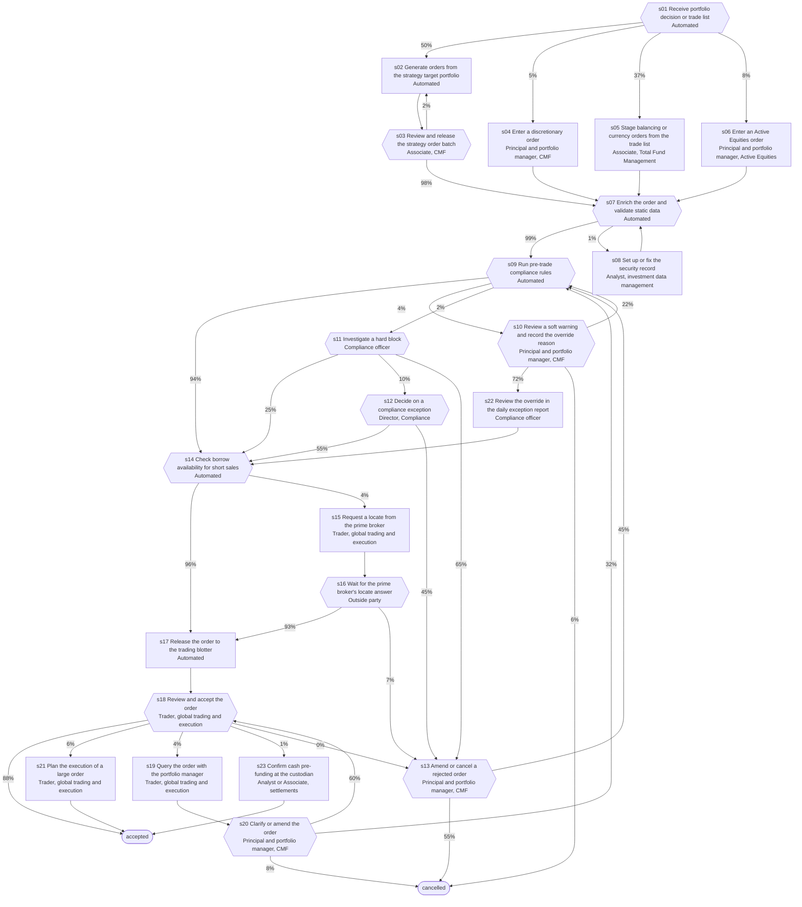

# Capture orders and run pre-trade compliance checks

`pim-mkt-order-capture` · asset management (public pension fund) · investment trading · part of `pension-investment-manager`

Every public market order from the fund's systematic strategies, discretionary and fundamental portfolio managers and the balancing and currency teams enters the order management system before the central trading desk works it. The system enriches the order, tests it against the restricted list, the statutory 10% issuer and 30% voting share limits, mandate limits and short sale rules, and either passes it, warns the portfolio manager or blocks it for Compliance. A trader then accepts the order and plans large ones. Most orders pass in minutes; the slow and error-prone cases are false blocks from stale positions, overrides that need a reason and later review, hard-to-borrow shorts, re-keyed baskets and orders queried by the desk.

| | |
|---|---|
| Unit of work | one order |
| Starts when | A portfolio decision or a rebalancing or currency trade list reaches the order management system. |
| Done when | The order has passed pre-trade compliance and been accepted by a trader (with an execution plan for large orders), or it has been cancelled or withdrawn. |
| Organisation | A very large Canadian national pension fund manager with a central trading desk that executes public equity, rates, FX and listed derivative orders for all investment departments and the Balancing Portfolio. (2,052 employees, 2019-2022) |
| Volume | 25,000 cases a month (range 18,000 to 35,000) |

## Where it sits

- Starts with **portfolio_decision** from cmf-internal-strategies (55% of cases)
- Starts with **rebalancing_trade_list** from tf-balancing-rebalance (27% of cases)
- Starts with **rebalancing_trade_list** from tf-currency-management (10% of cases)
- Starts with **portfolio_decision** from ae-fundamental-research (8% of cases)
- Relies on **restricted_list_update** from lc-negotiate-close (a standing input; it does not start a case)
- Relies on **reference_data** from io-data-management (a standing input; it does not start a case)
- Relies on **credit_approval** from risk-counterparty-credit (a standing input; it does not start a case)
- Relies on **department_mandate** from tf-capital-allocation (a standing input; it does not start a case)
- Sends **trade_order** to mkt-execute-trades (outcome: accepted)

## Flow

## Roles

| Role | Department | Layer | FTE on this process | Loaded cost per hour | Evidence |
|---|---|---|---:|---:|---|
| Trader, global trading and execution | Global trading and execution | senior specialist | 4 | 373 CAD | C [ar21] |
| Principal and portfolio manager, CMF | Capital Markets and Factor Investing | supervisor | 2.4 | 571 CAD | C |
| Associate, CMF | Capital Markets and Factor Investing | individual contributor | 0.4 | 155 CAD | C |
| Principal and portfolio manager, Active Equities | Active Equities | supervisor | 1 | 571 CAD | B [ar22] |
| Associate, Total Fund Management | Total Fund Management | individual contributor | 0.1 | 155 CAD | C |
| Compliance officer | Compliance | individual contributor | 1.5 | 122 CAD | C [bbg_comp] |
| Director, Compliance | Compliance | manager | 0.05 | 478 CAD | C |
| Analyst, investment data management | Investment data management | individual contributor | 0.4 | 81 CAD | B [sifma_soc] |
| Analyst or Associate, settlements | Cash, collateral and settlements | individual contributor | 0.3 | 78 CAD | C |

## Steps

Hands-on time and the wait before each step show the most common value. Evidence tier A is a sourced number, B a sourced description, C the author's estimate.

| Step | Who | Kind | Hands-on | Wait before | Control | Evidence |
|---|---|---|---:|---:|---|---|
| **s01 Receive portfolio decision or trade list.** A portfolio decision or a rebalancing or currency trade list reaches the order system from one of four sources: a systematic strategy run, a discretionary CMF portfolio manager, the Total Fund Management balancing or currency team, or an Active Equities portfolio manager. The system records the source, the portfolio and the time received. | Automated | intake | 0 min | 0 min |  | C [ar21] |
| **s02 Generate orders from the strategy target portfolio.** At a scheduled run the strategy engine compares target positions with current holdings, converts the differences into child orders with quantity, side, account and order type, and loads the batch into the order management system as a staged list. | Automated | system auto | 0 min | 5 min |  | C |
| **s03 Review and release the strategy order batch.** A CMF associate opens the staged batch, compares order count, gross and net notional and turnover with the expected size of the run, spot-checks the largest orders against prices on Bloomberg, and releases the batch, or rejects it and asks for a rerun when the totals look wrong. | Associate, CMF | review | 0.15 min | 15 min | Model output check before release (four-eyes review of systematic order batches under CMF trading controls) | C [lseg_breaks] |
| **s04 Enter a discretionary order.** A CMF macro or discretionary portfolio manager opens the order ticket, picks the instrument, side, quantity or notional and account, and types instructions for the desk such as urgency, limit price and benchmark, then submits the order to compliance checking. | Principal and portfolio manager, CMF | data entry | 3 min | 5 min |  | C |
| **s05 Stage balancing or currency orders from the trade list.** A TFM associate uploads the approved basket of futures, ETF, swap, cash equity or FX forward orders from the trade list spreadsheet into the order system, checks that the uploaded count and notional match the list, and submits the basket to compliance checking. | Associate, Total Fund Management | data entry | 0.08 min | 10 min |  | C [lseg_breaks] |
| **s06 Enter an Active Equities order.** An Active Equities portfolio manager enters the buy, sell, short or cover order that follows a portfolio decision and the optimiser's sizing, choosing quantity, account and instructions such as limit, participation rate and time horizon, and submits it to compliance checking. | Principal and portfolio manager, Active Equities | data entry | 3 min | 10 min |  | B [ar22] |
| **s07 Enrich the order and validate static data.** The order system looks up the security master, account, settlement market, lot size and price tolerance, adds default broker lists and trade date, and rejects orders whose security or account is missing or inactive. | Automated | system auto | 0 min | 0.1 min |  | C [sifma_soc] |
| **s08 Set up or fix the security record.** An investment data analyst receives the exception, looks the instrument up in vendor reference data, creates or corrects the security master record with identifiers, market and settlement details, has it checked by a second analyst, and releases it so the order can be revalidated. | Analyst, investment data management | lookup | 20 min | 1.0 h | New securities and changes to securities authorised and processed accurately (SOC 1 baseline control objective) | B [sifma_soc] |
| **s09 Run pre-trade compliance rules.** The compliance engine tests the order against the restricted list, the statutory 10% issuer and 30% voting share limits, ownership reporting thresholds, program mandate limits, short sale rules, counterparty limits for OTC trades and foreign ownership limits, and returns pass, soft warning or hard block. | Automated | system auto | 0 min | 0.1 min | The model fund Regulations s.11 (10% of assets in one issuer) and s.13 (30% of voting shares); insider trading prohibitions in securities law; short selling rules | B [fund_regs], [bbg_comp], [sifma_soc] |
| **s10 Review a soft warning and record the override reason.** The portfolio manager opens the warning, checks the projected position against the threshold (for example an approach to an ownership reporting level or a program concentration limit), and either types an override reason, reduces the order or cancels it. | Principal and portfolio manager, CMF | judgment | 3 min | 10 min | Investment compliance policy: documented reason for every soft-warning override | C [mm_ptc] |
| **s11 Investigate a hard block.** A compliance officer opens the blocked order, checks why the rule fired (restricted list entry, statutory limit calculation, foreign ownership room or counterparty limit), confirms positions with the data owner or the deal team, and clears false blocks, refers an exception or rejects the order back to the portfolio manager. | Compliance officer | validation | 15 min | 30 min | Insider trading prohibitions (for example Ontario Securities Act s.76) and the model fund Regulations investment limits; Compliance clears blocked orders | B [bbg_comp], [fund_regs] |
| **s12 Decide on a compliance exception.** The compliance director reads the officer's note and the portfolio manager's request, for example a temporary limit excess caused by an index event, decides whether an exception is allowed under policy and records the decision and any conditions. | Director, Compliance | approval | 10 min | 45 min | Exceptions to investment restrictions approved by Compliance management, not by the portfolio manager | C |
| **s13 Amend or cancel a rejected order.** The portfolio manager reads the rejection reason, then resizes the order, picks another instrument (for example a swap instead of a physical short) or cancels the order, and resubmits any amended order to compliance checking. | Principal and portfolio manager, CMF | judgment | 5 min | 20 min |  | C |
| **s14 Check borrow availability for short sales.** For sell orders that would create or add to a short position, the order system checks the prime brokers' easy-to-borrow list and attaches the locate; long sales and buys pass straight through. Hard-to-borrow names are held for a manual locate. | Automated | system auto | 0 min | 0.1 min | Regulation SHO Rule 203(b)(1) locate before a short sale; EU Short Selling Regulation requires short sales of shares to be covered | B [regsho], [esma_ssr] |
| **s15 Request a locate from the prime broker.** A trader sends the security and quantity to one or more prime brokers through their locate tool or chat, asks for the borrow rate, and records the locate reference on the order. | Trader, global trading and execution | communication | 1.5 min | 5 min | Regulation SHO Rule 203(b)(1): locate made and documented before effecting the short sale | B [regsho] |
| **s16 Wait for the prime broker's locate answer.** The prime broker's stock loan desk checks its inventory and replies with an approved quantity and rate, a partial amount or a refusal. Scarce names can take longer or need several brokers. | Outside party | external wait | 0 min | 20 min |  | C |
| **s17 Release the order to the trading blotter.** The order system routes the cleared order to the blotter of the right desk by asset class and region and timestamps the release, so it is visible to the traders on duty. | Automated | system auto | 0 min | 0.5 min |  | B [ar21] |
| **s18 Review and accept the order.** A trader checks the order against the market: size against average daily volume, instructions, limit price against the current price, upcoming events and whether the market is open. Most orders are accepted in one click, some baskets in bulk; unclear or unusual orders are queried. | Trader, global trading and execution | review | 0.25 min | 15 min | Central trading model: orders executed by the central desk, separate from the portfolio manager who decides them | B [ar21] |
| **s19 Query the order with the portfolio manager.** The trader messages or calls the portfolio manager to confirm quantity, side, limit or urgency, or to point out a likely keying error, and notes the query on the order. | Trader, global trading and execution | communication | 3 min | 5 min |  | C |
| **s20 Clarify or amend the order.** The portfolio manager answers the query: confirms the order as entered, amends it (which sends it back through compliance checks) or withdraws it. | Principal and portfolio manager, CMF | judgment | 5 min | 20 min |  | C |
| **s21 Plan the execution of a large order.** For an order that is large against daily volume or above desk size guidance, the trader estimates market impact and cost with the pre-trade tool, picks a benchmark and horizon, splits the work across regional desks if needed and records the plan on the order. | Trader, global trading and execution | analysis | 7 min | 10 min |  | C [ar21] |
| **s22 Review the override in the daily exception report.** The next morning a compliance officer reviews the list of overridden warnings, checks each reason against the rule and the resulting position, and follows up with the portfolio manager where the reason is weak. This review does not hold up the order. | Compliance officer | review | 3 min | 0 min | Investment guideline compliance and guideline breach review (SOC 1 control area); audit trail of overrides | B [sifma_soc] |
| **s23 Confirm cash pre-funding at the custodian.** For a buy in a market that requires cash before trading, a settlements analyst checks the local currency balance on the custodian portal, arranges an FX conversion or transfer if short, and confirms to the desk that the order can be worked. | Analyst or Associate, settlements | validation | 7 min | 30 min | Local market pre-funding rules in some emerging markets | C |

## Exceptions

| Exception | Share of cases | What happens |
|---|---:|---|
| Security not set up | 1% | The instrument or account is missing from the security master, so the order waits for an investment data analyst to create the record. |
| Soft warning overridden | 3% | The order approaches a threshold; the portfolio manager records a reason and Compliance reviews it the next morning. |
| Hard block rejected | 1% | The order hits the restricted list or a statutory or mandate limit; Compliance rejects it and the portfolio manager amends or cancels. |
| False block from stale positions | 0% | Start-of-day positions are late or wrong, so a limit appears breached; Compliance confirms positions and clears the block. |
| Hard-to-borrow short | 4% | A short sale is not on the easy-to-borrow list; the trader gets a manual locate, and without borrow the order is amended or cancelled. |
| Order queried by the desk | 4% | The trader questions quantity, side or instructions; amendments go back through compliance checks. |
| Pre-funded market | 1% | A buy in a market that requires cash before trading waits for settlements to confirm local currency at the custodian. |

## Benchmarks

| Metric | Value | Unit | Population | Evidence |
|---|---|---|---|---|
| cycle_time_days | p50 0.06, p90 0.25 | calendar days from the decision or trade list reaching the order system to trader acceptance | Orders at a large multi-strategy institutional investor with a central desk | C |
| voting_share_limit | 0.3 | share of votes to elect directors of one corporation | The model fund | A [fund_regs] |
| single_issuer_limit | 0.1 | share of total book value of assets in securities of one person | The model fund | A [fund_regs] |
| eu_net_short_reporting_threshold | 0.001 | share of issued share capital (public disclosure from 0.005) | Net short positions in EU shares | A [esma_ssr] |
| active_equities_transaction_costs | 63000000 | CAD, fiscal 2021 | Active Equities department | A [ar21] |

## Pain points

- Balancing and currency baskets are built in spreadsheets and uploaded to the order system, so quantities are re-keyed and checked twice. (steps s05, s18; B [lseg_breaks])
- Most compliance alerts are false positives caused by stale start-of-day positions, index events or coarse rules, and each one interrupts a portfolio manager or a compliance officer. (steps s09, s10, s11; C [mm_ptc])
- Long/short and derivative strategies need rules for net exposure, short sales and counterparty limits that generic pre-trade engines handle poorly. (steps s09, s14, s15; B [mm_ptc], [ar22])
- Order, compliance and execution tools were separate during the period; the fund was building an integrated public markets trading platform, so status chasing between tools was common. (steps s17, s18, s19; B [ar21], [lseg_breaks])

## Assumptions

- The process starts when an order request reaches the order system and ends at trader acceptance; working the order, broker routing and fills belong to pim-mkt-execute-trades, which starts from the accepted order on the blotter.
- Origin shares by order count (systematic 55%, balancing 27%, currency 10%, Active Equities 8%) are the author's estimates; the fund publishes no order counts.
- Balancing orders are uploaded as baskets. The list-level staging, compliance alert handling and trader acceptance already appear in pim-tf-balancing-rebalance (steps s15 to s18); here the same work is seen per order, so tfm_associate time per order is tiny and its fte_on_process is kept at 0.1 to avoid double counting.
- cmf_principal stands in for the originating portfolio manager when answering warnings, amending rejected orders and clarifying queries, because the step graph cannot remember which team sent the order.
- Pass, soft warning and hard block shares (94.5%, 4%, 1.5%) and their outcomes are estimates; no published rate of pre-trade alerts was found.
- The organisation file lists no process that sends the restricted list to order capture; restricted_list_update is taken as a standing input from lc-negotiate-close, which is the only producer in the file.
- compliance_director, data_ops_analyst, cmf_associate and set_analyst are organisation roles not listed for this process; they are added for exception approval, security set-up, batch release and pre-funding checks.
- cmf_trading_director is listed for the process but takes no step here; desk-head sign-off on large or sensitive orders is modelled in pim-mkt-execute-trades (step s07).
- Credit orders are out of scope because Credit Investments executes its own public credit trades.
- The next-morning review of overrides does not delay the order and is modelled as a concurrent step with no wait.
- Loaded costs come from the organisation file and include large incentive pay, so labour cost per order is high relative to the minutes spent.

## Sources

- [ar21] The model fund F2021 Annual Report (fiscal year ended March 31, 2021) (link withheld) (The model fund, 2021). Financing, Collateral & Trading oversees global trading and execution of all public assets except credit for all investment teams and the Balancing Portfolio; multi-year initiative to build an integrated platform for public market trades across the trading life cycle; Active Equities transaction costs of C$63 million in fiscal 2021
- [ar22] The model fund F2022 Annual Report (fiscal year ended March 31, 2022) (link withheld) (The model fund, 2022). Active Equities builds a concentrated long/short market-neutral portfolio through an optimisation that removes unintended factor exposures; gross assets C$74 billion; trading fees rising with the size and complexity of public market activity
- [fund_regs] The model fund Regulations (SOR/99-190) (link withheld) (Government of Canada, Justice Laws Website, 2022). Section 11: no more than 10% of the book value of assets in securities of one person or associated persons (index-replicating funds exempt); section 13: no investment in a corporation whose securities carry more than 30% of the votes to elect directors; section 16: related-party transaction prohibition
- [regsho] [Key Points About Regulation SHO](https://www.sec.gov/investor/pubs/regsho.htm) (U.S. Securities and Exchange Commission, 2022). Rule 203(b)(1): a broker-dealer must have reasonable grounds to believe the security can be borrowed, and the locate must be made and documented before effecting a short sale
- [esma_ssr] [Short Selling (Markets and Infrastructure)](https://www.esma.europa.eu/esmas-activities/markets-and-infrastructure/short-selling) (European Securities and Markets Authority, 2022). EU short selling rules: all short sales of shares must be covered; net short positions reported to regulators from 0.1% of issued share capital and disclosed publicly from 0.5%
- [sifma_soc] [Asset Manager's Guide to SOC 1](https://www.sifma.org/wp-content/uploads/2017/08/SIFMA_AMG_asset-managers-guide-soc-2017.pdf) (SIFMA Asset Management Group, 2017). Baseline control objectives: trades authorised and processed in accordance with portfolio guidelines and account restrictions; new securities and changes to securities authorised and processed accurately; investment guideline and restriction compliance, trade errors and guideline breaches, insider trading and cross trading as control areas
- [bbg_comp] [Trading & Investment Compliance Solutions](https://professional.bloomberg.com/products/compliance/) (Bloomberg Professional Services, 2026). Compliance enforced at trade entry and execution inside the order management system; automated alerts let compliance supervisors review and approve or reject blocked trades; potential rule breaches flagged so users can adjust intent before orders move forward
- [lseg_breaks] [Reducing PMS, OMS and EMS workflow breaks](https://www.lseg.com/en/data-analytics/trading-solutions/multi-asset-trading/reducing-oms-ems-workflow-breaks) (London Stock Exchange Group (LSEG Data & Analytics), 2025). Workflow breaks arise when investment decisions, order creation, compliance checks, staging and execution sit in separate workflows, causing duplicate data entry, status chasing, repeated checks and manual reconciliation
- [mm_ptc] [Buy Side Assesses Pre-Trade Compliance](https://www.marketsmedia.com/buy-side-assesses-pre-trade-compliance) (Markets Media, 2014). Long-only equity managers with current pre-trade compliance engines cope with new rules, while leveraged, long/short and derivative users find it harder; the main challenges are workflow once a pre-trade rule has tripped

Written by claude-opus on 2026-11-17.
