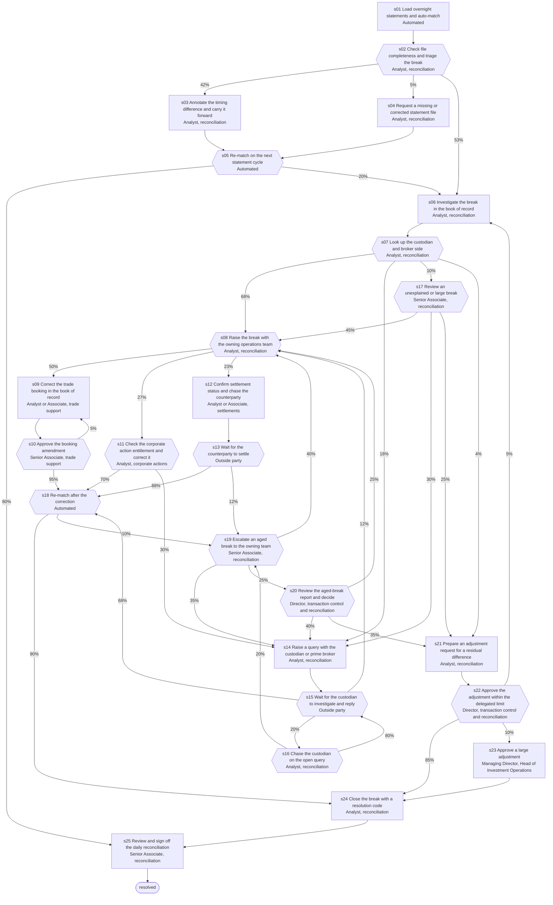

# Reconcile positions and cash with custodians and brokers (one reconciliation break)

`pim-mkt-reconcile` · pension fund investment management · investment operations · part of `pension-investment-manager`

Every night the fund's investment book of record (SimCorp Dimension) is matched against statements of holdings and cash from the global custodian and the prime brokers, and every line that does not agree becomes a break. Reconciliation analysts triage the breaks each morning, leave timing differences to clear on the next cycle, and investigate the rest by comparing the book of record with the custodian's records, then send each break to the team that must fix it: trade support for booking errors, corporate actions for entitlement and income differences, settlements for failed trades, or the custodian itself. Most elapsed time is spent waiting for other teams, counterparties and the custodian to respond and for the next overnight statement to confirm the fix. Breaks that age are escalated and reviewed weekly, small residual cash differences are adjusted under approval limits, and a senior associate signs off each daily reconciliation, which releases clean positions to accounting, pricing and liquidity forecasting.

| | |
|---|---|
| Unit of work | one reconciliation break |
| Starts when | The overnight match of custodian, prime broker and bank statements against the book of record finds a position or cash line that does not agree. |
| Done when | The break is matched or adjusted under approval, closed with a root cause code, and covered by the signed-off daily reconciliation, so the position record is released downstream. |
| Organisation | A very large Canadian national pension fund investment manager that invests one fund globally with mostly internal teams, using SimCorp Dimension as its investment book of record and a global custodian plus several prime brokers. (2,052 employees, 2019-2022) |
| Volume | 3,000 cases a month (range 2,000 to 4,500) |

## Where it sits

- Starts with **custodian_statement** from custodian (55% of cases)
- Starts with **custodian_statement** from prime_brokers (15% of cases)
- Starts with **settlement_status** from mkt-settle-trades (18% of cases)
- Starts with **corporate_action_entitlement** from io-corporate-actions (12% of cases)
- Sends **position_record** to fin-investment-accounting (outcome: resolved)
- Sends **position_record** to io-price-daily-nav (outcome: resolved)
- Sends **position_record** to tf-liquidity-forecast (outcome: resolved)
- Sends **position_record** to lc-foreign-regulatory-filings (outcome: resolved)

## Flow

## Roles

| Role | Department | Layer | FTE on this process | Loaded cost per hour | Evidence |
|---|---|---|---:|---:|---|
| Analyst, reconciliation | Transaction control and reconciliation | individual contributor | 9 | 74 CAD | B [src2], [src12] |
| Senior Associate, reconciliation | Transaction control and reconciliation | senior specialist | 2 | 156 CAD | C [src2] |
| Director, transaction control and reconciliation | Transaction control and reconciliation | manager | 0.25 | 432 CAD | C |
| Analyst or Associate, trade support | Middle office and trade support | individual contributor | 1.3 | 81 CAD | C [src2] |
| Senior Associate, trade support | Middle office and trade support | senior specialist | 0.15 | 156 CAD | C |
| Analyst, corporate actions | Corporate actions and asset servicing | individual contributor | 0.9 | 78 CAD | C [src7] |
| Analyst or Associate, settlements | Cash, collateral and settlements | individual contributor | 0.6 | 78 CAD | B [src3] |
| Managing Director, Head of Investment Operations | Investment operations leadership and controls | director | 0.01 | 900 CAD | C |

## Steps

Hands-on time and the wait before each step show the most common value. Evidence tier A is a sourced number, B a sourced description, C the author's estimate.

| Step | Who | Kind | Hands-on | Wait before | Control | Evidence |
|---|---|---|---:|---:|---|---|
| **s01 Load overnight statements and auto-match.** Overnight jobs load the custodians' SWIFT statements of holdings and transactions, cash statements and the prime brokers' position files into the reconciliation tool and match them against the SimCorp book of record by account, security identifier, quantity and cash amount. Quantities must match exactly and cash within a small tolerance; every line that does not match becomes a break in the morning queue. | Automated | system auto | 0 min | 30 min |  | B [src4], [src5], [src6], [src10] |
| **s02 Check file completeness and triage the break.** At the start of the Toronto day the analyst confirms that every expected custodian and broker file arrived, then opens the break, reads the quantity, cash or price difference and the account, and tags it as a timing difference, a data load problem or a break that needs investigation. Breaks are worked in order of market value and age. | Analyst, reconciliation | intake | 3 min | 3.0 h |  | B [src2], [src5] |
| **s03 Annotate the timing difference and carry it forward.** The analyst links the break to the pending trade, unsettled FX or accrued income that explains it, writes a comment with the expected clearing date and leaves it open. No correction is made; the next statement cycle should clear it. | Analyst, reconciliation | data entry | 2 min | 5 min |  | B [src6] |
| **s04 Request a missing or corrected statement file.** The analyst emails the custodian's client service team or the prime broker, or uses the custodian portal, to ask for the missing or corrected file, and tells investment data management if a mapping change caused the load to fail. | Analyst, reconciliation | communication | 10 min | 15 min |  | C |
| **s05 Re-match on the next statement cycle.** The next overnight load matches the break again. Items that now agree close automatically in the tool; items still open return to the analyst for investigation. | Automated | system auto | 0 min | 21.0 h |  | C |
| **s06 Investigate the break in the book of record.** The analyst opens SimCorp and pulls the holding, transaction history, pending trades, settlement status, corporate action events and FX for the account and security, and lines them up against the break to find which transaction is missing, duplicated or different. | Analyst, reconciliation | analysis | 12 min | 1.5 h |  | B [src2], [src7] |
| **s07 Look up the custodian and broker side.** The analyst checks the custodian portal for the custodian's transaction detail and settlement messages, the prime broker statement, and Bloomberg for corporate action terms or prices, to decide which side is wrong. Many breaks need both views before the cause is clear. | Analyst, reconciliation | lookup | 6 min | 5 min |  | B [src2], [src7] |
| **s08 Raise the break with the owning operations team.** The analyst writes a ticket or email to trade support, corporate actions or settlements with the account, security, difference and evidence screenshots, and records the owner on the break so it shows in that team's queue. | Analyst, reconciliation | communication | 4 min | 10 min |  | B [src2], [src10] |
| **s09 Correct the trade booking in the book of record.** A trade support analyst compares the booking with the broker confirmation and the order record, then amends the quantity, price, account, settlement date or FX rate in SimCorp, or books the missing trade, and submits the change for approval. | Analyst or Associate, trade support | data entry | 12 min | 8.0 h |  | C |
| **s10 Approve the booking amendment.** A second person in trade support checks the amendment against the confirmation and approves it in SimCorp, or rejects it with a comment. The book of record does not accept a change without this second approval. | Senior Associate, trade support | approval | 3 min | 2.0 h | Maker-checker approval of book of record amendments under internal control over financial reporting (COSO Internal Control Integrated Framework 2013, control activities), certified by the CEO and CFRO and audited by the external auditor | B [src1] |
| **s11 Check the corporate action entitlement and correct it.** A corporate actions analyst compares the announced terms, election, ex and pay dates and withholding tax rate with the custodian's entitlement, then fixes the event or income booking in SimCorp, or concludes that the custodian paid or credited the wrong amount. | Analyst, corporate actions | analysis | 15 min | 10.0 h |  | B [src7] |
| **s12 Confirm settlement status and chase the counterparty.** A settlement analyst checks the custodian's settlement status and fail reason for the trade, contacts the broker or counterparty to repair the instruction or deliver, and records the expected settlement date on the break. | Analyst or Associate, settlements | communication | 8 min | 4.0 h |  | B [src3], [src7] |
| **s13 Wait for the counterparty to settle.** The counterparty or broker delivers the securities or cash, or repairs its instruction, and the custodian reports the trade as settled. | Outside party | external wait | 0 min | 2.0 d |  | C |
| **s14 Raise a query with the custodian or prime broker.** The analyst logs an inquiry in the custodian portal or emails the prime broker's service desk with the account, security, expected position or cash and supporting evidence, and records the case reference on the break. | Analyst, reconciliation | communication | 8 min | 30 min |  | B [src2] |
| **s15 Wait for the custodian to investigate and reply.** The custodian's client service team researches the query with its sub-custodian or operations area and either corrects its records, which shows on a later statement, or replies that the fund's own booking is wrong. | Outside party | external wait | 0 min | 2.0 d |  | C |
| **s16 Chase the custodian on the open query.** The analyst follows up by email or phone with the custodian's client service contact, citing the case reference and the age of the break, and copies the senior associate when the item is large. | Analyst, reconciliation | communication | 5 min | 1.0 h |  | C |
| **s17 Review an unexplained or large break.** The senior associate reviews the analyst's work on breaks above a value threshold or with no clear cause, looks at the full transaction trail and may call the custodian relationship manager, then decides who must fix it or whether it is a residual difference to adjust. | Senior Associate, reconciliation | judgment | 20 min | 4.0 h |  | C |
| **s18 Re-match after the correction.** The next overnight load compares the corrected book of record or the custodian's corrected statement. A break that now matches closes; one that still differs goes to escalation as an aged break. | Automated | system auto | 0 min | 18.0 h |  | C |
| **s19 Escalate an aged break to the owning team.** When a break passes the ageing threshold (for example five business days, or a lower threshold for large values), the senior associate escalates it to the owning team's manager or the custodian relationship manager and sets a fix date, and the break appears on the aged-break report. | Senior Associate, reconciliation | coordination | 10 min | 1.0 d | Investment operations break ageing and escalation procedure with thresholds by age and value | B [src2], [src9] |
| **s20 Review the aged-break report and decide.** In the weekly aged-break meeting the director goes through breaks older than about 30 days with the seniors, asks owning teams for dates, escalates to the custodian's relationship management, or agrees that a residual difference should be adjusted. | Director, transaction control and reconciliation | review | 10 min | 3.0 d | Aged-break governance: weekly director review and monthly key risk indicators to the head of investment operations | B [src9] |
| **s21 Prepare an adjustment request for a residual difference.** For a small cash difference that cannot be recovered, such as a bank fee or rounding, the analyst prepares an adjustment request with the evidence, the amount and the account to charge, so that fund accounting can book it once approved. | Analyst, reconciliation | drafting | 15 min | 2.0 h |  | C |
| **s22 Approve the adjustment within the delegated limit.** The director reviews the evidence and approves the adjustment if it is within the delegated limit, sends larger amounts to the head of investment operations, or rejects it for more investigation. | Director, transaction control and reconciliation | approval | 6 min | 12.0 h | Management authorities: delegated approval limits for write-offs and adjustments | B [src1] |
| **s23 Approve a large adjustment.** The head of investment operations reviews the rare adjustment above the director's limit with its history and approves it, often after asking fund accounting and operational risk whether it should be logged as an incident. | Managing Director, Head of Investment Operations | approval | 10 min | 2.0 d | Management authorities: delegated approval limits for write-offs and adjustments | C [src1] |
| **s24 Close the break with a resolution code.** The analyst confirms the item now matches or the approved adjustment is booked, records the root cause code and owning team, and closes the break so it feeds the monthly root cause and ageing metrics. | Analyst, reconciliation | data entry | 2 min | 2.0 h |  | B [src10], [src2] |
| **s25 Review and sign off the daily reconciliation.** At the end of the day the senior associate reviews the open and closed breaks and their comments for each custodian and prime broker account and signs off the reconciliation, which releases the reconciled positions and cash to accounting, pricing and liquidity. | Senior Associate, reconciliation | review | 1 min | 4.0 h | Daily book of record to custodian reconciliation as a key control over financial reporting (COSO 2013, CEO/CFRO certification, external auditor's ICFR audit) and as the complementary user entity control assumed in the custodian's service organisation control report | B [src1], [src11] |

## Exceptions

| Exception | Share of cases | What happens |
|---|---:|---|
| Missing or partial custodian file | 5% | A late or partial statement creates many false breaks at once; the analyst requests a re-send and the next cycle clears them. |
| Custodian error with slow reply | 5% | The custodian's record is wrong and its client service team does not answer by the agreed date, so the analyst chases and may escalate through relationship management. |
| Corporate action booked on the wrong terms | 10% | An entitlement or income amount differs from the custodian's because of the ratio, election, date or withholding rate; corporate actions corrects the event or claims from the custodian. |
| Persistent settlement fail | 2% | A counterparty fails to deliver for more than a few days; the break ages and is escalated. |
| Residual cash difference written off | 7% | A small unrecoverable difference such as a bank fee is adjusted under the director's limit or, rarely, the head of investment operations' limit. |

## Benchmarks

| Metric | Value | Unit | Population | Evidence |
|---|---|---|---|---|
| cycle_time_days | p50 2, p90 10 | calendar days from the break first appearing to the signed-off reconciliation that covers its closure | Public market position and cash breaks at a large asset owner with in-house operations | C [src6], [src9] |
| share of firms relying primarily on end-of-day reconciliation | 0.7 | share of buy-side firms (more than) | Buy-side operations leaders, SmartStream roundtable 2026 | A [src5] |
| share of firms using spreadsheets for critical reconciliations | 0.57 | share of firms | 250 senior managers at US asset management and capital markets firms, AutoRek 2025 | A [src8] |
| auto-match rate after automation | 0.95 | share of items matched without a person (more than) | One tier-1 US investment services firm, over 100,000 daily securities transactions across five custodians | A [src6] |

## Pain points

- Timing differences and data mismatches flood the morning queue with breaks that need no fix but still need a look and a comment. (steps s02, s03, s05; B [src5], [src6])
- Breaks wait days for the custodian's client service team or a failing counterparty, and chasing is manual by email and portal. (steps s13, s15, s16; C)
- Analysts switch between the reconciliation tool, SimCorp, the custodian portal, SWIFT messages and Bloomberg to find a root cause, with spreadsheets for some accounts. (steps s06, s07; B [src2], [src8])
- Corporate action and income breaks need specialist knowledge and recur around dividend season and complex events. (steps s11; B [src7])

## Assumptions

- Unit of work is one break, not one reconciliation; the daily sign-off and file checks are spread over the day's breaks as small per-break minutes.
- Trade support (ts_analyst, ts_senior) and corporate actions (ca_analyst) roles take part in fixing breaks although the process_map entry lists only reconciliation, settlements and the head of investment operations; they are organisation file roles.
- A rule-based reconciliation tool (recon_tool) is added because the organisation file lists no reconciliation system; a model fund posting after the period names a central reconciliation utility, and spreadsheets were still common in 2019 to 2022.
- Root cause shares (42% timing, 5% file problems, then about 36% booking, 18% corporate action, 16% settlement and 18% custodian among investigated breaks) are the author's estimates; no public source splits break causes this way.
- Ageing thresholds (five business days to escalate, about 30 days for director review) and adjustment limits are assumptions; the organisation does not publish them.
- Loaded hourly costs are the organisation file's, which include incentive pay and a 1.25 overhead factor and so sit far above Job Bank medians for NOC 11109 (Toronto median 34.62 an hour in 2023-2024).
- Rework loops: rejected amendments, custodian replies that show the fund's side is wrong, and breaks that fail to clear after a fix return to earlier steps.
- The simulated median cycle time (about 2.8 days) sits above the 2-day benchmark estimate because every investigated break waits for an overnight re-match after its fix and for the end-of-day sign-off; both figures are estimates, and the gap is within the validator's range.

## Sources

- [src1] The model fund F2022 Annual Report (fiscal year ended March 31, 2022) (link withheld) (The model fund, 2022). CEO/CFRO certification of internal control over financial reporting against the COSO Internal Control Integrated Framework (2013), done voluntarily; Deloitte audited internal control over financial reporting for the first time in fiscal 2022; management authorities and division of responsibilities in the internal control framework; Assurance & Advisory group as third line. Read from the text of the downloaded PDF.
- [src2] Analyst, Transaction Control and Reconciliation (job posting, the model fund, Toronto) (link withheld) (Built In Toronto, 2025). Transaction Control & Reconciliation team performs cash and position reconciliations of internal records against custodian, prime broker and bank data, identifies root causes of discrepancies, coordinates resolution with stakeholders, escalates exceptions, produces control metrics; 1 to 3 years of experience; Excel and reconciliation tools.
- [src3] Associate, Cash, Collateral & Settlements Operations (job posting, the model fund, Toronto) (link withheld) (Built In Toronto, 2025). Settlements team ensures trades are processed, reconciled and settled in line with market deadlines; works with brokers, custodians and prime brokers on issue resolution; monitors key metrics and escalates issues; Bloomberg and SimCorp.
- [src4] [SWIFT ISO 15022 message type MT535 Statement of Holdings](https://www.iotafinance.com/en/SWIFT-ISO15022-Message-type-MT535.html) (iotafinance, 2024). MT535 is sent by the account servicer (custodian) to the account owner and reports the quantity and identification of holdings at a point in time; the custody statement is used mainly for position reconciliation; frequency can be daily.
- [src5] [Smartstream research reveals five realities redefining buy side reconciliations (news release, 22 April 2026)](https://smart.stream/?p=22896) (SmartStream Technologies, 2026). Over 70% of buy-side firms rely primarily on end-of-day reconciliation; 53% cite timing differences and data mismatches as the leading causes of breaks (roundtable of senior operations leaders).
- [src6] [The operational reconciliation advantage driving control, scale and confidence in capital markets (blog, 19 March 2026)](https://www.trintech.com/blog/the-operational-reconciliation-advantage-driving-control-scale-and-confidence-in-capital-markets/) (Trintech, 2026). Citing a Datos Insights study: 71% of firms resolve payment breaks the same day while securities and accounting reconciliations lag significantly; a tier-1 investment services firm reconciling over 100,000 daily securities transactions across five custodians reached an auto-match rate above 95%; separating timing differences from actionable breaks and automated break assignment.
- [src7] [When exceptions become the rule (feature, 10 June 2026)](https://www.assetservicingtimes.com/specialistfeatures/specialistfeature.php?specialist_id=710) (Asset Servicing Times, 2026). Breaks come from timing differences between record updates, processing errors, settlement issues, stale or incorrect standing settlement instructions, reference data and identifier mismatches; up to 67% of asset servicing errors attributed to data quality (SmartStream); automation leaves a residual exception tail needing investigation and judgement; escalation frameworks.
- [src8] [The Cost of Complacency: Why Capital Markets Must Modernize Back-Office Operations Now (white paper)](https://eco-cdn.iqpc.com/eco/files/event_content/wbr-cost-of-complacency-autorekaEM7Lyk4letWbtMRiJtcIXPmArykxlDRHDhH1EG0.pdf) (AutoRek (via WBR / IQPC), 2025). AutoRek 2025 survey of 250 senior managers in US asset management and capital markets firms: 57% still rely on spreadsheets, often with in-house or legacy systems, for critical reconciliation processes; 79% of reconciliation processes struggle or expect to struggle with data volumes.
- [src9] [What are Aging Reconciliation Items? (glossary)](https://www.hyperbots.com/glossary/aging-reconciliation-items) (Hyperbots, 2025). Open reconciliation items grouped into 0-30, 31-60, 61-90 and over 90 day buckets; 61-90 day items need escalation and tracking; KPIs such as average age of unresolved items, open exceptions and resolution cycle time.
- [src10] [FA Solutions documentation: Reconciliation (FA Operations)](https://documentation.fasolutions.com/en/reconciliation.html) (FA Solutions, 2025). Reconciliation workflow in a portfolio system: fetch custodian data by bank or custody connection, MT535 upload or CSV; view reconciliations, assign mismatches, fix a mismatch, close reconciliations, track history and download reports.
- [src11] [How to Properly Audit a Client Who Uses a Service Organization: SOC Report or No SOC Report (ISACA Journal)](https://www.isaca.org/resources/isaca-journal/past-issues/2013/how-to-properly-audit-a-client-who-uses-a-service-organization-soc-report-or-no-soc-report) (ISACA, 2013). Service organisation reports rely on complementary controls at the user entity, such as reconciliation of data returned by the service organisation, which the user auditor tests.
- [src12] [Wages: Financial Compliance Officer (NOC 11109) in the Toronto Region](https://www.jobbank.gc.ca/marketreport/wages-occupation/296408/geo9219) (Job Bank, Government of Canada, 2025). NOC 11109 hourly wages, Toronto Region: low 23.00, median 34.62, high 66.46 (reference period 2023-2024).

Written by claude-opus on 2026-11-17.
