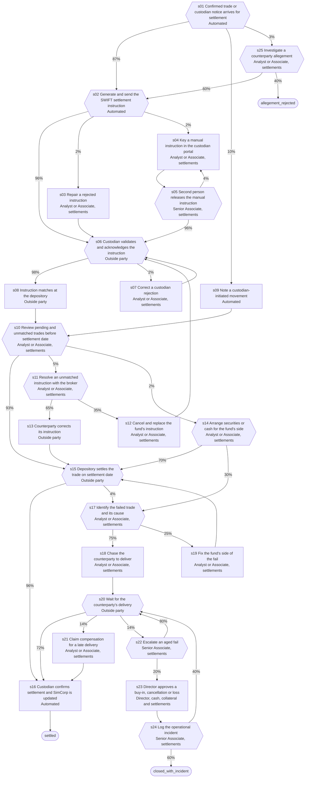

# Instruct and settle trades with the custodian

`pim-mkt-settle-trades` · asset management (public pension fund investment) · investment operations (settlements) · part of `pension-investment-manager`

Once a trade is confirmed, settlements instructs the global custodian over SWIFT to deliver or receive securities against cash, watches the trade until the depository settles it two business days after the trade, and works on anything that will not settle on time. Most instructions go straight through; analysts repair rejected messages, key and dual-release manual instructions, resolve unmatched instructions with brokers the day before settlement, recall lent securities or arrange cash, and chase counterparties when trades fail. Fails come mostly from counterparties lacking securities and from wrong or missing settlement instructions; aged fails are escalated, and buy-ins and losses are approved and logged as operational incidents.

| | |
|---|---|
| Unit of work | one transaction |
| Starts when | A confirmed trade arrives from confirmation and affirmation, or the custodian reports an allegement or a custodian-initiated movement. |
| Done when | The custodian confirms settlement and the book of record shows the trade settled; or a failed trade is closed by buy-in or cancellation with an incident report; or an allegement is rejected as not the fund's trade. |
| Organisation | A very large Canadian national pension fund manager settling public market trades in 64 countries through one global custodian, with SimCorp Dimension generating SWIFT instructions. (2,052 employees, 2019-2022) |
| Volume | 48,000 cases a month (range 32,000 to 70,000) |

## Where it sits

- Starts with **trade_confirmation** from mkt-confirm-affirm (87% of cases)
- Starts with **settlement_status** from custodian (13% of cases)
- Sends **settlement_instruction** to custodian (outcome: any)
- Sends **settlement_status** to mkt-reconcile (outcome: settled)
- Sends **settlement_status** to mkt-reconcile (outcome: closed_with_incident)
- Sends **incident_report** to risk-operational-risk (outcome: closed_with_incident)

## Flow

## Roles

| Role | Department | Layer | FTE on this process | Loaded cost per hour | Evidence |
|---|---|---|---:|---:|---|
| Analyst or Associate, settlements | Cash, collateral and settlements | individual contributor | 15 | 78 CAD | B [fund_posting], [jobbank_11109] |
| Senior Associate, settlements | Cash, collateral and settlements | senior specialist | 2 | 156 CAD | C |
| Director, cash, collateral and settlements | Cash, collateral and settlements | manager | 0.2 | 432 CAD | C |

## Steps

Hands-on time and the wait before each step show the most common value. Evidence tier A is a sourced number, B a sourced description, C the author's estimate.

| Step | Who | Kind | Hands-on | Wait before | Control | Evidence |
|---|---|---|---:|---:|---|---|
| **s01 Confirmed trade or custodian notice arrives for settlement.** A confirmed trade arrives from confirmation and affirmation and needs an instruction to the custodian. Some cases start at the custodian instead: a counterparty instruction alleged against the fund's account, or a custodian-initiated movement such as a securities lending return that settlements only monitor. | Automated | system auto | 0 min | 0 min |  | B [fund_posting], [citi_swift] |
| **s02 Generate and send the SWIFT settlement instruction.** SimCorp builds the instruction from the enriched trade (MT540 to MT543 for securities against or free of payment, MT304 for FX, payment messages for cash) and sends it to the custodian over SWIFT in intraday batches. | Automated | system auto | 0 min | 30 min |  | B [citi_swift], [fxgc] |
| **s03 Repair a rejected instruction.** The settlement analyst opens the SimCorp message repair queue, finds the missing or wrong field (counterparty BIC, place of settlement, safekeeping account), corrects the static data or the trade with trade support and resends. | Analyst or Associate, settlements | data entry | 5 min | 45 min |  | B [t1report] |
| **s04 Key a manual instruction in the custodian portal.** For trades that cannot go straight through the analyst keys the instruction in the custodian's web portal from the SimCorp trade and the counterparty's SSI, attaching any market-specific details. | Analyst or Associate, settlements | data entry | 8 min | 30 min |  | C |
| **s05 Second person releases the manual instruction.** A senior associate compares the keyed instruction with the trade and SSI and releases it in the custodian portal under dual authorisation, or rejects it back. | Senior Associate, settlements | approval | 3 min | 30 min | Dual authorisation of manual instructions in the custodian portal (custody agreement and payment controls) | B [sifma_soc] |
| **s06 Custodian validates and acknowledges the instruction.** The custodian checks the instruction against its own rules and market cut-offs and returns an MT548 status message: accepted, or rejected with a reason. | Outside party | external wait | 0 min | 20 min |  | B [citi_swift] |
| **s07 Correct a custodian rejection.** The analyst reads the rejection reason (unknown counterparty account, invalid place of settlement, missed cut-off), fixes the data or instruction and resends, calling the custodian's client service team when the reason is unclear. | Analyst or Associate, settlements | data entry | 7 min | 1.0 h |  | C |
| **s08 Instruction matches at the depository.** The custodian or its local sub-custodian passes the instruction to the depository (CDS in Canada, DTC in the U.S., Euroclear and local depositories elsewhere), where it is matched with the counterparty's instruction and reported back as matched or unmatched. | Outside party | external wait | 0 min | 6.0 h |  | B [csa24402], [cibcm_t2] |
| **s09 Note a custodian-initiated movement.** A lending return, recall or repo leg instructed by the lending agent or custodian appears on the pending report; the analyst only checks it is expected and that cash or securities are available. | Automated | system auto | 0 min | 1.0 h |  | C [fund_posting] |
| **s10 Review pending and unmatched trades before settlement date.** On the day before settlement and the morning of settlement the analyst works through the custodian's pending report and status messages, looking for unmatched instructions, counterparty problems and any shortage of securities or cash on the fund's side. | Analyst or Associate, settlements | lookup | 0.15 min | 8.0 h | Trades settled accurately, completely and timely; pending items monitored daily (SOC 1 baseline settlement objective) | B [sifma_soc], [fund_posting] |
| **s11 Resolve an unmatched instruction with the broker.** The analyst compares the fund's instruction with the counterparty's alleged details from the custodian (amount, quantity, settlement date, depository account) and calls or emails the broker's settlement desk to agree who corrects. | Analyst or Associate, settlements | communication | 8 min | 1.0 h |  | B [t1report] |
| **s12 Cancel and replace the fund's instruction.** The analyst corrects the trade or SSI with trade support, cancels the original instruction at the custodian and sends a replacement. | Analyst or Associate, settlements | data entry | 5 min | 15 min |  | C |
| **s13 Counterparty corrects its instruction.** The broker's settlement team corrects its booking, cancels its instruction at the depository and sends a replacement, after which the two instructions match and wait for settlement date. | Outside party | external wait | 0 min | 3.0 h |  | C |
| **s14 Arrange securities or cash for the fund's side.** The analyst asks the lending agent to recall lent securities, or asks cash management to fund the currency through an FX trade or an approved overdraft, and tells the broker if delivery will be late. | Analyst or Associate, settlements | coordination | 10 min | 2.0 h |  | B [t1report], [fxgc] |
| **s15 Depository settles the trade on settlement date.** On settlement date the depository exchanges securities and cash delivery versus payment in its batch or real-time cycle, or the instruction fails because one side lacks securities or cash or the instruction is still unmatched. Weekends and cross-market holidays lengthen the wait. | Outside party | external wait | 0 min | 15.0 h |  | B [csa24402], [sifma_aar], [esma_trv] |
| **s16 Custodian confirms settlement and SimCorp is updated.** The custodian sends a settlement confirmation (MT544 to MT547) and SimCorp marks the trade settled and updates cash and positions for reconciliation and the cash forecast. | Automated | system auto | 0 min | 30 min |  | B [citi_swift] |
| **s17 Identify the failed trade and its cause.** From the custodian's failing status and reason code (counterparty lacks securities, fund lacks cash, instruction unmatched, market deadline missed) the analyst works out which side caused the fail and updates the fails log and the cash forecast. | Analyst or Associate, settlements | lookup | 5 min | 4.0 h | Investment operations fails management procedure: every fail logged with cause and owner and reported daily | B [fxgc], [t1report] |
| **s18 Chase the counterparty to deliver.** The analyst calls the broker's settlement desk, agrees the expected delivery date, asks about partial delivery and records the answer in the fails log. | Analyst or Associate, settlements | communication | 6 min | 30 min |  | C |
| **s19 Fix the fund's side of the fail.** The analyst completes the recall, funding or instruction fix that caused the fund's fail and re-presents the trade for the next settlement cycle, informing the broker. | Analyst or Associate, settlements | coordination | 12 min | 2.0 h |  | C |
| **s20 Wait for the counterparty's delivery.** Most counterparty fails clear within a day or two once securities are borrowed or received; a few run for a week or more. | Outside party | external wait | 0 min | 1.0 d |  | B [boc_fail], [esma_csdr] |
| **s21 Claim compensation for a late delivery.** Where the late delivery cost the fund interest on cash or a missed income payment, the analyst calculates the claim and sends it to the broker; from February 2022 EU penalties credited or debited by the depository are also checked and booked. | Analyst or Associate, settlements | communication | 12 min | 1.0 d | EU CSDR settlement discipline cash penalties (from 1 February 2022); FX Global Code principle 55 on timely compensation claims | B [esma_csdr], [fxgc] |
| **s22 Escalate an aged fail.** Fails outstanding beyond several days go to a senior associate, who reviews the exposure, agrees next steps with the broker and the trader (partial settlement, cancel and re-trade, or a buy-in where the market allows it) and decides whether the director must be involved. | Senior Associate, settlements | judgment | 20 min | 1.0 d | Fails escalation thresholds in the investment operations procedures | C |
| **s23 Director approves a buy-in, cancellation or loss.** The director of cash, collateral and settlements reviews the case and approves a buy-in, a cancel and re-trade or acceptance of a cost, and requires an incident report. | Director, cash, collateral and settlements | approval | 20 min | 1.0 d | Operational loss and incident reporting policy: losses and significant fails approved and reported to operational risk | C |
| **s24 Log the operational incident.** A senior associate writes the incident record with the cause, the cost to the fund, the counterparty, the timeline and the fix, and submits it to the Operational Risk group for analysis. | Senior Associate, settlements | drafting | 30 min | 8.0 h | Operational risk incident reporting (three lines model): incidents logged and analysed by the Operational Risk group | C |
| **s25 Investigate a counterparty allegement.** The custodian reports a counterparty instruction against the fund's account that has no matching fund instruction. The analyst searches SimCorp and asks trade support whether the trade exists but is not yet booked or confirmed; if no one recognises it, the analyst tells the broker the trade is not known. | Analyst or Associate, settlements | lookup | 6 min | 2.0 h |  | B [citi_swift] |

## Exceptions

| Exception | Share of cases | What happens |
|---|---:|---|
| Instruction repair or manual instruction | 4% | Messages failing validation are repaired; trades that cannot go straight through are keyed in the custodian portal and released by a second person. |
| Unmatched at the depository | 5% | The fund's and the broker's instructions differ; one side cancels and replaces. |
| Fund short of securities or cash | 2% | Lent securities must be recalled or a currency funded; some still fail. |
| Counterparty fail | 4% | The counterparty cannot deliver on settlement date; settlements chase, some cases need compensation claims and a few become aged fails. |
| Aged fail closed by buy-in or cancellation | 0% | A long-running fail is bought in or cancelled with director approval and logged as an incident. |
| Counterparty allegement | 3% | A broker instruction appears with no fund instruction; the trade is found and instructed, or rejected as unknown. |

## Benchmarks

| Metric | Value | Unit | Population | Evidence |
|---|---|---|---|---|
| cycle_time_days | p50 1.9, p90 4.0 | calendar days from confirmed trade to settled status | Author calculation for T+2 settlement with trades spread over the working week | B [cibcm_t2] |
| settlement_fail_rate_cds_cns | 0.0158 | share of value, average May 2007 to March 2016 | Canadian equity trades in CDS continuous net settlement | A [csa24402] |
| settlement_fail_rate_eu_equities | 0.09 | share of value, 1H 2021 | EEA central securities depositories | A [esma_trv] |
| settlement_fail_rate_us_cns | 0.0212 | share of value, July 2024 | NSCC continuous net settlement | A [sifma_aar] |

## Pain points

- Unmatched instructions found the day before settlement leave little time to agree corrections with brokers across time zones. (steps s10, s11, s12, s13; B [t1report])
- Counterparty fails are common in some markets and, before CSDR penalties in the EU and with no fail fee in Canada, brokers had little incentive to deliver on time. (steps s17, s18, s20, s22; A [esma_trv], [boc_fail], [esma_csdr])
- Securities out on loan and currency funding must be arranged in time for sales to settle, which needs coordination with the lending agent and cash management. (steps s14, s19; B [t1report])
- Manual instructions and repairs in the custodian portal need keying and a second person to release. (steps s03, s04, s05, s07; C)

## Assumptions

- One global custodian with sub-custodians in local markets is assumed; prime broker settlement for long-short strategies is outside this workflow.
- The blended fail rate on settlement date (4.5% by count, plus fails from the fund's own shortages) is an author estimate between Canadian and U.S. levels of about 2% by value and EU equity levels of 7% to 9%.
- Cash funding and securities lending recalls are done with cash management and the lending agent; only the settlement analyst's coordination time is counted.
- Allegements and custodian-initiated movements (13% of cases) start at the custodian; they share the steps after the instruction is sent.
- Settlement analysts also run cash management and some collateral work, so their FTE here is a share of the team; margin calls are in io-collateral-margin.
- Loaded costs come from the organisation file; they include incentive pay and an overhead factor of 1.25.

## Sources

- [fund_posting] [Associate, Cash, Collateral & Settlements Operations (job posting)](https://builtintoronto.com/job/associate-cash-collateral-settlements-operations/7434948) (Built In Toronto, 2025). Investment Operations settlements team: affirmation, confirmation and settlement of listed equities, fixed income and repo, money market, FX and securities lending; relationships with brokers, custodians and prime brokers; Bloomberg, SimCorp and affirmation and matching platforms; settlement on time in line with market deadlines and internal policy
- [t1report] [Accelerating the U.S. Securities Settlement Cycle to T+1](https://www.sifma.org/wp-content/uploads/2021/12/Accelerating-the-U.S.-Securities-Settlement-Cycle-to-T1-December-1-2021.pdf) (SIFMA, ICI and DTCC (with Deloitte), 2021). About 20% of institutional allocations occur during the trading day and 80% after the close; affirmation deadline 11:30 AM ET on T+1 under T+2; confirmation and affirmation can only start once allocations are complete; causes of settlement errors and fails include missing or incorrect SSIs, stale reference data, recalls and cancel and rebill
- [sifma_soc] [Asset Manager's Guide to SOC 1](https://www.sifma.org/wp-content/uploads/2017/08/SIFMA_AMG_asset-managers-guide-soc-2017.pdf) (SIFMA Asset Management Group and Grant Thornton, 2017). Baseline SOC 1 control objectives: trades properly authorised, settled and recorded accurately, completely and timely; block orders allocated according to management methodologies and allocations approved; new securities authorised and processed accurately; cash and positions reconciled to custodians
- [fxgc] [FX Global Code (updated December 2024; first published 2017)](https://www.globalfxc.org/docs/fx_global.pdf) (Global Foreign Exchange Committee, 2024). Principles 46 to 55: confirm trades as soon as practicable using automated matching; review, affirm and allocate block transactions as soon as practicable; resolve confirmation and settlement discrepancies; measure settlement risk and use PVP where practicable; use standard settlement instructions; request direct payments; reconcile accounts and submit compensation claims in a timely manner
- [citi_swift] [SWIFT ISO 15022 Message Formats (custody client message matrix)](https://www.citibank.com/mss/sa/dcc/swift/iso_15022/msg_fmt_matrix.html) (Citi Securities Services, 2026). ISO 15022 settlement messages used with a global custodian: MT540 to MT543 instructions, MT544 to MT547 confirmations, MT548 settlement status and processing advice, MT537 pending transactions, MT578 allegements, MT535 and MT536 statements
- [csa24402] [CSA Consultation Paper 24-402: Policy Considerations for Entities Proposing to Shorten the Settlement Cycle (Annex E)](https://www.asc.ca/-/media/ASC-Documents-part-1/Regulatory-Instruments/2018/10/5313054-Consultation-Paper-24-402.pdf) (Alberta Securities Commission (Canadian Securities Administrators), 2016). CDS continuous net settlement fails averaged 1.58% of the value of trades processed between May 2007 and March 2016 and were generally below 2%; definition of a failed trade; about 40% of trades on Canadian exchanges are in inter-listed securities and cross-border trades are nearly 25% of CDS trades; ITM threshold of 90% matched by noon T+1
- [cibcm_t2] [Shortening the Settlement Cycle: Final CSA Amendments to NI 24-101](https://cibcmellon.com/en/our-thinking/2017/ot201707-csa.jsp) (CIBC Mellon, 2017). Canadian move to T+2 on September 5, 2017 in line with the U.S.; extended noon T+2 matching deadline for non-North-American trades repealed so parties match on T+1
- [esma_trv] [ESMA Report on Trends, Risks and Vulnerabilities No. 2, 2021](https://www.esma.europa.eu/sites/default/files/library/esma50-165-1842_trv2-2021.pdf) (European Securities and Markets Authority, 2021). EEA settlement fail rate (by value) for equities 9% in 1H21, 8% in 2H20, 7% in 2H19 and a 14% peak in March 2020; sovereign bonds 3% and corporate bonds 1.8% in 1H21
- [esma_csdr] [ESMA publishes technical standards to suspend the CSDR buy-in regime](https://www.esma.europa.eu/node/100706) (European Securities and Markets Authority, 2022). CSDR settlement discipline (settlement fails reporting and cash penalties) applies from 1 February 2022; mandatory buy-in regime postponed by three years
- [boc_fail] [Consultation on the potential implementation of a fee for failing to settle Government of Canada bond and treasury bill trades](https://www.bankofcanada.ca/wp-content/uploads/2022/11/white-paper-consultation-implementation-fee-failing-settle-government-canadabond-T-bill-trades.pdf) (Bank of Canada (Canadian Fixed-Income Forum), 2022). Canadian fixed-income market convention postpones failed settlements so the cost of failing is the overnight rate, with no fail fee in place; fails occur in cash and repo GoC trades; proposed CDS-calculated fail fee
- [sifma_aar] [SIFMA, ICI and DTCC Release T+1 After Action Report (press release)](https://www.sifma.org/resources/news/press-releases/sifma-ici-and-dtcc-release-t1-after-action-report-industry-coordination-led-to-successful-transition-reducing-risk-and-costs-in-the-system) (SIFMA, 2024). Same-day affirmation by 9 PM ET was 73% at the end of January 2024 under T+2 and nearly 95% after T+1; average CNS fail rate 2.12% and DTC non-CNS fail rate 3.31% in July 2024, consistent with T+2 averages
- [jobbank_11109] [Wages: Credit Counsellor and other financial officers (NOC 11109) in the Toronto Region](https://www.jobbank.gc.ca/marketreport/wages-occupation/296946/geo9219) (Job Bank, Government of Canada, 2025). Toronto Region hourly wages for NOC 11109: low 23.00, median 34.62, high 66.46 (2023-2024)

Written by claude-opus on 2026-11-17.
