# Monitor and manage direct private equity portfolio companies

`pim-pe-asset-management` · asset management (public pension fund investment) · private equity investing · part of `pension-investment-manager`

After a direct private equity deal closes, the deal team owns the holding until exit. Each quarter the team reads the company's monthly and quarter-end management accounts, talks to the CFO, updates its model and covenant headroom, sends valuation inputs to the independent valuation group, prepares the fund's director for the board meeting and takes positions on budgets, add-on acquisitions and refinancings. Most holdings are owned alongside a lead sponsor or partner, so the fund often has a board seat but not control, and about a third are passive co-investments followed through the sponsor's reports. Company packs arrive in different formats and are re-keyed into spreadsheets, board timing is set by the company, and the work competes with new deals for the same people.

| | |
|---|---|
| Unit of work | one portfolio company-quarter |
| Starts when | The first monthly management pack of the quarter arrives from an active holding (or the lead sponsor's quarterly report for a passive co-investment), a newly closed holding is handed over, or a value creation plan is launched. |
| Done when | The quarter's monitoring note is filed with valuation inputs sent to Valuations and board decisions recorded, or an exit proposal is sent to the exit process. |
| Organisation | A very large Canadian public pension investment manager whose Private Equity department holds about 150 to 170 direct investments, mostly alongside sponsors and partners. (2,052 employees, 2019-2022) |
| Volume | 50 cases a month (range 40 to 65) |

## Where it sits

- Starts with **portfolio_company_report** from portfolio_companies (92% of cases)
- Starts with **transaction_documents** from lc-negotiate-close (5% of cases)
- Starts with **value_creation_plan** from ra-pvc-value-creation (3% of cases)
- Sends **portfolio_company_report** to fin-quarterly-valuation (outcome: any)
- Sends **portfolio_company_report** to ra-pvc-value-creation (outcome: any)
- Sends **exit_proposal** to pe-exits (outcome: exit_proposed)

## Flow

```mermaid
flowchart TD
    s01{{"s01 Log the incoming report and route the holding<br/>Associate, Private Equity"}}
    s02["s02 Set up monitoring for a newly closed company<br/>Senior Associate, Private Equity"]
    s03["s03 Review month-one management accounts against budget<br/>Associate, Private Equity"]
    s04["s04 Re-key monthly figures into the portfolio dashboard<br/>Associate, Private Equity"]
    s05["s05 Hold the monthly call with the company CFO<br/>Principal, Private Equity"]
    s06["s06 Review month-two management accounts<br/>Associate, Private Equity"]
    s07["s07 Wait for quarter-end results from the company<br/>Outside party"]
    s08["s08 Update the quarterly model, covenant headroom and KPI dashboard<br/>Associate, Private Equity"]
    s09{{"s09 Review the quarterly update and send valuation inputs to Valuations<br/>Senior Associate, Private Equity"}}
    s10{{"s10 Wait for the board pack<br/>Outside party"}}
    s11["s11 Prepare the board briefing note for the fund's director<br/>Senior Associate, Private Equity"]
    s12{{"s12 Attend the board meeting and vote<br/>Director, Private Equity"}}
    s13["s13 Analyse the decision item and draft the fund's position<br/>Senior Associate, Private Equity"]
    s14{{"s14 Approve the fund's position on the reserved matter<br/>Managing Director, PE group head"}}
    s15["s15 Open a follow-on opportunity in the deal pipeline<br/>Associate, Private Equity"]
    s16{{"s16 Record board decisions and actions<br/>Associate, Private Equity"}}
    s17{{"s17 Review value creation plan progress with Portfolio Value Creation<br/>Principal, portfolio value creation"}}
    s18["s18 Collect annual sustainability, cyber and climate updates<br/>Associate, Private Equity"]
    s19["s19 Consolidate the holding into the department's quarterly portfolio report<br/>Associate, PE portfolio and business management"]
    s20{{"s20 Review the holding at the quarterly portfolio review<br/>Managing Director, PE group head"}}
    s21["s21 Run the watch-list remediation plan<br/>Principal, Private Equity"]
    s22["s22 Draft the exit proposal<br/>Senior Associate, Private Equity"]
    s23["s23 File the quarterly monitoring note<br/>Associate, Private Equity"]
    s24["s24 Review the sponsor's quarterly report on a passive co-investment<br/>Associate, Private Equity"]
    s25["s25 Update the co-investment record and send valuation inputs<br/>Associate, Private Equity"]
    s01 -->|"5%"| s02
    s01 -->|"62%"| s03
    s01 -->|"33%"| s24
    s02 --> s03
    s03 --> s04
    s04 --> s05
    s05 --> s06
    s06 --> s07
    s07 --> s08
    s08 --> s09
    s09 -->|"90%"| s10
    s09 -->|"10%"| s08
    s10 -->|"90%"| s11
    s10 -->|"10%"| s19
    s11 --> s12
    s12 -->|"70%"| s16
    s12 -->|"30%"| s13
    s13 --> s14
    s14 -->|"80%"| s16
    s14 -->|"8%"| s13
    s14 -->|"12%"| s15
    s15 --> s16
    s16 -->|"35%"| s17
    s16 -->|"16%"| s18
    s16 -->|"49%"| s19
    s17 -->|"25%"| s18
    s17 -->|"75%"| s19
    s18 --> s19
    s19 --> s20
    s20 -->|"84%"| s23
    s20 -->|"10%"| s21
    s20 -->|"6%"| s22
    s21 --> s23
    s22 --> end0
    s23 --> end1
    s24 --> s25
    s25 --> s19
    end0(["exit_proposed"])
    end1(["quarter_closed"])
```

## Roles

| Role | Department | Layer | FTE on this process | Loaded cost per hour | Evidence |
|---|---|---|---:|---:|---|
| Associate, Private Equity | Private Equity | individual contributor | 6 | 155 CAD | B [src2], [src8] |
| Senior Associate, Private Equity | Private Equity | senior specialist | 4 | 293 CAD | B [src8] |
| Principal, Private Equity | Private Equity | supervisor | 1.2 | 571 CAD | C |
| Director, Private Equity | Private Equity | manager | 1.6 | 1080 CAD | B [src5], [src6], [src8] |
| Managing Director, PE group head | Private Equity | director | 0.5 | 1662 CAD | C [src2] |
| Associate, PE portfolio and business management | PE strategy, portfolio and business management | individual contributor | 0.25 | 148 CAD | C |
| Principal, portfolio value creation | Portfolio value creation | supervisor | 0.25 | 571 CAD | B [src2], [src3] |

## Steps

Hands-on time and the wait before each step show the most common value. Evidence tier A is a sourced number, B a sourced description, C the author's estimate.

| Step | Who | Kind | Hands-on | Wait before | Control | Evidence |
|---|---|---|---:|---:|---|---|
| **s01 Log the incoming report and route the holding.** The associate covering the holding saves the company's first monthly management pack of the quarter (or, for a passive co-investment, the lead sponsor's quarterly company report) to the deal folder, logs its arrival date against the reporting deadline in the shareholder agreement and routes the holding as newly closed, active board-seat or passive. | Associate, Private Equity | intake | 20 min | 0 min |  | B [src2], [src7] |
| **s02 Set up monitoring for a newly closed company.** The senior associate turns the diligence model and investment thesis into a monitoring template, agrees the monthly pack contents, KPI schedule and reporting deadlines with the company CFO, loads the board calendar, and records the value creation plan baseline and reserved matters that need the fund's consent. | Senior Associate, Private Equity | coordination | 8.0 h | 3.0 d |  | B [src4], [src7] |
| **s03 Review month-one management accounts against budget.** The associate compares revenue, EBITDA, cash conversion, capital expenditure and net debt with budget and the prior year, reads management's variance commentary, updates the monthly tab of the monitoring model and lists questions for the CFO call. | Associate, Private Equity | analysis | 4.0 h | 4.0 h |  | B [src7], [src8] |
| **s04 Re-key monthly figures into the portfolio dashboard.** The associate copies the headline monthly figures and KPIs from the company's spreadsheet or PDF into the department's portfolio monitoring template and dashboard, because company packs come in different formats and are not fed automatically. | Associate, Private Equity | data entry | 1.0 h | 4.0 h |  | B [src9] |
| **s05 Hold the monthly call with the company CFO.** The principal, with the associate listening in, walks through the variances, cash, trading outlook, pipeline and any issues with the CFO, and records agreed follow-ups and anything the board should hear early. | Principal, Private Equity | communication | 1.5 h | 3.0 d |  | B [src6], [src8] |
| **s06 Review month-two management accounts.** When the second monthly pack of the quarter arrives, the associate repeats the budget and prior-year comparison, updates the model and dashboard in one pass, and escalates to the principal only if results or cash moved materially. | Associate, Private Equity | analysis | 3.0 h | 24.0 d |  | B [src7] |
| **s07 Wait for quarter-end results from the company.** The company closes its quarter and sends quarter-end management accounts, the KPI schedule and, where it has debt, the covenant compliance calculation; late or restated packs are chased by email. | Outside party | external wait | 0 min | 14.0 d |  | B [src7] |
| **s08 Update the quarterly model, covenant headroom and KPI dashboard.** The associate rolls the model to the quarter end: last-twelve-month EBITDA, net debt and leverage against covenants, progress against the value creation plan milestones, KPIs from the investment thesis, and a refreshed forecast for the year. | Associate, Private Equity | analysis | 8.0 h | 4.0 h |  | B [src7], [src8] |
| **s09 Review the quarterly update and send valuation inputs to Valuations.** The senior associate checks the model against the company's accounts, writes a short performance commentary and assembles the valuation input pack (last-twelve-month and budget EBITDA, net debt, comparable companies and recent transactions) for the Finance valuation group by the valuation calendar deadline. | Senior Associate, Private Equity | review | 4.0 h | 1.0 d | Valuation policy and calendar: deal teams supply quarter-end valuation inputs to the independent valuation group by its deadline | B [src1], [src10], [src11] |
| **s10 Wait for the board pack.** Company management prepares the board pack (quarterly results, strategy updates, decisions sought) and circulates it on the board portal or by email a few days before the meeting; some quarters have no formal meeting. | Outside party | external wait | 0 min | 7.0 d |  | B [src6] |
| **s11 Prepare the board briefing note for the fund's director.** The senior associate reads the board pack, reconciles it to the monitoring model, and writes a briefing note with the issues to raise, questions for management and a recommended position on each resolution. | Senior Associate, Private Equity | drafting | 5.0 h | 8.0 h |  | B [src6], [src8] |
| **s12 Attend the board meeting and vote.** The director nominated by the fund reads the pack and briefing note, attends the meeting in person or by video, challenges management on performance and plans, and votes on resolutions within the fund's agreed positions. | Director, Private Equity | communication | 6.0 h | 3.0 d |  | B [src5], [src6], [src8] |
| **s13 Analyse the decision item and draft the fund's position.** The senior associate analyses the proposal (next year's budget, an add-on acquisition model, new debt terms, a dividend recapitalisation or a management incentive plan), tests it against the investment case and drafts a recommendation for the group head. | Senior Associate, Private Equity | analysis | 12.0 h | 1.0 d |  | B [src5], [src6] |
| **s14 Approve the fund's position on the reserved matter.** The group head reviews the decision note, may call the director and company CEO, and approves how the fund will vote or consent; any request for new equity from the fund is sent to the investment committees as a follow-on. | Managing Director, PE group head | approval | 1.0 h | 2.0 d | Investment Management Authorities: group head approval of shareholder positions on reserved matters; follow-on investments need IDC or PEC approval | B [src1], [src2] |
| **s15 Open a follow-on opportunity in the deal pipeline.** The associate records the follow-on request (add-on funding, rescue equity or a partner's stake for sale) as a new opportunity in the pipeline system so that it goes through screening, diligence and committee approval like a new deal. | Associate, Private Equity | data entry | 45 min | 4.0 h |  | C |
| **s16 Record board decisions and actions.** The associate writes up the board outcome, the fund's votes and follow-up actions in the holding's monitoring file and updates the dashboard flags (watch items, covenant headroom, value creation milestones). | Associate, Private Equity | drafting | 1.5 h | 4.0 h |  | C |
| **s17 Review value creation plan progress with Portfolio Value Creation.** The PVC principal and the deal team review milestones in the value creation plan (pricing, procurement, digital and data projects, management hires), agree changes and send the updated plan back to the deal team and company. | Principal, portfolio value creation | review | 2.0 h | 3.0 d |  | B [src2], [src3], [src5] |
| **s18 Collect annual sustainability, cyber and climate updates.** Once a year the associate sends the company the sustainability KPI template (health, safety and environment, emissions, diversity and other core metrics), the cyber maturity questions and, where climate risk is material, the climate scenario update, then checks and files the answers with Sustainable Investing. | Associate, Private Equity | data entry | 3.0 h | 5.0 d | Policy on Sustainable Investing: monitoring of material sustainability factors in assets with material governance rights | B [src4] |
| **s19 Consolidate the holding into the department's quarterly portfolio report.** The business management associate pulls the holding's figures, valuation movement and flags from the dashboard into the department's quarterly portfolio report and checks that every holding has reported. | Associate, PE portfolio and business management | data entry | 30 min | 3.0 d |  | C |
| **s20 Review the holding at the quarterly portfolio review.** The group head and department leaders review each holding's performance against plan, valuation change and risks in a portfolio review meeting and decide to hold, put it on the watch list or start preparing an exit. | Managing Director, PE group head | judgment | 30 min | 5.0 d |  | B [src5], [src1] |
| **s21 Run the watch-list remediation plan.** The principal steps up contact with the company: weekly cash reviews, lender discussions on covenant resets, management changes or PVC support, and reports progress to the group head until the holding comes off the watch list. | Principal, Private Equity | coordination | 15.0 h | 2.0 d |  | C |
| **s22 Draft the exit proposal.** The senior associate sets out exit options (sale to a strategic or sponsor buyer, listing, sale to a partner), timing against the business plan and market windows, expected proceeds against the latest valuation, and the partner's view, then files the note and sends the proposal to the exit process. | Senior Associate, Private Equity | drafting | 12.0 h | 3.0 d |  | B [src2], [src5] |
| **s23 File the quarterly monitoring note.** The associate files the quarter's monitoring note (results, valuation inputs, board summary, actions) in the document system and updates the holding's status in the pipeline and portfolio systems. | Associate, Private Equity | data entry | 1.0 h | 1.0 d |  | C |
| **s24 Review the sponsor's quarterly report on a passive co-investment.** For a passive co-investment the associate reads the lead sponsor's company report and capital account, compares results and the sponsor's value with the prior quarter and the original case, and notes questions for the sponsor's next investor call. | Associate, Private Equity | analysis | 1.5 h | 1.0 d |  | B [src2] |
| **s25 Update the co-investment record and send valuation inputs.** The associate keys the headline figures and the sponsor's reported value into the dashboard and sends them, with the sponsor report, to the valuation group. | Associate, Private Equity | data entry | 45 min | 4.0 h |  | B [src1], [src10] |

## Exceptions

| Exception | Share of cases | What happens |
|---|---:|---|
| Late or restated company pack | 15% | The company misses its reporting deadline or restates a month; the associate chases and the quarter-end model and valuation inputs are held up. |
| Reserved matter needing the fund's consent | 19% | The board asks for a budget sign-off, add-on, refinancing, dividend or management change and the group head must approve the fund's position. |
| Follow-on equity request | 2% | The company or partner asks the fund for new equity, which leaves this process as a new pipeline opportunity needing committee approval. |
| Watch list | 10% | Results or liquidity deteriorate and the principal runs a remediation plan with management and lenders. |
| Exit preparation | 6% | The quarterly portfolio review decides to prepare a sale or listing and an exit proposal goes to the exit process. |

## Benchmarks

| Metric | Value | Unit | Population | Evidence |
|---|---|---|---|---|
| cycle_time_days | p50 65, p90 90 | calendar days from the first monthly pack of the quarter (or sponsor report) to the quarterly monitoring note filed | Active and passive direct private equity holdings of a large pension investor | B [src6], [src7], [src12] |
| board_meetings_per_year | low 4, typical 6 to 10 | meetings a year | PE-backed company boards | B [src6] |
| board_size | 5 to 7 members in over 90% of portfolio companies | directors | 79 PE investors surveyed | A [src5] |
| post_investment_operating_partner_use | 0.51 | share of deals | 79 PE investors surveyed | A [src5] |
| direct_investments_held | F2020 152, F2021 166 | direct investments | Private Equity department | A [src2], [src3] |

## Pain points

- Company packs arrive in different formats and are re-keyed into spreadsheets and the dashboard, which takes associate time and introduces keying errors. (steps s04, s06, s25; B [src9])
- Quarter-end packs arrive two to four weeks after quarter end while valuation inputs are due soon after, so the model update and valuation pack are squeezed. (steps s07, s08, s09; B [src7], [src12])
- Board dates are set by the company and the lead sponsor; packs often arrive only a few days before the meeting, leaving little time to brief the director. (steps s10, s11, s12; B [src6])
- As a minority co-owner the fund can only influence some decisions through its board seat and consent rights, and passive co-investments depend on the sponsor's reporting. (steps s12, s14, s24; B [src2])
- The same deal professionals run new deals, so monitoring work waits behind live transactions. (steps s03, s08, s11; C)

## Assumptions

- The unit is one holding-quarter. The case starts when the first monthly pack of the quarter arrives (about 20 days into the second month) and runs through the quarter-end pack, valuation inputs and the board meeting to the quarterly portfolio review, so consecutive cases overlap by a few weeks.
- Mix of holding-quarters: 62% active holdings with a board seat or material governance rights, 33% passive co-investments followed through the sponsor, 5% newly closed holdings in their first quarter. This is the author's split of the 166 direct investments reported in F2021 (88 in DPE).
- The deal team's proposal of a quarter-end value and the valuation challenge are in fin-quarterly-valuation; this workflow stops at sending the inputs. The valuation workflow expects deal team proposals about ten days after quarter end, earlier than the quarter-end packs assumed here (two to three weeks after quarter end); in practice teams use flash results.
- Follow-on requests leave this workflow as a new pipeline opportunity (step s15). The process map has no link from this process to screening or committee approval for follow-ons, which is a gap in the organisation file.
- Hands-on times count focused work only. At 50 holding-quarters a month they imply about 14 FTE and the roles state about 14 FTE, roughly 15% of the 95 people in the direct and Asia groups, who also run new deals and exits. Informal contact with management and travel are not counted, so real time on portfolio work is likely higher.
- The simulated median (about 70 days) sits slightly above the 65-day benchmark reading because the simulator adds the wait for the board pack after the valuation inputs in sequence; passive co-investments close in about two weeks and pull the overall distribution down only below the median.
- Board meetings are counted once per quarter; extra meetings at boards that meet six to ten times a year are folded into the director's time range.
- Loaded costs per hour are the organisation file's (total compensation scaled to F2022 personnel expense, times an overhead factor of 1.25, divided by 1,950 hours).
- pvc_principal is in the process map's role list for the value creation link; si_specialist work on sustainability data is folded into the associate's step s18 rather than added as a role.

## Sources

- [src1] The model fund F2022 Annual Report (fiscal year ended March 31, 2022) (link withheld) (The model fund, 2022). The Portfolio Execution Committee, chaired by the CIO, reviews new investments, dispositions and follow-on transactions for approval; Finance oversees valuation processes independently of investment departments, with the Valuation Committee (management) and Audit Committee (Board) governing valuation
- [src2] The model fund F2021 Annual Report (fiscal year ended March 31, 2021) (link withheld) (The model fund, 2021). PE has 166 direct investments and 160 manager relationships (F2021); the Direct Private Equity portfolio held 88 direct investments valued at C$53.3 billion; DPE invests alongside aligned partners; Funds and Secondaries makes minority, passive direct investments up to C$100 million alongside fund partners; Portfolio Value Creation supports active asset management of direct equity investments with material governance rights (value creation planning, evaluation and selection of senior management, board director selection and engagement, investment monitoring); the Investment Decision Committee approves follow-on transactions to existing investments under CEO-set Investment Management Authorities; DPE pursued follow-ons and supported two portfolio company IPOs in fiscal 2021
- [src3] The model fund 2020 Annual Report (link withheld) (The model fund, 2020). PE had 152 direct investments and 152 manager relationships (F2020); DPE held 85 direct investments valued at C$38.0 billion; PVC assists in due diligence, enhances governance, actively monitors portfolio companies and drives operational change through value creation initiatives
- [src4] 2022 Report on Sustainable Investing (link withheld) (The model fund, 2022). Onboarding and monitoring practices for assets with material governance rights (value creation planning, management and director evaluation, monitoring of company performance including sustainability factors); proprietary sustainability KPI framework for existing direct equity investments developed in fiscal 2022; cyber maturity assessment of direct equity portfolio companies; Climate Change Security Selection Framework applied to existing assets; joined the ESG Data Convergence Initiative in fall 2021; engagement through board representation
- [src5] [What Do Private Equity Firms Say They Do? (NBER Working Paper 21133)](https://www.nber.org/papers/w21133.pdf) (Gompers, Kaplan and Mukharlyamov, National Bureau of Economic Research, 2015). Survey of 79 PE investors: over 90% of portfolio company boards have 5 to 7 members; operating partners are involved in post-investment value creation in 51% of deals and outside consultants in 27%; sources of added value in order are revenue growth, incentives and governance, a high-value exit, additional acquisitions, replacing management and cost cuts; holding periods centre on about five years
- [src6] [Standard board meeting cadence (Private equity board member handbook)](https://umbrex.com/resources/private-equity-board-member-handbook/standard-board-meeting-cadence/) (Umbrex, 2024). Many PE-backed boards meet 6 to 10 times a year, most often every 6 to 8 weeks, with four meetings a year as the minimum; management circulates the board pack 3 to 7 days before the meeting and directors need at least two hours to read it; meetings run 2 to 4 hours; next year's budget is discussed in September and October, finalised in November and December and signed off in January and February
- [src7] [PE portfolio reporting requirements](https://www.getaleph.com/answers/pe-portfolio-reporting-requirements) (Aleph, 2024). Sponsors typically require a monthly flash within 3 to 10 business days, a full monthly management pack 10 to 20 business days after month end with variance commentary and cash reporting, a KPI schedule tied to the investment thesis, a quarterly covenant compliance certificate often due 45 days after quarter end, a quarterly board pack 5 to 7 days before the meeting and an annual budget before the fiscal year starts
- [src8] Principal, Sustainable Energies (job posting, the model fund, New York) (link withheld) (Built In, 2025). The model fund principals oversee the financial and operating performance of portfolio companies, sit on portfolio company boards as members or observers, prepare internal materials on portfolio company updates and recommendations, lead portfolio company valuation analyses and build operating models
- [src9] [Replacing Excel for KPI analysis?](https://central.cvca.ca/opinion/replacing-excel-for-kpi-analysis/) (Canadian Venture Capital and Private Equity Association (CVCA Central), 2022). Private equity firms track portfolio company KPIs mostly in Excel; reports are assembled from several systems by hand, which wastes hours and creates differences between source systems and the Excel report
- [src10] [International Private Equity and Venture Capital Valuation Guidelines (December 2018 edition)](https://www.privateequityvaluation.com/Portals/0/Documents/Guidelines/IPEV%20Valuation%20Guidelines%20-%20December%202018.pdf?ver=2018-12-21-085233-863&timestamp=1545382360113) (IPEV Board, 2018). Fair value of each investment assessed at each measurement date; valuation inputs calibrated to the entry price; backtesting of realised exits against prior estimates
- [src11] [2020 GIPS Standards for Asset Owners](https://www.gipsstandards.org/wp-content/uploads/2021/02/2020_gips_standards_asset_owners.pdf) (CFA Institute, 2020). Private market investment portfolios valued at least quarterly as of each quarter end (22.A.30)
- [src12] the fund's governing act (S.C. 1997, c. 40), sections 47 to 52 (link withheld) (Justice Laws Website, Government of Canada, 2024). Quarterly financial statements must be sent to the ministers within 45 days after the quarter (s. 50(1)), which sets the deadline for quarter-end valuation inputs

Written by claude-opus on 2026-11-17.
