# Conduct due diligence on direct private equity investments

`pim-pe-direct-due-diligence` · pension fund investment management · private equity investing · part of `pension-investment-manager`

A direct private equity deal team takes an opportunity that passed screening into deep, second-round diligence, usually in a seller's auction and alongside a sponsor or other partners. The team reviews the data room, meets management, builds the financial model, hires accounting, strategy, legal and environmental advisers, and gets tax, sustainability and value creation input. About half of these deals end with an investment memo sent to Risk and the Portfolio Execution Committee; the rest are dropped on red flags or price or lost in the auction. The seller's timetable compresses the work, adviser reports and internal inputs arrive late, and memos go through several rounds of edits.

| | |
|---|---|
| Unit of work | one deal in deep diligence |
| Starts when | The group head accepts a screening memo and the team is invited into the second round of a sale process or a partner invites the fund into a bilateral deal. |
| Done when | An investment memo is submitted to Risk and the Portfolio Execution Committee, or the deal is dropped or lost. |
| Organisation | A very large Canadian national pension fund manager whose private equity department invests directly in companies alongside sponsors, with internal deal teams and outside advisers. (2,052 employees, 2019-2022) |
| Volume | 28 cases a month (range 20 to 38) |

## Where it sits

- Starts with **screening_memo** from pe-source-screen (100% of cases)
- Sends **investment_memo** to risk-transaction-review (outcome: memo_submitted)
- Sends **investment_memo** to tf-pec-approval (outcome: memo_submitted)
- Sends **term_sheet** to fin-tax-structuring (outcome: any)
- Sends **term_sheet** to ra-si-esg-assessment (outcome: any)

## Flow

```mermaid
flowchart TD
    s01["s01 Staff deal team and set the phase 2 workplan<br/>Director, Private Equity"]
    s02["s02 Clear conflicts and add target to the watch list<br/>Compliance officer"]
    s03["s03 Request proposals and engage outside advisers<br/>Principal, Private Equity"]
    s04["s04 Scope legal diligence and instruct external counsel<br/>Legal counsel"]
    s05["s05 Review data room and log questions<br/>Associate, Private Equity"]
    s06["s06 Submit questions and chase answers<br/>Analyst, Private Equity"]
    s07{{"s07 Wait for seller answers and added documents<br/>Outside party"}}
    s08["s08 Attend management presentation and site visit<br/>Principal, Private Equity"]
    s09["s09 Build operating model and returns analysis<br/>Associate, Private Equity"]
    s10{{"s10 Review model and challenge assumptions<br/>Principal, Private Equity"}}
    s11["s11 Assess operations and draft value creation plan<br/>Principal, portfolio value creation"]
    s12["s12 Receive advisers' draft reports<br/>Outside party"]
    s13["s13 Review draft diligence reports and update the model<br/>Senior Associate, Private Equity"]
    s14{{"s14 Decide whether to continue after confirmatory findings<br/>Managing Director, PE group head"}}
    s15["s15 Prepare term sheet and send it to Tax and Sustainable Investing<br/>Senior Associate, Private Equity"]
    s16["s16 Negotiate governance and co-investment terms with partners<br/>Managing Director, PE group head"]
    s17["s17 Mark up purchase agreement and review legal findings<br/>Legal counsel"]
    s18["s18 Confirm financing and warranty insurance terms<br/>Principal, Private Equity"]
    s19["s19 Integrate tax structure memo and ESG and climate assessment<br/>Associate, Private Equity"]
    s20["s20 Set valuation range and bid price<br/>Director, Private Equity"]
    s21["s21 Draft investment memo<br/>Senior Associate, Private Equity"]
    s22{{"s22 Review and edit the memo<br/>Director, Private Equity"}}
    s23{{"s23 Review memo with the group head<br/>Managing Director, PE group head"}}
    s24{{"s24 Check approval authority and required sign-offs<br/>Associate, PE portfolio and business management"}}
    s25{{"s25 Present at the department investment review<br/>Senior Managing Director and Global Head of Private Equity"}}
    s26["s26 Submit memo to Risk and the committee secretariat<br/>Associate, Private Equity"]
    s01 --> s02
    s02 --> s03
    s03 --> s04
    s04 --> s05
    s05 --> s06
    s06 --> s07
    s07 -->|"96%"| s08
    s07 -->|"4%"| end0
    s08 --> s09
    s09 --> s10
    s10 -->|"70%"| s11
    s10 -->|"30%"| s09
    s11 --> s12
    s12 --> s13
    s13 --> s14
    s14 -->|"62%"| s15
    s14 -->|"25%"| end1
    s14 -->|"8%"| s09
    s14 -->|"5%"| end0
    s15 --> s16
    s16 --> s17
    s17 --> s18
    s18 --> s19
    s19 --> s20
    s20 --> s21
    s21 --> s22
    s22 -->|"65%"| s23
    s22 -->|"35%"| s21
    s23 -->|"80%"| s24
    s23 -->|"12%"| s21
    s23 -->|"8%"| end1
    s24 -->|"90%"| s25
    s24 -->|"10%"| s21
    s25 -->|"85%"| s26
    s25 -->|"10%"| s21
    s25 -->|"5%"| end1
    s26 --> end2
    end0(["lost"])
    end1(["dropped"])
    end2(["memo_submitted"])
```

## Roles

| Role | Department | Layer | FTE on this process | Loaded cost per hour | Evidence |
|---|---|---|---:|---:|---|
| Managing Director, PE group head | Private Equity | director | 2.5 | 1662 CAD | C [src2] |
| Senior Managing Director and Global Head of Private Equity | Private Equity | executive | 0.1 | 2115 CAD | C [src11] |
| Director, Private Equity | Private Equity | manager | 4 | 1080 CAD | C [src2] |
| Principal, Private Equity | Private Equity | supervisor | 6 | 571 CAD | B [src10] |
| Senior Associate, Private Equity | Private Equity | senior specialist | 11 | 293 CAD | B [src10] |
| Associate, Private Equity | Private Equity | individual contributor | 15 | 155 CAD | B [src10] |
| Analyst, Private Equity | Private Equity | individual contributor | 1.5 | 104 CAD | C [src10] |
| Principal, portfolio value creation | Portfolio value creation | supervisor | 3 | 571 CAD | B [src2] |
| Legal counsel | Legal | senior specialist | 2 | 373 CAD | C [src1] |
| Compliance officer | Compliance | individual contributor | 0.1 | 122 CAD | C |
| Associate, PE portfolio and business management | PE strategy, portfolio and business management | individual contributor | 0.2 | 148 CAD | C |

## Steps

Hands-on time and the wait before each step show the most common value. Evidence tier A is a sourced number, B a sourced description, C the author's estimate.

| Step | Who | Kind | Hands-on | Wait before | Control | Evidence |
|---|---|---|---:|---:|---|---|
| **s01 Staff deal team and set the phase 2 workplan.** After the group head accepts the screening memo, the director names the principal, associates and analyst, sets the phase 2 timetable against the seller's process letter, drafts an adviser budget and logs the deal stage in the pipeline system. | Director, Private Equity | coordination | 2.0 h | 12.0 h |  | B [src5], [src10] |
| **s02 Clear conflicts and add target to the watch list.** A compliance officer checks the target and its lenders against existing holdings and the restricted list, adds the target to the watch list in the compliance system and confirms the information barrier before the team receives non-public data. | Compliance officer | validation | 30 min | 8.0 h | Code of Conduct and confidential information policy: watch and restricted list entry before receiving material non-public information | C |
| **s03 Request proposals and engage outside advisers.** The principal asks accounting, strategy, legal and environmental firms for scope and fee proposals, compares them, negotiates caps and signs engagement letters within the deal's approved transaction cost budget. | Principal, Private Equity | coordination | 6.0 h | 1.0 d | Expense management policy with seniority-based approval authorities for transaction costs | B [src1], [src3] |
| **s04 Scope legal diligence and instruct external counsel.** In-house legal counsel agrees the legal diligence scope and materiality thresholds with the deal team, instructs the external law firm and asks it to start the purchase agreement markup. | Legal counsel | drafting | 2.0 h | 1.0 d |  | B [src5] |
| **s05 Review data room and log questions.** The associate reads the information memorandum, financial statements, customer and supplier contracts and management accounts in the virtual data room, notes gaps and inconsistencies and builds the question list. | Associate, Private Equity | analysis | 1.0 d | 4.0 h |  | B [src4], [src6] |
| **s06 Submit questions and chase answers.** The analyst loads the questions into the data room Q&A module by workstream, tracks open items in a spreadsheet and chases the seller's adviser for overdue answers. | Analyst, Private Equity | communication | 4.0 h | 1.0 h |  | B [src5] |
| **s07 Wait for seller answers and added documents.** The seller's banker and management answer questions in batches and upload added documents to the data room. Sometimes the seller pauses or narrows the field. | Outside party | external wait | 0 min | 5.0 d |  | C [src5] |
| **s08 Attend management presentation and site visit.** The principal and director attend the management presentation, tour a main site and test management's plan, then write up notes and new questions for the team. | Principal, Private Equity | communication | 8.0 h | 2.0 d |  | B [src6] |
| **s09 Build operating model and returns analysis.** The associate builds the operating model from management accounts and the data room, adds the capital structure, exit cases and sensitivities, and compares trading and transaction multiples pulled from market data. | Associate, Private Equity | analysis | 1.5 d | 4.0 h |  | B [src10] |
| **s10 Review model and challenge assumptions.** The principal walks through the model with the associate, challenges growth, margin and exit assumptions against diligence findings and comparables, and lists changes. | Principal, Private Equity | review | 4.0 h | 1.0 d |  | C [src10] |
| **s11 Assess operations and draft value creation plan.** A Portfolio Value Creation principal reviews operations, management capability and digital opportunities, and drafts the first value creation plan and the governance rights the fund should seek. | Principal, portfolio value creation | analysis | 12.0 h | 2.0 d |  | B [src2], [src3] |
| **s12 Receive advisers' draft reports.** The accounting firm sends its quality of earnings and net debt findings, the strategy consultant its market report, the law firm its red-flag legal report and, where relevant, the environmental firm its Phase I report. | Outside party | external wait | 0 min | 7.0 d |  | B [src7], [src9] |
| **s13 Review draft diligence reports and update the model.** The senior associate reads each report, lists red flags and quantified adjustments to earnings and net debt, agrees follow-ups with the advisers and updates the model and price range. | Senior Associate, Private Equity | review | 12.0 h | 8.0 h |  | B [src4] |
| **s14 Decide whether to continue after confirmatory findings.** The group head meets the team, reviews red flags, the updated value range and the competitive position, and decides whether to keep spending on the deal. | Managing Director, PE group head | judgment | 2.0 h | 2.0 d |  | B [src3] |
| **s15 Prepare term sheet and send it to Tax and Sustainable Investing.** The senior associate writes the proposed structure, price, governance rights and jurisdictions into a term sheet and sends it to the tax and sustainable investing teams for their reviews. | Senior Associate, Private Equity | drafting | 4.0 h | 4.0 h |  | B [src1] |
| **s16 Negotiate governance and co-investment terms with partners.** The group head negotiates board seats, vetoes, information rights and co-investment allocation with the lead sponsor or co-investors, and agrees how the consortium will bid. | Managing Director, PE group head | communication | 5.0 h | 3.0 d |  | B [src2] |
| **s17 Mark up purchase agreement and review legal findings.** Legal counsel reviews the external firm's legal report, settles the purchase agreement markup and the shareholder agreement term sheet for the final bid, and flags issues for the memo. | Legal counsel | review | 8.0 h | 8.0 h | Legal department review of transaction documents before a binding offer | B [src5] |
| **s18 Confirm financing and warranty insurance terms.** The principal confirms acquisition debt terms with the lead sponsor or lenders and, where used, obtains the buy-side warranty insurance quote through the broker, and adds both to the model. | Principal, Private Equity | coordination | 4.0 h | 1.0 d |  | B [src8] |
| **s19 Integrate tax structure memo and ESG and climate assessment.** The associate waits for the tax structure memo and the sustainable investing assessment, adds withholding and structure costs to the model and inserts the ESG and climate scenario findings into the memo draft. | Associate, Private Equity | analysis | 4.0 h | 2.0 d | Climate Change Security Selection Framework for material transactions | B [src1] |
| **s20 Set valuation range and bid price.** The director reviews the final model, returns against the hurdle for the strategy, sensitivities and the competitive picture, and sets the recommended price and walk-away level. | Director, Private Equity | judgment | 6.0 h | 1.0 d |  | C [src6] |
| **s21 Draft investment memo.** The senior associate and associate write the investment memo: thesis, business and market, diligence findings, value creation plan, valuation and returns, risks and mitigants, tax, ESG, governance and the requested approval. | Senior Associate, Private Equity | drafting | 1.0 d | 4.0 h |  | B [src10] |
| **s22 Review and edit the memo.** The director reads the draft, checks key numbers against the model, rewrites the thesis and risk sections and sends it back with comments or passes it to the group head. | Director, Private Equity | review | 6.0 h | 1.0 d |  | C |
| **s23 Review memo with the group head.** The group head reads the memo, tests the thesis and price with the team and decides whether to take it to the department review. | Managing Director, PE group head | review | 3.0 h | 2.0 d |  | C [src11] |
| **s24 Check approval authority and required sign-offs.** A business management associate checks the deal size against the Investment Management Authorities to confirm the approving body, and checks that tax, legal, ESG and risk sections and sign-offs are present. | Associate, PE portfolio and business management | validation | 1.0 h | 12.0 h | Investment Management Authorities set by the CEO: transaction approval authorities | B [src2], [src11] |
| **s25 Present at the department investment review.** The deal team presents to the department head and group heads at the weekly department review, answers questions and records the endorsement or required changes before the item goes to the Portfolio Execution Committee. | Senior Managing Director and Global Head of Private Equity | approval | 1.5 h | 3.0 d | Investment Management Authorities: department-level committee review | B [src11], [src2] |
| **s26 Submit memo to Risk and the committee secretariat.** The associate files the final memo, model and appendices in the memo repository and sends them to the risk team and the Portfolio Execution Committee secretariat for the next agenda. | Associate, Private Equity | communication | 1.0 h | 4.0 h |  | B [src1] |

## Exceptions

| Exception | Share of cases | What happens |
|---|---:|---|
| Red flag or value gap in confirmatory diligence | 25% | Adviser reports reveal an earnings, legal or environmental issue, or the price needed to win is above the team's value; the group head stops spending. |
| Seller drops the team or pulls the process | 9% | The seller narrows the field, signals the bid is out of range or suspends the sale. |
| Model rework after review | 30% | The principal sends the model back for changes to growth, margin, structure or exit assumptions. |
| Memo rewrite | 35% | The director or group head returns the memo for rewrites of thesis, numbers or risk sections. |
| Missing sign-off or wrong approval tier | 10% | The authority check finds a missing tax, legal or ESG section or the wrong approving body. |

## Benchmarks

| Metric | Value | Unit | Population | Evidence |
|---|---|---|---|---|
| cycle_time_days | p50 45, p90 85 | calendar days from screening approval to memo submitted or deal dropped | Large institutional investors in second-round private company auctions | B [src5], [src6] |
| deep_diligence_to_close_rate | 0.26 | share of deep-diligence deals that close | 71 PE firms answering the funnel question in a survey of 79 firms | A [src3] |
| data_room_to_announcement_days | 230 | average days, private targets | Hundreds of transactions on the Intralinks data room platform | A [src4] |
| commercial_diligence_window | 14 | days or less between data room access and decision | Competitive private equity processes | A [src7] |
| outside_consultant_use | 0.37 | share of deals using outside consultants pre-deal | PE firms surveyed | A [src3] |

## Pain points

- Seller timetables leave little time for commercial and financial work, so teams bid on draft adviser findings. (steps s07, s12, s13; A [src7])
- Deal teams spend heavily on deals they do not win: roughly three in four deep-diligence deals never close, and adviser fees are sunk. (steps s03, s14; A [src3])
- The memo waits on tax, sustainability and legal inputs from other teams that work several deals at once. (steps s19, s17; C)
- Several layers of memo review (director, group head, authority check, department review) add days and rewrites before the committee sees the deal. (steps s22, s23, s24, s25; C [src11])

## Assumptions

- The process starts when the group head accepts a screening memo and ends at memo submission; the first-round bid, risk review, committee approval and closing negotiations are other processes.
- Volume follows the process map (28 deals a month entering deep diligence). This looks high for direct private equity alone: the DPE portfolio held 88 investments in F2021 with C$3.5 billion of new investment, which suggests far fewer than 7 closings a month. The volume may include co-investments and Asia direct deals.
- Branch shares are set so that about 55% of deals reach a memo, 35% are dropped by the team and 9% are lost in the auction, consistent with the published funnel (95% of deep-diligence deals offer terms, 57% sign an LOI, 26% close).
- All deals are treated as requiring Portfolio Execution Committee approval; small deals within department authority would stop at the department review.
- Hands-on times count focused work only; deal teams also spend many unrecorded hours in calls and travel. At the process map volume the simulated hands-on time implies about 47 FTE, and the roles state 45 FTE, which is close to half of the roughly 95 people in the direct and Asia private equity groups. This is another sign that the process map volume is high.
- The simulated median (about 54 days) is above the 45-day benchmark reading because deals that are dropped usually fall out only after the adviser reports arrive, late in the phase; the benchmark itself is a tier B reading of practitioner stage lengths, not a measured statistic.
- Loaded costs per hour come from the organisation file (total compensation scaled to F2022 personnel expense, times overhead factor 1.25, divided by 1,950 hours).
- pe_smd, pe_bm, legal_counsel and compliance_officer are organisation roles that the process map does not list for this process; they are added because the department review, authority check, legal markup and watch-list steps need them.

## Sources

- [src1] The model fund F2022 Annual Report (fiscal year ended March 31, 2022) (link withheld) (The model fund, 2022). PEC chaired by the CIO reviews new investments, dispositions and follow-ons; Climate Change Security Selection Framework applied to material transactions needing senior-most committee approval; seniority-based expense approval authorities; transaction-related expenses include due diligence, legal and tax advisory fees
- [src2] The model fund F2021 Annual Report (fiscal year ended March 31, 2021) (link withheld) (The model fund, 2021). Investment Management Authorities set transaction approval authorities for department and group committees; Direct Private Equity invests alongside partners (88 direct investments, C$53.3 billion, C$3.5 billion new investment in F2021); Portfolio Value Creation assists in due diligence
- [src3] [What Do Private Equity Firms Say They Do? (NBER Working Paper 21133)](https://www.nber.org/papers/w21133.pdf) (Gompers, Kaplan and Mukharlyamov, National Bureau of Economic Research, 2015). Deal funnel: of 100 opportunities 23.7 reach deep due diligence, 22.5 an offered term sheet, 13.6 a signed LOI and 6.1 close; outside consultants involved in about 37% of deals and operating partners in 45% pre-investment
- [src4] [Unveiling a decade of M&A diligence trends: key insights for deal success](https://www.intralinks.com/guides/unveiling-ma-diligence-trends) (SS&C Intralinks, 2023). Data room opening to announcement averaged 203 days (124 a decade earlier), about 230 days for private targets, 247 days for 2020 to 2022 deals; cross-border deals add about 30 days
- [src5] [Sell-side M&A process](https://www.wallstreetprep.com/knowledge/sell-side-process/) (Wall Street Prep, 2024). Auction stages: round 1 4-6 weeks with non-binding indications, round 2 4-6 weeks with management meetings, data room diligence, draft definitive agreement and final bids, negotiations 6-8 weeks
- [src6] [Sale Processes](https://macabacus.com/mechanics/sale-processes) (Macabacus, 2024). Two-stage auction with first-round bids, data room, management presentations and site visits, final proposals; about four to five months to a signed agreement
- [src7] [Commercial Due Diligence and Data Science in Private Equity Timelines](https://stax.com/news/commercial-due-diligence-data-science-private-equity-timelines) (Stax, 2021). Funds may have two weeks or less between data room access and the investment decision
- [src8] [Reps & Warranties Insurance (RWI) Fast Facts](https://www.srsacquiom.com/resources/reps-warranties-insurance-rwi-fast-facts) (SRS Acquiom, 2021). Non-binding RWI quotes in 2-4 business days, formal underwriting 1-2 weeks, retention about 1-2% of deal value, premium about 3-4% of limit
- [src9] [Brownfields All Appropriate Inquiries](https://www.epa.gov/brownfields/brownfields-all-appropriate-inquiries) (United States Environmental Protection Agency, 2024). Phase I environmental site assessment under ASTM E1527-21 by an environmental professional; inquiry within one year and key elements within 180 days before acquisition
- [src10] [Associate, Private Equity Funds (job posting)](https://builtintoronto.com/job/associate-private-equity-funds/7914922) (Built In Toronto, 2025). Associates research, analyse and execute commitments and co-investments, support origination, due diligence and monitoring, present new opportunities at investment committee meetings; financial modelling and valuation skills
- [src11] The model fund 2020 Annual Report (link withheld) (The model fund, 2020). Under the Investment Management Authorities, the department decision committee must approve transactions above set sizes and the Board's Investment Committee approves transactions above set amounts

Written by claude-opus on 2026-11-17.
