# Select private funds and commit capital

`pim-pe-fund-selection-commitment` · asset management (public pension fund investment) · private equity fund investments · part of `pension-investment-manager`

The fund investments team decides which private equity funds to back and commits capital to them, mostly re-ups with general partners it already knows plus a few new managers each year. A case starts when a fund comes to market, passes a pipeline screen, goes through track record analysis, review of the ILPA questionnaire, meetings, references and operational due diligence, and becomes a memo that Risk reviews and the Portfolio Execution Committee approves. Legal then negotiates the side letter, operations completes subscription and know-your-client forms, and the commitment is live when the general partner accepts it at a closing. Elapsed time is driven by waits on general partners, committee calendars, rounds of side letter markups and the general partner's closing dates, while popular funds compress the diligence window.

| | |
|---|---|
| Unit of work | one fund commitment |
| Starts when | A general partner launches a fund raise (a re-up for an existing manager or an offering from a new one) and the team logs it for screening. |
| Done when | The commitment is accepted at a closing and set up in the private admin system, or the opportunity is declined at screen, operational due diligence or committee. |
| Organisation | A national public pension investment manager of about 2,000 staff whose private equity department commits C$100 million to C$1 billion per fund to about 160 managers, with in-house legal and investment operations. (2,052 employees, 2019-2022) |
| Volume | 8 cases a month (range 5 to 12) |

## Where it sits

- Starts with **gp_report** from pe-gp-monitoring (60% of cases)
- Starts with **fund_offering_memo** from general_partners (32% of cases)
- Starts with **department_mandate** from tf-capital-allocation (8% of cases)
- Relies on **tax_structure_memo** from fin-tax-structuring (a standing input; it does not start a case)
- Sends **term_sheet** to fin-tax-structuring (outcome: any)
- Sends **investment_memo** to risk-transaction-review (outcome: any)
- Sends **investment_memo** to tf-pec-approval (outcome: any)

## Flow

```mermaid
flowchart TD
    s01["s01 Log fund offering in pipeline<br/>Analyst, Private Equity"]
    s02["s02 Screen the offering against the mandate<br/>Associate, Private Equity"]
    s03{{"s03 Decide at weekly pipeline meeting<br/>Managing Director, PE group head"}}
    s04["s04 Request DDQ, track record and data room<br/>Associate, Private Equity"]
    s05["s05 Wait for GP questionnaire and data<br/>Outside party"]
    s06["s06 Analyse track record and portfolio<br/>Analyst, Private Equity"]
    s07{{"s07 Review strategy, team and terms<br/>Senior Associate, Private Equity"}}
    s08["s08 Hold GP meetings and onsite visit<br/>Principal, Private Equity"]
    s09["s09 Make reference calls<br/>Principal, Private Equity"]
    s10["s10 Get internal reference from Credit Investments<br/>Principal, Credit Investments"]
    s11{{"s11 Run operational due diligence<br/>Senior Associate, funds operations"}}
    s12["s12 Wait for GP answers to operational follow-ups<br/>Outside party"]
    s13["s13 Send term sheet to Tax<br/>Associate, Private Equity"]
    s14["s14 Review LPA and list side letter requests<br/>Legal counsel"]
    s15["s15 Draft commitment memo<br/>Senior Associate, Private Equity"]
    s16{{"s16 Review and edit memo<br/>Director, Private Equity"}}
    s17{{"s17 Sponsor memo and submit to Risk and PEC<br/>Managing Director, PE group head"}}
    s18["s18 Answer Risk questions<br/>Senior Associate, Private Equity"]
    s19{{"s19 Present at PEC and receive decision<br/>Managing Director, PE group head"}}
    s20["s20 Negotiate side letter and final terms<br/>Legal counsel"]
    s21{{"s21 Wait for GP counsel response<br/>Outside party"}}
    s22["s22 Prepare subscription, KYC and tax forms<br/>Senior Associate, funds operations"]
    s23{{"s23 Confirm execution versions<br/>Legal counsel"}}
    s24["s24 Sign under authorised signatories<br/>Managing Director, PE group head"]
    s25{{"s25 Wait for GP and administrator review<br/>Outside party"}}
    s26["s26 Wait for closing and GP acceptance<br/>Outside party"]
    s27["s27 Set up commitment in private admin system<br/>Senior Associate, funds operations"]
    s01 --> s02
    s02 --> s03
    s03 -->|"80%"| s04
    s03 -->|"20%"| end0
    s04 --> s05
    s05 --> s06
    s06 --> s07
    s07 -->|"40%"| s08
    s07 -->|"60%"| s11
    s08 --> s09
    s09 --> s10
    s10 --> s11
    s11 -->|"88%"| s13
    s11 -->|"9%"| s12
    s11 -->|"3%"| end0
    s12 --> s11
    s13 --> s14
    s14 --> s15
    s15 --> s16
    s16 -->|"75%"| s17
    s16 -->|"25%"| s15
    s17 -->|"95%"| s18
    s17 -->|"5%"| s15
    s18 --> s19
    s19 -->|"86%"| s20
    s19 -->|"9%"| s15
    s19 -->|"5%"| end0
    s20 --> s21
    s21 -->|"40%"| s20
    s21 -->|"60%"| s22
    s22 --> s23
    s23 -->|"90%"| s24
    s23 -->|"10%"| s22
    s24 --> s25
    s25 -->|"75%"| s26
    s25 -->|"25%"| s22
    s26 --> s27
    s27 --> end1
    end0(["declined"])
    end1(["committed"])
```

## Roles

| Role | Department | Layer | FTE on this process | Loaded cost per hour | Evidence |
|---|---|---|---:|---:|---|
| Managing Director, PE group head | Private Equity | director | 0.3 | 1662 CAD | C [src6], [src8] |
| Director, Private Equity | Private Equity | manager | 0.4 | 1080 CAD | C [src8] |
| Principal, Private Equity | Private Equity | supervisor | 1 | 571 CAD | C [src4], [src8] |
| Senior Associate, Private Equity | Private Equity | senior specialist | 1.6 | 293 CAD | C [src8] |
| Associate, Private Equity | Private Equity | individual contributor | 0.6 | 155 CAD | B [src8] |
| Analyst, Private Equity | Private Equity | individual contributor | 1.1 | 104 CAD | C [src8], [src12] |
| Principal, Credit Investments | Credit Investments | supervisor | 0.03 | 571 CAD | C |
| Senior Associate, funds operations | Funds operations | senior specialist | 1.3 | 169 CAD | C [src9] |
| Legal counsel | Legal | senior specialist | 1.1 | 373 CAD | C [src5], [src11] |

## Steps

Hands-on time and the wait before each step show the most common value. Evidence tier A is a sourced number, B a sourced description, C the author's estimate.

| Step | Who | Kind | Hands-on | Wait before | Control | Evidence |
|---|---|---|---:|---:|---|---|
| **s01 Log fund offering in pipeline.** A funds team analyst records a new fund raise in the deal pipeline system when a general partner or placement agent sends a private placement memorandum, or when the monitoring team flags that an existing manager is coming back to market. The analyst saves the memorandum and fundraising timetable in the document store and requests data room access. | Analyst, Private Equity | intake | 40 min | 12.0 h |  | B [src4] |
| **s02 Screen the offering against the mandate.** An associate reads the memorandum and the summary track record, checks the strategy, fund size and timing against the department mandate and annual commitment pacing, and looks up prior fund results and monitoring notes for an existing manager. The associate writes a one-page screening note recommending whether to spend diligence time on the fund. | Associate, Private Equity | analysis | 4.0 h | 4.0 d |  | B [src4], [src8] |
| **s03 Decide at weekly pipeline meeting.** The group head chairs the weekly funds pipeline meeting, hears the screening notes and decides which offerings get full diligence, given team capacity, the target close date and the commitment budget. Offerings that do not fit are declined and the general partner is told. | Managing Director, PE group head | judgment | 20 min | 3.5 d | Department mandate and annual commitment pacing approved through the business plan | C [src4] |
| **s04 Request DDQ, track record and data room.** The associate asks the general partner for its completed ILPA due diligence questionnaire, deal-level cash flows for prior funds, the draft limited partnership agreement, team biographies and reference contacts. For a re-up the request is limited to an updated questionnaire and the latest deal data. | Associate, Private Equity | communication | 1.0 h | 1.0 d |  | B [src1], [src2] |
| **s05 Wait for GP questionnaire and data.** The general partner's investor relations team uploads the questionnaire answers, track record files and draft fund documents to its data room. Responses for large funds are often staged, with sensitive items given later or only in meetings. | Outside party | external wait | 0 min | 10.0 d |  | B [src2] |
| **s06 Analyse track record and portfolio.** An analyst loads the deal-level cash flows into the team's spreadsheet model and calculates gross and net IRR, multiples, realised and unrealised splits, loss ratios, dispersion by deal partner and a public market equivalent against a listed index. The analyst compares results with peer benchmark quartiles and flags deals whose marks look high. | Analyst, Private Equity | analysis | 15.0 h | 3.0 d |  | B [src1], [src4] |
| **s07 Review strategy, team and terms.** A senior associate reads the questionnaire answers and draft agreement, checks key person, GP commitment, fee, carried interest and expense terms against ILPA Principles and the department's preferred terms, and lists open questions. The senior associate decides with the principal whether a full onsite review is needed. | Senior Associate, Private Equity | review | 10.0 h | 1.0 d |  | B [src1], [src3], [src4] |
| **s08 Hold GP meetings and onsite visit.** The principal and senior associate meet the general partner's investment team at its offices, interview partners one by one, review recent deals and value creation work, and test the strategy against the track record findings. Travel and calendars of both sides set the timing. | Principal, Private Equity | communication | 16.0 h | 10.0 d |  | B [src4] |
| **s09 Make reference calls.** The principal calls references the general partner listed and others found independently, such as former portfolio company executives, co-investors and other limited partners, and writes up what each said about the team, conduct and alignment. | Principal, Private Equity | communication | 8.0 h | 4.0 d |  | B [src1], [src4] |
| **s10 Get internal reference from Credit Investments.** A Credit Investments principal who has lent to the general partner's portfolio companies, or a colleague who co-invested with the manager, gives a short internal view on how the sponsor behaves in negotiations and when deals go wrong. The view is noted for the memo. | Principal, Credit Investments | communication | 45 min | 2.0 d |  | C [src7] |
| **s11 Run operational due diligence.** A funds operations senior associate reviews the operations sections of the questionnaire, the fund administrator, auditor, valuation policy, controls report, cash and wire controls and cybersecurity, and holds a call with the general partner's chief financial officer. The reviewer rates the manager as pass, pass with follow-up items, or fail. | Senior Associate, funds operations | validation | 8.0 h | 1.0 d | Investment Operations operational due diligence standard for external managers | B [src9], [src4] |
| **s12 Wait for GP answers to operational follow-ups.** The general partner's finance team answers follow-up questions, for example on who can release wires, how valuations are approved or which administrator will be used, and sends supporting policies. | Outside party | external wait | 0 min | 10.0 d |  | C |
| **s13 Send term sheet to Tax.** The associate sends Tax a short term sheet with the fund's legal structure, jurisdictions, expected investments and proposed commitment so Tax can choose the holding entity and check withholding and filing exposure. The tax structure memo comes back while the memo is being drafted. | Associate, Private Equity | communication | 1.0 h | 1.0 d |  | B [src1] |
| **s14 Review LPA and list side letter requests.** Legal counsel reads the draft limited partnership agreement against the organisation's standard positions and ILPA Principles and drafts the side letter requests a Crown corporation investor needs, such as preserved immunities, tax status, confidentiality, reporting and most favoured nation rights. Counsel writes a key legal issues summary for the memo. | Legal counsel | review | 12.0 h | 5.0 d | Legal review of fund documents required before commitment under Management Authorities | B [src5], [src3] |
| **s15 Draft commitment memo.** The senior associate writes the investment memo: thesis, team, strategy, track record, terms and fees, operational due diligence result, tax structure, legal issues, portfolio fit, commitment size and risks. Exhibits come from the track record model and the issues lists. | Senior Associate, Private Equity | drafting | 20.0 h | 3.0 d |  | B [src4], [src8] |
| **s16 Review and edit memo.** The director who leads the funds team reads the memo with the principal, checks the numbers against the model, challenges the thesis and sizing, and sends it back with comments or clears it for the group head. | Director, Private Equity | review | 3.0 h | 3.0 d |  | C |
| **s17 Sponsor memo and submit to Risk and PEC.** The group head reads the memo, confirms it fits the department's Investment Management Authority and pacing, and submits it to the Portfolio Execution Committee agenda and to Risk for an independent opinion. | Managing Director, PE group head | approval | 1.5 h | 2.0 d | Management Authorities: commitments are approved by the Portfolio Execution Committee on a sponsor's recommendation | B [src6] |
| **s18 Answer Risk questions.** Risk reviews the memo for concentration, liquidity and leverage effects on the total fund and sends questions. The senior associate answers them, updates exhibits and waits for the written risk opinion that goes to the committee. | Senior Associate, Private Equity | communication | 3.0 h | 5.0 d | Independent risk opinion on investment proposals (second line of defence) | C [src6] |
| **s19 Present at PEC and receive decision.** The group head and principal present the commitment at the Portfolio Execution Committee chaired by the Chief Investment Officer and answer questions. The committee approves, asks for more work, or declines. | Managing Director, PE group head | communication | 1.5 h | 6.0 d | Portfolio Execution Committee approval under the Board-approved authorities policy | B [src6] |
| **s20 Negotiate side letter and final terms.** Legal counsel sends the side letter and LPA comments to the general partner's counsel, negotiates fee breaks for commitment size, reporting, confidentiality and tax provisions, and agrees which points rely on the most favoured nation clause. The deal team joins calls on economic points. | Legal counsel | communication | 7.0 h | 3.0 d |  | B [src5], [src7] |
| **s21 Wait for GP counsel response.** The general partner's counsel reviews the requests against what other investors were given and returns a markup, often holding back points until it has seen all side letters for the closing. | Outside party | external wait | 0 min | 8.0 d |  | C [src3] |
| **s22 Prepare subscription, KYC and tax forms.** A funds operations senior associate completes the subscription agreement and investor questionnaire, assembles the know-your-client package (constating documents, incumbency and signing authority, beneficial ownership statement for a Crown corporation) and the US or other tax forms, and sets the notice contacts and bank instructions for capital calls. | Senior Associate, funds operations | data entry | 5.0 h | 3.0 d |  | B [src5], [src13] |
| **s23 Confirm execution versions.** Legal counsel checks that the final LPA, side letter and subscription agreement match the approved terms, the commitment amount and the investing entity named in the tax memo, then releases them for signature. | Legal counsel | review | 2.0 h | 2.0 d | Legal sign-off on execution versions before signature | C |
| **s24 Sign under authorised signatories.** Two authorised officers, normally the group head and a second senior signatory, sign the subscription agreement and side letter electronically after checking the approval record. | Managing Director, PE group head | approval | 30 min | 2.0 d | Two authorised signatories required under the signing authority policy within Management Authorities | C [src6] |
| **s25 Wait for GP and administrator review.** The general partner's fund administrator checks the subscription package for anti-money-laundering and tax completeness and either confirms it or asks for missing items such as a certified register or a newer incumbency certificate. | Outside party | external wait | 0 min | 7.0 d |  | C [src9] |
| **s26 Wait for closing and GP acceptance.** The commitment is accepted when the general partner holds its next closing and countersigns, which may be weeks away because closings are batched. Investors in later closings may owe an equalisation payment. | Outside party | external wait | 0 min | 14.0 d |  | B [src3] |
| **s27 Set up commitment in private admin system.** A funds operations senior associate creates the fund, commitment, fee terms and side letter obligations in the private investments administration system, records the verified notice and bank details for future calls, files the executed documents and tells the monitoring team and Finance the commitment is live. | Senior Associate, funds operations | data entry | 3.0 h | 3.0 d | Four-eyes check of new commitment static data under internal control over financial reporting | C |

## Exceptions

| Exception | Share of cases | What happens |
|---|---:|---|
| Re-up without onsite review | 45% | For an existing manager with an unchanged team and strategy the team skips the onsite visit and outside references and relies on monitoring knowledge and an update call. |
| Operational follow-up loop | 7% | Operational due diligence finds gaps (for example a single person able to release wires or no independent administrator) and waits for the GP's fixes before passing. |
| Committee sends memo back | 8% | The committee asks for more analysis, such as a different commitment size or more on a key person risk, and the memo returns to drafting. |
| Missing KYC or tax items | 25% | The GP's administrator rejects the subscription package for a missing or stale document and operations re-sends it. |
| Declined after diligence | 7% | The manager fails operational due diligence or the committee declines, after weeks of team effort. |

## Benchmarks

| Metric | Value | Unit | Population | Evidence |
|---|---|---|---|---|
| cycle_time_days | p50 120, p90 230 | calendar days from logging the offering to the commitment being accepted and set up | Large sophisticated public pension LPs committing to private equity funds, re-ups and new managers combined | C [src10], [src4] |
| share_of_commitments_to_existing_managers | 0.8 | share of new commitments | The model fund private equity, F2021 | C [src7] |

## Pain points

- Popular funds set short windows before final close, so diligence, memo and committee time are compressed and the team works to the GP's timetable. (steps s05, s15, s19, s26; C [src3])
- Questionnaires and track record files arrive in different formats and need re-keying into the team's model, despite the ILPA DDQ. (steps s05, s06; B [src1], [src2])
- Side letter negotiation runs in several rounds and depends on what the GP has given other investors, often pushing signing close to the closing date. (steps s20, s21; B [src5], [src3])
- Subscription packages bounce for missing KYC or tax items, adding a week or more at the end. (steps s22, s25; C)

## Assumptions

- The process covers the full path from a fund coming to market to the commitment being accepted. The Portfolio Execution Committee's own deliberation is modelled in tf-pec-approval and the risk opinion in risk-transaction-review; steps s17 to s19 here hold only the funds team's time. Legal fund-document work is modelled here (s14, s20, s23) although the organisation file's lc-negotiate-close also lists fund documents; a combined model should count it once.
- Signed subscription documents go to general partners through lc-negotiate-close in the organisation file's map, so they are not listed as an output here.
- The tax structure memo is an input that arrives mid-process (before s15), not a case trigger, so its trigger share is 0.
- Real Assets and Credit fund commitments follow the same flow with a Real Assets or Credit principal leading; ra_principal is not given separate steps. ci_principal appears only as an internal reference.
- Cases are fund opportunities taken to the pipeline meeting (8 a month); about 75% end in a commitment. Commitments above the Board threshold would also go to the Board's Investment Strategy Committee; this is rare for fund commitments and not modelled.
- Loaded hourly costs come from the organisation file and include incentive pay, so labour cost per case is high.
- Hands-on times, waits, decline and rework rates are tier C estimates unless a source is cited.

## Sources

- [src1] [Due Diligence Questionnaire 2.0 (updated November 2021)](https://ilpa.org/wp-content/uploads/2021/11/ILPA-DDQ-2.0.pdf) (Institutional Limited Partners Association (ILPA), 2021). Standard LP questionnaire covering firm, fund, key persons, strategy, track record, operations, legal and ESG, with appendices of requested documents, references and portfolio templates; LPs may add their own questions.
- [src2] [ILPA DDQ 2.0 User Guide, version 1.0](https://ilpa.org/wp-content/uploads/2021/11/ILPA-DDQ-2.0-User-Guide.pdf) (Institutional Limited Partners Association (ILPA), 2021). Purpose of the DDQ is to reduce the burden of redundant customised questionnaires; GPs may give sensitive answers in person or later in diligence.
- [src3] [ILPA Principles 3.0: Fostering Transparency, Governance and Alignment of Interests for General and Limited Partners](https://ilpa.org/wp-content/uploads/2019/06/ILPA-Principles-3.0_2019.pdf) (Institutional Limited Partners Association (ILPA), 2019). LP positions on fees, key person, governance and side letters; fundraising should end within about 12 months of the initial close; side letter negotiation costs can be sizeable.
- [src4] [External Investment Manager and Vehicle Selection Policy and Procedures (IMD-POL-1001-IMD, version 1)](https://www.nctreasurer.gov/documents/files/imd/meetingdocumentsarchives/meeting5-29-13/iacvehicleselection-052913/download) (North Carolina Department of State Treasurer, Investment Management Division, 2013). Public pension procedure for private fund commitments: opportunity database, preliminary fund screen, intensive due diligence (PPM review, performance analysis, onsite visits, reference checks, operational review), investment recommendation memo, compliance review, conditional approval, negotiation with legal counsel, final approval and execution.
- [src5] [Primer: Side Letters in Private Equity and Venture Capital Funds](https://thefundlawyer.cooley.com/primer-side-letters-in-private-equity-and-venture-capital-funds/) (Cooley LLP (TheFundLawyer), 2026). Provisions public pensions and governmental investors request in side letters (sovereign immunity, tax, confidentiality, reporting, co-investment, fee discounts, excuse rights); MFN election packages with about 30 days to elect; side letters handled in the closing process.
- [src6] The model fund F2022 Annual Report (link withheld) (The model fund, 2022). Portfolio Execution Committee chaired by the CIO reviews new investments for approval; Management Authorities delegate decisions. Read from a text extraction of the PDF, which is larger than the web fetch limit.
- [src7] The model fund F2021 Annual Report (link withheld) (The model fund, 2021). Funds and Secondaries has relationships with 131 fund managers and C$71.7 billion of exposure; PE Asia has 37 fund managers and added three new managers in the year; focus on negotiating better aligned fund terms.
- [src8] Associate, Private Equity Funds (job posting) (link withheld) (The model fund via Built In Toronto, 2025). PE Funds team: about 40 core funds and 100 legacy and prospective relationships; commitments of C$100 million to C$1 billion; associates research, analyse and execute commitments and present at investment committee.
- [src9] [2024 Private Investment Operational DDQ Analysis](https://publishedresearch.cambridgeassociates.com/?p=19112) (Cambridge Associates, 2025). Operational due diligence of private fund managers through DDQs covering service providers, fund administration, valuation, compliance and cybersecurity; 65% of managers used a third-party administrator in 2018.
- [src10] [LP due diligence crossing year marks](https://www.privatefundscfo.com/lp-due-diligence-crossing-year-marks/) (Private Funds CFO (PEI), 2014). A quarter of investors say it takes them more than 12 months to make a single fund commitment (standfirst; article body behind registration).
- [src11] [Summary: Legal Counsel (NOC 41101) near Toronto (ON)](https://www.jobbank.gc.ca/marketreport/summary-occupation/15824/22437) (Government of Canada Job Bank, 2026). Median hourly wage of C$69.74 for lawyers in the Toronto region.
- [src12] [Wages: Financial Analyst (NOC 11101) in Canada](https://www.jobbank.gc.ca/marketreport/wages-occupation/12417/ca) (Government of Canada Job Bank, 2026). Hourly wages for NOC 11101 in Canada and Ontario: low 28.21, median 43.27, high 72.36 (2023-2024).
- [src13] [ILPA Templates, Standards and Model Documents](https://ilpa.org/industry-guidance/templates-standards-model-documents/) (Institutional Limited Partners Association (ILPA), 2026). DDQ standardises the key areas investors ask about; model LPA addresses the cost and time of negotiating fund terms; model subscription agreement released December 2017.

Written by claude-opus on 2026-11-17.
