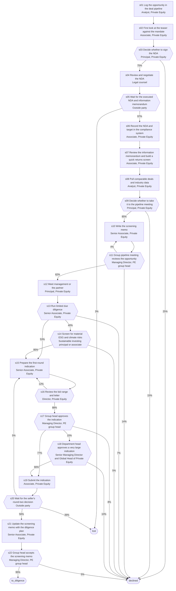

# Source and screen direct private equity opportunities

`pim-pe-source-screen` · asset management (public pension fund) · private equity investing · part of `pension-investment-manager`

Private Equity deal teams in North America, Europe and Asia receive sale processes from banks and invitations from partner funds to co-control or minority stakes, and decide quickly whether each one is worth the team's time. Most are declined from the teaser or the information memorandum; the rest go to a weekly pipeline meeting, a management meeting, limited diligence and a non-binding first-round indication. Only about a quarter of opportunities reach deep diligence. Waiting on NDAs, management presentations, weekly meetings and the seller's round-one decision makes up most of the elapsed time, and much analysis is spent on deals that are later lost or declined.

| | |
|---|---|
| Unit of work | one opportunity |
| Starts when | A banker's teaser or a partner's invitation to a direct private equity deal reaches a deal team. |
| Done when | The group head accepts a screening memo and the deal enters deep diligence, or the opportunity is declined or lost. |
| Organisation | A very large Canadian national pension fund manager whose 166-person Private Equity department invests directly alongside partner funds and through fund commitments and secondaries. (2,052 employees, 2019-2022) |
| Volume | 120 cases a month (range 90 to 160) |

## Where it sits

- Starts with **deal_opportunity** from sellers_advisors (65% of cases)
- Starts with **deal_opportunity** from general_partners (35% of cases)
- Relies on **department_mandate** from tf-capital-allocation (a standing input; it does not start a case)
- Sends **screening_memo** to pe-direct-due-diligence (outcome: to_diligence)

## Flow

## Roles

| Role | Department | Layer | FTE on this process | Loaded cost per hour | Evidence |
|---|---|---|---:|---:|---|
| Senior Managing Director and Global Head of Private Equity | Private Equity | executive | 0.05 | 2115 CAD | C |
| Managing Director, PE group head | Private Equity | director | 1.4 | 1662 CAD | C |
| Director, Private Equity | Private Equity | manager | 1.3 | 1080 CAD | C |
| Principal, Private Equity | Private Equity | supervisor | 4.5 | 571 CAD | C |
| Senior Associate, Private Equity | Private Equity | senior specialist | 12.5 | 293 CAD | C |
| Associate, Private Equity | Private Equity | individual contributor | 8 | 155 CAD | C |
| Analyst, Private Equity | Private Equity | individual contributor | 3.6 | 104 CAD | C |
| Legal counsel | Legal | senior specialist | 0.8 | 373 CAD | C |
| Sustainable investing principal or associate | Sustainable investing | senior specialist | 0.5 | 267 CAD | B [si22] |

## Steps

Hands-on time and the wait before each step show the most common value. Evidence tier A is a sourced number, B a sourced description, C the author's estimate.

| Step | Who | Kind | Hands-on | Wait before | Control | Evidence |
|---|---|---|---:|---:|---|---|
| **s01 Log the opportunity in the deal pipeline.** An analyst records an incoming opportunity (a banker's teaser for a sale process or a call from a partner fund offering a co-control or minority stake) in the deal pipeline with company, sector, region, size, seller, adviser and deadline, and assigns it to the coverage team. | Analyst, Private Equity | intake | 20 min | 4.0 h |  | B [macabacus], [ar21] |
| **s02 First look at the teaser against the mandate.** An associate reads the teaser or partner note, checks size, sector, geography, ownership structure, partner quality and expected equity cheque against the program mandate and current pipeline, and writes a few lines on fit for the principal. | Associate, Private Equity | analysis | 1.0 h | 12.0 h |  | C [gkm] |
| **s03 Decide whether to sign the NDA.** The principal reads the first-look note and decides whether to sign the non-disclosure agreement and request the information memorandum, or to decline and tell the banker or partner. | Principal, Private Equity | judgment | 20 min | 12.0 h | Program mandate and deployment guidance set through capital allocation | B [gkm] |
| **s04 Review and negotiate the NDA.** In-house counsel reviews the seller's non-disclosure agreement for scope, term, non-solicitation, standstill and residuals clauses and the fund's standard positions, marks it up and agrees the final text with the seller's counsel. | Legal counsel | review | 45 min | 1.0 d | Legal sign-off on confidentiality agreements under the fund's contracting authority | B [macabacus] |
| **s05 Wait for the executed NDA and information memorandum.** The seller's counsel and banker countersign the NDA and release the information memorandum and any initial data. A few processes are pulled or the fund is not given access. | Outside party | external wait | 0 min | 1.5 d |  | C |
| **s06 Record the NDA and target in the compliance system.** The associate records the signed NDA, target and counterparties in the compliance system so Compliance can see the confidential relationship and, for a listed target, add it to the watch list. | Associate, Private Equity | data entry | 10 min | 1.0 h | Insider trading law and the fund's information barrier policy for confidential information on listed targets | C |
| **s07 Review the information memorandum and build a quick returns screen.** The associate reads the information memorandum, spreads the historical financials, and builds a simple buyout or co-investment returns model with entry multiple, leverage, growth and exit cases to see whether target returns are achievable at the likely price. | Associate, Private Equity | analysis | 7.0 h | 1.0 d |  | B [macabacus] |
| **s08 Pull comparable deals and industry data.** An analyst pulls trading comparables, precedent transactions, industry growth data and any previous fund work on the sector or company, and adds them to the model and memo appendix. | Analyst, Private Equity | lookup | 4.0 h | 0 min |  | C |
| **s09 Decide whether to take it to the pipeline meeting.** The principal reviews the quick returns screen and comparables and decides whether the opportunity is worth group discussion or should be declined now. | Principal, Private Equity | judgment | 1.0 h | 12.0 h |  | B [gkm] |
| **s10 Write the screening memo.** A senior associate writes a short screening memo: business and market, investment thesis, partner and governance, valuation and returns range, key risks, ESG flags, fit with the mandate and the resources needed to pursue it. | Senior Associate, Private Equity | drafting | 4.0 h | 12.0 h |  | B [gkm] |
| **s11 Group pipeline meeting reviews the opportunity.** At the weekly pipeline meeting the group head and team discuss the memo against other live opportunities and decide to pursue it with management meetings and limited diligence, ask for more information, or decline. | Managing Director, PE group head | review | 30 min | 3.0 d | Group-level review of opportunities before resources are committed | B [gkm] |
| **s12 Meet management or the partner.** The principal and senior associate attend the management presentation or a call with the partner fund, test the business plan, management quality and the partner's thesis and governance proposals, and write up notes. | Principal, Private Equity | communication | 5.0 h | 5.0 d |  | B [gkm] |
| **s13 Run limited due diligence.** The senior associate refines the model with management's plan, calls a few industry experts, reviews key customer, margin and leverage questions, and lists issues that would need deep diligence. | Senior Associate, Private Equity | analysis | 10.0 h | 1.0 d |  | B [gkm] |
| **s14 Screen for material ESG and climate risks.** A Sustainable Investing specialist checks the sector against the materiality framework, looks for controversies, and where climate risk may be material applies a first pass of the climate security selection framework, then sends red flags to the team. | Sustainable investing principal or associate | analysis | 2.0 h | 2.0 d | Climate Change Security Selection Framework applied at the screening stage where climate risk may be material | B [si22] |
| **s15 Prepare the first-round indication.** The senior associate drafts the non-binding indication of interest or partner term outline: valuation range, structure and equity cheque, key assumptions, conditions, financing approach and timetable for confirmatory work. | Senior Associate, Private Equity | drafting | 5.0 h | 1.0 d |  | B [macabacus], [wsp] |
| **s16 Review the bid range and letter.** A director checks the valuation range against the model, comparables and the group's return targets, edits the letter's conditions and sends it back or forwards it for approval. | Director, Private Equity | review | 2.0 h | 1.0 d |  | C |
| **s17 Group head approves the indication.** The group head approves submitting the non-binding indication within the group's authority, refers a very large indication to the department head, or decides not to bid. | Managing Director, PE group head | approval | 1.0 h | 1.0 d | PE delegated authorities for non-binding bids under the fund's governing act s.35 investment policies | C [fund_act] |
| **s18 Department head approves a very large indication.** The Global Head of Private Equity reviews the largest indications for fit with deployment plans and concentration, and approves or stops them. | Senior Managing Director and Global Head of Private Equity | approval | 30 min | 2.0 d | PE delegated authorities for large commitments under the fund's governing act s.35 investment policies | C |
| **s19 Submit the indication.** The associate sends the signed indication letter to the banker or partner by the deadline and updates the pipeline record. | Associate, Private Equity | communication | 40 min | 4.0 h |  | C |
| **s20 Wait for the seller's round-two decision.** The banker and seller compare indications and decide which bidders to invite to the second round; a partner decides whether to bring the fund in. Some sellers ask bidders to improve their range first. | Outside party | external wait | 0 min | 10.0 d |  | B [wsp], [gkm] |
| **s21 Update the screening memo with the diligence plan.** The senior associate updates the screening memo with the round-one outcome, the price range, the main diligence questions, the advisers needed and their budget, and the timetable. | Senior Associate, Private Equity | drafting | 4.0 h | 8.0 h |  | C |
| **s22 Group head accepts the screening memo.** The group head approves entering deep diligence with the adviser budget and staffing, which hands the deal to the due diligence team, or stops it if priorities have changed. | Managing Director, PE group head | approval | 1.0 h | 1.0 d | Group head approval to commit adviser spending and staff to deep diligence | C |

## Exceptions

| Exception | Share of cases | What happens |
|---|---:|---|
| Declined at first look | 25% | The teaser shows the deal is outside the mandate on size, sector, region or structure. |
| Declined after the information memorandum | 11% | The quick returns screen shows the likely price cannot reach target returns. |
| Declined at the pipeline meeting | 9% | The group prefers other opportunities or sees a key risk. |
| Not selected for round two | 17% | The seller picks higher or more certain bidders after first-round indications. |
| Asked to improve the indication | 2% | The banker asks bidders to raise their range before choosing round-two bidders. |

## Benchmarks

| Metric | Value | Unit | Population | Evidence |
|---|---|---|---|---|
| cycle_time_days | p50 20, p90 50 | calendar days from opportunity received to decline, loss or acceptance of the screening memo | Direct private equity opportunities at a large institutional investor | B [wsp], [gkm] |
| share_reaching_partner_review | 0.618 | share of opportunities considered | 79 PE firms surveyed | A [gkm] |
| share_meeting_management | 0.528 | share of opportunities considered | 79 PE firms surveyed | A [gkm] |
| share_reaching_deep_due_diligence | 0.237 | share of opportunities considered | 79 PE firms surveyed | A [gkm] |
| closed_deals_investment_bank_generated | 0.333 | share of closed deals | 79 PE firms surveyed | A [gkm] |
| auction_duration_to_signing | 4 to 5 months | months | Sell-side auctions | A [macabacus] |
| dpe_portfolio_size | 88 | direct investments at March 31, 2021 (valued at C$53.3 billion) | Direct Private Equity group | A [ar21] |

## Pain points

- Most screening effort goes to deals that are later declined or lost: three in four opportunities never reach deep diligence. (steps s07, s13, s15; A [gkm])
- Waits on NDA signatures, management presentations and the seller's round-one decision are set by outside parties. (steps s05, s12, s20; B [wsp], [macabacus], [intralinks])
- Weekly pipeline meetings batch decisions, so good opportunities can wait several days for a slot. (steps s11; C)
- Large, complex direct deals with partners need several approval layers even for non-binding bids. (steps s16, s17, s18; B [ar22])

## Assumptions

- Branch shares follow the Gompers, Kaplan and Mukharlyamov funnel (61.8% partner review, 52.8% management meeting, 49.1% limited diligence, 23.7% deep diligence), so about 28 of 120 monthly opportunities feed the 28 cases a month of pim-pe-direct-due-diligence.
- The process map volume of 120 opportunities a month looks high for direct private equity alone; the DPE portfolio grew from 85 to 88 investments in fiscal 2021. It may include Asia direct deals and partner co-investments, or the survey funnel may be tighter at this fund.
- The last step (group head accepts the screening memo) is the trigger of pim-pe-direct-due-diligence, which then runs conflicts clearance, adviser engagement and round-two work.
- Partner-sourced deals (35% of cases) are modelled on the same path as banker-led auctions; for them the round-two decision is the partner's choice to bring the fund in.
- The pipeline meeting and approval steps count only the decision maker's time although others attend.
- legal_counsel and si_specialist are organisation roles not listed for this process; they are added for NDA review and ESG screening. Other PE time is within the headcount the organisation file gives each role after existing claims.
- Loaded costs come from the organisation file and include large incentive pay.

## Sources

- [ar21] The model fund F2021 Annual Report (fiscal year ended March 31, 2021) (link withheld) (The model fund, 2021). Direct Private Equity invests directly in private companies in North America and Europe, in sizable investments alongside aligned partners (private equity funds, family offices, long-term investors, corporations, management teams); DPE held 88 direct investments valued at C$53.3 billion with C$3.5 billion of new investment in fiscal 2021
- [ar22] The model fund F2022 Annual Report (fiscal year ended March 31, 2022) (link withheld) (The model fund, 2022). Private Equity invests globally through funds, secondaries and direct investments, both directly and with partners; 166 full-time employees; direct private equity investments are larger with more complex transaction structures
- [si22] 2022 Report on Sustainable Investing (link withheld) (The model fund, 2022). Climate Change Security Selection Framework applied during the screening and due diligence stages of deals where climate risk is potentially material; structured reviews of material sustainability factors for potential direct private equity investments
- [gkm] [What Do Private Equity Firms Say They Do? (NBER Working Paper 21133)](https://www.nber.org/papers/w21133.pdf) (National Bureau of Economic Research (Gompers, Kaplan and Mukharlyamov), 2015). Deal funnel per 100 opportunities considered: 61.8 reviewed with partner group or investment committee, 52.8 meet management, 49.1 limited due diligence, 23.7 deep due diligence, 22.5 offer terms, 13.6 sign LOI, 6.1 close; closed deals 35.6% proactively self-generated and 33.3% investment-bank generated; business model and competitive position is the top selection factor, then management, ability to add value and valuation
- [macabacus] [Sale Process Types: Auctions & Negotiated Sales](https://macabacus.com/mechanics/sale-processes) (Macabacus, 2024). Buyers receive a 1-5 page teaser, sign a confidentiality agreement, receive a 50+ page information memorandum and submit preliminary non-binding bids, after which selected bidders are invited to further due diligence; broad auctions have more than ten bidders, targeted auctions three to ten, negotiated sales one or two; auctions take four to five months to a signed agreement
- [wsp] [Sell Side M&A: Auction Process and Timeline Example](https://www.wallstreetprep.com/knowledge/sell-side-process/) (Wall Street Prep, 2024). Round 1 of an auction runs 4-6 weeks with NDAs, the CIM and non-binding indications of interest used to narrow the buyer list; Round 2 runs 4-6 weeks with management meetings, data room diligence and final bids; negotiations 6-8 weeks
- [intralinks] [Unveiling a decade of M&A diligence trends: key insights for deal success](https://www.intralinks.com/guides/unveiling-ma-diligence-trends) (SS&C Intralinks, 2024). Average time from data room opening to announcement rose to 203 days; private targets average about 230 days before announcement versus 125 for public targets; cross-border deals add about 30 days
- [fund_act] the fund's governing act (S.C. 1997, c. 40), sections 34 and 35 (link withheld) (Government of Canada, Justice Laws Website, 2022). The board must establish investment policies, standards and procedures that a person of ordinary prudence would exercise in dealing with the property of others, and the Board must follow them

Written by claude-opus on 2026-11-17.
