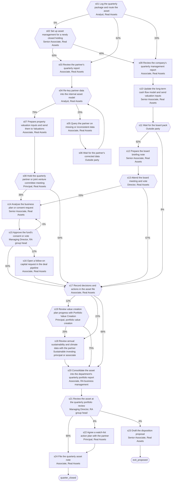

# Asset-manage real estate, infrastructure and energy holdings with partners

`pim-ra-asset-management` · asset management (public pension fund investment) · real assets investing · part of `pension-investment-manager`

Real Assets owns about 200 real estate, infrastructure and energy investments, most of them run day to day by operating partners or company management. Each quarter the team reviews the partner's or company's report, re-keys the figures into its own models, sends valuation inputs to the independent valuation group, meets the partner or sits on the board, and approves business plans, budgets, major leases, capital projects and financings that need the fund's consent. A quarterly portfolio review decides whether to hold, watch or sell. Partners report in their own formats and on their own timetables, and consent requests and board dates are set by others, so most of the elapsed time is waiting.

| | |
|---|---|
| Unit of work | one asset-quarter |
| Starts when | The operating partner's or company's quarter-end reporting package arrives, a newly closed holding is handed over, or a value creation plan is launched. |
| Done when | The quarterly asset note is filed with valuation inputs sent and consents decided, or a disposition proposal is sent to the disposition process. |
| Organisation | A very large Canadian public pension investment manager whose Real Assets department of about 250 people holds about 200 real asset investments with about 60 operating partners. (2,052 employees, 2019-2022) |
| Volume | 83 cases a month (range 65 to 105) |

## Where it sits

- Starts with **portfolio_company_report** from investment_partners (62% of cases)
- Starts with **portfolio_company_report** from portfolio_companies (30% of cases)
- Starts with **transaction_documents** from lc-negotiate-close (5% of cases)
- Starts with **value_creation_plan** from ra-pvc-value-creation (3% of cases)
- Sends **portfolio_company_report** to fin-quarterly-valuation (outcome: any)
- Sends **portfolio_company_report** to ra-pvc-value-creation (outcome: any)
- Sends **exit_proposal** to ra-exits (outcome: exit_proposed)

## Flow

## Roles

| Role | Department | Layer | FTE on this process | Loaded cost per hour | Evidence |
|---|---|---|---:|---:|---|
| Associate, Real Assets | Real Assets | individual contributor | 7.5 | 155 CAD | B [src6] |
| Analyst, Real Assets | Real Assets | individual contributor | 1.5 | 104 CAD | C [src6] |
| Senior Associate, Real Assets | Real Assets | senior specialist | 4.5 | 293 CAD | B [src7] |
| Principal, Real Assets | Real Assets | supervisor | 1.8 | 571 CAD | B [src6], [src7] |
| Director, Real Assets | Real Assets | manager | 1.3 | 1080 CAD | B [src7], [src8] |
| Managing Director, RA group head | Real Assets | director | 0.7 | 1662 CAD | C [src2] |
| Associate, RA business management | RA strategy and business management | individual contributor | 0.35 | 148 CAD | C |
| Principal, portfolio value creation | Portfolio value creation | supervisor | 0.25 | 571 CAD | B [src2] |
| Sustainable investing principal or associate | Sustainable investing | senior specialist | 0.4 | 267 CAD | B [src4] |

## Steps

Hands-on time and the wait before each step show the most common value. Evidence tier A is a sourced number, B a sourced description, C the author's estimate.

| Step | Who | Kind | Hands-on | Wait before | Control | Evidence |
|---|---|---|---:|---:|---|---|
| **s01 Log the quarterly package and route the asset.** The analyst saves the partner's or company's quarter-end package to the asset folder, logs its date against the reporting deadline in the joint venture or shareholder agreement and routes the asset as newly closed, partner-run real estate, or an infrastructure or energy company with a board seat. | Analyst, Real Assets | intake | 15 min | 0 min |  | B [src2] |
| **s02 Set up asset management for a newly closed holding.** The senior associate sets up the asset file: reporting deadlines and contents from the agreements, the approved business plan as the baseline, thresholds for leasing, capital and debt decisions that need the fund's consent, and the board or committee calendar. | Senior Associate, Real Assets | coordination | 7.0 h | 3.0 d |  | B [src5], [src4] |
| **s03 Review the partner's quarterly report.** The associate compares net operating income, occupancy, leasing activity, capital spending, development progress and debt covenants with the approved budget and last quarter, reads the partner's commentary and lists questions. | Associate, Real Assets | analysis | 5.0 h | 8.0 h |  | B [src6] |
| **s04 Re-key partner data into the internal asset model.** The analyst copies property-level income, occupancy, leasing and capital figures from the partner's spreadsheet or PDF into the fund's asset model and portfolio database, because each partner reports in its own format. | Analyst, Real Assets | data entry | 1.5 h | 4.0 h |  | C [src2] |
| **s05 Query the partner on missing or inconsistent data.** The associate emails the partner's asset manager with the list of gaps and inconsistencies (rent roll not matching income, missing capital spend detail, covenant calculations) and agrees when corrected data will arrive. | Associate, Real Assets | communication | 45 min | 4.0 h |  | C |
| **s06 Wait for the partner's corrected data.** The partner's asset manager or property manager looks into the queries, corrects the schedules or explains the differences, and resends the package by email. | Outside party | external wait | 0 min | 3.0 d |  | C |
| **s07 Prepare property valuation inputs and send them to Valuations.** The associate updates the income forecast, leasing and capital assumptions and market evidence (recent sales, capitalisation rates), writes a short note on value drivers and sends the pack to the valuation group, which also manages the annual external appraisal. | Associate, Real Assets | analysis | 4.0 h | 1.0 d | Valuation policy and calendar: investment teams supply quarter-end valuation inputs to the independent valuation group by its deadline | B [src1], [src9] |
| **s08 Hold the quarterly partner or joint venture committee meeting.** The principal meets the operating partner, in person or by video, to review results, leasing, capital projects, financing and the outlook, and takes the fund's position on items the partner brings for approval. | Principal, Real Assets | communication | 3.0 h | 5.0 d |  | B [src5], [src6] |
| **s09 Review the company's quarterly management report.** The associate reviews the quarter's monthly and quarter-end reports from the infrastructure or energy company: operating availability or production, regulatory and tariff matters, safety incidents, capital projects and debt, against budget and the investment case. | Associate, Real Assets | analysis | 6.0 h | 8.0 h |  | B [src7], [src11] |
| **s10 Update the long-term cash flow model and send valuation inputs.** The senior associate rolls the company's long-term cash flow model forward for actual results, the latest budget, regulatory decisions and interest rates, and sends the valuation input pack with a commentary to the valuation group. | Senior Associate, Real Assets | analysis | 5.0 h | 1.0 d | Valuation policy and calendar: investment teams supply quarter-end valuation inputs to the independent valuation group by its deadline | B [src7], [src1] |
| **s11 Wait for the board pack.** Company management circulates the board pack a few days before the meeting; a few companies hold no formal meeting in the quarter. | Outside party | external wait | 0 min | 7.0 d |  | B [src8] |
| **s12 Prepare the board briefing note.** The senior associate reads the board pack, reconciles it to the model and variance notes, takes input from Portfolio Value Creation where relevant, and writes the director's briefing note with questions and recommended positions. | Senior Associate, Real Assets | drafting | 5.0 h | 8.0 h |  | B [src7], [src8] |
| **s13 Attend the board meeting and vote.** The director nominated by the fund attends the board, challenges management on safety, operations, regulation and capital plans, and votes within the fund's agreed positions. | Director, Real Assets | communication | 6.0 h | 3.0 d |  | B [src7], [src8] |
| **s14 Analyse the business plan or consent request.** The senior associate analyses the partner's or management's proposal (annual business plan and budget, a major lease, a capital or development project, new debt or an add-on acquisition), tests it against the asset model and drafts the fund's recommended position. | Senior Associate, Real Assets | analysis | 10.0 h | 1.0 d |  | B [src5], [src6] |
| **s15 Approve the fund's consent or vote.** The group head reviews the recommendation and approves the fund's consent or vote; a request for new capital beyond the approved business plan is sent to the investment committees as a follow-on. | Managing Director, RA group head | approval | 1.0 h | 2.0 d | Joint venture or shareholder agreement reserved matters and Investment Management Authorities: group head approval of consents; follow-on capital needs IDC or PEC approval | B [src2], [src1] |
| **s16 Open a follow-on capital request in the deal pipeline.** The associate records the request (development funding, a partner's capital call above plan, an add-on acquisition) as an opportunity in the pipeline system so that it follows the diligence and committee route. | Associate, Real Assets | data entry | 45 min | 4.0 h |  | C |
| **s17 Record decisions and actions in the asset file.** The associate writes up the meeting outcome, the fund's consents and votes and follow-up actions, and updates the asset's flags (covenants, leasing risk, capital projects, safety). | Associate, Real Assets | drafting | 1.5 h | 4.0 h |  | C |
| **s18 Review annual sustainability and climate data with the partner.** Once a year a Sustainable Investing specialist and the associate review the partner's or company's energy, emissions, water, safety and certification data and, where climate risk is material, the climate scenario update, and agree improvement actions. | Sustainable investing principal or associate | review | 2.0 h | 5.0 d | Policy on Sustainable Investing: monitoring of material sustainability and climate factors during ownership | B [src4], [src10] |
| **s19 Review value creation plan progress with Portfolio Value Creation.** For a material direct investment, the PVC principal and deal team review progress on the value creation plan (operating efficiency, digital and data projects, management changes) and agree changes with management. | Principal, portfolio value creation | review | 2.0 h | 3.0 d |  | B [src2] |
| **s20 Consolidate the asset into the department's quarterly portfolio report.** The business management associate pulls the asset's figures, valuation change and flags into the Real Assets quarterly portfolio report and checks that every asset has reported. | Associate, RA business management | data entry | 25 min | 3.0 d |  | C |
| **s21 Review the asset at the quarterly portfolio review.** The group head and department leaders review each asset's results, valuation change, partner performance and risks, and decide to hold, put it on the watch list or prepare a disposition to recycle capital. | Managing Director, RA group head | judgment | 30 min | 5.0 d |  | B [src2], [src3] |
| **s22 Agree a watch-list action plan with the partner.** The principal works with the partner or management on a recovery plan (leasing push, cost cuts, refinancing, capital deferral or a change of property manager) and reports progress to the group head. | Principal, Real Assets | coordination | 10.0 h | 2.0 d |  | C |
| **s23 Draft the disposition proposal.** The senior associate sets out the sale options and timing, the partner's rights under the joint venture agreement (rights of first offer, tag and drag), expected proceeds against the latest valuation and use of proceeds, then files the note and sends the proposal to the disposition process. | Senior Associate, Real Assets | drafting | 10.0 h | 3.0 d |  | B [src5], [src6] |
| **s24 File the quarterly asset note.** The associate files the quarter's asset note (results, valuation inputs, meeting outcome, actions) and updates the asset's status in the pipeline and portfolio systems. | Associate, Real Assets | data entry | 45 min | 1.0 d |  | C |

## Exceptions

| Exception | Share of cases | What happens |
|---|---:|---|
| Partner data gaps | 16% | The partner's package is incomplete or inconsistent and the associate queries the partner before the data can be re-keyed. |
| Consent or business plan approval | 33% | The partner or board brings a business plan, budget, major lease, capital project or financing for the fund's consent. |
| Follow-on capital request | 4% | New capital beyond the approved plan is needed and leaves this process as a pipeline opportunity. |
| Watch list | 6% | Results or leasing deteriorate and the principal agrees a recovery plan with the partner. |
| Disposition | 4% | The portfolio review decides to sell and a disposition proposal goes to the disposition process. |

## Benchmarks

| Metric | Value | Unit | Population | Evidence |
|---|---|---|---|---|
| cycle_time_days | p50 25, p90 45 | calendar days from receipt of the quarter-end package to the quarterly asset note filed | Real estate, infrastructure and energy holdings of a large pension investor | C [src8], [src11], [src12] |
| real_estate_external_valuation_interval | 12 | months at most | Directly owned real estate under GIPS for asset owners | A [src9] |
| operating_partners | F2020 60, F2021 58 | real estate operating partners | Real Estate group | A [src2], [src3] |
| real_assets_investments | F2020 179, F2021 204 | investments | Real Assets department | A [src2], [src3] |

## Pain points

- About 60 partners report in their own formats, so figures are re-keyed into internal models and gaps are chased by email. (steps s04, s05, s06; C [src2])
- Partner meetings and board dates are set by others and consent requests arrive with short deadlines. (steps s08, s11, s14; B [src5], [src8])
- Valuation inputs are needed early while partners' full quarterly reports often arrive later, so teams work from flash figures. (steps s07, s10; B [src12])
- As a joint venture partner the fund can only steer reserved matters; day-to-day asset management sits with the partner. (steps s08, s15; B [src1], [src5])

## Assumptions

- The unit is one asset-quarter. The case starts when the partner's or company's quarter-end package arrives (assumed two to three weeks after quarter end, with fuller reports later) and ends with the quarterly asset note.
- Mix of asset-quarters: 62% partner-run real estate, 33% infrastructure, power and energy companies with board seats, 5% newly closed holdings. The author's split of the F2021 portfolio.
- The investment team's proposal of a quarter-end value, appraiser engagement and the valuation challenge are in fin-quarterly-valuation; this workflow stops at sending inputs. That workflow expects deal team proposals about ten days after quarter end, earlier than the package timing assumed here; teams use partners' flash figures to bridge it.
- Follow-on capital requests leave this workflow as a pipeline opportunity (step s16); the process map has no link from this process to screening or diligence for follow-ons, which is a gap in the organisation file.
- si_specialist is an organisation role that the process map does not list for this process; it is added for the annual sustainability and climate review.
- Hands-on times count focused work only; time on site visits and informal partner contact is not counted. At 83 asset-quarters a month they imply about 20 FTE and the roles state about 19 FTE, under a tenth of Real Assets' 252 staff, who also source and close deals.
- The simulated median (about 26 days) matches the 25-day benchmark reading, which is itself the author's estimate; no published figure for this cycle was found.
- Loaded costs per hour are the organisation file's (total compensation scaled to F2022 personnel expense, times an overhead factor of 1.25, divided by 1,950 hours).

## Sources

- [src1] The model fund F2022 Annual Report (fiscal year ended March 31, 2022) (link withheld) (The model fund, 2022). External partners provide research, local knowledge and ongoing asset management services; the Portfolio Execution Committee reviews new investments, dispositions and follow-on transactions; Finance oversees valuation independently of investment departments
- [src2] The model fund F2021 Annual Report (fiscal year ended March 31, 2021) (link withheld) (The model fund, 2021). Real Assets held 204 investments managed by 223 professionals in eight offices (F2021); Real Estate held 152 investments with 58 operating partners, invests typically through joint ventures and actively assesses holdings for disposition and recycling of capital; Infrastructure held 24 direct investments with significant stakes and meaningful governance rights, can deploy additional capital to existing portfolio companies and works with management on operational and financial improvements; Energy and Resources held 19 investments; PVC supports asset management of direct equity investments with material governance rights; the climate framework was being applied to existing investments; the Investment Decision Committee approves follow-ons
- [src3] The model fund 2020 Annual Report (link withheld) (The model fund, 2020). Real Estate held 136 investments with 60 operating partners managed by 79 professionals (F2020) and sold C$7.8 billion of assets; value-added real estate investments require active asset management
- [src4] 2022 Report on Sustainable Investing (link withheld) (The model fund, 2022). Onboarding and monitoring practices for assets with material governance rights; proprietary sustainability KPI framework for existing direct equity investments (fiscal 2022); climate framework applied to existing assets; 253 green-certified buildings where the fund holds at least 10%; the Sustainable Investing group of 20 sits in Real Assets
- [src5] [Real estate joint ventures: governance and management](https://cms.law/en/int/publication/cms-funds-group-back-to-basics-briefings/real-estate-joint-ventures-governance-and-management) (CMS, 2023). Each partner appoints directors in proportion to its stake; reserved matters for both partners include approving or materially amending the business plan and third-party debt, with carve-outs for items pre-approved in the business plan; deadlock escalation to senior executives and buy-out or sale mechanisms
- [src6] Associate, Real Estate Investments (job posting, the model fund, Toronto) (link withheld) (SelectLeaders, 2023). Associates monitor investment performance, take part in meetings with joint venture partners, analyse proposed budgets, leasing plans, capital plans and other investment and development recommendations, and assist in buy, hold and sell analysis for the existing portfolio
- [src7] Principal, Sustainable Energies (job posting, the model fund, New York) (link withheld) (Built In, 2025). Principals oversee the financial and operating performance of portfolio companies, sit on portfolio company boards as members or observers, prepare internal materials on portfolio company updates and recommendations and lead portfolio company valuation analyses
- [src8] [Standard board meeting cadence (Private equity board member handbook)](https://umbrex.com/resources/private-equity-board-member-handbook/standard-board-meeting-cadence/) (Umbrex, 2024). Sponsor-backed boards meet at least four times a year, commonly every 6 to 8 weeks; packs circulate 3 to 7 days before meetings of 2 to 4 hours; budgets are finalised in November and December and signed off in January and February
- [src9] [2020 GIPS Standards for Asset Owners](https://www.gipsstandards.org/wp-content/uploads/2021/02/2020_gips_standards_asset_owners.pdf) (CFA Institute, 2020). Private market investments valued at least quarterly (22.A.30); directly owned real estate externally valued at least every 12 months by an independent certified valuer (22.A.33, 22.A.34)
- [src10] [GRESB Real Estate Assessment](https://www.gresb.com/nl-en/real-estate-assessment/) (GRESB, 2025). Property companies, funds and direct investors report energy, greenhouse gas emissions, water, waste and management practices once a year between April 1 and July 1, with results released in October
- [src11] [PE portfolio reporting requirements](https://www.getaleph.com/answers/pe-portfolio-reporting-requirements) (Aleph, 2024). Owners typically require monthly management packs 10 to 20 business days after month end, quarterly covenant certificates often 45 days after quarter end, quarterly board packs 5 to 7 days before meetings and an annual budget before the fiscal year
- [src12] the fund's governing act (S.C. 1997, c. 40), sections 47 to 52 (link withheld) (Justice Laws Website, Government of Canada, 2024). Quarterly financial statements due to the ministers within 45 days after the quarter (s. 50(1)), which sets the valuation input deadline

Written by claude-opus on 2026-11-17.
