# Conduct due diligence on real estate, infrastructure and energy investments

`pim-ra-due-diligence` · asset management (public pension fund investment) · real assets investing · part of `pension-investment-manager`

A Real Assets deal team takes an opportunity that passed screening into deep diligence: a property or portfolio bought with a joint venture partner, an infrastructure company, or a power, renewables or energy business. The team assesses the partner, reviews the data room, visits the assets, builds a cash flow model that runs 10 to 30 years, hires engineering, environmental, market, legal and insurance advisers, negotiates governance rights with the partner and gets tax and sustainability and climate input before writing the investment memo for Risk and the Portfolio Execution Committee. About half of these deals reach a memo; the rest are dropped on technical, regulatory or price grounds or lost. Adviser reports, seller answers and partner negotiations take most of the elapsed time, and memos go through several rounds of edits.

| | |
|---|---|
| Unit of work | one deal in deep diligence |
| Starts when | The group head accepts a screening memo and the team enters the second round of a sale process or a partner brings a bilateral deal. |
| Done when | An investment memo is submitted to Risk and the Portfolio Execution Committee, or the deal is dropped or lost. |
| Organisation | A very large Canadian public pension investment manager whose Real Assets department of about 250 people holds about 200 real estate, infrastructure and energy investments, mostly with partners. (2,052 employees, 2019-2022) |
| Volume | 25 cases a month (range 18 to 34) |

## Where it sits

- Starts with **screening_memo** from ra-source-screen (100% of cases)
- Relies on **due_diligence_report** from external_advisors (a standing input; it does not start a case)
- Relies on **tax_structure_memo** from fin-tax-structuring (a standing input; it does not start a case)
- Relies on **esg_assessment** from ra-si-esg-assessment (a standing input; it does not start a case)
- Sends **investment_memo** to risk-transaction-review (outcome: memo_submitted)
- Sends **investment_memo** to tf-pec-approval (outcome: memo_submitted)
- Sends **term_sheet** to fin-tax-structuring (outcome: any)
- Sends **term_sheet** to ra-si-esg-assessment (outcome: any)

## Flow

```mermaid
flowchart TD
    s01["s01 Staff the deal team and set the diligence workplan<br/>Director, Real Assets"]
    s02["s02 Clear conflicts and add the target to the watch list<br/>Compliance officer"]
    s03["s03 Assess the operating or joint venture partner<br/>Principal, Real Assets"]
    s04["s04 Engage technical, environmental, market and insurance advisers<br/>Principal, Real Assets"]
    s05["s05 Scope legal diligence and instruct external counsel<br/>Legal counsel"]
    s06["s06 Review the data room and log questions<br/>Associate, Real Assets"]
    s07["s07 Submit questions and chase answers<br/>Analyst, Real Assets"]
    s08{{"s08 Wait for seller answers and added documents<br/>Outside party"}}
    s09["s09 Visit the assets and meet management or the partner<br/>Principal, Real Assets"]
    s10["s10 Build the long-term cash flow model<br/>Associate, Real Assets"]
    s11{{"s11 Review the model and challenge assumptions<br/>Senior Associate, Real Assets"}}
    s12["s12 Receive advisers' draft technical, environmental and market reports<br/>Outside party"]
    s13{{"s13 Review advisers' reports and update the model<br/>Senior Associate, Real Assets"}}
    s14["s14 Assess operations and draft the value creation plan<br/>Principal, portfolio value creation"]
    s15{{"s15 Decide whether to continue after confirmatory findings<br/>Managing Director, RA group head"}}
    s16["s16 Prepare the term sheet and send it to Tax and Sustainable Investing<br/>Senior Associate, Real Assets"]
    s17["s17 Negotiate governance and joint venture terms with the partner<br/>Managing Director, RA group head"]
    s18["s18 Review legal findings and mark up the agreements<br/>Legal counsel"]
    s19["s19 Confirm asset-level financing and insurance terms<br/>Principal, Real Assets"]
    s20["s20 Integrate the tax structure memo and the sustainability and climate assessment<br/>Associate, Real Assets"]
    s21["s21 Set the valuation range and bid price<br/>Director, Real Assets"]
    s22["s22 Draft the investment memo<br/>Senior Associate, Real Assets"]
    s23{{"s23 Review and edit the memo<br/>Director, Real Assets"}}
    s24{{"s24 Review the memo with the group head<br/>Managing Director, RA group head"}}
    s25{{"s25 Check approval authority and required sign-offs<br/>Associate, RA business management"}}
    s26{{"s26 Present at the department investment review<br/>Senior Managing Director, Global Head of Real Assets and Chief Sustainability Officer"}}
    s27["s27 Submit the memo to Risk and the committee secretariat<br/>Associate, Real Assets"]
    s01 --> s02
    s02 --> s03
    s03 --> s04
    s04 --> s05
    s05 --> s06
    s06 --> s07
    s07 --> s08
    s08 -->|"96%"| s09
    s08 -->|"4%"| end0
    s09 --> s10
    s10 --> s11
    s11 -->|"70%"| s12
    s11 -->|"30%"| s10
    s12 --> s13
    s13 -->|"40%"| s14
    s13 -->|"60%"| s15
    s14 --> s15
    s15 -->|"62%"| s16
    s15 -->|"22%"| end1
    s15 -->|"8%"| s10
    s15 -->|"8%"| end0
    s16 --> s17
    s17 --> s18
    s18 --> s19
    s19 --> s20
    s20 --> s21
    s21 --> s22
    s22 --> s23
    s23 -->|"65%"| s24
    s23 -->|"35%"| s22
    s24 -->|"80%"| s25
    s24 -->|"12%"| s22
    s24 -->|"8%"| end1
    s25 -->|"90%"| s26
    s25 -->|"10%"| s22
    s26 -->|"85%"| s27
    s26 -->|"10%"| s22
    s26 -->|"5%"| end1
    s27 --> end2
    end0(["lost"])
    end1(["dropped"])
    end2(["memo_submitted"])
```

## Roles

| Role | Department | Layer | FTE on this process | Loaded cost per hour | Evidence |
|---|---|---|---:|---:|---|
| Managing Director, RA group head | Real Assets | director | 2.8 | 1662 CAD | C [src2] |
| Director, Real Assets | Real Assets | manager | 4 | 1080 CAD | C [src2] |
| Principal, Real Assets | Real Assets | supervisor | 5.5 | 571 CAD | B [src10] |
| Senior Associate, Real Assets | Real Assets | senior specialist | 10.5 | 293 CAD | B [src10] |
| Associate, Real Assets | Real Assets | individual contributor | 14 | 155 CAD | B [src10], [src12] |
| Analyst, Real Assets | Real Assets | individual contributor | 2 | 104 CAD | C |
| Principal, portfolio value creation | Portfolio value creation | supervisor | 1 | 571 CAD | B [src2] |
| Legal counsel | Legal | senior specialist | 1.5 | 373 CAD | B [src9] |
| Compliance officer | Compliance | individual contributor | 0.1 | 122 CAD | C |
| Associate, RA business management | RA strategy and business management | individual contributor | 0.2 | 148 CAD | C [src2] |
| Senior Managing Director, Global Head of Real Assets and Chief Sustainability Officer | Real Assets | executive | 0.1 | 2308 CAD | C [src2] |

## Steps

Hands-on time and the wait before each step show the most common value. Evidence tier A is a sourced number, B a sourced description, C the author's estimate.

| Step | Who | Kind | Hands-on | Wait before | Control | Evidence |
|---|---|---|---:|---:|---|---|
| **s01 Staff the deal team and set the diligence workplan.** After the group head accepts the screening memo, the director names the principal, associates and analyst, sets the diligence timetable against the seller's process letter or the partner's timetable, drafts an adviser budget and records the deal stage in the pipeline system. | Director, Real Assets | coordination | 2.0 h | 12.0 h |  | B [src6], [src10] |
| **s02 Clear conflicts and add the target to the watch list.** A compliance officer checks the target, seller and proposed partner against existing holdings and the restricted list, adds the target to the watch list and confirms the information barrier before the team receives non-public data. | Compliance officer | validation | 30 min | 8.0 h | Code of Conduct and confidential information policy: watch list entry before receiving material non-public information | C |
| **s03 Assess the operating or joint venture partner.** The principal reviews the proposed partner's track record, alignment of interest, fee and promote terms, team, reporting quality and know-your-counterparty documents; for existing partners this is a refresh of the last review. | Principal, Real Assets | analysis | 6.0 h | 1.0 d |  | B [src2], [src3] |
| **s04 Engage technical, environmental, market and insurance advisers.** The principal asks engineering, environmental, market, insurance and accounting firms for scopes and fees, compares proposals, negotiates caps and signs engagement letters within the deal's approved transaction cost budget. | Principal, Real Assets | coordination | 6.0 h | 1.0 d | Expense management policy: seniority-based approval of transaction costs | B [src9], [src10], [src5] |
| **s05 Scope legal diligence and instruct external counsel.** In-house legal counsel agrees the legal scope (title and land rights, concessions and licences, permits, material contracts, existing joint venture agreements) and materiality thresholds, and instructs the external law firm. | Legal counsel | drafting | 2.0 h | 1.0 d |  | B [src8], [src9] |
| **s06 Review the data room and log questions.** The associate reads the information memorandum, rent rolls and leases or offtake and concession contracts, operating history, capital expenditure records and regulatory filings in the virtual data room, notes gaps and builds the question list by workstream. | Associate, Real Assets | analysis | 1.0 d | 4.0 h |  | B [src9], [src12] |
| **s07 Submit questions and chase answers.** The analyst loads the questions into the data room question module, tracks open items in a spreadsheet by workstream and chases the seller's adviser for overdue answers. | Analyst, Real Assets | communication | 4.0 h | 1.0 h |  | B [src6] |
| **s08 Wait for seller answers and added documents.** The seller's adviser and the asset's managers answer questions in batches and upload further documents; sometimes the seller narrows the field or pauses the process. | Outside party | external wait | 0 min | 5.0 d |  | C [src6] |
| **s09 Visit the assets and meet management or the partner.** The principal and director tour the main properties or plants, meet management or the operating partner, test the business plan and capital needs on site, and write up notes and new questions. | Principal, Real Assets | communication | 10.0 h | 2.0 d |  | B [src6] |
| **s10 Build the long-term cash flow model.** The associate builds the asset model: leases and re-leasing for real estate, or contracted and regulated revenue, operating costs and capital programmes for infrastructure and energy, over 10 to 30 years or the concession term, with the capital structure, exit or terminal value and sensitivities. | Associate, Real Assets | analysis | 1.7 d | 4.0 h |  | B [src2], [src10] |
| **s11 Review the model and challenge assumptions.** The senior associate walks through the model with the associate, challenges rent growth, capitalisation rates, regulated returns, availability and degradation assumptions against diligence findings and comparables, and lists changes. | Senior Associate, Real Assets | review | 5.0 h | 1.0 d |  | C [src10] |
| **s12 Receive advisers' draft technical, environmental and market reports.** The engineering firm delivers its property condition assessment or independent engineer's report with a capital replacement budget, the environmental firm its Phase I report (with a Phase II plan if needed), and the market and insurance advisers their findings. | Outside party | external wait | 0 min | 10.0 d |  | B [src7], [src8], [src9] |
| **s13 Review advisers' reports and update the model.** The senior associate reads each report, lists red flags (deferred maintenance, contamination, permit or concession gaps, grid or offtake risk), quantifies capital and remediation costs with the advisers and updates the model and price range. | Senior Associate, Real Assets | review | 12.0 h | 8.0 h |  | B [src8], [src9] |
| **s14 Assess operations and draft the value creation plan.** For a platform or operating company, a Portfolio Value Creation principal reviews operations, management capability and digital opportunities, and drafts the first value creation plan and the governance rights the fund should seek. | Principal, portfolio value creation | analysis | 10.0 h | 2.0 d |  | B [src2] |
| **s15 Decide whether to continue after confirmatory findings.** The group head meets the team, reviews red flags, the updated value range, partner terms and the competitive position, and decides whether to keep spending on the deal. | Managing Director, RA group head | judgment | 2.0 h | 2.0 d |  | B [src5] |
| **s16 Prepare the term sheet and send it to Tax and Sustainable Investing.** The senior associate writes the proposed structure, price, partner and governance terms and jurisdictions into a term sheet and sends it to the tax team for structuring and to Sustainable Investing for the sustainability and climate review. | Senior Associate, Real Assets | drafting | 4.0 h | 4.0 h |  | B [src4] |
| **s17 Negotiate governance and joint venture terms with the partner.** The group head negotiates board and committee seats, reserved matters such as business plan approval and new debt, fees and promote, transfer and exit rights, and deadlock provisions with the partner or co-investors. | Managing Director, RA group head | communication | 6.0 h | 3.0 d |  | B [src11], [src2] |
| **s18 Review legal findings and mark up the agreements.** Legal counsel reviews the external firm's title, permit and contract findings, settles the purchase agreement markup and the joint venture or shareholder agreement term sheet for the final bid, and flags issues for the memo. | Legal counsel | review | 8.0 h | 1.0 d | Legal department review of transaction documents before a binding offer | B [src8], [src11] |
| **s19 Confirm asset-level financing and insurance terms.** The principal confirms debt terms with lenders or the partner (amount, tenor, covenants, hedging) and insurance cover for property damage, business interruption and liability with the broker, and adds both to the model. | Principal, Real Assets | coordination | 4.0 h | 1.0 d |  | C [src9] |
| **s20 Integrate the tax structure memo and the sustainability and climate assessment.** The associate waits for the tax structure memo and the Sustainable Investing assessment, adds withholding and structure costs to the model, runs the high-physical and high-transition climate scenarios where material, and inserts the findings into the memo draft. | Associate, Real Assets | analysis | 5.0 h | 2.0 d | Climate Change Security Selection Framework: bookend scenarios required where climate impacts are material to a transaction needing committee approval | B [src1], [src4] |
| **s21 Set the valuation range and bid price.** The director reviews the final model, returns against the hurdle for the strategy, sensitivities and the competitive picture, and sets the recommended price and walk-away level. | Director, Real Assets | judgment | 6.0 h | 1.0 d |  | C [src10] |
| **s22 Draft the investment memo.** The senior associate and associate write the memo: thesis, asset and market, partner, diligence findings, technical and environmental issues, cash flows and returns, risks and mitigants, tax, sustainability and climate, governance and the approval sought. | Senior Associate, Real Assets | drafting | 1.0 d | 4.0 h |  | B [src10] |
| **s23 Review and edit the memo.** The director reads the draft, checks key numbers against the model, rewrites the thesis and risk sections and sends it back with comments or passes it to the group head. | Director, Real Assets | review | 6.0 h | 1.0 d |  | C |
| **s24 Review the memo with the group head.** The group head reads the memo, tests the thesis, partner and price with the team and decides whether to take it to the department review. | Managing Director, RA group head | review | 3.0 h | 2.0 d |  | C |
| **s25 Check approval authority and required sign-offs.** A business management associate checks the deal size against the Investment Management Authorities to confirm the approving body, and checks that tax, legal, sustainability and climate sections and sign-offs are present. | Associate, RA business management | validation | 1.0 h | 12.0 h | Investment Management Authorities set by the CEO: transaction approval authorities | B [src2] |
| **s26 Present at the department investment review.** The deal team presents to the department head and group heads, answers questions and records the endorsement or required changes before the item goes to Risk and the Portfolio Execution Committee. | Senior Managing Director, Global Head of Real Assets and Chief Sustainability Officer | approval | 1.5 h | 3.0 d | Investment Management Authorities: department-level committee review | B [src2], [src1] |
| **s27 Submit the memo to Risk and the committee secretariat.** The associate files the final memo, model and appendices in the memo repository and sends them to the risk team and the Portfolio Execution Committee secretariat for the next agenda. | Associate, Real Assets | communication | 1.0 h | 4.0 h |  | B [src1] |

## Exceptions

| Exception | Share of cases | What happens |
|---|---:|---|
| Model rework after review | 30% | The senior associate sends the model back for changes to rent, regulated return or capital assumptions. |
| Technical or environmental red flag | 22% | Advisers find deferred capital needs, contamination or permit and concession gaps, and the group head drops the deal. |
| Lost in the auction or partner walks | 12% | The seller narrows the field, halts the sale or the partner withdraws. |
| Memo rewrite | 45% | The director, group head, authority check or department review sends the memo back for changes. |

## Benchmarks

| Metric | Value | Unit | Population | Evidence |
|---|---|---|---|---|
| cycle_time_days | p50 55, p90 100 | calendar days from screening approval to memo submitted or deal dropped | Real estate, infrastructure and energy deals in deep diligence at a large pension investor | B [src6], [src9] |
| deep_diligence_to_close_rate | 0.26 | share of deep-diligence deals that close | 79 PE investors surveyed (applied to real assets by the organisation file) | A [src5] |
| phase_i_validity_window | full 365, key_elements 180 | days before acquisition | Phase I environmental site assessments under All Appropriate Inquiries | A [src7] |
| existing_partner_share_of_re_investment | 0.98 | share of F2021 real estate investment activity | Real Estate group, excluding listed real estate | A [src2] |

## Pain points

- Technical, environmental and market reports take weeks and arrive late in the phase, so deals are often dropped only after most of the work is done. (steps s12, s13, s15; B [src9])
- Long-term cash flow models over 10 to 30 years are built in spreadsheets and go through several review rounds. (steps s10, s11; C)
- Partner and co-investor negotiations on governance and promote run in parallel with diligence and depend on the other side's timetable. (steps s17; B [src11])
- Tax and sustainability inputs come from other teams and the memo waits for them. (steps s20; B [src4])
- Memo drafting and edits by several levels take one to three weeks. (steps s22, s23, s24, s26; C)

## Assumptions

- The process starts when the group head accepts a screening memo and ends at memo submission; first-round bids, the risk review, committee approval and closing negotiations are other processes.
- Volume follows the process map (25 deals a month in deep diligence). This looks high: Real Assets held 179 investments in F2020 and 204 in F2021, and much real estate investment is follow-on capital with existing partners rather than new deep-diligence deals.
- About 40% of deals are platforms or operating companies that get a Portfolio Value Creation review; the rest are assets or joint ventures run by partners.
- Branch shares are set so that about 55% of deals reach a memo, 30% are dropped by the team and 12% are lost, consistent with the published funnel (26% of deep-diligence deals close).
- All deals are treated as needing Portfolio Execution Committee approval; small follow-ons within department authority would stop at the department review.
- Hands-on times count focused work only; deal teams also spend unrecorded time on calls and travel. Adviser fees are not in the labour cost. At 25 deals a month the hands-on time implies about 45 FTE and the roles state about 42 FTE, about a sixth of the 252 Real Assets staff, which is another sign that the process map volume is high.
- The simulated median (about 60 days) is close to the 55-day benchmark reading; the simulated 90th percentile (about 77 days) is below the 100-day reading because the simulator draws each wait independently and does not reproduce deals that stall for months on regulatory or partner issues.
- ra_smd, ra_bm, legal_counsel and compliance_officer are organisation roles that the process map does not list for this process; they are added because the department review, authority check, legal work and watch list need them.
- The external advisers' reports, the tax structure memo and the ESG assessment are listed as inputs rather than triggers because they arrive during a case that the screening memo starts; the process map lists them under triggered_by.
- Loaded costs per hour are the organisation file's (total compensation scaled to F2022 personnel expense, times an overhead factor of 1.25, divided by 1,950 hours).

## Sources

- [src1] The model fund F2022 Annual Report (fiscal year ended March 31, 2022) (link withheld) (The model fund, 2022). The Portfolio Execution Committee, chaired by the CIO, reviews new investments, dispositions and follow-ons; for decisions where climate change impacts are material, the Climate Change Security Selection Framework requires the financial impacts of high-physical and high-transition risk scenarios to be considered
- [src2] The model fund F2021 Annual Report (fiscal year ended March 31, 2021) (link withheld) (The model fund, 2021). Real Assets had 204 investments managed by 223 professionals in eight offices, 66% of them outside Canada (F2021); Real Estate held 152 investments with 58 operating partners and more than 98% of its new investment was with existing partners, typically through joint ventures; Infrastructure held 24 direct investments in regulated or contracted businesses with significant stakes and meaningful governance rights, often with partners; Energy and Resources held 19 investments; the climate framework must be applied to any transaction requiring Investment Decision Committee approval where climate impacts are material; Investment Management Authorities set transaction approval authorities; PVC assists in due diligence
- [src3] The model fund 2020 Annual Report (link withheld) (The model fund, 2020). Real Assets had 179 investments managed by 219 professionals (F2020); Real Estate held 136 investments with 60 operating partners, managed by 79 professionals
- [src4] 2022 Report on Sustainable Investing (link withheld) (The model fund, 2022). Detailed evaluations of material sustainability factors for potential direct equity investments in private assets (environment, health and safety, labour and human rights, community relations, cybersecurity and data privacy, business integrity and governance); the climate framework with bookend scenarios is applied to any direct investment requiring Portfolio Execution Committee approval where climate risk is potentially material; the Head of Sustainable Investing is a member of the Portfolio Execution Committee
- [src5] [What Do Private Equity Firms Say They Do? (NBER Working Paper 21133)](https://www.nber.org/papers/w21133.pdf) (Gompers, Kaplan and Mukharlyamov, National Bureau of Economic Research, 2015). Deal funnel: of 100 opportunities 23.7 reach deep due diligence, 13.6 a signed letter of intent and 6.1 close; outside consultants used before the deal in about 37% of deals
- [src6] [Sell-side M&A process](https://www.wallstreetprep.com/knowledge/sell-side-process/) (Wall Street Prep, 2024). Round 2 of an auction takes 4 to 6 weeks with management meetings, data room diligence, a draft definitive agreement and final bids; negotiations take a further 6 to 8 weeks
- [src7] [Brownfields All Appropriate Inquiries](https://www.epa.gov/brownfields/brownfields-all-appropriate-inquiries) (United States Environmental Protection Agency, 2024). Phase I environmental site assessments under ASTM E1527-21 by a qualified environmental professional; inquiry within one year before acquisition, with interviews, records review, site inspection and lien searches within 180 days
- [src8] [Third party reports for due diligence](https://www.burkelaw.com/alert-third-party-reports-for-due-diligence) (Burke, Warren, MacKay and Serritella, 2024). Buyers of commercial real estate commission an ALTA/NSPS survey, a property condition assessment with a 10-year capital replacement budget, a Phase I environmental site assessment (with Phase II sampling if conditions are found) and a zoning report during the due diligence period
- [src9] [Solar and storage M&A diligence (article)](https://www.pv-tech.org/ma-solar-storage-diligence-artificial-intelligence-euclid/) (PV Tech, 2026). Renewable energy acquisition diligence routinely takes three months or more; investors coordinate an independent engineer or technical advisor, tax counsel, real estate counsel, transaction counsel, an environmental consultant and a financial advisor; each project comprises several hundred contracts and documents
- [src10] Principal, Sustainable Energies (job posting, the model fund, New York) (link withheld) (Built In, 2025). Principals lead due diligence workstreams for new investments, identify and manage third-party advisors, build operating models and lead the development of internal investment memoranda and recommendations
- [src11] [Real estate joint ventures: governance and management](https://cms.law/en/int/publication/cms-funds-group-back-to-basics-briefings/real-estate-joint-ventures-governance-and-management) (CMS, 2023). Joint venture board appointment rights, reserved matters such as approving or amending the business plan and third-party debt, and deadlock escalation and buy-out mechanisms negotiated between partners
- [src12] Associate, Real Estate Investments (job posting, the model fund, Toronto) (link withheld) (SelectLeaders, 2023). Real estate associates work with joint venture partners, analyse proposed budgets, leasing plans and capital plans and assist in buy, hold and sell analysis

Written by claude-opus on 2026-11-17.
