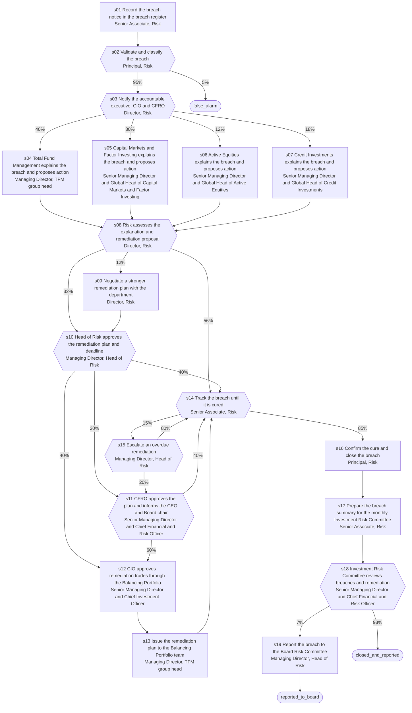

# Escalate and resolve risk limit breaches (one breach or threshold exception)

`pim-risk-limit-breach-escalation` · pension fund investment management · investment risk oversight · part of `pension-investment-manager`

The fund runs inside Board and management limits on total risk, leverage, liquidity, credit and concentration, with lower thresholds that act as early warnings. When the daily risk run or counterparty monitoring shows a limit or threshold exceeded, Risk validates and classifies the event, notifies the accountable department head, the CIO and the CFRO, judges the department's explanation or remediation plan, gets plans approved, tracks the measure until it is back inside, and reports every event to the monthly Investment Risk Committee and Board-level ones to the Board. Most of the elapsed time is waiting for markets or trades to bring the measure back and for the next committee meeting; the hard parts are telling data errors from real breaches and agreeing how fast a passive breach should be cured.

| | |
|---|---|
| Unit of work | one breach or threshold exception |
| Starts when | The daily risk run or counterparty credit monitoring issues a limit breach notice after a Risk principal or director has confirmed the measure is over a limit or threshold. |
| Done when | The measure is back within its limit or threshold, the breach is closed in the register and reviewed by the Investment Risk Committee, and Board-level breaches are reported to the Board Risk Committee; or the notice is withdrawn as a data error. |
| Organisation | A Canadian national pension fund investment manager with about 2,000 employees and a second-line Risk group under the CFRO that monitors Board and management limits daily. (2,052 employees, 2019-2022) |
| Volume | 6 cases a month (range 2 to 12) |

## Where it sits

- Starts with **limit_breach_notice** from risk-market-limit-monitoring (65% of cases)
- Starts with **limit_breach_notice** from risk-counterparty-credit (35% of cases)
- Relies on **risk_report** from risk-market-limit-monitoring (a standing input; it does not start a case)
- Sends **remediation_plan** to tf-balancing-rebalance (outcome: any)
- Sends **risk_report** to ex-board-reporting (outcome: any)

## Flow

## Roles

| Role | Department | Layer | FTE on this process | Loaded cost per hour | Evidence |
|---|---|---|---:|---:|---|
| Senior Associate, Risk | Finance, Analytics and Risk - Risk | senior specialist | 0.15 | 267 CAD | C |
| Principal, Risk | Finance, Analytics and Risk - Risk | supervisor | 0.07 | 467 CAD | C [src9] |
| Director, Risk | Finance, Analytics and Risk - Risk | manager | 0.09 | 739 CAD | C |
| Managing Director, Head of Risk | Finance, Analytics and Risk - Risk | director | 0.03 | 1246 CAD | C |
| Senior Managing Director and Chief Financial and Risk Officer | Finance, Analytics and Risk - CFRO office | executive | 0.01 | 1603 CAD | C |
| Senior Managing Director and Chief Investment Officer | Total Fund Management | executive | 0.01 | 2564 CAD | C |
| Managing Director, TFM group head | Total Fund Management | director | 0.03 | 1662 CAD | C |
| Senior Managing Director and Global Head of Capital Markets and Factor Investing | Capital Markets and Factor Investing | executive | 0.01 | 1923 CAD | C |
| Senior Managing Director and Global Head of Active Equities | Active Equities | executive | 0.01 | 1923 CAD | C |
| Senior Managing Director and Global Head of Credit Investments | Credit Investments | executive | 0.01 | 1923 CAD | C |

## Steps

Hands-on time and the wait before each step show the most common value. Evidence tier A is a sourced number, B a sourced description, C the author's estimate.

| Step | Who | Kind | Hands-on | Wait before | Control | Evidence |
|---|---|---|---:|---:|---|---|
| **s01 Record the breach notice in the breach register.** A Risk senior associate logs the notice from the daily risk run or the counterparty monitoring team in the breach register: the measure, the limit or threshold, the level reached, the date first exceeded and the accountable department. | Senior Associate, Risk | intake | 20 min | 1.0 h |  | B [src1], [src2], [src7] |
| **s02 Validate and classify the breach.** A Risk principal reruns or checks the measure and its inputs to rule out data or model errors, then classifies the event as a threshold exception, a management-level limit breach or a Board limit breach, and as active (caused by a trade) or passive (caused by market moves). | Principal, Risk | validation | 45 min | 2.0 h | Risk Policy breach treatment and escalation procedures (Investment Statement s. 9.11) | B [src2], [src5] |
| **s03 Notify the accountable executive, CIO and CFRO.** The Risk director emails the head of the accountable department, the Chief Investment Officer and the CFRO with the measure, limit, current level, cause as far as known and the response expected, and calls the department head for Board limits. | Director, Risk | communication | 30 min | 1.0 h | Risk Policy escalation: Risk notifies the accountable department head and the CIO of limit breaches | B [src1], [src4] |
| **s04 Total Fund Management explains the breach and proposes action.** The Total Fund Management group head responsible for the limit (leverage, liquidity, total risk or currency) reviews the breach notice with the portfolio team, explains what caused it (a trade, a market move, a valuation change or a data issue), and replies to Risk with either an explanation for a threshold exception or a remediation proposal with trades, hedges or limits on new activity and a target date. | Managing Director, TFM group head | judgment | 1.0 h | 8.0 h |  | C |
| **s05 Capital Markets and Factor Investing explains the breach and proposes action.** The head of Capital Markets and Factor Investing, for desk, strategy or counterparty exposure limits reviews the breach notice with the portfolio team, explains what caused it (a trade, a market move, a valuation change or a data issue), and replies to Risk with either an explanation for a threshold exception or a remediation proposal with trades, hedges or limits on new activity and a target date. | Senior Managing Director and Global Head of Capital Markets and Factor Investing | judgment | 45 min | 12.0 h |  | C |
| **s06 Active Equities explains the breach and proposes action.** The head of Active Equities, for department risk budget, active risk or concentration limits reviews the breach notice with the portfolio team, explains what caused it (a trade, a market move, a valuation change or a data issue), and replies to Risk with either an explanation for a threshold exception or a remediation proposal with trades, hedges or limits on new activity and a target date. | Senior Managing Director and Global Head of Active Equities | judgment | 45 min | 12.0 h |  | C |
| **s07 Credit Investments explains the breach and proposes action.** The head of Credit Investments, for credit risk, concentration or department risk budget limits reviews the breach notice with the portfolio team, explains what caused it (a trade, a market move, a valuation change or a data issue), and replies to Risk with either an explanation for a threshold exception or a remediation proposal with trades, hedges or limits on new activity and a target date. | Senior Managing Director and Global Head of Credit Investments | judgment | 45 min | 12.0 h |  | C |
| **s08 Risk assesses the explanation and remediation proposal.** The Risk director checks the stated cause against the data, judges whether a threshold exception can be accepted with monitoring, and for limit breaches whether the proposed trades and deadline cure the breach in reasonable time at acceptable cost, including whether a passive breach should be cured gradually. | Director, Risk | review | 1.0 h | 4.0 h | Three lines of defence: second line independently challenges the first line's response | B [src1], [src5], [src8] |
| **s09 Negotiate a stronger remediation plan with the department.** The Risk director meets the department team to agree faster or larger risk reduction, interim restrictions on new trades or an alternative hedge, and documents the revised plan and deadline. | Director, Risk | coordination | 1.0 h | 1.0 d |  | C |
| **s10 Head of Risk approves the remediation plan and deadline.** The Managing Director, Head of Risk reviews the plan, the deadline and any interim restrictions, approves them or asks for changes, and decides whether the CFRO must approve because the breach is of a Board limit or is large. | Managing Director, Head of Risk | approval | 40 min | 8.0 h | Risk Policy: remediation plans for limit breaches approved by the Head of Risk | C [src1] |
| **s11 CFRO approves the plan and informs the CEO and Board chair.** The Chief Financial and Risk Officer approves the plan for Board-level or large breaches, informs the CEO and, for a Board limit, the chair of the Board's Risk Committee ahead of the formal report. | Senior Managing Director and Chief Financial and Risk Officer | approval | 45 min | 8.0 h | Risk Policy and Board Risk Committee oversight of exceptions to risk policies | B [src1], [src4] |
| **s12 CIO approves remediation trades through the Balancing Portfolio.** The Chief Investment Officer approves the size and timing of rebalancing trades in the Balancing Portfolio or other total fund levers needed to bring the measure back within its limit. | Senior Managing Director and Chief Investment Officer | approval | 20 min | 8.0 h | Management authorities: CIO accountable for total fund exposures and rebalancing | B [src1], [src2] |
| **s13 Issue the remediation plan to the Balancing Portfolio team.** The Total Fund Management group head sends the approved plan with target exposures and deadline to the Balancing Portfolio team so it enters the next daily rebalancing review. | Managing Director, TFM group head | communication | 20 min | 1.0 h |  | C |
| **s14 Track the breach until it is cured.** The senior associate checks the measure in each daily risk run against the plan, updates the breach register, reminds the department of the deadline and flags slippage to the director. | Senior Associate, Risk | lookup | 1.5 h | 3.0 d |  | B [src4], [src5] |
| **s15 Escalate an overdue remediation.** The Head of Risk raises the missed deadline with the department head and CIO, agrees an extended deadline or extra actions, and decides whether the CFRO must be involved. | Managing Director, Head of Risk | coordination | 30 min | 8.0 h | Risk Policy escalation of unremediated breaches | B [src4] |
| **s16 Confirm the cure and close the breach.** The principal confirms from the risk run that the measure has stayed within the limit, records the cure date, root cause and actions taken in the register, and closes the item. | Principal, Risk | validation | 20 min | 4.0 h | Breach register kept as evidence for internal audit and Board reporting | C |
| **s17 Prepare the breach summary for the monthly Investment Risk Committee.** At month end the senior associate writes up each breach and threshold exception with cause, remediation, days outstanding and status for the monthly risk and limit summary that goes to the Investment Risk Committee. | Senior Associate, Risk | drafting | 30 min | 5.0 d |  | B [src1] |
| **s18 Investment Risk Committee reviews breaches and remediation.** At its monthly meeting the Investment Risk Committee, chaired by the CFRO, reviews the breaches and threshold exceptions, challenges repeat causes and decides whether a limit design change or a Board report is needed. | Senior Managing Director and Chief Financial and Risk Officer | review | 10 min | 3.0 d | Management committee structure: IRC oversight of market, credit, liquidity and leverage risk limits | B [src1] |
| **s19 Report the breach to the Board Risk Committee.** The Head of Risk writes the breach, its cause and remediation into the quarterly risk report for the Board's Risk Committee, and presents it with the CFRO at the next meeting. | Managing Director, Head of Risk | drafting | 2.0 h | 14.0 d | Investment Statement s. 9.10: limits and thresholds reported to the Board at least quarterly; Board Risk Committee reviews exceptions | A [src2], [src1], [src3] |

## Exceptions

| Exception | Share of cases | What happens |
|---|---:|---|
| False alarm from data or model error | 5% | Validation finds a stale price, missing position or proxy error behind the apparent breach and the notice is withdrawn. |
| Inadequate remediation plan | 11% | Risk judges the department's plan too slow or too small and negotiates a stronger one before approval. |
| Overdue remediation | 15% | The measure is still over the limit at the deadline, often because markets keep moving against a passive breach, and the Head of Risk extends the deadline or adds actions. |
| Board limit breach | 7% | A Board-level limit is exceeded; the CFRO approves the plan, informs the CEO and the Risk Committee chair, and the breach is reported to the Board. |
| Market stress cluster | 10% | In a market shock several leverage, liquidity and counterparty limits are breached in the same week and the same executives receive several notices at once, lengthening every response. |

## Benchmarks

| Metric | Value | Unit | Population | Evidence |
|---|---|---|---|---|
| cycle_time_days | p50 18, p90 40 | calendar days from breach notice to closure and review at the monthly Investment Risk Committee | Limit breaches and threshold exceptions at a large pension investment manager | C [src4] |
| board_notification_deadline | 1 | business day to report an illiquid-investment limit breach to the board, with a plan | US registered open-end funds under SEC Rule 22e-4 | A [src4] |
| plan_reassessment_interval | 30 | days between board reassessments while a breach lasts | US registered open-end funds under SEC Rule 22e-4 | A [src4] |
| liquidity_coverage_ratio | 2.9 | times, 10-day ratio at March 31, 2022 | The model fund | A [src1] |
| recourse_leverage_limit | 0.45 | share of net assets, Board limit from April 1, 2022 | The model fund | A [src1] |

## Pain points

- Apparent breaches caused by stale prices, missing positions or private asset proxies have to be ruled out before anyone is notified, delaying real escalations. (steps s02; B [src6])
- Department heads answer breach notices between deal and portfolio work, so responses take a day or more. (steps s04, s05, s06, s07; C)
- Passive breaches caused by market moves can take weeks to cure without forced selling, and deadlines are often extended. (steps s14, s15; B [src5], [src4])
- Breaches are tracked in a spreadsheet register and written up by hand for the monthly committee, so status can lag the daily risk run. (steps s14, s17; C)

## Assumptions

- The process map's 2 to 12 events a month is kept; it includes threshold exceptions and department or desk limits. The daily risk run workflow issues formal notices on only about 1.6% of days for total fund limits, so most cases here come from department, desk and counterparty limits and escalated threshold warnings.
- Department heads stand for their teams: their touch time covers their own review, while analysts' preparation is not counted separately.
- Routing shares by department (TFM 40%, CMF 30%, AE 12%, CI 18%), the 56% share of threshold exceptions accepted with monitoring and the approval levels are estimates; the Risk Policy is not public.
- Comparable regulatory rules for US mutual funds (SEC Rule 22e-4) and EU UCITS are cited as practice benchmarks; they do not apply to this organisation.
- The remediation plan to the Balancing Portfolio team and the risk report to Board reporting are produced only on some paths, so their outcome is 'any'.
- Loaded hourly costs come from the organisation file (overhead factor 1.25).

## Sources

- [src1] The model fund F2022 Annual Report (fiscal year ended March 31, 2022) (link withheld) (The model fund, 2022). Risk appetite of limits (boundaries within which the fund must normally operate), statements and targets; Risk independently measures and monitors compliance with all limits; Investment Risk Committee chaired by the CFRO monitors exposures and designs Board and management limits; Board Risk Committee reviews exceptions to risk policies; Board receives quarterly risk reports; 10-day liquidity coverage ratio 2.9x; Board recourse leverage limit 45% of net assets. Read from a text copy saved under scratch/ar22.txt.
- [src2] Statement of Investment Objectives, Policies, Return Expectations and Risk Management for the Investment Portfolios of the Base plan and the Additional plan (effective April 2, 2025) (link withheld) (The model fund, 2025). s. 9.8 market, credit, liquidity and leverage risks monitored daily and holdings rebalanced to stay within limits; s. 9.10 total risk and management-level limits and thresholds reported to the Board at least quarterly; s. 9.11 breach treatment and escalation procedures are in the Risk Policy; glossary defines limits as values where breaches indicate an unacceptable risk level. Read from a text copy saved by earlier work under scratch/pim-tf-balancing-rebalance/is.txt; effective date after the reference period.
- [src3] Terms of Reference for the Investment Strategy Committee (June 22, 2022) (link withheld) (The model fund, 2022). The Board committee receives reports on implementation of the Investment Statements and, jointly with the Risk Committee, the Risk Policy, and reviews procedures to monitor compliance. Read from a text copy saved by earlier work under scratch/pim-pe-direct-due-diligence/dl_isc/isc.txt.
- [src4] [17 CFR 270.22e-4, Liquidity risk management programs](https://www.law.cornell.edu/cfr/text/17/270.22e-4) (Legal Information Institute, Cornell Law School, 2024). For US open-end funds: if illiquid investments exceed 15% of net assets the program administrator reports to the board within one business day with the causes and a plan to return within limits in a reasonable time; the board reassesses the plan every 30 days while the breach lasts; a shortfall below the highly liquid minimum lasting over 7 days is reported within one business day.
- [src5] [Directive 2009/65/EC (UCITS), Article 57](https://eur-lex.europa.eu/legal-content/EN/TXT/HTML/?uri=CELEX:32009L0065) (EUR-Lex, European Union, 2009). When investment limits are exceeded for reasons beyond the fund's control, remedying the situation is a priority objective of its sales, taking due account of unit-holders' interests (passive breach treatment).
- [src6] [Principles for effective risk data aggregation and risk reporting (BCBS 239)](https://www.bis.org/publ/bcbs239.htm) (Bank for International Settlements, 2013). Background: many banks in the crisis could not aggregate risk exposures and identify concentrations fully, quickly and accurately.
- [src7] [Principles for an Effective Risk Appetite Framework](https://www.fsb.org/2013/11/r_131118/) (Financial Stability Board, 2013). Risk limits and the roles of the board and senior management are key elements of a risk appetite framework.
- [src8] [Corporate governance principles for banks](https://www.bis.org/bcbs/publ/d328.htm) (Bank for International Settlements (Basel Committee), 2015). Strengthened guidance on risk governance across the three lines of defence: business units, risk management and internal audit.
- [src9] [Wages: Financial Analyst (NOC 11101) in Canada](https://www.jobbank.gc.ca/marketreport/wages-occupation/12417/ca) (Job Bank, Government of Canada, 2025). NOC 11101 hourly wages in Canada: low C$28.21, median C$43.27, high C$72.36 (2023-2024).

Written by claude-opus on 2026-11-17.
