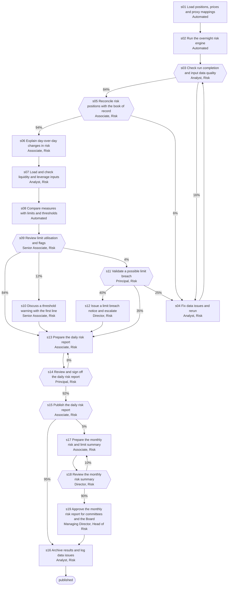

# Measure market, credit and leverage risk and monitor limits (daily risk run)

`pim-risk-market-limit-monitoring` · asset management (public pension fund investment) · risk management (second line) · part of `pension-investment-manager`

Every business day the total fund and market risk team, independent of the investment departments, measures how much the fund could lose and checks the result against Board and management limits. An overnight run in the risk platform calculates potential loss, the equity/debt risk ratio, active risk, credit value-at-risk and sensitivities; analysts then check data quality and fix gaps, associates reconcile positions to the book of record, explain why risk moved and verify the liquidity and leverage figures from Total Fund Management, and senior staff review limit use, talk to the first line about warnings and validate any possible breach before a director issues a breach notice. The daily report is reviewed and published, and at month end a summary goes to the Investment Risk Committee and quarterly to the Board. The work is slowed by data gaps, proxies for private holdings and waiting for upstream inputs.

| | |
|---|---|
| Unit of work | one daily risk run |
| Starts when | The daily valuation and positions are final, together with the liquidity forecast from Total Fund Management and the current strategic targets and limits. |
| Done when | The daily risk report is reviewed and published, any breach has been notified, results and data issues are archived, and on month end the summary has gone to committees. |
| Organisation | A national pension fund manager of about C$540 billion whose Risk group reports to the Chief Financial and Risk Officer and independently monitors Board limits cascaded to department-level limits. (2,052 employees, 2019-2022) |
| Volume | 21 cases a month (range 20 to 23) |

## Where it sits

- Starts with **net_asset_value** from io-price-daily-nav (70% of cases)
- Starts with **liquidity_forecast** from tf-liquidity-forecast (20% of cases)
- Starts with **strategic_portfolio** from tf-strategic-portfolio-design (10% of cases)
- Sends **risk_report** to tf-leverage-management (outcome: published)
- Sends **risk_report** to risk-stress-testing (outcome: published)
- Sends **risk_report** to ex-board-reporting (outcome: any)
- Sends **limit_breach_notice** to risk-limit-breach-escalation (outcome: any)

## Flow

## Roles

| Role | Department | Layer | FTE on this process | Loaded cost per hour | Evidence |
|---|---|---|---:|---:|---|
| Analyst, Risk | Finance, Analytics and Risk - Risk | individual contributor | 0.4 | 100 CAD | C [ar22], [jb11101] |
| Associate, Risk | Finance, Analytics and Risk - Risk | individual contributor | 0.6 | 141 CAD | C [ar22], [jb11101] |
| Senior Associate, Risk | Finance, Analytics and Risk - Risk | senior specialist | 0.25 | 267 CAD | C [ar22] |
| Principal, Risk | Finance, Analytics and Risk - Risk | supervisor | 0.15 | 467 CAD | C [ar22] |
| Director, Risk | Finance, Analytics and Risk - Risk | manager | 0.06 | 739 CAD | C [ar22], [is25] |
| Managing Director, Head of Risk | Finance, Analytics and Risk - Risk | director | 0.02 | 1246 CAD | C [ar22], [is25] |

## Steps

Hands-on time and the wait before each step show the most common value. Evidence tier A is a sourced number, B a sourced description, C the author's estimate.

| Step | Who | Kind | Hands-on | Wait before | Control | Evidence |
|---|---|---|---:|---:|---|---|
| **s01 Load positions, prices and proxy mappings.** After the daily valuation is final, a scheduled job loads positions and valuations from the book of record, market data histories and the mappings that represent private holdings by public market proxies into the risk platform. | Automated | system auto | 0 min | 45 min |  | B [ar21], [bcbs239] |
| **s02 Run the overnight risk engine.** The risk platform calculates one-year and five-year potential loss, the equity/debt risk ratio, active risk, credit value-at-risk, sensitivities to equity, rates, spreads and currency, and leverage measures by account, pool, department and program. | Automated | system auto | 0 min | 1.0 h |  | A [ar22] |
| **s03 Check run completion and input data quality.** The analyst checks that every portfolio ran, that position counts and market values match the valuation, that no price series is stale or missing, and that day-over-day jumps in measures have a plausible cause. Problems are logged before anyone uses the numbers. | Analyst, Risk | validation | 40 min | 45 min | Data, model and user-developed application controls maintained by Finance, Analytics and Risk under the Integrated Risk Framework | B [ar21], [bcbs239] |
| **s04 Fix data issues and rerun.** The analyst asks investment data operations or risk technology to correct the security master entry, price history or proxy mapping, or applies an approved temporary proxy, and reruns the affected portfolios. | Analyst, Risk | coordination | 40 min | 1.0 h |  | C |
| **s05 Reconcile risk positions with the book of record.** The associate ties total market value and exposures by account and department in the risk platform to the daily valuation and the book of record, within tolerance, and follows up any portfolio that does not tie. | Associate, Risk | validation | 30 min | 15 min | Reconciliation of risk system positions to the book of record before reporting | C |
| **s06 Explain day-over-day changes in risk.** The associate attributes the change in potential loss and key exposures since yesterday to market moves, trades, new private investments, flows and any model or proxy change, so the report can say why risk moved. | Associate, Risk | analysis | 45 min | 10 min |  | B [ar21] |
| **s07 Load and check liquidity and leverage inputs.** The analyst loads the liquidity coverage ratio, liquidity buffer and recourse leverage figures that Total Fund Management publishes, checks them against the risk platform's own positions and questions anything that does not agree. | Analyst, Risk | validation | 15 min | 1.0 h | Independent second line verification of first line liquidity and leverage measures | B [ar22], [is25] |
| **s08 Compare measures with limits and thresholds.** The risk platform compares each measure with Board limits and the management-level limits and thresholds cascaded to departments, and produces a utilisation table with flags for measures near or over a level. | Automated | system auto | 0 min | 5 min | Board-approved Integrated Risk Policy limits and management-level limits and thresholds | A [ar22], [ar21], [is25] |
| **s09 Review limit utilisation and flags.** The senior associate reads the utilisation table, separates real exposure changes from data artefacts and decides whether any flag needs a conversation with the first line or a breach check. | Senior Associate, Risk | review | 30 min | 20 min |  | B [ar22] |
| **s10 Discuss a threshold warning with the first line.** The senior associate contacts the department or TFM risk owner about a measure near its threshold, records their explanation and planned action, and adds the commentary to the report. | Senior Associate, Risk | communication | 30 min | 1.0 h |  | B [ar22], [iia20] |
| **s11 Validate a possible limit breach.** A principal reruns the measure with corrected data if needed, checks the methodology and proxies behind it and confirms the position with the first line before anything is declared a breach. | Principal, Risk | analysis | 1.0 h | 30 min |  | C |
| **s12 Issue a limit breach notice and escalate.** A risk director issues the breach notice to the accountable department head and the CIO, informs the CFRO and, for a Board limit, prepares the escalation to the CEO and the Board committee set out in the Risk Policy. | Director, Risk | communication | 45 min | 1.0 h | Breach treatment and escalation procedures in the Integrated Risk Policy (Investment Statement section 9.11) | B [is25], [ar22] |
| **s13 Prepare the daily risk report.** The associate assembles the daily report: limit utilisation, potential loss by account and department, key sensitivities, liquidity and leverage, drivers of change and any threshold or breach commentary. | Associate, Risk | drafting | 45 min | 15 min |  | B [ar22], [ar20] |
| **s14 Review and sign off the daily risk report.** A principal checks the figures against the utilisation table, reads the commentary and signs off the report, or sends it back for corrections. | Principal, Risk | review | 20 min | 30 min | Four-eyes review of risk reports before distribution | C |
| **s15 Publish the daily risk report.** The associate distributes the report to TFM, the investment departments, the CFRO and risk leadership and posts it to the shared risk site. | Associate, Risk | communication | 10 min | 10 min |  | B [ar22] |
| **s16 Archive results and log data issues.** The analyst saves the day's measures and report, logs data issues, temporary proxies and reruns, and updates the open-issues list for the data and technology teams. | Analyst, Risk | drafting | 15 min | 15 min |  | C |
| **s17 Prepare the monthly risk and limit summary.** At month end the associate compiles the month's limit utilisation, breaches and remediation, potential loss trends and stress results into the summary for the Investment Risk Committee and, each quarter, the Board's Risk Committee. | Associate, Risk | drafting | 4.0 h | 4.0 h |  | B [ar22], [ar20] |
| **s18 Review the monthly risk summary.** A risk director reviews the summary for accuracy and messaging, checks that every breach and threshold event is explained and sends it back if needed. | Director, Risk | review | 1.0 h | 1.0 d |  | C |
| **s19 Approve the monthly risk report for committees and the Board.** The Head of Risk approves the summary, adds the overall view and submits it to the Investment Risk Committee and, at quarter end, to the Board package. | Managing Director, Head of Risk | approval | 40 min | 1.0 d | Management reports total risk and limit use to the Board at least quarterly (Investment Statement section 9.10) | B [is25], [ar22] |

## Exceptions

| Exception | Share of cases | What happens |
|---|---:|---|
| Data issue or failed job | 16% | Missing prices, positions or proxy mappings, or a failed job, force a fix and rerun before measures can be used. |
| Positions do not tie to the book of record | 6% | Risk platform totals differ from the valuation beyond tolerance and the cause must be found and rerun. |
| Threshold warning | 12% | A department or fund measure nears its management threshold; Risk records the first line's explanation and planned action. |
| Possible or confirmed limit breach | 4% | A measure appears over a limit; a principal validates it and, if confirmed, a director issues a breach notice that starts the breach escalation process. |
| Month-end committee reporting | 5% | On the last business day of the month the team also prepares, reviews and approves the monthly risk summary for the Investment Risk Committee and, quarterly, the Board. |

## Benchmarks

| Metric | Value | Unit | Population | Evidence |
|---|---|---|---|---|
| cycle_time_days | p50 0.5, p90 0.8 | calendar days from final daily valuation to published and archived daily risk report | Daily risk runs at a large pension fund manager | C [ar22] |
| one_year_potential_loss_base_plan | F2022 0.18, F2021 0.18, limit 0.2 | share of base plan investment value, 19 times out of 20 | This organisation | A [ar22] |
| market_risk_limit_equity_debt_ratio | base_cpp 80-90%, additional_cpp 50-60% | equity share of equivalent two-asset portfolio | This organisation, F2022 | A [ar22] |
| active_risk_limit | 450 | basis points | This organisation, F2022 | A [ar22] |
| tfm_share_of_one_year_potential_loss_base_plan | 0.3 | share of total, F2021 | This organisation | A [ar21] |

## Pain points

- Risk numbers depend on overnight positions, price histories and proxy mappings for private holdings; gaps force reruns and temporary proxies that can linger. (steps s01, s03, s04; B [ar21], [bcbs239])
- The report waits for the liquidity and leverage figures that Total Fund Management publishes late morning. (steps s07; C)
- Limit registers, attribution and reports are partly assembled in spreadsheets, so figures are checked twice and stale numbers can slip into reports. (steps s06, s13, s14; C)
- The cascade of Board limits to department-level limits and thresholds multiplied the number of measures to check and explain each day. (steps s08, s09, s10; B [ar21], [ar22])

## Assumptions

- The process covers the daily run and the month-end summary; annual limit calibration, stress testing and model validation are separate processes.
- Threshold warnings on about 12% of days and possible breaches on about 4% are estimates; the organisation reports remaining within all Board limits, so most breaches are of management-level limits or thresholds.
- The liquidity and leverage check is shown as running alongside the change attribution; the simulation treats it as sequential with a shortened wait.
- fte_on_process covers only the daily cycle; the 30-person total fund and market risk team also runs stress tests, model work, transaction reviews and projects.
- Loaded hourly costs come from the organisation file and include large incentive pay.
- Web search capacity ran out during research, so practitioner material on risk data quality could not be opened beyond the BCBS 239 summary page; affected steps are tier C.

## Sources

- [ar22] The model fund F2022 Annual Report (fiscal year ended March 31, 2022) (link withheld) (The model fund, 2022). Integrated Risk Policy approved by the Board at least annually with risk limits, statements and targets; potential investment losses monitored daily and reported to the Board at least quarterly; Risk independently measures and monitors compliance with all limits; suite of measures including one-year potential loss (19 times out of 20), five-year potential loss, active risk, equity/debt risk ratio (limit 80-90% base plan, 50-60% additional plan), active risk limit 450 bps, credit value-at-risk, stress scenarios and model validation; Investment Risk Committee chaired by the CFRO monitors risk exposures; F2022 expanded investment risk limits and thresholds; remained within all Board limits
- [ar21] The model fund F2021 Annual Report (fiscal year ended March 31, 2021) (link withheld) (The model fund, 2021). Board limits cascaded to management-level limits for each investment department in F2021, with more granular limits and thresholds planned for F2022; new risk limits framework with a process to systematically calculate measures on a timely basis; roadmap to modernise risk technology and data; one-year potential loss by department (TFM C$30.6 billion of C$89.0 billion for base plan); Risk develops, measures and monitors compliance with all approved limits
- [ar20] The model fund 2020 Annual Report (link withheld) (The model fund, 2020). Risk Policy approved annually formalises risk constraints, measures and Absolute Risk Operating Ranges in equity/debt terms; Risk group independently provides standard risk metrics, sensitivity tests and stress scenarios to the Board, senior management and the Investment Planning Committee; the management committee received risk information weekly and reviewed portfolio risks at least monthly; Long-Term Risk model uses conditional value-at-risk over five years
- [is25] Statement of Investment Objectives, Policies, Return Expectations and Risk Management for the Investment Portfolios of the Base plan and the Additional plan (effective April 2, 2025) (link withheld) (The model fund, 2025). Board approves market risk limits in equity/debt and absolute potential loss (value-at-risk) terms and liquidity and leverage limits annually; limits wide enough for normal daily variation; variation outside limits needs prior Board approval except de minimis variances approved by the CEO; management monitors market, credit, liquidity and leverage risks daily; management-level limits and thresholds reported to the Board at least quarterly; breach treatment and escalation in the Risk Policy
- [bcbs239] [Principles for effective risk data aggregation and risk reporting (BCBS 239)](https://www.bis.org/publ/bcbs239.htm) (Basel Committee on Banking Supervision, 2013). Financial institutions in the crisis were unable to aggregate risk exposures and identify concentrations fully, quickly and accurately; principles aim to strengthen risk data aggregation and internal risk reporting
- [iia20] [The IIA's Three Lines Model: An update of the Three Lines of Defense](https://www.theiia.org/en/content/position-papers/2020/the-iias-three-lines-model-an-update-of-the-three-lines-of-defense/) (The Institute of Internal Auditors, 2020). Three lines model of how organisational roles work together for governance and risk management
- [jb11101] [Wages: Financial Analyst (NOC 11101) in Canada](https://www.jobbank.gc.ca/marketreport/wages-occupation/12417/ca) (Job Bank, Government of Canada, 2025). Canada and Ontario hourly wages for NOC 11101: low 28.21, median 43.27, high 72.36 (2023-2024)

Written by claude-opus on 2026-11-17.
