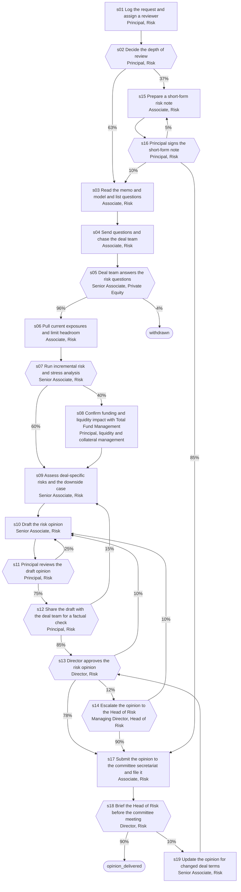

# Give an independent risk view on proposed transactions (one transaction reviewed)

`pim-risk-transaction-review` · pension fund investment management · investment risk oversight · part of `pension-investment-manager`

Before the Portfolio Execution Committee decides on a new private investment, follow-on, fund commitment, manager engagement or exit, the Risk group, independent of the investment departments, gives the committee its own view of what the deal adds to the fund's market, credit, liquidity, leverage and concentration risk. A principal triages each memo; for most new deals an associate and senior associate question the deal team, measure the deal's contribution to potential loss and limits, judge the downside case and draft an opinion that a principal and director approve, while routine items get a one-page note. The work runs on the deal team's bid timetable, so it is squeezed by late memos, slow answers to questions and deal terms that change after the opinion is written.

| | |
|---|---|
| Unit of work | one transaction reviewed |
| Starts when | A deal team or the committee secretariat sends Risk a draft investment memo or exit proposal that will go to the Portfolio Execution Committee. |
| Done when | An approved risk opinion or short-form note is in the committee package and the Head of Risk is briefed, or the deal is withdrawn before the opinion is finished. |
| Organisation | A Canadian national pension fund investment manager with about 2,000 employees investing most private assets directly through internal teams, with a second-line Risk group reporting to the CFRO. (2,052 employees, 2019-2022) |
| Volume | 45 cases a month (range 30 to 65) |

## Where it sits

- Starts with **investment_memo** from pe-direct-due-diligence (24% of cases)
- Starts with **investment_memo** from ra-due-diligence (23% of cases)
- Starts with **investment_memo** from ci-credit-underwriting (18% of cases)
- Starts with **investment_memo** from ae-ri-source-diligence (5% of cases)
- Starts with **investment_memo** from pe-fund-selection-commitment (10% of cases)
- Starts with **investment_memo** from pe-secondaries (3% of cases)
- Starts with **investment_memo** from pe-gp-co-invest (6% of cases)
- Starts with **investment_memo** from cmf-select-external-managers (2% of cases)
- Starts with **exit_proposal** from pe-exits (5% of cases)
- Starts with **exit_proposal** from ra-exits (4% of cases)
- Relies on **risk_report** from risk-market-limit-monitoring (a standing input; it does not start a case)
- Sends **risk_opinion** to tf-pec-approval (outcome: opinion_delivered)

## Flow

## Roles

| Role | Department | Layer | FTE on this process | Loaded cost per hour | Evidence |
|---|---|---|---:|---:|---|
| Principal, Risk | Finance, Analytics and Risk - Risk | supervisor | 1 | 467 CAD | C [src9] |
| Associate, Risk | Finance, Analytics and Risk - Risk | individual contributor | 1.8 | 141 CAD | C |
| Senior Associate, Risk | Finance, Analytics and Risk - Risk | senior specialist | 3.6 | 267 CAD | C |
| Director, Risk | Finance, Analytics and Risk - Risk | manager | 0.4 | 739 CAD | C |
| Managing Director, Head of Risk | Finance, Analytics and Risk - Risk | director | 0.03 | 1246 CAD | C |
| Senior Associate, Private Equity | Private Equity | senior specialist | 0.45 | 293 CAD | C |
| Principal, liquidity and collateral management | Total Fund Management - Balancing, liquidity and collateral (treasury) | supervisor | 0.05 | 540 CAD | C |

## Steps

Hands-on time and the wait before each step show the most common value. Evidence tier A is a sourced number, B a sourced description, C the author's estimate.

| Step | Who | Kind | Hands-on | Wait before | Control | Evidence |
|---|---|---|---:|---:|---|---|
| **s01 Log the request and assign a reviewer.** A Risk principal receives the draft investment memo, model and term sheet from the deal team or the committee secretariat, logs it in the transaction tracker with the target committee date and any bid deadline, and assigns the associate and senior associate who cover that department. | Principal, Risk | intake | 15 min | 2.0 h |  | B [src1], [src2] |
| **s02 Decide the depth of review.** The principal compares the deal size, type and risk with the Risk Policy thresholds and recent opinions: new direct investments, large commitments and leveraged or concentrated deals get a full opinion, while small follow-ons, routine fund commitments and most exits get a short-form note. | Principal, Risk | judgment | 20 min | 1.0 h | Risk Policy and management authorities: independent risk guidance required for transactions going to the Portfolio Execution Committee | C [src2] |
| **s03 Read the memo and model and list questions.** The Risk associate reads the memo, the base and downside cases in the model, the capital structure, the partner and governance terms and the diligence findings, and writes a list of questions on assumptions, leverage, exit routes and data gaps. | Associate, Risk | analysis | 3.0 h | 4.0 h |  | C |
| **s04 Send questions and chase the deal team.** The associate emails the question list to the deal team's senior associate, agrees a time to walk through the model, and follows up when answers are late against the committee date. | Associate, Risk | communication | 40 min | 30 min |  | C |
| **s05 Deal team answers the risk questions.** A deal team senior associate pulls answers from the model, the data room and advisers' reports, adds sensitivity runs where asked, and replies to Risk; deal work for the bid usually takes priority, so answers queue. | Senior Associate, Private Equity | drafting | 1.5 h | 16.0 h |  | B [src8] |
| **s06 Pull current exposures and limit headroom.** The associate pulls from the risk platform the department's risk budget use, its contribution to total fund potential loss, and existing exposure to the same company, sector, country and currency across all departments, and checks the deal against the 10% single-entity limit and the leverage and liquidity limits. | Associate, Risk | lookup | 1.5 h | 1.0 h | The model fund Regulations s. 11(1): no more than 10% of book value of assets in one person or associated persons; s. 13(1) 30% voting limit | A [src5], [src1] |
| **s07 Run incremental risk and stress analysis.** A senior associate maps the deal to proxy risk factors, runs its incremental contribution to one-year potential loss and to the department's risk budget, applies the standard stress scenarios and credit loss measures, and records the non-recourse leverage and unfunded commitments it adds. | Senior Associate, Risk | analysis | 4.0 h | 6.0 h |  | B [src1], [src3] |
| **s08 Confirm funding and liquidity impact with Total Fund Management.** For large deals the senior associate asks the liquidity and collateral principal whether funding the deal, its unfunded commitments and any guarantees keep the liquidity coverage and leverage within limits over the forecast horizon, and records the answer. | Principal, liquidity and collateral management | lookup | 30 min | 8.0 h | Investment Statement s. 9.5: Board-approved liquidity and leverage limits | B [src4], [src1] |
| **s09 Assess deal-specific risks and the downside case.** The senior associate judges the deal's own risks: leverage and covenant headroom at the asset, sensitivity of returns to key assumptions, exit and liquidity risk, partner and governance protections, currency, and climate or ESG flags raised in diligence, and compares them with similar past deals. | Senior Associate, Risk | analysis | 3.0 h | 1.0 h |  | B [src1] |
| **s10 Draft the risk opinion.** The senior associate writes a two to four page opinion: an overall view (supportive, supportive with conditions, or not supportive), the main risks and mitigants, the effect on department and total fund limits, and recommended conditions such as leverage caps or monitoring triggers. | Senior Associate, Risk | drafting | 3.0 h | 1.0 h |  | C |
| **s11 Principal reviews the draft opinion.** The principal checks the analysis and proxies, challenges the conclusions and wording, and either clears the draft or returns it with comments. | Principal, Risk | review | 1.0 h | 6.0 h | Four-eyes review within Risk: the reviewer is not the drafter | C |
| **s12 Share the draft with the deal team for a factual check.** The principal sends the draft to the deal team lead or walks it through on a call so factual errors are corrected before committee; if the deal team changes price, structure or leverage in response, Risk reassesses. | Principal, Risk | communication | 45 min | 6.0 h |  | C |
| **s13 Director approves the risk opinion.** The Risk director responsible for the department reads the opinion and its support, confirms the overall view and conditions, and approves it for the committee or sends it back; contested or limit-breaching views go to the Head of Risk. | Director, Risk | approval | 40 min | 8.0 h | Risk Policy: second-line opinion approved at director level before submission to the Portfolio Execution Committee | B [src1], [src2] |
| **s14 Escalate the opinion to the Head of Risk.** The Managing Director, Head of Risk reviews opinions that are not supportive, take a department or total fund limit close to its threshold, or go to the Board committee, discusses them with the department head if needed and signs the final view. | Managing Director, Head of Risk | approval | 45 min | 12.0 h | Risk Policy escalation of significant risk views; Investment Statement s. 9.9 Board-level transactions | B [src4], [src6] |
| **s15 Prepare a short-form risk note.** For routine items the associate pulls the exposure and limit headroom summary, notes any concentration or leverage effect and writes a one-page note confirming the item is within limits and naming any points for the committee. | Associate, Risk | drafting | 2.0 h | 8.0 h |  | C |
| **s16 Principal signs the short-form note.** The principal checks the note against the memo and the exposure summary and signs it, returns it for correction, or upgrades the item to a full opinion if the risk is larger than it looked at triage. | Principal, Risk | approval | 30 min | 6.0 h | Four-eyes review within Risk on short-form notes | C |
| **s17 Submit the opinion to the committee secretariat and file it.** The associate saves the final opinion or note in the memo repository, sends it to the Total Fund Management secretariat for the committee pre-read package, and records the conditions recommended so they can be followed after approval. | Associate, Risk | communication | 20 min | 30 min |  | B [src7] |
| **s18 Brief the Head of Risk before the committee meeting.** The director briefs the Head of Risk, who sits on the Portfolio Execution Committee, on the opinion's main points and open issues so the risk view can be given at the meeting. | Director, Risk | communication | 20 min | 4.0 h |  | B [src1] |
| **s19 Update the opinion for changed deal terms.** When price, structure, leverage or partner terms change after the opinion, the senior associate reruns the affected analysis, revises the opinion and sends it back for director approval before the meeting. | Senior Associate, Risk | drafting | 2.0 h | 12.0 h |  | B [src8] |

## Exceptions

| Exception | Share of cases | What happens |
|---|---:|---|
| Deal withdrawn or lost during review | 4% | The deal team drops the deal or loses the auction while Risk is waiting for answers, and the review stops. |
| Deal terms change after the draft | 15% | The factual check or late bid negotiations change price, structure or leverage, and Risk reassesses before approval. |
| Contested or limit-impacting opinion | 8% | The view is not supportive, the deal takes a limit near its threshold, or the item goes to the Board committee, so the Head of Risk signs. |
| Short-form item upgraded | 4% | A routine item turns out larger or riskier than it looked at triage and is moved to the full opinion path. |
| Terms change after the opinion is submitted | 10% | The final bid or structure changes before the meeting and the opinion is updated and re-approved. |
| Large deal needs a liquidity check | 25% | Funding, unfunded commitments or guarantees are large enough that Total Fund Management confirms the liquidity and leverage impact. |

## Benchmarks

| Metric | Value | Unit | Population | Evidence |
|---|---|---|---|---|
| cycle_time_days | p50 5, p90 10 | calendar days from memo received by Risk to opinion delivered and Head of Risk briefed | Transactions submitted to the investment committee of a large Canadian pension investment manager | C [src8] |
| department_one_year_potential_loss | private_equity 41, real_assets 25, credit_investments 8 | C$ billions, fiscal 2022 | The model fund departments | A [src1] |
| single_entity_limit | 0.1 | share of total book value of assets in one person or associated persons | The model fund Regulations | A [src5] |
| recourse_leverage_limit | 0.45 | share of net assets, effective April 1, 2022 | The model fund | A [src1] |

## Pain points

- Memos reach Risk late in the deal timetable, so the analysis and approvals are compressed into a few days before the committee. (steps s01, s07, s13; B [src8])
- Answers from deal teams wait behind bid work and are the longest single wait in a full review. (steps s05; C)
- Private deals have to be mapped to public-market proxies to measure their risk contribution, and a poor proxy can understate risk. (steps s07; B [src1])
- Exposures to the same company or sector held through other departments or funds are hard to see in one place. (steps s06, s15; B [src7])
- Terms that change after the opinion force reruns and a second approval close to the meeting. (steps s12, s19; C)

## Assumptions

- The opinion is modelled as starting when Risk receives the draft memo; informal early engagement during diligence is not counted as a case.
- The private equity senior associate role stands in for deal team members of every investment department who answer Risk's questions; their time is small and also appears in the departments' diligence workflows.
- The 63% full and 37% short-form split, approval levels and rework shares are estimates; the organisation does not publish its Risk Policy or opinion thresholds.
- Trigger shares copy the committee workflow's split of items by source so the two workflows agree.
- The daily risk report is a standing input for exposures and limit use and does not start a case.
- Risk roles sit in the organisation file's Risk unit; the process owner is the Investment risk oversight team of about 25 people, so the stated 7 FTE of Risk staff fits within that team alongside its other oversight work.
- Loaded hourly costs come from the organisation file (overhead factor 1.25), which are far above Job Bank market medians because incentive pay is large.

## Sources

- [src1] The model fund F2022 Annual Report (fiscal year ended March 31, 2022) (link withheld) (The model fund, 2022). Three lines of defence: the Risk group independently challenges the first line and measures compliance with limits; Risk reports to the CFRO; PEC chaired by the CIO reviews new investments, dispositions and follow-ons; IRC chaired by the CFRO; one-year potential loss by department (PE C$41 billion, RA C$25 billion, CI C$8 billion); regular stress scenarios (GFC repeat about 15%, severe stress about 21%); credit risk as permanent loss; liquidity and leverage definitions and the 45% recourse leverage limit. Read from a text copy saved under scratch/ar22.txt.
- [src2] The model fund F2021 Annual Report (fiscal year ended March 31, 2021) (link withheld) (The model fund, 2021). The ISRC and its subcommittees are required to consider formal guidance or recommendations on certain matters so that approval bodies factor in diverse perspectives. Read from a text copy saved under scratch/ar21.txt.
- [src3] The model fund 2020 Annual Report (link withheld) (The model fund, 2020). The Risk group independently provides standard risk metrics and supplementary risk assessments, including sensitivity tests and stress scenarios, to the Board, senior management and the investment committee. Read from a text copy saved under scratch/ar20.txt.
- [src4] Statement of Investment Objectives, Policies, Return Expectations and Risk Management for the Investment Portfolios of the Base plan and the Additional plan (effective April 2, 2025) (link withheld) (The model fund, 2025). s. 9.5 Board-approved liquidity and leverage limits; s. 9.9 transactions above Board dollar limits need Investment Strategy Committee approval; s. 9.10 management-level limits and thresholds reported to the Board at least quarterly; s. 9.11 breach and escalation procedures in the Risk Policy. Read from a text copy saved by earlier work under scratch/pim-tf-balancing-rebalance/is.txt; effective date after the reference period.
- [src5] The model fund Regulations (SOR/99-190) (link withheld) (Justice Laws Website, Government of Canada, 2024). s. 11(1) no more than 10% of the total book value of assets in the securities of any one person or associated persons, with exceptions in s. 11(2); s. 13(1) no more than 30% of the votes to elect directors of a corporation, except subsidiaries.
- [src6] Terms of Reference for the Investment Strategy Committee (June 22, 2022) (link withheld) (The model fund, 2022). The Board committee approves Investment Transactions as provided by the Authorities Policy and receives reports on implementation of the Investment Statements and Risk Policy. Read from a text copy saved by earlier work under scratch/pim-pe-direct-due-diligence/dl_isc/isc.txt.
- [src7] [Investment-decision process (Twenty-four ways to classify private equity firms)](https://umbrex.com/resources/twenty-four-ways-to-classify-private-equity-firms/investment-decision-process/) (Umbrex, 2024). Investment committee models and tiered gates (pre-IC, interim IC, final IC); materials pre-circulated before meetings; pod-based committees can miss portfolio-level concentration risk.
- [src8] [Sell-side M&A process](https://www.wallstreetprep.com/knowledge/sell-side-process/) (Wall Street Prep, 2024). Auction round 2 lasts 4 to 6 weeks with management meetings, data room diligence and a draft agreement, ending with final bids.
- [src9] [Wages: Financial Analyst (NOC 11101) in Canada](https://www.jobbank.gc.ca/marketreport/wages-occupation/12417/ca) (Job Bank, Government of Canada, 2025). NOC 11101 hourly wages in Canada: low C$28.21, median C$43.27, high C$72.36 (2023-2024).

Written by claude-opus on 2026-11-17.
