# Rebalance the Balancing Portfolio to target exposures (daily review)

`pim-tf-balancing-rebalance` · asset management (public pension fund investment) · total fund management · part of `pension-investment-manager`

Every trading day the Balancing Portfolio Management team checks whether the whole fund still has the exposures it is meant to have once all active programs are counted, and trades a completion portfolio of public securities to close the gaps. The morning starts with an overnight exposure aggregation that analysts must check for data gaps, then associates measure drift against targets and ranges, a senior associate decides whether and how far to trade, and trade lists pass a liquidity check, a four-eyes review and, for large moves, director or group head approval before going to the central trading desk. Elapsed time is driven by the overnight batch, data fixes, approvals and execution through the session; errors come mostly from data gaps, private-asset proxies and re-keying spreadsheets into the order system. Large private fundings and market shocks force unplanned rebalancing.

| | |
|---|---|
| Unit of work | one trading day's rebalancing review |
| Starts when | The daily fund valuation and positions are available after the overnight batch, together with the liquidity forecast and any remediation plan from Risk. |
| Done when | Either rebalancing trades are executed, reconciled and the daily log signed off, or a no-trade decision is recorded with the exposure summary. |
| Organisation | A national pension fund manager of about C$540 billion that runs a public-market Balancing Portfolio of about C$228 billion to complete the exposures of its active programs. (2,052 employees, 2019-2022) |
| Volume | 21 cases a month (range 20 to 23) |

## Where it sits

- Starts with **net_asset_value** from io-price-daily-nav (80% of cases)
- Starts with **liquidity_forecast** from tf-liquidity-forecast (12% of cases)
- Starts with **department_mandate** from tf-capital-allocation (5% of cases)
- Starts with **remediation_plan** from risk-limit-breach-escalation (3% of cases)
- Sends **rebalancing_trade_list** to mkt-order-capture (outcome: rebalanced)
- Sends **rebalancing_trade_list** to ci-public-credit-decisions (outcome: rebalanced)

## Flow

```mermaid
flowchart TD
    s01["s01 Aggregate overnight exposures<br/>Automated"]
    s02{{"s02 Check exposure data quality<br/>Analyst, Total Fund Management"}}
    s03["s03 Chase data fixes and rerun exposures<br/>Analyst, Total Fund Management"]
    s04["s04 Gather known cash flows and planned trades<br/>Analyst, Total Fund Management"]
    s05["s05 Compare exposures with targets and ranges<br/>Associate, Total Fund Management"]
    s06{{"s06 Decide whether and how far to rebalance<br/>Senior Associate, Total Fund Management"}}
    s07{{"s07 Choose instruments and timing<br/>Senior Associate, Total Fund Management"}}
    s08["s08 Give market colour and cost estimate<br/>Trader, global trading and execution"]
    s09["s09 Build the trade list and post-trade exposures<br/>Associate, Total Fund Management"]
    s10{{"s10 Confirm cash, margin and collateral capacity<br/>Principal, liquidity and collateral management"}}
    s11{{"s11 Review the trade list<br/>Principal, Total Fund Management"}}
    s12{{"s12 Approve large or non-routine rebalancing<br/>Director, Total Fund Management"}}
    s13{{"s13 Approve very large rebalancing and brief the CIO<br/>Managing Director, TFM group head"}}
    s14["s14 Send the credit leg to Public Credit<br/>Associate, Total Fund Management"]
    s15["s15 Stage orders in the order management system<br/>Associate, Total Fund Management"]
    s16{{"s16 Run pre-trade compliance checks<br/>Automated"}}
    s17{{"s17 Resolve a compliance alert<br/>Senior Associate, Total Fund Management"}}
    s18["s18 Accept orders and agree the execution approach<br/>Trader, global trading and execution"]
    s19{{"s19 Monitor fills and intraday exposures<br/>Associate, Total Fund Management"}}
    s20["s20 Reconcile executions and update post-trade exposures<br/>Associate, Total Fund Management"]
    s21["s21 Publish the daily exposure and rebalancing summary<br/>Associate, Total Fund Management"]
    s22["s22 Sign off the daily balancing log<br/>Principal, Total Fund Management"]
    s23["s23 Escalate an exposure outside threshold and agree remediation<br/>Director, Total Fund Management"]
    s24["s24 Record a no-trade decision and circulate the exposure summary<br/>Associate, Total Fund Management"]
    s01 --> s02
    s02 -->|"88%"| s04
    s02 -->|"12%"| s03
    s03 --> s02
    s04 --> s05
    s05 --> s06
    s06 -->|"72%"| s07
    s06 -->|"25%"| s24
    s06 -->|"3%"| s23
    s07 -->|"40%"| s08
    s07 -->|"60%"| s09
    s08 --> s09
    s09 --> s10
    s10 -->|"93%"| s11
    s10 -->|"7%"| s09
    s11 -->|"56%"| s15
    s11 -->|"22%"| s12
    s11 -->|"14%"| s14
    s11 -->|"8%"| s09
    s12 -->|"66%"| s15
    s12 -->|"17%"| s14
    s12 -->|"12%"| s13
    s12 -->|"5%"| s09
    s13 -->|"75%"| s15
    s13 -->|"20%"| s14
    s13 -->|"5%"| s09
    s14 --> s15
    s15 --> s16
    s16 -->|"96%"| s18
    s16 -->|"4%"| s17
    s17 -->|"70%"| s15
    s17 -->|"30%"| s18
    s18 --> s19
    s19 -->|"92%"| s20
    s19 -->|"8%"| s09
    s20 --> s21
    s21 --> s22
    s22 --> end0
    s23 --> s07
    s24 --> end1
    end0(["rebalanced"])
    end1(["no_trade"])
```

## Roles

| Role | Department | Layer | FTE on this process | Loaded cost per hour | Evidence |
|---|---|---|---:|---:|---|
| Analyst, Total Fund Management | Total Fund Management | individual contributor | 0.35 | 104 CAD | C [ar21], [jb11101] |
| Associate, Total Fund Management | Total Fund Management | individual contributor | 0.9 | 155 CAD | C [ar21], [jb11101] |
| Senior Associate, Total Fund Management | Total Fund Management | senior specialist | 0.45 | 293 CAD | C [ar21] |
| Principal, Total Fund Management | Total Fund Management | supervisor | 0.25 | 571 CAD | C [ar21] |
| Director, Total Fund Management | Total Fund Management | manager | 0.1 | 1080 CAD | C [ar21] |
| Managing Director, TFM group head | Total Fund Management | director | 0.03 | 1662 CAD | C [ar21] |
| Principal, liquidity and collateral management | Total Fund Management - Balancing, liquidity and collateral (treasury) | supervisor | 0.08 | 540 CAD | C [ar21], [is25] |
| Trader, global trading and execution | Financing, Collateral and Trading - Global trading and execution | senior specialist | 0.12 | 373 CAD | C [ar21] |

## Steps

Hands-on time and the wait before each step show the most common value. Evidence tier A is a sourced number, B a sourced description, C the author's estimate.

| Step | Who | Kind | Hands-on | Wait before | Control | Evidence |
|---|---|---|---:|---:|---|---|
| **s01 Aggregate overnight exposures.** After the daily fund valuation lands, a scheduled job in the enterprise data platform combines active program and Balancing Portfolio positions and maps them to factor, currency, region and credit exposures for the base and additional plan accounts and the Core Pool. Private holdings are mapped through proxies. The output is a set of exposure tables and a dashboard for the morning review. | Automated | system auto | 0 min | 45 min |  | B [ar21], [ar22] |
| **s02 Check exposure data quality.** The analyst opens the exposure dashboard and checks that all portfolios loaded, compares totals with the prior day and the daily valuation, and looks for large unexplained moves, stale prices and private holdings without a current proxy. Anything that does not tie out is logged for a fix before the numbers are used. | Analyst, Total Fund Management | validation | 35 min | 1.2 h | Data and user-developed application controls maintained by Finance, Analytics and Risk and Technology and Data under the Integrated Risk Framework | B [ar21] |
| **s03 Chase data fixes and rerun exposures.** The analyst messages the pricing and data operations team or the risk technology support desk with the missing item, waits for a corrected price, position or mapping, and asks for the exposure job to be rerun. If a fix cannot come in time, the analyst applies a documented manual adjustment and flags it in the summary. | Analyst, Total Fund Management | coordination | 30 min | 45 min |  | C |
| **s04 Gather known cash flows and planned trades.** The analyst pulls the day's liquidity forecast, private closings and capital calls due in the next few days from the deal pipeline, plan transfer dates and any large trades active programs have flagged. These flows change exposures before markets move and decide whether cash must be raised or invested. | Analyst, Total Fund Management | lookup | 25 min | 10 min |  | B [ar21], [is25] |
| **s05 Compare exposures with targets and ranges.** The associate lines up the validated exposures and expected flows against current-year target exposures, the equity/debt risk target and the tolerance ranges for factors, currency, regions and credit. The spreadsheet shows the drift in each bucket in dollars and percentage points and the estimated cost to correct it. | Associate, Total Fund Management | analysis | 45 min | 10 min |  | B [ar21], [ar22] |
| **s06 Decide whether and how far to rebalance.** The senior associate reviews the drift analysis and decides whether today's drift and flows justify trading, how much of the gap to close and whether to spread trades over several days. The call weighs tracking against targets with transaction costs, market liquidity and what active programs are about to do. | Senior Associate, Total Fund Management | judgment | 30 min | 20 min |  | B [ar21], [nbim18], [nbim12] |
| **s07 Choose instruments and timing.** The senior associate chooses how to deliver the change: equity index or bond futures, total return swaps, ETFs or cash securities in the Balancing Portfolio blocks, and whether to trade at the open, through the day or at the close. The choice considers financing cost, margin, leverage use and how the trade affects the liquidity coverage ratio. | Senior Associate, Total Fund Management | judgment | 30 min | 5 min |  | B [ar21], [is25], [russell], [tai25] |
| **s08 Give market colour and cost estimate.** A trader on the central desk looks at market depth, futures roll calendars and recent volumes and replies with an estimated cost and a suggested execution approach, for example splitting a large futures order over two sessions or using an index swap with a dealer. | Trader, global trading and execution | communication | 15 min | 30 min |  | B [ar21] |
| **s09 Build the trade list and post-trade exposures.** The associate turns the plan into a trade list in the rebalancing spreadsheet: instrument, side, contract count or notional, account and pool, with currency legs. The sheet recalculates exposures, leverage and estimated margin after the trades so the reviewer can see the result. | Associate, Total Fund Management | drafting | 45 min | 15 min |  | C |
| **s10 Confirm cash, margin and collateral capacity.** The liquidity and collateral principal checks the draft list against the day's cash position, the liquidity forecast, initial margin needed for new futures and swap financing lines, and the collateral available. If the list would push the liquidity coverage ratio toward its floor or needs collateral that is not free, it goes back for resizing or a funding action. | Principal, liquidity and collateral management | validation | 15 min | 20 min | Board-approved liquidity risk limit and 10-day liquidity coverage ratio minimum of 1.0x in the Risk Policy | B [ar22], [is25] |
| **s11 Review the trade list.** A principal who did not build the list checks each line against the decision, the target ranges and the post-trade exposures, and confirms sizes are within the team's delegated trading authority. Errors or unclear rationale send the list back to the associate. | Principal, Total Fund Management | review | 20 min | 20 min | Four-eyes review of trade lists before release under TFM delegated trading authorities | C |
| **s12 Approve large or non-routine rebalancing.** A TFM director reviews rebalancing that exceeds the principal's delegated size, moves several exposures at once or follows a large private funding. The director checks the rationale, cost estimate and timing and approves by email or sends the list back. | Director, Total Fund Management | approval | 15 min | 1.0 h | Delegated investment and trading authorities under the Investment Statement and Investment Strategy and Risk Committee delegations | B [is25], [ar22] |
| **s13 Approve very large rebalancing and brief the CIO.** The TFM group head reviews a very large or unusual rebalancing, such as moving several billion dollars of equity exposure after a market shock, approves it and briefs the Chief Investment Officer, who may ask for the trade to be phased. | Managing Director, TFM group head | approval | 20 min | 2.0 h | Delegated authority escalation for large total fund exposure changes | C |
| **s14 Send the credit leg to Public Credit.** When the change includes credit exposure, the associate sends the credit amount, direction and timing to the Public Credit team, which manages the balancing credit portfolio and picks the bonds, credit ETFs or index products itself. | Associate, Total Fund Management | communication | 10 min | 5 min |  | B [ar21] |
| **s15 Stage orders in the order management system.** The associate enters or uploads the approved lines into the order management system, choosing account, instrument, side, quantity and instructions for the desk. This re-keys what is already in the spreadsheet, so quantities and accounts are checked again on screen. | Associate, Total Fund Management | data entry | 20 min | 10 min |  | C |
| **s16 Run pre-trade compliance checks.** The order management system tests each staged order against coded rules such as the restricted list, account and mandate permissions, position and concentration limits and fat finger size checks. Passing orders release to the desk blotter; breaches raise an alert. | Automated | system auto | 0 min | 1 min | Pre-trade compliance rules coded in the order management system (restricted list, mandate and size limits) | B [deloitte24] |
| **s17 Resolve a compliance alert.** The senior associate reads the alert, decides whether the order is wrong or the rule is too tight for a futures position, and either amends the order or asks Compliance for a documented override. Overrides are logged with a reason. | Senior Associate, Total Fund Management | coordination | 20 min | 20 min | Compliance approval of soft-block overrides with a logged reason | B [deloitte24] |
| **s18 Accept orders and agree the execution approach.** A trader on the central desk picks up the released orders, checks them against any cost advice given earlier and confirms timing with the associate, for example working futures through the afternoon and finishing at the close. Execution then runs in the trade execution process. | Trader, global trading and execution | communication | 10 min | 10 min |  | B [ar21] |
| **s19 Monitor fills and intraday exposures.** Through the trading day the associate watches fills in the order system and the intraday exposure view. If markets move sharply or orders fill only partly, the associate flags it to the senior associate and prepares top-up or reduced lines. | Associate, Total Fund Management | analysis | 30 min | 2.0 h |  | B [ar21] |
| **s20 Reconcile executions and update post-trade exposures.** After the close the associate ties executed quantities and prices to the trade list, records any unfilled residual for tomorrow and refreshes the post-trade exposure and leverage figures with actual fills. | Associate, Total Fund Management | validation | 25 min | 40 min |  | C |
| **s21 Publish the daily exposure and rebalancing summary.** The associate sends TFM leadership, the liquidity team and Risk a short summary of exposures against targets, trades done and their rationale, margin impact and residuals, and saves it with the trade list in the team folder. | Associate, Total Fund Management | communication | 20 min | 15 min |  | C |
| **s22 Sign off the daily balancing log.** A principal reads the summary and trade record, confirms the rationale is recorded and the residuals are owned, and signs off the log, which second and third line reviewers can later sample. | Principal, Total Fund Management | review | 10 min | 30 min | Documented rationale for portfolio decisions available to Risk, internal audit and the special examiner | C |
| **s23 Escalate an exposure outside threshold and agree remediation.** When an exposure or the leverage or liquidity measure is outside a management-level threshold, or Risk has sent a remediation plan, a TFM director reviews the cause with Risk, agrees how fast to bring it back and records the plan before trades are built. | Director, Total Fund Management | coordination | 1.0 h | 2.0 h | Integrated Risk Policy: management-level limits and thresholds and breach escalation procedures | B [is25], [ar22] |
| **s24 Record a no-trade decision and circulate the exposure summary.** On days when exposures are inside their ranges and no large flows are due, the associate records the no-trade decision with the drift figures and sends the short exposure summary to TFM leadership and the liquidity team. | Associate, Total Fund Management | communication | 15 min | 10 min |  | C |

## Exceptions

| Exception | Share of cases | What happens |
|---|---:|---|
| Exposure data gap or late batch | 12% | A missing price, position or private-asset proxy forces a fix and rerun before the review can proceed, delaying trading decisions into late morning. |
| Large private funding or market shock | 10% | A multi-billion closing, capital call cluster or sharp equity move forces an unplanned rebalancing that needs desk input and director or group head approval and may be phased over several days. |
| Exposure outside a management threshold | 3% | An exposure, leverage or liquidity measure sits outside a threshold or Risk sends a remediation plan; a director agrees the remediation with Risk before trades are built. |
| Pre-trade compliance alert | 3% | An order trips a restricted-list, mandate or size rule and must be amended or overridden with Compliance approval. |
| Partial fills or intraday market move | 6% | Orders do not complete or markets move enough that the list is rebuilt with top-up or reduced lines the same day. |
| Quarterly futures roll | 5% | In roll weeks expiring equity and bond futures must be rolled to the next contract, adding roll lines to the trade list and desk coordination. |

## Benchmarks

| Metric | Value | Unit | Population | Evidence |
|---|---|---|---|---|
| cycle_time_days | p50 0.7, p90 0.95 | calendar days from the daily valuation becoming available to the signed-off balancing log | Daily balancing reviews at a large in-house pension fund manager | C [ar21] |
| balancing_portfolio_size | 228000000000 | CAD at March 31, 2022 | This organisation | A [ar22] |
| share_of_gross_assets_in_balancing_portfolios | 0.354 | share of gross assets under management, March 31, 2021 | This organisation | A [ar21] |
| market_risk_limit_base_plan | 80-90% equity/debt risk equivalence, target 85% | equity share of equivalent two-asset portfolio | This organisation, F2022 | A [ar22] |
| peer_rebalancing_band | 4 | percentage points of equity share before rebalancing is triggered (proposal to narrow to about 2) | Norway's Government Pension Fund Global, 2018 | A [nbim18] |

## Pain points

- Exposure numbers depend on an overnight chain of pricing, positions and private-asset proxies; a late or missing input holds up the morning review and manual adjustments can linger. (steps s01, s02, s03; C)
- Trade lists are built in spreadsheets and re-keyed or uploaded into the order management system, so the same quantities are checked twice and keying errors still slip through. (steps s09, s15, s16; C)
- Large or non-routine rebalancing waits for director or group head availability during market hours, which can push execution into the next session. (steps s12, s13; C)
- Private fundings and capital calls arrive with uncertain timing, so the team must hold buffers or trade at short notice to keep exposures and cash on target. (steps s04, s06, s10; B [ar21])

## Assumptions

- The unit of work is one trading day's review; a large rebalancing phased over several days appears as several daily cases.
- About 72% of trading days lead to some trades because private program flows, plan transfers and market drift change exposures most days; 25% end with no trade and 3% start with an exposure outside a management threshold. These shares are estimates.
- Delegated trading sizes for principal, director and group head approval are not published; the branch shares (22% of trading days to a director, of which 12% to the group head) are estimates.
- Credit adjustments are handed to Public Credit, which executes them in its own process; equity, rates, FX and derivative orders go to the central trading desk. Execution time is shown only as the wait before the associate's monitoring step.
- fte_on_process covers only this daily cycle. The 18-person balancing team also designs Balancing Portfolio blocks, manages Core and Supplementary Pool weights, runs currency management and research, so stated FTE is about twice the FTE implied by hands-on time.
- Loaded hourly costs come from the organisation file. They are far above Job Bank market medians because they include large incentive pay, so labour cost per case is high relative to effort.
- The Investment Statement cited is the April 2025 version served at the 2020 address; its rebalancing, liquidity and limit provisions match the F2021 and F2022 annual report descriptions for the reference period.
- Exposure aggregation is placed in the enterprise data platform and risk platform from the organisation file; the actual tools are not public.

## Sources

- [ar22] The model fund F2022 Annual Report (fiscal year ended March 31, 2022) (link withheld) (The model fund, 2022). TFM manages exposures, leverage and liquidity and invests the Balancing Portfolio; balancing process trades when exposures or total risk diverge too far from targets; Balancing Portfolio C$228 billion; TFM 80 full-time employees; equity/debt risk limit 80-90% for base plan; potential losses monitored daily; Investment Risk Committee; Risk independently monitors compliance with all limits
- [ar21] The model fund F2021 Annual Report (fiscal year ended March 31, 2021) (link withheld) (The model fund, 2021). Daily aggregation of risk, factor, currency and geographic exposures starts the balancing process; Balancing Portfolio Management group decides when, to what extent and by what means to rebalance and works with Balancing & Collateral and Public Credit; Public Credit manages the balancing credit portfolio; FCT executes trades for the Balancing Portfolio; rebalancing back to target EDR is weighed against transaction costs; 35.4% of gross assets in Balancing Portfolios; rebalancing trades executed in volatile markets
- [is25] Statement of Investment Objectives, Policies, Return Expectations and Risk Management for the Investment Portfolios of the Base plan and the Additional plan (effective April 2, 2025) (link withheld) (The model fund, 2025). Management monitors market, credit, liquidity and leverage risks daily and rebalances tradeable holdings from time to time; liquidity must permit changes in composition and meet collateral and margin requirements; Board approves market risk, liquidity and leverage limits annually; breach escalation is set in the Risk Policy; derivatives used to achieve intended exposures
- [nbim18] [The rule for rebalancing the equity share in the Government Pension Fund Global (letter to the Ministry of Finance)](https://nbim.no/en/publications/submissions-to-ministry/2018/the-rule-for-rebalancing-the-equity-share-in-the-government-pension-fund-global) (Norges Bank Investment Management, 2018). Peer practice: rebalancing triggered when the equity share deviates more than 4 percentage points from target, proposal to narrow to about 2 points; gradual adjustment in smaller monthly trades lowers transaction costs; larger fund size makes rebalancing trades harder to execute
- [nbim12] [Empirical analysis of rebalancing strategies (Discussion Note 3/2012)](https://www.nbim.no/en/news-and-insights/publications/discussion-notes/2012/empirical-analysis-of-rebalancing-strategies/) (Norges Bank Investment Management, 2012). Calendar and threshold rebalancing regimes compared; threshold example of 3 percentage points; the decision to rebalance matters more than the details of the regime
- [russell] [Overlay program with an OCIO (insight article)](https://russellinvestments.com/us/insights/articles/overlay-program-with-ocio) (Russell Investments, n.d.). Futures overlays rebalance exposures and equitize cash; standing rebalancing orders or client-authorised futures rebalances; overlay results reported separately
- [tai25] From Vision to Execution: How investors are operationalizing the total portfolio approach (link withheld) (Thinking Ahead Institute and CAIA Association, 2025). Total portfolio approach funds use completion and overlay portfolios to offset exposures created by active programs; the model fund's completion portfolio began as a quasi-balancing overlay portfolio
- [deloitte24] [Trading Controls: Prevention and Automation (blog)](https://www.deloitte.com/uk/en/Industries/financial-services/blogs/preventative-trading-controls-a-step-change.html) (Deloitte UK, 2024). Preventative pre-trade controls take the form of pre-trade checks, prompts, supervisory approval or hard blocks; soft blocks are easily clicked through, raising fat finger risk
- [jb11101] [Wages: Financial Analyst (NOC 11101) in Canada](https://www.jobbank.gc.ca/marketreport/wages-occupation/12417/ca) (Job Bank, Government of Canada, 2025). Canada and Ontario hourly wages for NOC 11101: low 28.21, median 43.27, high 72.36 (2023-2024)

Written by claude-opus on 2026-11-17.
