# Allocate capital and set program mandates and deployment guidance

`pim-tf-capital-allocation` · pension fund investment management · total fund management (active portfolio management) · part of `pension-investment-manager`

Total Fund Management decides how much capital each of about 20 active investment programs should target, at what pace it should deploy and with what risk, regional and sector characteristics, and the Chief Investment Officer approves each program's written mandate. In the annual round after the Strategic Portfolio is approved, and in quarterly updates as markets and pipelines change, staff compile each program's deployment and pipeline, compare the sum with the total fund targets and liquidity budget, ask departments for updated requests and draft allocations. Department heads in Private Equity, Real Assets, Credit, Active Equities and Capital Markets review and contest their numbers, a TFM managing director negotiates, and the CIO approves the mandates and guidance. Elapsed time goes mostly to waiting for department inputs and negotiation rounds, and stale program data is the main error source.

| | |
|---|---|
| Unit of work | one program allocation round |
| Starts when | A new Strategic Portfolio is approved (annual round) or quarter-end performance and pipeline data arrive (quarterly update). |
| Done when | Approved program mandates and deployment guidance are issued to departments, loaded into the data and risk platforms, and the balancing team and Risk are briefed. |
| Organisation | A Canadian national pension fund investment manager whose Total Fund Management department allocates capital to active programs run by five investment departments and completes the exposures with a balancing portfolio. (2,052 employees, 2019-2022) |
| Volume | 0.33 cases a month (range 0.33 to 0.67) |

## Where it sits

- Starts with **strategic_portfolio** from tf-strategic-portfolio-design (25% of cases)
- Starts with **performance_report** from fin-performance-attribution (75% of cases)
- Sends **department_mandate** to ae-fundamental-research (outcome: issued)
- Sends **department_mandate** to cmf-internal-strategies (outcome: issued)
- Sends **department_mandate** to ci-public-credit-decisions (outcome: issued)
- Sends **department_mandate** to pe-source-screen (outcome: issued)
- Sends **department_mandate** to ra-source-screen (outcome: issued)
- Sends **department_mandate** to ci-originate-screen (outcome: issued)
- Sends **department_mandate** to ae-ri-source-diligence (outcome: issued)
- Sends **department_mandate** to pe-fund-selection-commitment (outcome: issued)
- Sends **department_mandate** to pe-secondaries (outcome: issued)
- Sends **department_mandate** to cmf-select-external-managers (outcome: issued)
- Sends **department_mandate** to tf-balancing-rebalance (outcome: issued)

## Flow

```mermaid
flowchart TD
    s01["s01 Open the allocation round<br/>Director, Total Fund Management"]
    s02["s02 Compile program deployment and pipeline data<br/>Senior Associate, Total Fund Management"]
    s03["s03 Check program figures against Finance data<br/>Senior Associate, Total Fund Management"]
    s04["s04 Analyse total fund fit<br/>Principal, Total Fund Management"]
    s05["s05 Ask departments for updated pipelines and requests<br/>Senior Associate, Total Fund Management"]
    s06["s06 Consolidate department requests<br/>Senior Associate, Total Fund Management"]
    s07["s07 Draft proposed allocations and deployment guidance<br/>Principal, Total Fund Management"]
    s07b["s07b Revise allocations after negotiation<br/>Principal, Total Fund Management"]
    s08{{"s08 Director reviews the proposal<br/>Director, Total Fund Management"}}
    s09["s09 Private Equity head reviews proposed allocation<br/>Senior Managing Director and Global Head of Private Equity"]
    s10["s10 Real Assets head reviews proposed allocation<br/>Senior Managing Director, Global Head of Real Assets and Chief Sustainability Officer"]
    s11["s11 Credit Investments head reviews proposed allocation<br/>Senior Managing Director and Global Head of Credit Investments"]
    s12["s12 Active Equities head reviews proposed allocation<br/>Senior Managing Director and Global Head of Active Equities"]
    s13["s13 Capital Markets and Factor Investing head reviews proposed allocation<br/>Senior Managing Director and Global Head of Capital Markets and Factor Investing"]
    s14{{"s14 Negotiate disputed allocations<br/>Managing Director, TFM group head"}}
    s15["s15 Draft program mandates and guidance letters<br/>Senior Associate, Total Fund Management"]
    s16{{"s16 Managing director reviews the mandate package<br/>Managing Director, TFM group head"}}
    s17{{"s17 CIO approves mandates and guidance<br/>Senior Managing Director and Chief Investment Officer"}}
    s18["s18 Issue mandates and guidance to departments<br/>Director, Total Fund Management"]
    s19["s19 Update program targets in systems<br/>Senior Associate, Total Fund Management"]
    s20["s20 Brief balancing and Risk on target changes<br/>Principal, Total Fund Management"]
    s01 --> s02
    s02 --> s03
    s03 --> s04
    s04 --> s05
    s05 --> s06
    s06 --> s07
    s07 --> s08
    s07b --> s09
    s08 -->|"88%"| s09
    s08 -->|"12%"| s07
    s09 --> s10
    s10 --> s11
    s11 --> s12
    s12 --> s13
    s13 --> s14
    s14 -->|"75%"| s15
    s14 -->|"25%"| s07b
    s15 --> s16
    s16 -->|"90%"| s17
    s16 -->|"10%"| s15
    s17 -->|"90%"| s18
    s17 -->|"10%"| s15
    s18 --> s19
    s19 --> s20
    s20 --> end0
    end0(["issued"])
```

## Roles

| Role | Department | Layer | FTE on this process | Loaded cost per hour | Evidence |
|---|---|---|---:|---:|---|
| Senior Managing Director and Chief Investment Officer | Total Fund Management | executive | 0.01 | 2564 CAD | A [ar21] |
| Managing Director, TFM group head | Total Fund Management | director | 0.04 | 1662 CAD | C [ar21] |
| Director, Total Fund Management | Total Fund Management | manager | 0.05 | 1080 CAD | C [ar21] |
| Principal, Total Fund Management | Total Fund Management | supervisor | 0.2 | 571 CAD | C [ar21] |
| Senior Associate, Total Fund Management | Total Fund Management | senior specialist | 0.25 | 293 CAD | C [ar21] |
| Senior Managing Director and Global Head of Private Equity | Private Equity | executive | 0.005 | 2115 CAD | C [ar21] |
| Senior Managing Director, Global Head of Real Assets and Chief Sustainability Officer | Real Assets | executive | 0.005 | 2308 CAD | C [ar21] |
| Senior Managing Director and Global Head of Credit Investments | Credit Investments | executive | 0.005 | 1923 CAD | C [ar21] |
| Senior Managing Director and Global Head of Active Equities | Active Equities | executive | 0.005 | 1923 CAD | C [ar21] |
| Senior Managing Director and Global Head of Capital Markets and Factor Investing | Capital Markets and Factor Investing | executive | 0.005 | 1923 CAD | C [ar21] |

## Steps

Hands-on time and the wait before each step show the most common value. Evidence tier A is a sourced number, B a sourced description, C the author's estimate.

| Step | Who | Kind | Hands-on | Wait before | Control | Evidence |
|---|---|---|---:|---:|---|---|
| **s01 Open the allocation round.** The Active Portfolio Management director confirms whether this round is the annual mandate refresh after the Strategic Portfolio is approved or a quarterly guidance update after quarter-end performance, sets the timetable and tells departments what will be asked of them. | Director, Total Fund Management | coordination | 4.0 h | 2.0 d |  | B [ar21] |
| **s02 Compile program deployment and pipeline data.** A senior associate pulls each program's net assets, returns, deployment against its range, unfunded commitments and pipeline from the performance report, the data platform and the deal pipeline system into the allocation workbook. | Senior Associate, Total Fund Management | data entry | 1.0 d | 3.0 d |  | B [ar21] |
| **s03 Check program figures against Finance data.** The senior associate compares program totals with the performance and accounting figures, investigates differences in program mapping or timing and fixes the workbook or logs the break with Finance. | Senior Associate, Total Fund Management | validation | 8.0 h | 1.0 d |  | C |
| **s04 Analyse total fund fit.** A principal aggregates the programs' expected exposures over one and five years, compares them with the Strategic Portfolio and current-year targets by factor, region and asset class, and checks the liquidity budget for private deployments. | Principal, Total Fund Management | analysis | 1.0 d | 2.0 d |  | B [ar21], [tai], [inv_stmt] |
| **s05 Ask departments for updated pipelines and requests.** The senior associate sends each department's business management team the gap analysis extract and a template for updated pipelines, capacity and any requested change to program size or range. | Senior Associate, Total Fund Management | communication | 4.0 h | 4.0 h |  | C |
| **s06 Consolidate department requests.** As the five departments reply, the senior associate chases late ones, puts requests on a common basis and lists where the requested capital exceeds what the total fund can absorb. | Senior Associate, Total Fund Management | data entry | 12.0 h | 8.0 d |  | C [ar21] |
| **s07 Draft proposed allocations and deployment guidance.** The principal sets for each program a target size, deployment range, intended risk and characteristics by region, sector and investment type, and expected return spread, trading off department requests against total fund gaps and liquidity. | Principal, Total Fund Management | judgment | 1.7 d | 2.0 d |  | B [ar21], [ar20] |
| **s07b Revise allocations after negotiation.** When the negotiation leaves several departments unresolved, the principal revises the disputed program sizes and ranges, rechecks the total fund fit and liquidity budget, and recirculates the revised proposal to department heads. | Principal, Total Fund Management | judgment | 8.0 h | 1.0 d |  | C |
| **s08 Director reviews the proposal.** The Active Portfolio Management director reviews the proposed allocations for consistency with the Strategic Portfolio and fairness across departments and sends the principal back to rework any that will not hold up. | Director, Total Fund Management | review | 8.0 h | 2.0 d |  | C |
| **s09 Private Equity head reviews proposed allocation.** The global head of Private Equity reviews the proposed target sizes, deployment ranges and characteristics for the department's fund, secondary, co-investment and direct private equity programs, compares them with the department's pipeline and business plan, and replies with acceptance or objections and supporting deal evidence. | Senior Managing Director and Global Head of Private Equity | review | 2.0 h | 4.0 d |  | B [ar21] |
| **s10 Real Assets head reviews proposed allocation.** The global head of Real Assets reviews the proposed target sizes, deployment ranges and characteristics for the department's real estate, infrastructure and sustainable energy programs, compares them with the department's pipeline and business plan, and replies with acceptance or objections and supporting deal evidence. | Senior Managing Director, Global Head of Real Assets and Chief Sustainability Officer | review | 2.0 h | 4.0 h |  | B [ar21] |
| **s11 Credit Investments head reviews proposed allocation.** The global head of Credit Investments reviews the proposed target sizes, deployment ranges and characteristics for the department's private and public credit programs, compares them with the department's pipeline and business plan, and replies with acceptance or objections and supporting deal evidence. | Senior Managing Director and Global Head of Credit Investments | review | 2.0 h | 4.0 h |  | B [ar21] |
| **s12 Active Equities head reviews proposed allocation.** The global head of Active Equities reviews the proposed target sizes, deployment ranges and characteristics for the department's fundamental, relationship and thematic equity programs, compares them with the department's pipeline and business plan, and replies with acceptance or objections and supporting deal evidence. | Senior Managing Director and Global Head of Active Equities | review | 2.0 h | 4.0 h |  | B [ar21] |
| **s13 Capital Markets and Factor Investing head reviews proposed allocation.** The global head of Capital Markets and Factor Investing reviews the proposed target sizes, deployment ranges and characteristics for the department's external manager, macro and systematic programs, compares them with the department's pipeline and business plan, and replies with acceptance or objections and supporting deal evidence. | Senior Managing Director and Global Head of Capital Markets and Factor Investing | review | 2.0 h | 4.0 h |  | B [ar21] |
| **s14 Negotiate disputed allocations.** A TFM managing director meets the department heads who objected, weighs their deal evidence against total fund needs and agrees revised numbers, or sends the proposal back for a further round when several departments disagree. | Managing Director, TFM group head | coordination | 12.0 h | 3.0 d |  | B [ar21], [tai] |
| **s15 Draft program mandates and guidance letters.** A senior associate updates each affected program's written mandate (scope of investments, comparative advantage, strategies, measures of success) and writes the department guidance letters with the agreed sizes, ranges and deployment targets. | Senior Associate, Total Fund Management | drafting | 1.0 d | 2.0 d |  | B [ar21] |
| **s16 Managing director reviews the mandate package.** The TFM managing director checks the mandate changes and letters against what was agreed in the negotiations and clears the package for the CIO. | Managing Director, TFM group head | review | 4.0 h | 2.0 d |  | C |
| **s17 CIO approves mandates and guidance.** The Chief Investment Officer reviews the package, usually at a Portfolio Strategy Committee meeting, resolves any escalated disagreement and approves the written mandates and the guidance. | Senior Managing Director and Chief Investment Officer | approval | 2.0 h | 5.0 d | Total portfolio framework: every investment program needs a written mandate approved by the CIO | A [ar21], [ar22] |
| **s18 Issue mandates and guidance to departments.** The director sends each department head its approved mandates and guidance letter, walks business management teams through the changes and files the signed documents. | Director, Total Fund Management | communication | 4.0 h | 1.0 d |  | B [ar21] |
| **s19 Update program targets in systems.** The senior associate loads the new program targets and ranges into the data platform and risk platform used for balancing, PEC fit checks and monitoring, and a colleague checks the loaded values. | Senior Associate, Total Fund Management | data entry | 8.0 h | 1.0 d | Four-eyes check of target and reference data changes | C |
| **s20 Brief balancing and Risk on target changes.** A principal tells the balancing team which completion exposures will change as programs grow or shrink and gives Risk the new program ranges for its monitoring, then closes the round. | Principal, Total Fund Management | communication | 2.0 h | 1.0 d |  | B [ar21] |

## Exceptions

| Exception | Share of cases | What happens |
|---|---:|---|
| Second negotiation round | 25% | Several departments reject their allocations, so the principal redrafts and departments review again before the CIO sees the package. |
| Director sends proposal back | 12% | The director finds an allocation that is inconsistent with the Strategic Portfolio or unfair across departments and asks for rework before departments see it. |
| Out-of-cycle reallocation for a large transaction | 10% | A department needs room for a large deal before the next round; a smaller version of the round runs for the affected programs, with the CIO approving the change. |
| CIO changes the package | 10% | The CIO resolves an escalation differently from the proposal and the mandate documents are redrafted. |

## Benchmarks

| Metric | Value | Unit | Population | Evidence |
|---|---|---|---|---|
| cycle_time_days | p50 50, p90 75 | calendar days from opening the round to issuing mandates | Program allocation rounds at a large Canadian pension investment manager | C [ar21] |
| investment_programs | 20 | programs | This organisation, F2021 | A [ar21] |
| active_programs_share_of_gross_assets | 0.65 | share | This organisation, F2021 | A [ar21] |

## Pain points

- Department heads contest allocations with competing ambitions, so rounds repeat and the CIO arbitrates escalations. (steps s09, s14, s17; B [ar21], [tai])
- Pipeline and unfunded commitment data come from several systems and departments, so figures are stale or on different bases. (steps s02, s03, s06; C)
- Waiting for department replies and the committee date takes most of the elapsed time. (steps s06, s09, s17; C)

## Assumptions

- The five department head reviews run in parallel; they are listed in sequence with near-zero waits after the first and marked concurrent.
- Department business management teams' time on submissions is not counted; it shows as the wait at s06.
- The process map lists no Risk role; Risk's view enters through the Strategic Portfolio and the monitoring briefing at s20.
- Trigger shares assume one annual round triggered by the Strategic Portfolio and three quarterly updates triggered by performance reporting.
- The CIO's approval is assumed to happen at a Portfolio Strategy Committee meeting; the organisation does not publish this cadence.
- Loaded costs are taken from the organisation file.

## Sources

- [ar22] The model fund F2022 Annual Report (fiscal year ended March 31, 2022) (link withheld) (The model fund, 2022). Strategic Portfolios: six asset classes and three regions, indicative allocations five years out (base plan public equity 23%, private equity 23%, public fixed income 32%, credit 17%, real assets 31%, cash and absolute return -27%); strategic mix of factor exposures and leverage reviewed at least triennially; CIO accountable for designing Strategic Portfolios and recommending market risk and leverage targets; ISRC with Portfolio Execution, Portfolio Strategy, Investment Risk and Operational and Legal Risk committees; Business Plan includes the Strategic Portfolios; leverage defined (term debt, commercial paper, secured borrowing, synthetic financing); recourse leverage C$122 billion in F2022, 18% to 25% of net assets over five years; Board limit of 45% of net assets from April 1, 2022, reviewed yearly with risk appetite; 10-day liquidity coverage ratio 2.9x against 1.0x; leverage-related expenses C$295 million. Read from a text copy saved under scratch/.
- [ar21] The model fund F2021 Annual Report (fiscal year ended March 31, 2021) (link withheld) (The model fund, 2021). TFM responsibilities (Strategic Exposures, current-year target exposures and range expectations, alignment of departments); Active Portfolio Management gives annual factor, geographic and sector guidance to 20 investment programs; Portfolio Design sets targeted allocation to programs within risk appetite and liquidity constraints; TFM's annual portfolio design process with departments and Risk over one- and five-year periods narrows each program to a preferred five-year deployment range; Balancing and Collateral group delivers required financial leverage; FCT executes financing and the term debt programme; External Portfolio Management has more than 60 managers and negotiates fees for alignment. Read from a text copy saved under scratch/.
- [ar20] The model fund 2020 Annual Report (link withheld) (The model fund, 2020). Board governance of investment strategy: Risk Policy and risk appetite approved annually, Reference Portfolios, Business Plan with confirmation or adjustment of the Strategic Portfolios and Target Portfolios' allocation bands, Investment Statements; Board approves external manager appointments as required by the Act, delegating to the CEO those below a defined size; five key return-risk factors used in portfolio construction. Read from a text copy saved under scratch/.
- [inv_stmt] Statement of Investment Objectives, Policies, Return Expectations and Risk Management for the Investment Portfolios of the Base plan and the Additional plan (version effective April 2, 2025) (link withheld) (The model fund, 2025). Strategic Portfolios at Reference Portfolio risk (s. 5.3), reviewed at least triennially (s. 5.4), target allocations reviewed annually; Board approves market risk, liquidity and leverage limits annually (ss. 9.2, 9.5); leverage limits are a maximum relative to net assets; liquidity practices cover debt service, margin and transactions (s. 9.6); debt may be issued through a dedicated subsidiary with a guarantee (s. 8); transactions and external manager engagements above Board-set limits need ISC approval (s. 9.9). Later than the reference period; used for practice. Read from a text copy saved under scratch/.
- [tai] From Vision to Execution: How investors are operationalizing the total portfolio approach (link withheld) (Thinking Ahead Institute, WTW and CAIA Association, 2025). Total portfolio approach practice: at the model fund a central investment committee coordinates capital allocation across asset classes and a central portfolio construction group brings exposures together; competition for capital based on marginal contribution to the total portfolio; reference portfolios as the board's risk anchor. Read from a text copy saved under scratch/.

Written by claude-opus on 2026-11-17.
