# Manage leverage and the funding plan

`pim-tf-leverage-management` · pension fund investment management · total fund management (treasury: balancing, liquidity and collateral) · part of `pension-investment-manager`

Each month the liquidity and collateral team in Total Fund Management checks how much the fund has borrowed with recourse to the parent, about C$122 billion or roughly a fifth of net assets in fiscal 2022, against the Board limit, and decides the mix of term debt, commercial paper, repo and synthetic financing the funding team should run. An associate compiles and reconciles the leverage figure after month end, the funding team reports market conditions and headroom under the authorised debt limits, and a principal projects leverage, builds funding mix options and stress-tests them against events like the March 2020 commercial paper closure. Risk reviews the recommendation, a monthly meeting chaired by a TFM managing director agrees it and the CIO approves it before the funding team turns it into an issuance calendar. Most elapsed time is waiting for month-end data and the meeting slot, and errors come from classifying derivatives and repo in the leverage figure.

| | |
|---|---|
| Unit of work | one monthly leverage and funding review |
| Starts when | Month-end positions are final and the latest liquidity forecast and Risk report are available. |
| Done when | The CIO-approved funding plan has been sent to the funding team, turned into an execution calendar, loaded into the daily tools, reported to the Investment Risk Committee and filed. |
| Organisation | A Canadian national pension fund investment manager that issues term debt and commercial paper through a guaranteed subsidiary and uses repo and derivatives to finance a diversified portfolio. (2,052 employees, 2019-2022) |
| Volume | 1 cases a month (range 1 to 2) |

## Where it sits

- Starts with **liquidity_forecast** from tf-liquidity-forecast (60% of cases)
- Starts with **risk_report** from risk-market-limit-monitoring (40% of cases)
- Sends **funding_plan** to cmf-term-debt-issuance (outcome: approved)
- Sends **funding_plan** to cmf-short-term-funding (outcome: approved)

## Flow

```mermaid
flowchart TD
    s01["s01 Month-end positions and net assets are published<br/>Automated"]
    s02["s02 Compile the recourse leverage position<br/>Associate, Total Fund Management"]
    s03["s03 Reconcile leverage with Risk and Finance figures<br/>Associate, Total Fund Management"]
    s04["s04 Collect the deployment and maturity outlook<br/>Associate, Total Fund Management"]
    s05["s05 Report funding market conditions and capacity<br/>Principal, funding and term debt"]
    s05b["s05b Check collateral available for secured funding<br/>Principal, liquidity and collateral management"]
    s06{{"s06 Project leverage against the Board limit<br/>Principal, liquidity and collateral management"}}
    s07["s07 Build funding mix options<br/>Principal, liquidity and collateral management"]
    s08["s08 Stress-test the options<br/>Principal, liquidity and collateral management"]
    s09{{"s09 Risk reviews the recommendation<br/>Director, Risk"}}
    s10["s10 Draft the funding plan paper<br/>Associate, Total Fund Management"]
    s11{{"s11 Hold the monthly leverage and funding review<br/>Managing Director, TFM group head"}}
    s12{{"s12 CIO approves the funding plan<br/>Senior Managing Director and Chief Investment Officer"}}
    s13["s13 Send the funding plan to the funding team<br/>Principal, liquidity and collateral management"]
    s14["s14 Confirm the execution calendar<br/>Principal, funding and term debt"]
    s15["s15 Escalate projected limit pressure<br/>Managing Director, TFM group head"]
    s16["s16 Update leverage targets and thresholds in tools<br/>Associate, Total Fund Management"]
    s17["s17 Prepare the leverage section for the Investment Risk Committee<br/>Associate, Total Fund Management"]
    s18["s18 File the decision record<br/>Principal, liquidity and collateral management"]
    s01 --> s02
    s02 --> s03
    s03 --> s04
    s04 --> s05
    s05 --> s05b
    s05b --> s06
    s06 -->|"95%"| s07
    s06 -->|"5%"| s15
    s07 --> s08
    s08 --> s09
    s09 -->|"90%"| s10
    s09 -->|"10%"| s07
    s10 --> s11
    s11 -->|"88%"| s12
    s11 -->|"12%"| s07
    s12 -->|"95%"| s13
    s12 -->|"5%"| s07
    s13 --> s14
    s14 --> s16
    s15 --> s07
    s16 --> s17
    s17 --> s18
    s18 --> end0
    end0(["approved"])
```

## Roles

| Role | Department | Layer | FTE on this process | Loaded cost per hour | Evidence |
|---|---|---|---:|---:|---|
| Senior Managing Director and Chief Investment Officer | Total Fund Management | executive | 0.01 | 2564 CAD | B [ar22] |
| Managing Director, TFM group head | Total Fund Management | director | 0.03 | 1662 CAD | C [ar21] |
| Principal, liquidity and collateral management | Balancing, liquidity and collateral (treasury) | supervisor | 0.3 | 540 CAD | B [ar21] |
| Associate, Total Fund Management | Total Fund Management | individual contributor | 0.2 | 155 CAD | C |
| Principal, funding and term debt | Funding and term debt (treasury) | supervisor | 0.08 | 540 CAD | B [ar21], [debt22] |
| Director, Risk | Risk | manager | 0.03 | 739 CAD | B [ar22] |

## Steps

Hands-on time and the wait before each step show the most common value. Evidence tier A is a sourced number, B a sourced description, C the author's estimate.

| Step | Who | Kind | Hands-on | Wait before | Control | Evidence |
|---|---|---|---:|---:|---|---|
| **s01 Month-end positions and net assets are published.** The month-end valuation run in the investment book of record publishes net assets, financing liabilities, repo balances and derivative notionals, which is what the leverage review waits for. | Automated | system auto | 0 min | 3.0 d |  | C |
| **s02 Compile the recourse leverage position.** An associate pulls term debt by currency and maturity, commercial paper outstanding, repo and secured borrowing, and the notional of derivatives used to add exposure, nets cash and reverse repo, and computes recourse leverage as a share of net assets for each plan account. | Associate, Total Fund Management | data entry | 8.0 h | 4.0 h |  | B [ar22] |
| **s03 Reconcile leverage with Risk and Finance figures.** The associate compares the workbook with the leverage figure in Risk's monthly report and the financing liabilities in the accounts, investigates any difference in classification or timing, and corrects the workbook or agrees the break with Risk. | Associate, Total Fund Management | validation | 4.0 h | 2.0 h | Risk Policy: leverage measured consistently with the Board-approved recourse leverage definition | B [ar22], [inv_stmt] |
| **s04 Collect the deployment and maturity outlook.** The associate takes the latest liquidity forecast, expected private deployments and dispositions from the capital allocation guidance, plan transfer expectations and the maturity ladder of debt and repo, and lines them up by month for the next year. | Associate, Total Fund Management | lookup | 2.0 h | 2.0 h |  | B [inv_stmt] |
| **s05 Report funding market conditions and capacity.** A funding principal in Financing, Collateral and Trading summarises commercial paper rates and investor demand by currency, term debt windows and new issue costs, repo capacity and haircuts by dealer, and synthetic financing costs, with remaining headroom under the authorised debt limits. | Principal, funding and term debt | analysis | 8.0 h | 4.0 h |  | B [ar21], [debt22], [dbrs20], [boc24] |
| **s05b Check collateral available for secured funding.** The liquidity principal checks in the collateral system how many unencumbered government bonds and equities are free to pledge for repo and to meet margin after current postings, since secured funding and the liquidity buffer draw on the same pool. | Principal, liquidity and collateral management | lookup | 2.0 h | 2.0 h |  | B [ar21], [boc21] |
| **s06 Project leverage against the Board limit.** The liquidity principal projects recourse leverage month by month for the next year from the funding needs, maturities and expected net asset growth, and compares the path with the Board limit and the management thresholds below it. | Principal, liquidity and collateral management | analysis | 10.0 h | 4.0 h | Board-approved leverage limit: recourse leverage at most 45% of net assets from April 2022, reviewed yearly | A [ar22], [inv_stmt] |
| **s07 Build funding mix options.** The liquidity principal sets out two or three funding mixes for the coming months, varying term debt issuance by currency and tenor, commercial paper outstanding, repo and secured borrowing and synthetic financing, and compares all-in cost, average tenor and how much must roll over in any one month. | Principal, liquidity and collateral management | analysis | 12.0 h | 2.0 h |  | B [ar22], [dbrs19] |
| **s08 Stress-test the options.** The principal runs each option through stress cases such as a closed commercial paper market, a spike in margin calls and higher repo haircuts, and checks the 10-day liquidity coverage ratio and leverage stay within limits. | Principal, liquidity and collateral management | analysis | 8.0 h | 2.0 h |  | B [boc21], [ar22] |
| **s09 Risk reviews the recommendation.** A Risk director reviews the leverage projection, stress assumptions and recommended mix against the Board and management limits and sends comments or a request for changes before the meeting. | Director, Risk | review | 4.0 h | 1.5 d | Risk Policy: independent Risk input on leverage; IRC oversight of leverage risk limits | B [ar22] |
| **s10 Draft the funding plan paper.** The associate turns the analysis into the monthly paper: leverage now and projected, recommended issuance and outstanding targets by instrument, stress results, Risk's comments and decisions needed. | Associate, Total Fund Management | drafting | 5.0 h | 4.0 h |  | C |
| **s11 Hold the monthly leverage and funding review.** The TFM managing director chairs the review with the liquidity principal, the funding principal and Risk, discusses the trade-off between cost, tenor and liquidity under stress, and agrees the recommendation or asks for another option. | Managing Director, TFM group head | judgment | 2.0 h | 3.0 d |  | C [ar21] |
| **s12 CIO approves the funding plan.** The Chief Investment Officer reads the agreed recommendation, asks questions on cost and stress cases and approves the funding plan, with Risk's comments attached. | Senior Managing Director and Chief Investment Officer | approval | 45 min | 1.0 d | CIO accountability for recommending leverage targets and managing leverage within Board limits | B [ar22] |
| **s13 Send the funding plan to the funding team.** The liquidity principal sends the approved plan to Financing, Collateral and Trading with the target volumes and tenors for term debt, commercial paper and secured funding and the dates by which funds are needed. | Principal, liquidity and collateral management | communication | 1.5 h | 2.0 h |  | B [ar21] |
| **s14 Confirm the execution calendar.** The funding principal turns the plan into an issuance calendar for term debt windows, daily commercial paper targets by currency and tenor, and repo limits by dealer, and checks each stays within the authorised debt limits. | Principal, funding and term debt | coordination | 4.0 h | 4.0 h | Authorised borrowing limits: unsecured debt and debt maturing within one year capped | A [dbrs19], [dbrs20] |
| **s15 Escalate projected limit pressure.** When the projection approaches the Board limit, the TFM managing director alerts the CIO and the CFRO, agrees actions such as slowing deployments, reducing synthetic exposure through balancing or terming out funding, and asks for the options to be rebuilt around them. | Managing Director, TFM group head | coordination | 4.0 h | 1.0 d | Risk Policy escalation procedures for limits and thresholds | B [inv_stmt], [ar22] |
| **s16 Update leverage targets and thresholds in tools.** The associate updates the leverage targets and instrument limits in the treasury workbook and the dashboards used daily by the liquidity and funding teams, and a colleague checks them. | Associate, Total Fund Management | data entry | 2.0 h | 2.0 h | Four-eyes check of limit and threshold changes | C |
| **s17 Prepare the leverage section for the Investment Risk Committee.** The associate writes the leverage and funding page for the Investment Risk Committee pack, showing recourse leverage against the limit, the funding mix and maturity profile and any escalation. | Associate, Total Fund Management | drafting | 3.0 h | 4.0 h | Investment Statement s. 9.10: leverage and other key risks reported to the Board at least quarterly | B [inv_stmt], [ar22] |
| **s18 File the decision record.** The liquidity principal files the paper, the approval and Risk's comments in the document store so the decision trail is available for audit and the next month's review. | Principal, liquidity and collateral management | data entry | 30 min | 2.0 h | Record of management decisions on leverage for internal and external audit | C |

## Exceptions

| Exception | Share of cases | What happens |
|---|---:|---|
| Projected leverage approaches the Board limit | 5% | The projection shows leverage nearing the limit, so the managing director escalates to the CIO and CFRO and the options are rebuilt around slower deployment or less synthetic exposure. |
| Review asks for another option | 20% | Risk, the monthly review or the CIO asks for a different mix, for example more term funding after commercial paper spreads widen. |
| Funding market disruption | 3% | As in March 2020, commercial paper cannot be rolled; an extra review shifts funding to term repo and term debt and the plan is reissued within days. |

## Benchmarks

| Metric | Value | Unit | Population | Evidence |
|---|---|---|---|---|
| cycle_time_days | p50 15, p90 22 | calendar days from month end to the filed, approved plan | Monthly leverage and funding reviews at a large Canadian pension investment manager | C |
| recourse_leverage | 122000000000 | CAD, March 31, 2022 | This organisation | A [ar22] |
| board_recourse_leverage_limit | 0.45 | share of net assets (from April 1, 2022) | This organisation | A [ar22] |
| recourse_debt_share_of_adjusted_net_assets | F2019 0.073, F2020 0.086 | share (commercial paper plus long-term debt) | This organisation, rating agency measure | A [dbrs19], [dbrs20] |
| authorised_unsecured_debt_limit | total 40000000000, maturing_within_one_year 15000000000 | CAD (2020) | This organisation | A [dbrs20] |
| bonds_issued_since_2015 | 49 | bonds (about C$60 billion) by early 2022 | This organisation | A [debt22] |
| ten_day_liquidity_coverage_ratio | F2022 2.9, minimum 1.0 | ratio | This organisation | A [ar22] |

## Pain points

- The leverage figure depends on classifying derivatives and repo correctly across systems, so it needs a manual reconciliation with Risk every month. (steps s02, s03; B [ar22])
- Private deployment timing is uncertain, so the projected funding need, and with it the plan, often moves after approval. (steps s04, s06; C)
- Short-term funding can close suddenly in a crisis, so plans that lean on commercial paper must be stress-tested and sometimes redone mid-month. (steps s08, s14; A [boc21])

## Assumptions

- The monthly review meeting and its chair are the author's assumption; the organisation file says the CIO approves the plan with Risk input.
- tfm_associate is added for data and paper work although the process map lists only principals and above.
- Term debt execution (dealer mandates, documentation) and daily commercial paper and repo trading are in separate processes; this workflow ends with the execution calendar.
- The Board-level leverage limit of 45% applies from April 2022; earlier in the period leverage was governed by the limits in the Risk Policy, which are not published.
- Authorised debt limits come from rating agency releases; the body that set them is not stated there.
- Loaded costs are taken from the organisation file.

## Sources

- [ar22] The model fund F2022 Annual Report (fiscal year ended March 31, 2022) (link withheld) (The model fund, 2022). Strategic Portfolios: six asset classes and three regions, indicative allocations five years out (base plan public equity 23%, private equity 23%, public fixed income 32%, credit 17%, real assets 31%, cash and absolute return -27%); strategic mix of factor exposures and leverage reviewed at least triennially; CIO accountable for designing Strategic Portfolios and recommending market risk and leverage targets; ISRC with Portfolio Execution, Portfolio Strategy, Investment Risk and Operational and Legal Risk committees; Business Plan includes the Strategic Portfolios; leverage defined (term debt, commercial paper, secured borrowing, synthetic financing); recourse leverage C$122 billion in F2022, 18% to 25% of net assets over five years; Board limit of 45% of net assets from April 1, 2022, reviewed yearly with risk appetite; 10-day liquidity coverage ratio 2.9x against 1.0x; leverage-related expenses C$295 million. Read from a text copy saved under scratch/.
- [ar21] The model fund F2021 Annual Report (fiscal year ended March 31, 2021) (link withheld) (The model fund, 2021). TFM responsibilities (Strategic Exposures, current-year target exposures and range expectations, alignment of departments); Active Portfolio Management gives annual factor, geographic and sector guidance to 20 investment programs; Portfolio Design sets targeted allocation to programs within risk appetite and liquidity constraints; TFM's annual portfolio design process with departments and Risk over one- and five-year periods narrows each program to a preferred five-year deployment range; Balancing and Collateral group delivers required financial leverage; FCT executes financing and the term debt programme; External Portfolio Management has more than 60 managers and negotiates fees for alignment. Read from a text copy saved under scratch/.
- [inv_stmt] Statement of Investment Objectives, Policies, Return Expectations and Risk Management for the Investment Portfolios of the Base plan and the Additional plan (version effective April 2, 2025) (link withheld) (The model fund, 2025). Strategic Portfolios at Reference Portfolio risk (s. 5.3), reviewed at least triennially (s. 5.4), target allocations reviewed annually; Board approves market risk, liquidity and leverage limits annually (ss. 9.2, 9.5); leverage limits are a maximum relative to net assets; liquidity practices cover debt service, margin and transactions (s. 9.6); debt may be issued through a dedicated subsidiary with a guarantee (s. 8); transactions and external manager engagements above Board-set limits need ISC approval (s. 9.9). Later than the reference period; used for practice. Read from a text copy saved under scratch/.
- [debt22] The model fund Debt Issuance Program, Spring 2022 investor presentation (link withheld) (The model fund, 2022). Issuer since 2015 with 49 bonds totalling about C$60 billion; C$50 billion multi-currency programme in USD, EUR, GBP, CAD, AUD and other currencies; notes issued by the model fund Capital Inc. with a model fund guarantee; green bond framework; maturity profile out to 2071. Read from a text copy saved under scratch/.
- [dbrs19] DBRS Confirms the model fund and the model fund Capital Inc. at AAA and R-1 (high) (press release, June 20, 2019) (link withheld) (DBRS Limited, 2019). Recourse debt (commercial paper plus long-term debt) C$30.9 billion at F2019, 7.3% of adjusted net assets, up from 6.3%; authorised unsecured debt limit raised to C$35 billion with a C$15 billion limit on debt maturing within a year; same-day available funds equal to at least five business days of upcoming liabilities; self-liquidity for commercial paper.
- [dbrs20] DBRS Morningstar confirms the model fund at AAA and the model fund Capital Inc. at AAA and R-1 (high) (press release, June 19, 2020) (link withheld) (DBRS Limited, 2020). Recourse debt C$38.4 billion at F2020, 8.6% of adjusted net assets; authorised unsecured debt limit raised to C$40 billion with the C$15 billion limit on debt maturing within a year kept; liquid assets cover the remaining authorised commercial paper limit.
- [boc21] COVID-19 crisis: Liquidity management at Canada's largest public pension funds (Staff Analytical Note 2021-11) (link withheld) (Bank of Canada, 2021). In March 2020 the eight largest Canadian pension funds, including the model fund, faced margin calls peaking near C$30 billion in one week and lost access to US commercial paper; they increased long-term repos by about C$20 billion, issued about C$19 billion of long-term debt from March to May 2020 and used total return swaps to raise about C$20 billion; leverage and access to funding markets are the two main sources of liquidity risk. Read from a text copy saved under scratch/.
- [boc24] [Staff Analytical Note 2024-4 (repo market activity)](https://www.bankofcanada.ca/2024/03/staff-analytical-note-2024-4/) (Bank of Canada, 2024). Canadian pension funds fund large beta fixed income portfolios with repo through primary dealer desks and use repo for daily cash shortfalls and bridge financing of acquisitions. Later than the reference period; used for practice.

Written by claude-opus on 2026-11-17.
