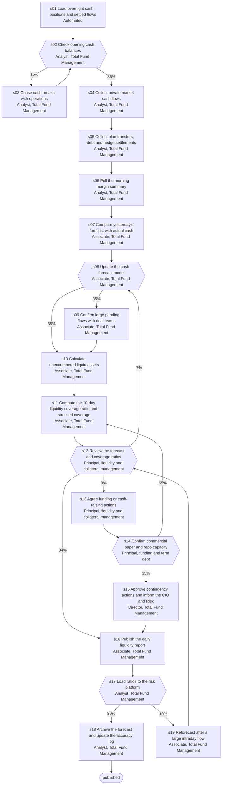

# Forecast liquidity and monitor the 10-day liquidity coverage ratio (daily)

`pim-tf-liquidity-forecast` · asset management (public pension fund investment) · total fund management (treasury) · part of `pension-investment-manager`

Each business day the liquidity team in Total Fund Management forecasts the fund's cash needs and checks that it holds enough liquid assets to meet them under stress. Analysts load and reconcile opening cash, collect capital calls, closings, distributions, margin, plan transfers and debt maturities from several teams and systems, and associates update a spreadsheet forecast, value the unencumbered liquidity buffer and compute the 10-day liquidity coverage ratio against its Board limit of 1.0x. A principal reviews the result, and shortfalls trigger calls to the funding and balancing teams. The work is slowed by re-keying inputs that arrive by email, waiting for deal teams to confirm closing dates and for the morning margin summary, and private fund call timing makes the forecast uncertain.

| | |
|---|---|
| Unit of work | one daily liquidity forecast |
| Starts when | Reconciled positions and custodian cash for the prior day are available, together with new margin, capital call, closing, distribution and plan transfer information. |
| Done when | The reviewed forecast and coverage ratios are published to the balancing, leverage, funding and Risk teams, loaded for Risk's limit monitoring and archived, with any funding actions agreed. |
| Organisation | A national pension fund manager of about C$540 billion with C$122 billion of recourse leverage, C$54 billion of unfunded private commitments and weekly plan cash flows. (2,052 employees, 2019-2022) |
| Volume | 21 cases a month (range 20 to 23) |

## Where it sits

- Starts with **position_record** from mkt-reconcile (40% of cases)
- Starts with **margin_summary** from io-collateral-margin (20% of cases)
- Starts with **cash_forecast** from io-capital-calls (15% of cases)
- Starts with **cash_forecast** from io-private-cash-settlement (10% of cases)
- Starts with **cash_forecast** from tf-plan-transfers (10% of cases)
- Starts with **cash_forecast** from io-distributions (5% of cases)
- Sends **liquidity_forecast** to tf-balancing-rebalance (outcome: published)
- Sends **liquidity_forecast** to tf-leverage-management (outcome: published)
- Sends **liquidity_forecast** to risk-market-limit-monitoring (outcome: published)
- Sends **liquidity_forecast** to cmf-short-term-funding (outcome: published)

## Flow

## Roles

| Role | Department | Layer | FTE on this process | Loaded cost per hour | Evidence |
|---|---|---|---:|---:|---|
| Analyst, Total Fund Management | Total Fund Management | individual contributor | 0.3 | 104 CAD | C [ar21], [jb11101] |
| Associate, Total Fund Management | Total Fund Management | individual contributor | 0.5 | 155 CAD | C [ar21], [jb11101] |
| Principal, liquidity and collateral management | Total Fund Management - Balancing, liquidity and collateral (treasury) | supervisor | 0.2 | 540 CAD | C [ar21] |
| Director, Total Fund Management | Total Fund Management | manager | 0.03 | 1080 CAD | C [ar21] |
| Principal, funding and term debt | Financing, Collateral and Trading - Funding and term debt (treasury) | supervisor | 0.03 | 540 CAD | C [ar21] |

## Steps

Hands-on time and the wait before each step show the most common value. Evidence tier A is a sourced number, B a sourced description, C the author's estimate.

| Step | Who | Kind | Hands-on | Wait before | Control | Evidence |
|---|---|---|---:|---:|---|---|
| **s01 Load overnight cash, positions and settled flows.** A scheduled job loads the prior day's reconciled positions, custodian cash balances by currency and account, settled trades and settled private cash movements from the investment book of record into the liquidity model's data tables. | Automated | system auto | 0 min | 30 min |  | C |
| **s02 Check opening cash balances.** The analyst compares opening cash by currency and account in the model with custodian portal balances and the reconciled position record, and checks that yesterday's expected flows actually settled. Differences above a small tolerance are listed as breaks. | Analyst, Total Fund Management | validation | 30 min | 1.0 h | Daily cash reconciliation before cash balances are used for funding decisions | B [afp23] |
| **s03 Chase cash breaks with operations.** The analyst emails the reconciliation or settlements team with each unexplained difference, for example a failed FX settlement or a capital call paid but not booked, and waits for the explanation or correction before using the balance. | Analyst, Total Fund Management | coordination | 25 min | 45 min |  | C |
| **s04 Collect private market cash flows.** The analyst pulls capital call notices received and not yet paid, expected distributions, scheduled closings and loan drawdowns from the private investments administration system and the deal pipeline, and reads emails from deal teams about closings that have moved. | Analyst, Total Fund Management | lookup | 35 min | 10 min |  | B [ilpa16], [allvue24], [ar21] |
| **s05 Collect plan transfers, debt and hedge settlements.** The analyst adds the weekly net plan contribution transfer and the monthly benefit outflow requirement, commercial paper maturities and coupons, term debt maturities and FX forward settlements due in the forecast horizon, taken from the funding team's schedule and the book of record. | Analyst, Total Fund Management | lookup | 20 min | 5 min |  | B [ar21], [is25] |
| **s06 Pull the morning margin summary.** The analyst takes the collateral team's morning summary of margin paid and received, collateral posted, excess collateral held and expected initial margin changes, and adds expected variation margin from yesterday's market moves. | Analyst, Total Fund Management | lookup | 15 min | 15 min |  | B [ar21], [dnb24] |
| **s07 Compare yesterday's forecast with actual cash.** The associate lines up yesterday's forecast for today against actual opening cash and explains the largest misses, for example a capital call paid early or a distribution that did not arrive. Repeated misses lead to adjusted assumptions for that flow type. | Associate, Total Fund Management | analysis | 25 min | 15 min |  | C [afp23] |
| **s08 Update the cash forecast model.** The associate enters or refreshes each flow by date and currency in the forecast spreadsheet for the next 10 business days, three months and beyond, applying probability weights to uncertain capital calls and distributions. Most inputs arrive by email or report and are re-keyed. | Associate, Total Fund Management | data entry | 45 min | 5 min |  | B [afp23], [allvue24] |
| **s09 Confirm large pending flows with deal teams.** For closings, drawdowns or calls above a size threshold that are not yet confirmed, the associate asks the deal team or funds operations for the expected date and amount and waits for replies, chasing by chat if a closing is within a few days. | Associate, Total Fund Management | communication | 20 min | 1.5 h |  | C |
| **s10 Calculate unencumbered liquid assets.** The associate takes positions in government bonds, money market securities and listed equities, removes securities already pledged as collateral or lent, and applies haircuts for stressed sale or repo values to arrive at the liquidity buffer by currency. | Associate, Total Fund Management | analysis | 25 min | 5 min |  | B [boc21], [is25] |
| **s11 Compute the 10-day liquidity coverage ratio and stressed coverage.** The associate divides the liquidity buffer by stressed outflows over the next 10 days, including stressed margin calls, capital calls, plan transfers, debt maturities and commercial paper that may not roll, and repeats the test at longer horizons. The results are compared with the 1.0x limit, internal early-warning levels and the 22% liquidity target. | Associate, Total Fund Management | analysis | 25 min | 5 min | Board-approved liquidity risk limit: 10-day liquidity coverage ratio minimum of 1.0x in the Integrated Risk Policy | A [ar22], [boc21] |
| **s12 Review the forecast and coverage ratios.** The liquidity principal checks the largest flows, the variance note, the buffer and the ratios against yesterday and market conditions, challenges probability weights on uncertain calls, and decides whether a shortfall or early-warning breach needs action today. | Principal, liquidity and collateral management | review | 25 min | 20 min | Four-eyes review of the daily liquidity forecast before it is published | C |
| **s13 Agree funding or cash-raising actions.** The liquidity principal works out how to cover the gap: issue or extend commercial paper, add repo against government bonds, use excess collateral, delay discretionary purchases or ask the balancing team to raise cash from the Balancing Portfolio, and calls the funding and balancing teams. | Principal, liquidity and collateral management | coordination | 40 min | 15 min |  | B [ar21], [boc21] |
| **s14 Confirm commercial paper and repo capacity.** The funding principal checks outstanding commercial paper against programme capacity, dealer demand and pricing in each currency, and available repo lines, then replies with what can be raised by which date. | Principal, funding and term debt | communication | 20 min | 45 min |  | B [boc21] |
| **s15 Approve contingency actions and inform the CIO and Risk.** A TFM director approves larger actions such as drawing a credit facility, raising cash from the Balancing Portfolio or pausing discretionary commitments, and informs the CIO and Risk, which may lead to a remediation plan. | Director, Total Fund Management | approval | 30 min | 1.5 h | Liquidity contingency and escalation procedures under the Integrated Risk Policy | B [is25], [ar22] |
| **s16 Publish the daily liquidity report.** The associate sends the forecast, the coverage ratios, liquidity as a share of net assets and any agreed actions to the balancing, leverage and funding teams, TFM leadership and Risk, and saves the version in the shared folder. | Associate, Total Fund Management | communication | 20 min | 10 min |  | B [ar22] |
| **s17 Load ratios to the risk platform.** The analyst uploads the day's coverage ratio, buffer and stressed outflows to the risk platform so that Risk can monitor the liquidity limit independently and include it in its daily limit report. | Analyst, Total Fund Management | data entry | 10 min | 10 min |  | B [ar22] |
| **s18 Archive the forecast and update the accuracy log.** The analyst saves the published forecast, logs forecast against actual for the main flow types and notes any manual assumptions used, so tomorrow's variance check and monthly accuracy reviews have a record. | Analyst, Total Fund Management | drafting | 10 min | 10 min |  | C |
| **s19 Reforecast after a large intraday flow.** When a large unexpected margin call, an accelerated capital call or a moved closing arrives during the day, the associate updates the affected dates, recomputes the ratios and sends a revised report. | Associate, Total Fund Management | analysis | 30 min | 2.5 h |  | B [boc21], [dnb24] |

## Exceptions

| Exception | Share of cases | What happens |
|---|---:|---|
| Cash breaks in opening balances | 15% | Custodian and book-of-record cash disagree, for example an unbooked capital call payment or failed FX settlement, and must be explained before the forecast is built. |
| Large unconfirmed private flows | 35% | Closings, drawdowns or capital calls above the size threshold need date and amount confirmation from deal teams or funds operations, adding hours of waiting. |
| Shortfall or early-warning breach | 9% | The forecast shows a cash gap or the coverage ratio near an internal early-warning level; funding and balancing teams are engaged and a director may approve contingency actions. |
| Large intraday flow | 10% | A large unexpected margin call or accelerated capital call during the day triggers a reforecast and a revised report. |
| Stressed market week | 2% | In episodes like March 2020, margin calls jump, commercial paper may not roll and the team reforecasts several times a day; peer Canadian funds saw margin calls peak at about C$30 billion in one week. |

## Benchmarks

| Metric | Value | Unit | Population | Evidence |
|---|---|---|---|---|
| cycle_time_days | p50 0.45, p90 0.65 | calendar days from overnight data load to published and archived forecast | Daily liquidity forecasts at a large Canadian pension fund manager | C |
| liquidity_coverage_ratio_10_day | F2022 2.9, F2021 6.2, limit 1.0 | ratio of available liquid assets to stressed obligations over 10 days, at March 31 | This organisation | A [ar22] |
| liquidity_share_of_net_assets | actual 0.23, target 0.22 | share of net assets, March 31, 2022 | This organisation | A [ar22] |
| peer_margin_calls_peak_week_march_2020 | 30000000000 | CAD cumulative net margin calls across the eight largest Canadian public pension funds, week of March 16, 2020 | Canada's Big Eight public pension funds | A [boc21] |
| suggested_liquidity_supply_to_demand_ratio | 2x to 3x | ratio | US pension plans (consultant guidance) | A [ca21] |

## Pain points

- Inputs arrive from many teams by email and report and are re-keyed into a spreadsheet model, so dates, signs and currencies are frequent error sources. (steps s04, s05, s08; B [afp23])
- Private fund capital calls and closings have uncertain timing; the team waits for deal teams to confirm and still carries probability-weighted estimates. (steps s04, s09; B [allvue24], [ilpa16])
- The forecast waits on upstream cash reconciliation and the collateral team's morning margin summary before it can be completed. (steps s02, s03, s06; C)
- Funding sources assumed in the buffer can disappear in stress, as US commercial paper did in March 2020, so capacity has to be confirmed rather than assumed. (steps s13, s14; A [boc21])

## Assumptions

- The process covers the daily forecast cycle only; monthly liquidity reporting to the Investment Risk Committee and annual calibration of stress assumptions are outside it.
- Forecast horizons of 10 business days, three months and longer follow the 10-day and 6-month coverage horizons in the F2021 report; the exact model structure is not public.
- Internal early-warning levels above the 1.0x Board limit are assumed; their values are not published. About 9% of days are assumed to need funding or cash-raising actions.
- The commercial paper and repo capacity check is done by the CMF funding team, which the organisation file places in Financing, Collateral and Trading; a separate process issues the paper.
- fte_on_process covers the daily cycle; the 18-person liquidity, leverage and collateral team also runs leverage management, collateral optimisation and plan transfers.
- Loaded hourly costs come from the organisation file and include large incentive pay.

## Sources

- [ar22] The model fund F2022 Annual Report (fiscal year ended March 31, 2022) (link withheld) (The model fund, 2022). 10-day Liquidity Coverage Ratio 2.9x at March 31, 2022 against a 1.0x minimum (6.2x a year earlier); liquidity 23% of net assets versus 22% longer-term target; LCR calibrated to stressed outflows over any 10-day period; unsecured credit facilities C$1.5 billion (C$3.0 billion in 2021), undrawn; recourse leverage C$122 billion; net transfers from plan C$8 billion in F2022
- [ar21] The model fund F2021 Annual Report (fiscal year ended March 31, 2021) (link withheld) (The model fund, 2021). Payment obligations include payments to the plan, unsecured debt repayments and collateral and margin requirements; liquidity sources are commercial paper, term debt, repo, unsecured credit facilities and liquid assets; coverage measured at 10 days and 6 months; weekly net cash flows of the two plan accounts; TFM integrated liquidity management into department processes in F2021
- [is25] Statement of Investment Objectives, Policies, Return Expectations and Risk Management for the Investment Portfolios of the Base plan and the Additional plan (effective April 2, 2025) (link withheld) (The model fund, 2025). Board approves liquidity risk limit set for the Core Pool as unrestricted eligible coverage assets held against cash requirements; liquidity must meet Cash for Benefits needs, debt service, collateral and margin calls, investment funding and rebalancing; plan provides monthly net cash outflow requirements; risks monitored daily
- [boc21] [COVID-19 crisis: Liquidity management at Canada's largest public pension funds (Staff Analytical Note 2021-11)](https://bankofcanada.ca/san2021-11) (Bank of Canada (Bedard-Page, Bolduc-Zuluaga, Demers, Dion, Pandey, Berger-Soucy and Walton), 2021). All of the Big Eight apply a liquidity coverage ratio framework: liquidity buffer over potential stressed outflows, kept above one; buffers are mostly high-quality assets and funding sources, not cash; March 2020 margin calls peaked at about C$30 billion cumulatively across the Big Eight in the week of March 16; some funds could not roll US commercial paper and built precautionary liquidity; Big Eight issued about C$19 billion of long-term debt March to May 2020
- [dnb24] [Dutch pension funds can meet margin calls on derivatives, but depend on functioning money markets](https://www.dnb.nl/en/sector-news/supervision-2024/dutch-pension-funds-can-meet-margin-calls-on-derivatives-but-depend-on-functioning-money-markets) (De Nederlandsche Bank and Dutch Authority for the Financial Markets, 2024). Collateral must typically be provided within one or two days of a margin call; cleared derivative margin must be met in cash; funds use cash, repo, money market funds and high-quality bonds in that order; repo access may fail in broad stress
- [ca21] [Overestimating Liquidity Needs Can Undercut the Return Potential of US Pension Plans](https://www.cambridgeassociates.com/en-as/insight/overestimating-liquidity-needs-can-undercut-the-return-potential-of-us-pension-plans/) (Cambridge Associates (Michael Dunleavy), 2021). Liquidity demand categories (benefits, capital calls, rebalancing, discretionary); capital calls fall to 25% to 35% of normal in stress; liquidity supply to demand ratio of 2x to 3x suggested; two-year stress horizon
- [afp23] [Fundamentals and Best Practices of Cash Forecasting](https://www.financialprofessionals.org/training-resources/resources/articles/Details/fundamentals-and-best-practices-of-cash-forecasting-for-2023) (Association for Financial Professionals, 2023). Cash forecasting tasks: identify data, establish sources, classify for accuracy, set horizon, choose method, manage daily, review output; receipts and disbursements, bank data and statistical methods; daily reconciliation and weekly comprehensive forecasts; spreadsheet models common
- [allvue24] [The Private Equity Pacing Model: 3 Key Challenges Investors Face](https://www.allvuesystems.com/resources/the-private-equity-pacing-model-3-key-challenges-investors-face/) (Allvue Systems (Megann Freston), 2024). Private market cash flow and pacing forecasts depend on deal, allocation and commitment data quality; timing of calls and distributions is uncertain
- [ilpa16] [Capital Call & Distribution Notice Best Practices, Version 1.1](https://ilpa.org/wp-content/uploads/2019/05/ILPA-Best-Practices-Capital-Calls-Distribution-Notices_Version-1.1.pdf) (Institutional Limited Partners Association, 2016). Content of capital call and distribution notices; estimates given in earlier notices are reconciled to actual flows in later notices
- [jb11101] [Wages: Financial Analyst (NOC 11101) in Canada](https://www.jobbank.gc.ca/marketreport/wages-occupation/12417/ca) (Job Bank, Government of Canada, 2025). Canada and Ontario hourly wages for NOC 11101: low 28.21, median 43.27, high 72.36 (2023-2024)

Written by claude-opus on 2026-11-17.
