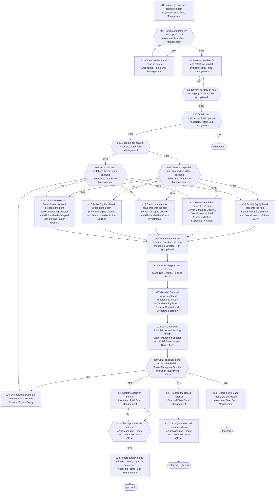

# Approve investments and dispositions at the Portfolio Execution Committee

`pim-tf-pec-approval` · pension fund investment management · investment governance · part of `pension-investment-manager`

The Portfolio Execution Committee, chaired by the Chief Investment Officer, decides on new private investments, follow-ons, fund commitments, manager engagements and dispositions that exceed department authority. A secretariat checks each memo and its approval tier, Total Fund Management checks mandate fit, Risk adds an independent opinion, and members read the package before a weekly meeting where the sponsoring department presents. Most items are approved, often with conditions; some are deferred for more work, a few are declined, and the largest go to the Board. Waiting for the risk opinion and the next meeting slot takes most of the elapsed time, and bid deadlines force special meetings.

| | |
|---|---|
| Unit of work | one investment decision submitted |
| Starts when | A deal team submits an investment memo or exit proposal that exceeds department authority. |
| Done when | The decision is approved and recorded, declined, withdrawn, or recommended to the Board. |
| Organisation | A very large Canadian national pension fund manager with a management investment committee under delegated authorities and Board approval of the largest transactions. (2,052 employees, 2019-2022) |
| Volume | 45 cases a month (range 35 to 60) |

## Where it sits

- Starts with **investment_memo** from pe-direct-due-diligence (24% of cases)
- Starts with **investment_memo** from ra-due-diligence (23% of cases)
- Starts with **investment_memo** from ci-credit-underwriting (18% of cases)
- Starts with **investment_memo** from ae-ri-source-diligence (5% of cases)
- Starts with **investment_memo** from pe-fund-selection-commitment (10% of cases)
- Starts with **investment_memo** from pe-secondaries (3% of cases)
- Starts with **investment_memo** from pe-gp-co-invest (6% of cases)
- Starts with **investment_memo** from cmf-select-external-managers (2% of cases)
- Starts with **exit_proposal** from pe-exits (5% of cases)
- Starts with **exit_proposal** from ra-exits (4% of cases)
- Relies on **risk_opinion** from risk-transaction-review (a standing input; it does not start a case)
- Sends **approval_decision** to lc-negotiate-close (outcome: approved)
- Sends **investment_memo** to ex-board-investment-approval (outcome: referred_to_board)

## Flow

## Roles

| Role | Department | Layer | FTE on this process | Loaded cost per hour | Evidence |
|---|---|---|---:|---:|---|
| Senior Managing Director and Chief Investment Officer | Total Fund Management | executive | 0.4 | 2564 CAD | B [src1] |
| Managing Director, TFM group head | Total Fund Management | director | 1.5 | 1662 CAD | C [src1] |
| Principal, Total Fund Management | Total Fund Management | supervisor | 0.8 | 571 CAD | C [src1] |
| Associate, Total Fund Management | Total Fund Management | individual contributor | 1.4 | 155 CAD | C |
| Senior Managing Director and Chief Financial and Risk Officer | CFRO office | executive | 0.25 | 1603 CAD | C [src1] |
| Managing Director, Head of Risk | Risk | director | 0.3 | 1246 CAD | B [src2] |
| Senior Managing Director, General Counsel and Corporate Secretary | General Counsel's office and legal operations | executive | 0.25 | 1603 CAD | C [src1] |
| Senior Managing Director and Global Head of Private Equity | Private Equity | executive | 0.25 | 2115 CAD | C [src1] |
| Senior Managing Director, Global Head of Real Assets and Chief Sustainability Officer | Real Assets | executive | 0.15 | 2308 CAD | C [src1] |
| Senior Managing Director and Global Head of Credit Investments | Credit Investments | executive | 0.1 | 1923 CAD | C [src1] |
| Senior Managing Director and Global Head of Active Equities | Active Equities | executive | 0.03 | 1923 CAD | C [src1] |
| Senior Managing Director and Global Head of Capital Markets and Factor Investing | Capital Markets and Factor Investing | executive | 0.02 | 1923 CAD | C [src1] |
| Director, Private Equity | Private Equity | manager | 0.6 | 1080 CAD | C |

## Steps

Hands-on time and the wait before each step show the most common value. Evidence tier A is a sourced number, B a sourced description, C the author's estimate.

| Step | Who | Kind | Hands-on | Wait before | Control | Evidence |
|---|---|---|---:|---:|---|---|
| **s01 Log memo and open committee item.** The secretariat receives the memo from the deal team, opens an item in the committee tracker with deal name, department, amount and requested decision, and files the memo in the repository. | Associate, Total Fund Management | intake | 15 min | 2.0 h |  | C [src1] |
| **s02 Check completeness and approval tier.** The secretariat checks the memo against the template (tax, legal, ESG and climate sections, sign-offs), reads the amount against the Investment Management Authorities to confirm the PEC or Board tier, and flags missing items. | Associate, Total Fund Management | validation | 40 min | 8.0 h | Investment Management Authorities set by the CEO: transaction approval tiers | B [src2] |
| **s03 Chase deal team for missing items.** The secretariat emails the deal lead listing the missing sections or sign-offs and follows up until the revised memo arrives. | Associate, Total Fund Management | communication | 30 min | 4.0 h |  | C |
| **s04 Assess mandate fit and total fund impact.** A TFM principal checks the deal against the department's mandate and capital allocation, its effect on exposure targets, leverage and liquidity, and writes a short portfolio fit note for the committee. | Principal, Total Fund Management | analysis | 2.0 h | 1.0 d |  | B [src1] |
| **s05 Review portfolio fit note.** A TFM managing director reads the note, adjusts the conclusion on capacity or mandate fit and approves it for the package. | Managing Director, TFM group head | review | 30 min | 1.0 d |  | C [src1] |
| **s06 Obtain the independent risk opinion.** The secretariat waits for the risk team's written opinion on market, credit, liquidity and concentration effects and attaches it to the item. Occasionally the deal team withdraws the item because the sale process moves on. | Associate, Total Fund Management | coordination | 20 min | 3.0 d | Integrated Risk Framework and Risk Policy: independent second-line risk view before approval | B [src2] |
| **s07 Book an agenda slot.** The secretariat checks the deal timetable against the meeting calendar, books the item into the next regular meeting or, for a bid deadline, asks the chair's office for a special meeting. | Associate, Total Fund Management | coordination | 20 min | 2.0 h |  | C [src1] |
| **s08 Arrange a special meeting and send the package.** For a deal with a bid deadline the secretariat finds a slot with enough members for quorum, sends the package the same day and confirms attendance. | Associate, Total Fund Management | coordination | 1.0 h | 4.0 h |  | C [src5] |
| **s09 Assemble and distribute the pre-read package.** The secretariat combines the memo, risk opinion, portfolio fit note and appendices into the meeting package, posts it to the repository and sends it to members before the meeting. | Associate, Total Fund Management | drafting | 40 min | 2.0 d |  | B [src5] |
| **s10 Private Equity head presents the item.** The Private Equity department head, with the deal lead, presents the memo at the meeting, summarises the thesis, price, risks and the requested approval, and answers members' questions on the deal. | Senior Managing Director and Global Head of Private Equity | communication | 1.2 h | 2.0 d |  | B [src1], [src5] |
| **s11 Real Assets head presents the item.** The Real Assets department head, with the deal lead, presents the memo at the meeting, summarises the thesis, price, risks and the requested approval, and answers members' questions on the deal. | Senior Managing Director, Global Head of Real Assets and Chief Sustainability Officer | communication | 1.2 h | 2.0 d |  | B [src1], [src5] |
| **s12 Credit Investments head presents the item.** The Credit Investments department head, with the deal lead, presents the memo at the meeting, summarises the thesis, price, risks and the requested approval, and answers members' questions on the deal. | Senior Managing Director and Global Head of Credit Investments | communication | 1.2 h | 2.0 d |  | B [src1], [src5] |
| **s13 Active Equities head presents the item.** The Active Equities department head, with the deal lead, presents the memo at the meeting, summarises the thesis, price, risks and the requested approval, and answers members' questions on the deal. | Senior Managing Director and Global Head of Active Equities | communication | 1.2 h | 2.0 d |  | B [src1], [src5] |
| **s14 Capital Markets and Factor Investing head presents the item.** The Capital Markets and Factor Investing department head, with the deal lead, presents the memo at the meeting, summarises the thesis, price, risks and the requested approval, and answers members' questions on the deal. | Senior Managing Director and Global Head of Capital Markets and Factor Investing | communication | 1.2 h | 2.0 d |  | B [src1], [src5] |
| **s15 Members review pre-read and question the team.** Committee members read the package before the meeting and question the deal team on price, downside cases and fit. This step carries the combined time of about four members other than the chair, risk, legal and finance. | Managing Director, TFM group head | review | 3.0 h | 0 min |  | B [src1] |
| **s16 Risk head gives the risk view.** The head of Risk summarises the risk opinion, the effect on total fund risk and limits, and any conditions Risk recommends. | Managing Director, Head of Risk | review | 45 min | 0 min | Three lines model: independent risk function separate from the investment department | B [src2] |
| **s17 General Counsel reviews legal and reputational issues.** The General Counsel reads the legal, regulatory, sanctions and reputational sections and raises conditions such as foreign investment review or structure changes. | Senior Managing Director, General Counsel and Corporate Secretary | review | 40 min | 0 min |  | C [src1] |
| **s18 CFRO reviews financial, tax and funding effects.** The Chief Financial and Risk Officer reviews valuation approach, tax structure, funding and liquidity effects and reporting implications, and gives a view. | Senior Managing Director and Chief Financial and Risk Officer | review | 40 min | 0 min |  | C [src1] |
| **s19 Chair concludes and records the decision.** The CIO sums up the discussion and decides to approve, approve with conditions, defer for more work, decline, or recommend the item to the Board because it exceeds the committee's authority. | Senior Managing Director and Chief Investment Officer | approval | 50 min | 0 min | Investment Management Authorities and PEC terms of reference: committee approval of new investments, dispositions and follow-ons | B [src1], [src2], [src3] |
| **s20 Deal team answers the committee's questions.** The sponsoring team's director runs the extra analysis the committee asked for, such as a downside case, a partner check or a revised structure, and sends a supplement for the next meeting. | Director, Private Equity | analysis | 8.0 h | 3.0 d |  | C [src5] |
| **s21 Draft the decision minute.** The secretariat writes the minute: decision, amount and price limits, conditions such as final diligence items or maximum leverage, and follow-up reporting, and sends it to the chair. | Associate, Total Fund Management | drafting | 45 min | 8.0 h |  | B [src4] |
| **s22 Chair approves the minute.** The CIO reads the draft minute, checks the recorded decision, conditions and price limits against the meeting, and approves it in the repository or corrects it. | Senior Managing Director and Chief Investment Officer | approval | 10 min | 1.0 d | Documented approval record under the approval authorities for audit and the special examination | C [src4] |
| **s23 Record approval and notify deal team, Legal and Compliance.** The secretariat updates the pipeline system, sends the approved minute and conditions to the deal team, Legal and Compliance, and closes the item. | Associate, Total Fund Management | communication | 20 min | 2.0 h |  | C [src1] |
| **s24 Record decline and notify the deal team.** The secretariat records the decline and the committee's reasons in the tracker and pipeline system and informs the deal team, which tells the seller or partner. | Associate, Total Fund Management | communication | 30 min | 8.0 h |  | C |
| **s25 Prepare the Board referral.** A TFM principal works with the deal team to turn the memo into a Board submission with a management recommendation and the committee's conditions, in the Board's format. | Principal, Total Fund Management | drafting | 4.0 h | 1.0 d |  | B [src1], [src4] |
| **s26 CIO signs the Board recommendation.** The CIO reviews and signs the Board submission and the board secretariat takes it for the next Investment Strategy Committee meeting or a special meeting. | Senior Managing Director and Chief Investment Officer | approval | 30 min | 1.0 d | the fund's governing act s.34: the Board's investment committee performs delegated duties and approves discretionary manager engagements; transaction thresholds are set in the Board's Authorities Policy | B [src4], [src7] |

## Exceptions

| Exception | Share of cases | What happens |
|---|---:|---|
| Incomplete memo | 15% | A tax, legal, ESG or climate section or a sign-off is missing; the secretariat returns the memo. |
| Deferred for more work | 17% | The committee asks for a downside case, partner checks or a revised structure and the item comes back to a later meeting. |
| Time-critical special meeting | 12% | A bid deadline falls before the next regular meeting, so the secretariat arranges a special meeting with a short pre-read. |
| Above committee authority | 6% | The amount exceeds the committee's authority; management recommends it to the Board's Investment Strategy Committee. |
| Item withdrawn | 3% | The sale process moves on or the partner drops out before the meeting. |

## Benchmarks

| Metric | Value | Unit | Population | Evidence |
|---|---|---|---|---|
| cycle_time_days | p50 12, p90 26 | calendar days from memo submission to recorded decision | Management investment committees at large institutional investors | C [src5] |
| board_committee_meetings_per_year | 12 | Investment Strategy Committee meetings | Fiscal 2022 | A [src1] |
| minimum_board_committee_meetings | 4 | meetings a year | Investment Strategy Committee terms of reference | A [src4] |

## Pain points

- Items wait for the risk opinion and the next weekly slot, which together take most of the elapsed time while the deal team has a bid deadline. (steps s06, s09; C [src2])
- Deferrals send items back for another full cycle, often a week or more, when a question could be answered between meetings. (steps s19, s20, s09; C [src5])
- Senior executives spend hours each week reading long packages; the chair and members are a scarce resource that sets the pace. (steps s15, s16, s17, s18, s19; B [src1])

## Assumptions

- The committee is assumed to meet weekly with special meetings for bid deadlines; the organisation does not publish its cadence.
- The secretariat role is filled by a TFM associate; the organisation file names no PEC secretary.
- The members' review step carries the time of about four members other than the chair, Risk, General Counsel and the CFRO, costed at the TFM managing director rate; real members are mostly department heads at higher pay.
- The deferral step uses pe_director as a stand-in for the sponsoring team's director; the organisation file gives PE, RA, CI and AE directors the same loaded cost.
- Shares of items by sponsoring process follow the upstream volumes in the process map and typical conversion rates; department shares (PE 48%, RA 27%, CI 18%, AE 5%, CMF 2%) follow from them.
- The risk opinion is an input to every item rather than a separate trigger, so its interface share is zero.
- The process map lists only investment department SMDs, the CIO, a TFM MD, the CFRO, the head of Risk and the General Counsel; tfm_principal, tfm_associate and pe_director are added for the fit note, secretariat and deferral work.
- Approval thresholds are not public (the Authorities Policy is not published); the Board share is set to match about 3 Board items a month in the process map.

## Sources

- [src1] The model fund F2022 Annual Report (fiscal year ended March 31, 2022) (link withheld) (The model fund, 2022). PEC is a subcommittee of the ISRC chaired by the CIO; it reviews new investments, dispositions and follow-on transactions for approval and checks alignment with each active strategy's mandate; its members are cross-functional Global Leadership Team representatives; the Board's Investment Strategy Committee approves certain transactions; eight regular ISC meetings plus special meetings in F2022 (12 attended by most directors); 14 Board meetings; Climate Change Security Selection Framework for transactions at the senior-most management committee
- [src2] The model fund F2021 Annual Report (fiscal year ended March 31, 2021) (link withheld) (The model fund, 2021). CEO sets Investment Management Authorities with transaction approval authorities for the IDC and department and group committees; the Board's Investment Committee approves transactions above certain amounts; Risk group independently measures and monitors key risks and reports to the ISRC and its subcommittees; IDC (predecessor of PEC) approves or declines investments, dispositions and follow-ons
- [src3] The model fund 2020 Annual Report (link withheld) (The model fund, 2020). Investment Department Decision Committee must approve transactions above sizes in its terms of reference; Board Investment Committee approves transactions above certain amounts (F2020)
- [src4] Terms of Reference for the Investment Strategy Committee (June 22, 2022) (link withheld) (The model fund, 2022). The committee meets the investment committee requirement of the fund's governing act, approves Investment Transactions and external manager engagements as provided by the Authorities Policy, meets at least four times a year and reports through minutes
- [src5] [Investment-Decision Process (Twenty-four ways to classify private equity firms)](https://umbrex.com/resources/twenty-four-ways-to-classify-private-equity-firms/investment-decision-process/) (Umbrex, 2024). Investment committee models: single central committee meeting twice a week with materials circulated beforehand, tiered pre-IC and final IC gates with a monthly global IC, weekly partnership meetings with vetoes, cheque limits below which heads approve without a committee
- [src6] [What Do Private Equity Firms Say They Do? (NBER Working Paper 21133)](https://www.nber.org/papers/w21133.pdf) (Gompers, Kaplan and Mukharlyamov, National Bureau of Economic Research, 2015). Funnel: 61.8 of 100 opportunities are reviewed with the partner group or investment committee at some stage, 22.5 reach offered terms and 6.1 close
- [src7] the fund's governing act (S.C. 1997, c. 40), sections 34 and 35 (link withheld) (Justice Laws Website, Government of Canada, 2024). The Board's investment committee performs duties delegated by the board, approves the engagement of investment managers with discretionary authority and oversees procedures to monitor investment policies; policies must meet a prudent person standard

Written by claude-opus on 2026-11-17.
