# Design the Strategic Portfolio and annual target exposures

`pim-tf-strategic-portfolio-design` · pension fund investment management · total fund management (portfolio design) · part of `pension-investment-manager`

Once a year the Portfolio Design group in Total Fund Management turns the Board's Reference Portfolios and risk appetite into Strategic Portfolios, the intended mix of six asset classes and three regions five years out, and into target exposures and ranges for the coming fiscal year. Staff refresh long-term return and risk assumptions, map about 20 investment programs to return-risk factors, collect opportunity sets from the investment departments, build and stress-test candidate portfolios, and get an independent view from Risk. Department heads negotiate their program ranges, the Portfolio Strategy Committee and the ISRC endorse the result, and the Board approves it with the business plan. The cycle takes months because departments with competing ambitions need several rounds, assumptions are contested and each committee meets on its own calendar.

| | |
|---|---|
| Unit of work | one annual portfolio design cycle |
| Starts when | The annual planning calendar opens the cycle, using the Board-approved Reference Portfolios and risk appetite and ISRC guidance. |
| Done when | The Board-approved Strategic Portfolios and current-year target exposures are loaded into the risk and data platforms and published to departments, capital allocation, financial planning and Risk. |
| Organisation | A Canadian national pension fund investment manager with C$539 billion of net assets that sets one total portfolio for the base and additional plan and invests mostly through internal teams. (2,052 employees, 2019-2022) |
| Volume | 0.083 cases a month (range 0.083 to 0.083) |

## Where it sits

- Starts with **board_approval** from board (50% of cases)
- Starts with **reference_portfolio_decision** from tf-reference-portfolio-review (20% of cases)
- Starts with **committee_decision** from ex-isrc-governance (20% of cases)
- Starts with **research_note** from ex-investment-strategy-research (10% of cases)
- Sends **strategic_portfolio** to tf-capital-allocation (outcome: published)
- Sends **strategic_portfolio** to fin-business-plan-budget (outcome: published)
- Sends **strategic_portfolio** to risk-market-limit-monitoring (outcome: published)

## Flow

```mermaid
flowchart TD
    s01["s01 Launch the annual design cycle<br/>Director, Total Fund Management"]
    s02["s02 Refresh long-term return and risk assumptions<br/>Senior Associate, Total Fund Management"]
    s03{{"s03 Challenge assumptions with research and Risk<br/>Principal, Total Fund Management"}}
    s04["s04 Update program exposures and factor mappings<br/>Associate, Total Fund Management"]
    s05["s05 Request opportunity sets from departments<br/>Associate, Total Fund Management"]
    s06["s06 Consolidate department submissions<br/>Associate, Total Fund Management"]
    s07["s07 Build candidate strategic portfolios<br/>Senior Associate, Total Fund Management"]
    s07b["s07b Rebuild candidates with revised constraints<br/>Senior Associate, Total Fund Management"]
    s08{{"s08 Test liquidity, leverage and stress resilience<br/>Principal, Total Fund Management"}}
    s09{{"s09 Risk reviews the candidates independently<br/>Director, Risk"}}
    s10["s10 Select the proposed portfolio<br/>Director, Total Fund Management"]
    s11{{"s11 Negotiate program ranges with department heads<br/>Managing Director, TFM group head"}}
    s12["s12 Draft the Portfolio Strategy Committee paper<br/>Senior Associate, Total Fund Management"]
    s13{{"s13 Managing director reviews the paper<br/>Managing Director, TFM group head"}}
    s14{{"s14 Portfolio Strategy Committee reviews the proposal<br/>Senior Managing Director and Chief Investment Officer"}}
    s15{{"s15 ISRC endorses the Strategic Portfolio<br/>President and Chief Executive Officer"}}
    s16["s16 Prepare Board materials and the business plan section<br/>Senior Associate, Total Fund Management"]
    s17["s17 CIO signs off the Board materials<br/>Senior Managing Director and Chief Investment Officer"]
    s18{{"s18 Board approves the Strategic Portfolio<br/>Outside party"}}
    s19["s19 Set current-year target exposures and ranges<br/>Principal, Total Fund Management"]
    s20{{"s20 Risk aligns limits and monitoring<br/>Director, Risk"}}
    s21["s21 Load targets into the risk and data platforms<br/>Associate, Total Fund Management"]
    s22["s22 Publish the Strategic Portfolio and targets<br/>Director, Total Fund Management"]
    s01 --> s02
    s02 --> s03
    s03 -->|"85%"| s04
    s03 -->|"15%"| s02
    s04 --> s05
    s05 --> s06
    s06 --> s07
    s07 --> s08
    s07b --> s08
    s08 -->|"90%"| s09
    s08 -->|"10%"| s07b
    s09 -->|"90%"| s10
    s09 -->|"10%"| s07b
    s10 --> s11
    s11 -->|"72%"| s12
    s11 -->|"28%"| s07b
    s12 --> s13
    s13 -->|"80%"| s14
    s13 -->|"20%"| s12
    s14 -->|"85%"| s15
    s14 -->|"15%"| s07b
    s15 -->|"90%"| s16
    s15 -->|"10%"| s12
    s16 --> s17
    s17 --> s18
    s18 -->|"95%"| s19
    s18 -->|"5%"| s12
    s19 --> s20
    s20 -->|"90%"| s21
    s20 -->|"10%"| s19
    s21 --> s22
    s22 --> end0
    end0(["published"])
```

## Roles

| Role | Department | Layer | FTE on this process | Loaded cost per hour | Evidence |
|---|---|---|---:|---:|---|
| Senior Managing Director and Chief Investment Officer | Total Fund Management | executive | 0.02 | 2564 CAD | B [ar22] |
| Managing Director, TFM group head | Total Fund Management | director | 0.05 | 1662 CAD | C [ar21] |
| Director, Total Fund Management | Total Fund Management | manager | 0.05 | 1080 CAD | C [ar21] |
| Principal, Total Fund Management | Total Fund Management | supervisor | 0.15 | 571 CAD | C [ar21] |
| Senior Associate, Total Fund Management | Total Fund Management | senior specialist | 0.45 | 293 CAD | C [ar21], [cfa_aa] |
| Associate, Total Fund Management | Total Fund Management | individual contributor | 0.2 | 155 CAD | C [ar21] |
| Director, Risk | Risk | manager | 0.05 | 739 CAD | B [ar21] |
| President and Chief Executive Officer | Office of the President and CEO | executive | 0.005 | 3397 CAD | B [ar22] |

## Steps

Hands-on time and the wait before each step show the most common value. Evidence tier A is a sourced number, B a sourced description, C the author's estimate.

| Step | Who | Kind | Hands-on | Wait before | Control | Evidence |
|---|---|---|---:|---:|---|---|
| **s01 Launch the annual design cycle.** A Portfolio Design director sets the timetable against the business planning calendar and Board dates, confirms whether this year is a full triennial review of the strategic mix or an annual confirmation, and collects the Board-approved Reference Portfolios, risk appetite and any ISRC guidance. | Director, Total Fund Management | coordination | 8.0 h | 3.0 d | ISC terms of reference 5.1: annual review of the Investment Framework and review of Strategic Portfolios at least every three years | B [isc_tor], [ar22] |
| **s02 Refresh long-term return and risk assumptions.** A senior associate updates long-horizon expected returns, volatilities and correlations for the key return-risk factors, using the Chief Investment Strategist's research notes, climate scenarios and market data, and documents every change from last year. | Senior Associate, Total Fund Management | analysis | 6.7 d | 3.0 d |  | B [ar22], [cfa_aa] |
| **s03 Challenge assumptions with research and Risk.** A principal runs a review session with the investment strategy researchers and Risk, walks through each changed assumption and its effect on candidate portfolios, and records the agreed set. | Principal, Total Fund Management | review | 8.0 h | 7.0 d |  | C [cfa_aa] |
| **s04 Update program exposures and factor mappings.** An associate pulls current exposures for each of about 20 investment programs from the risk platform and data platform, maps each program to the return-risk factors, regions and asset classes, and fills gaps for private holdings with proxies. | Associate, Total Fund Management | data entry | 3.3 d | 2.0 d |  | B [ar21], [ar20], [cfa_aa] |
| **s05 Request opportunity sets from departments.** The associate sends each investment department's business management team a template for its one-year and five-year opportunity set, expected deployment, capacity and return expectations by program, with a due date. | Associate, Total Fund Management | communication | 4.0 h | 1.0 d |  | B [ar21] |
| **s06 Consolidate department submissions.** As submissions arrive from Active Equities, Credit Investments, Private Equity, Real Assets and Capital Markets and Factor Investing, the associate chases late ones, puts them on one basis and flags figures that conflict with history or capacity. | Associate, Total Fund Management | data entry | 1.7 d | 15.0 d |  | B [ar21] |
| **s07 Build candidate strategic portfolios.** A senior associate runs the optimisation and simulation models to build candidate portfolios at the targeted risk level for the base and additional plan, applying constraints for department capacity, geography, liquidity and leverage, and summarises weights by asset class and region five years out. | Senior Associate, Total Fund Management | analysis | 5.0 d | 3.0 d |  | B [ar22], [cfa_aa], [inv_stmt] |
| **s07b Rebuild candidates with revised constraints.** When departments, Risk or the committee reject the candidates, the senior associate changes the disputed constraints or assumptions, reruns the models and updates the weight tables, reusing most of the earlier set-up. | Senior Associate, Total Fund Management | analysis | 1.7 d | 2.0 d |  | C |
| **s08 Test liquidity, leverage and stress resilience.** A principal checks each candidate against the liquidity coverage and leverage limits, private asset funding needs and historical and hypothetical stress scenarios, and rejects or adjusts candidates that fail. | Principal, Total Fund Management | analysis | 16.0 h | 2.0 d |  | B [ar22], [inv_stmt] |
| **s09 Risk reviews the candidates independently.** A Risk director reviews the candidates against the risk appetite, potential loss and concentration measures, checks the factor mappings and stress results, and writes a short independent view for the committee. | Director, Risk | review | 15.0 h | 5.0 d | Risk Policy and integrated risk framework: independent risk input to portfolio design | B [ar21], [ar22] |
| **s10 Select the proposed portfolio.** The Portfolio Design director compares the candidates, the Risk note and the department submissions and picks a proposed Strategic Portfolio and the program deployment ranges to discuss with departments. | Director, Total Fund Management | judgment | 8.0 h | 3.0 d |  | C |
| **s11 Negotiate program ranges with department heads.** A TFM managing director holds sessions with each department head on the proposed five-year deployment ranges, hears objections about capacity and opportunity, and agrees changes or escalates disagreements to the CIO. | Managing Director, TFM group head | coordination | 20.0 h | 7.0 d |  | B [ar21], [tai] |
| **s12 Draft the Portfolio Strategy Committee paper.** A senior associate writes the committee paper with the proposed weights by asset class and region, the change from last year, expected return and risk, liquidity and leverage effects, Risk's view and the open issues. | Senior Associate, Total Fund Management | drafting | 1.0 d | 2.0 d |  | C |
| **s13 Managing director reviews the paper.** The TFM managing director reviews the paper for clarity and consistency with what was agreed with departments and returns it with comments if needed. | Managing Director, TFM group head | review | 4.0 h | 2.0 d |  | C |
| **s14 Portfolio Strategy Committee reviews the proposal.** The Chief Investment Officer chairs the Portfolio Strategy Committee, which discusses the proposal with department and Risk representatives, gives guidance on key design targets and either endorses it or asks for alternatives. | Senior Managing Director and Chief Investment Officer | approval | 3.0 h | 10.0 d | ISRC sub-committee mandate: PSC chaired by the CIO gives guidance on key portfolio design targets | B [ar22] |
| **s15 ISRC endorses the Strategic Portfolio.** The CEO chairs the Investment Strategy and Risk Committee, which reviews the endorsed proposal together with the business plan and risk appetite and endorses it for the Board or asks for changes. | President and Chief Executive Officer | approval | 1.5 h | 10.0 d | ISRC mandate: oversight of the strategy, design, management and governance of the Investment Portfolios | B [ar22] |
| **s16 Prepare Board materials and the business plan section.** A senior associate turns the endorsed proposal into the Strategic Portfolio section of the business plan and the Board committee presentation, with the weight tables and the explanation of changes. | Senior Associate, Total Fund Management | drafting | 16.0 h | 3.0 d |  | B [ar22], [ar21] |
| **s17 CIO signs off the Board materials.** The CIO reads the Board paper and business plan section, makes final edits and approves them for the board secretariat. | Senior Managing Director and Chief Investment Officer | approval | 2.0 h | 2.0 d | CIO accountability for recommending the Strategic Portfolios and market risk and leverage targets | B [ar22] |
| **s18 Board approves the Strategic Portfolio.** The Board of Directors, an outside party, reviews the Strategic Portfolios as part of the annual business plan at its scheduled meeting and approves them or asks for more analysis. | Outside party | external wait | 0 min | 30.0 d | Board authorities: Board approval of the annual business plan, which includes the Strategic Portfolios | B [ar22], [ar20], [isc_tor] |
| **s19 Set current-year target exposures and ranges.** A principal translates the approved Strategic Portfolio into target exposures and allowed ranges for the coming fiscal year by asset class, region and pool for the base and additional plan, consistent with the expected deployment path. | Principal, Total Fund Management | analysis | 1.3 d | 3.0 d |  | B [ar21], [ar20] |
| **s20 Risk aligns limits and monitoring.** The Risk director checks the new targets and ranges against the Board limits approved with the risk appetite and confirms what the daily limit monitoring will measure against from the start of the fiscal year. | Director, Risk | validation | 8.0 h | 5.0 d | Risk Policy: Board-approved market, liquidity and leverage limits reviewed annually | B [inv_stmt] |
| **s21 Load targets into the risk and data platforms.** An associate enters the new target weights and ranges into the risk platform and the enterprise data platform used by balancing and capital allocation, and a second person checks the loaded values against the approved table. | Associate, Total Fund Management | data entry | 16.0 h | 2.0 d | Four-eyes check of reference data changes | C |
| **s22 Publish the Strategic Portfolio and targets.** The Portfolio Design director sends the approved Strategic Portfolio and current-year targets to department heads, the capital allocation team, financial planning and Risk, and files the cycle record. | Director, Total Fund Management | communication | 4.0 h | 1.0 d |  | B [ar21] |

## Exceptions

| Exception | Share of cases | What happens |
|---|---:|---|
| Departments reject the proposed ranges | 28% | A department head disputes the capacity or opportunity assumptions behind its range, and the candidates are rebuilt with revised constraints before the committee paper. |
| Committee asks for alternatives | 15% | The Portfolio Strategy Committee asks to see portfolios with different leverage, regional or private asset weights, adding a full modelling round. |
| Triennial review of the strategic mix | 33% | In the year after a Reference Portfolio review, the factor mix and leverage are reconsidered from first principles, so the assumption and modelling steps take at the high end of their ranges. |
| Risk asks for changes | 10% | Risk finds a concentration or stress result outside appetite and asks for the candidates to be rebuilt. |

## Benchmarks

| Metric | Value | Unit | Population | Evidence |
|---|---|---|---|---|
| cycle_time_days | p50 180, p90 230 | calendar days from launch to publication of targets | Annual strategic portfolio design at a large Canadian pension investment manager | C [ar21], [isc_tor] |
| investment_programs_given_allocations | 20 | programs | This organisation, F2021 | A [ar21] |
| strategic_portfolio_base_plan_weights | public_equity 0.23, private_equity 0.23, public_fixed_income 0.32, credit 0.17, real_assets 0.31, cash_and_absolute_return -0.27 | share of total, five years out | Base plan Strategic Portfolio, F2022 | A [ar22] |
| strategic_mix_review_frequency | 3 | years (at least) | This organisation | A [ar22], [inv_stmt], [isc_tor] |

## Pain points

- Departments negotiate for capital, so ranges go through several rounds and modelling is repeated. (steps s07b, s11; B [ar21], [tai])
- Optimised weights swing with small changes in long-term assumptions, so assumptions are contested and rerun. (steps s02, s03, s07; B [cfa_aa])
- Private holdings have no clean market proxy, so factor exposures and stress results rest on judgement. (steps s04, s08; B [cfa_aa], [ar20])
- Waiting for committee and Board dates takes more time than the analysis. (steps s14, s15, s18; C)

## Assumptions

- The ISRC step uses the CEO role, who chairs it; the process map lists only TFM roles and a Risk director, so other ISRC members' time is not counted.
- Department heads' and their business management teams' time on submissions and negotiation is not counted here; it shows as waits at s06 and s11.
- The Board's approval is taken to come through the annual business plan at a February or March meeting; the Board committee that reviews it first is not modelled separately.
- Trigger shares are the author's split: the annual Board-approved risk appetite starts most cycles, with the Reference Portfolio decision mattering in triennial review years.
- Hands-on hours are the author's estimates; the 20-person Portfolio Design group also runs the Reference Portfolio review, research and ad hoc analysis, which are outside this process.
- Loaded costs are taken from the organisation file.

## Sources

- [ar22] The model fund F2022 Annual Report (fiscal year ended March 31, 2022) (link withheld) (The model fund, 2022). Strategic Portfolios: six asset classes and three regions, indicative allocations five years out (base plan public equity 23%, private equity 23%, public fixed income 32%, credit 17%, real assets 31%, cash and absolute return -27%); strategic mix of factor exposures and leverage reviewed at least triennially; CIO accountable for designing Strategic Portfolios and recommending market risk and leverage targets; ISRC with Portfolio Execution, Portfolio Strategy, Investment Risk and Operational and Legal Risk committees; Business Plan includes the Strategic Portfolios; leverage defined (term debt, commercial paper, secured borrowing, synthetic financing); recourse leverage C$122 billion in F2022, 18% to 25% of net assets over five years; Board limit of 45% of net assets from April 1, 2022, reviewed yearly with risk appetite; 10-day liquidity coverage ratio 2.9x against 1.0x; leverage-related expenses C$295 million. Read from a text copy saved under scratch/.
- [ar21] The model fund F2021 Annual Report (fiscal year ended March 31, 2021) (link withheld) (The model fund, 2021). TFM responsibilities (Strategic Exposures, current-year target exposures and range expectations, alignment of departments); Active Portfolio Management gives annual factor, geographic and sector guidance to 20 investment programs; Portfolio Design sets targeted allocation to programs within risk appetite and liquidity constraints; TFM's annual portfolio design process with departments and Risk over one- and five-year periods narrows each program to a preferred five-year deployment range; Balancing and Collateral group delivers required financial leverage; FCT executes financing and the term debt programme; External Portfolio Management has more than 60 managers and negotiates fees for alignment. Read from a text copy saved under scratch/.
- [ar20] The model fund 2020 Annual Report (link withheld) (The model fund, 2020). Board governance of investment strategy: Risk Policy and risk appetite approved annually, Reference Portfolios, Business Plan with confirmation or adjustment of the Strategic Portfolios and Target Portfolios' allocation bands, Investment Statements; Board approves external manager appointments as required by the Act, delegating to the CEO those below a defined size; five key return-risk factors used in portfolio construction. Read from a text copy saved under scratch/.
- [isc_tor] Terms of Reference for the Investment Strategy Committee (June 22, 2022) (link withheld) (The model fund, 2022). The committee reviews the Investment Framework annually and the Reference and Strategic Portfolios at least every three years, receives quarterly reports on performance and pipelines, oversees criteria and process for selecting external managers with discretionary authority and approves their engagement as specified in the Authorities Policy. Read from a text copy saved under scratch/.
- [inv_stmt] Statement of Investment Objectives, Policies, Return Expectations and Risk Management for the Investment Portfolios of the Base plan and the Additional plan (version effective April 2, 2025) (link withheld) (The model fund, 2025). Strategic Portfolios at Reference Portfolio risk (s. 5.3), reviewed at least triennially (s. 5.4), target allocations reviewed annually; Board approves market risk, liquidity and leverage limits annually (ss. 9.2, 9.5); leverage limits are a maximum relative to net assets; liquidity practices cover debt service, margin and transactions (s. 9.6); debt may be issued through a dedicated subsidiary with a guarantee (s. 8); transactions and external manager engagements above Board-set limits need ISC approval (s. 9.9). Later than the reference period; used for practice. Read from a text copy saved under scratch/.
- [tai] From Vision to Execution: How investors are operationalizing the total portfolio approach (link withheld) (Thinking Ahead Institute, WTW and CAIA Association, 2025). Total portfolio approach practice: at the model fund a central investment committee coordinates capital allocation across asset classes and a central portfolio construction group brings exposures together; competition for capital based on marginal contribution to the total portfolio; reference portfolios as the board's risk anchor. Read from a text copy saved under scratch/.
- [cfa_aa] [Principles of Asset Allocation (refresher reading)](https://www.cfainstitute.org/insights/professional-learning/refresher-readings/2026/principles-asset-allocation) (CFA Institute, 2026). Asset allocation steps: mean-variance optimisation with constraints, reverse optimisation and Black-Litterman views, high sensitivity of weights to small input changes, Monte Carlo and scenario tests, proxies for illiquid assets, risk budgeting, liability-relative approaches and rebalancing ranges.

Written by claude-opus on 2026-11-17.
