# External financial statement audit of a mid-size private company

`prof-financial-statement-audit` · professional services (accounting firms) · audit and assurance

An accounting firm audits the annual financial statements of a mid-size private company, usually because its lenders or investors require an audit opinion within about 120 days of year end. The firm first decides whether to keep the client and confirms independence, then plans the audit, tests controls and transactions at an interim visit, and after year end tests balances using documents the client provides and confirmations from banks and customers. Work passes up through senior, manager and partner review, and for higher-risk clients through a second partner's quality review, before the partner signs the opinion and the file is archived within 60 days. Most of the elapsed time is calendar waiting for year end and for the client's close, and late or incomplete client schedules and rounds of review notes are the usual causes of delay.

| | |
|---|---|
| Unit of work | one annual financial statement audit engagement for one private company |
| Starts when | The firm's annual continuance cycle (or a new client's request for proposal) starts the acceptance or continuance evaluation, usually three to five months before the client's year end. |
| Done when | The partner has signed and released the audit opinion with governance letters, and the final audit file is assembled and locked; or the engagement is declined. |
| Organisation | A regional US CPA firm with an audit practice of about 50 to 60 people auditing private companies with $25 million to $500 million of revenue, using electronic workpaper software and a client request portal or spreadsheet. (300 employees, 2019-2022) |
| Volume | 8 cases a month (range 3 to 20) |

## Where it sits

- Starts with **prior-year engagement due for renewal** from Firm annual client continuance cycle (85% of cases)
- Starts with **request for proposal or audit requirement** from Prospective client or lender requiring an audit (15% of cases)
- Sends **audited financial statements with auditor's report** to Client management and board (outcome: opinion_issued)
- Sends **audited financial statements for covenant compliance** to Lenders and investors of the client (outcome: opinion_issued)
- Sends **governance communication and internal control deficiency letter** to Client management and board (outcome: opinion_issued)
- Sends **archived audit file and final billing** to Firm billing and engagement archive (outcome: opinion_issued)
- Sends **declined engagement** to Prospective client or lender requiring an audit (outcome: declined)

## Flow

```mermaid
flowchart TD
    s01["s01 Prepare acceptance or continuance evaluation<br/>Audit manager"]
    s02["s02 Confirm independence of firm and team<br/>Audit senior  in-charge"]
    s03{{"s03 Partner approves acceptance or continuance<br/>Audit engagement partner"}}
    s04{{"s04 Risk management partner approves high-risk client<br/>Engagement quality control reviewer  second partner"}}
    s05["s05 Draft and send engagement letter<br/>Audit manager"]
    s06{{"s06 Client signs engagement letter<br/>Outside party"}}
    s07["s07 Update understanding of the entity and its controls<br/>Audit senior  in-charge"]
    s08["s08 Assess risks, set materiality and design the audit plan<br/>Audit manager"]
    s09{{"s09 Partner approves the audit plan<br/>Audit engagement partner"}}
    s10["s10 Issue client request list and fieldwork schedule<br/>Audit senior  in-charge"]
    s11["s11 Perform interim fieldwork<br/>Staff auditor"]
    s12{{"s12 Send external confirmations and legal letters at year end<br/>Audit senior  in-charge"}}
    s13["s13 Observe the physical inventory count<br/>Staff auditor"]
    s14{{"s14 Client closes the books and provides year-end schedules<br/>Outside party"}}
    s15{{"s15 Chase outstanding client items<br/>Audit senior  in-charge"}}
    s16["s16 Perform year-end substantive testing<br/>Staff auditor"]
    s17["s17 Test complex areas and review staff work<br/>Audit senior  in-charge"]
    s18["s18 Manager review of workpapers<br/>Audit manager"]
    s19{{"s19 Clear review notes with client support<br/>Audit senior  in-charge"}}
    s20["s20 Propose adjustments and agree them with management<br/>Audit manager"]
    s21["s21 Prepare draft financial statements and disclosure checklist<br/>Audit senior  in-charge"]
    s22["s22 Client reviews and approves the draft financial statements<br/>Outside party"]
    s23{{"s23 Partner review of the file and financial statements<br/>Audit engagement partner"}}
    s24{{"s24 Engagement quality control review<br/>Engagement quality control reviewer  second partner"}}
    s25["s25 Complete subsequent events and completion procedures<br/>Audit senior  in-charge"]
    s26["s26 Management signs the representation letter<br/>Outside party"]
    s27["s27 Partner signs and releases the report<br/>Audit engagement partner"]
    s28["s28 Assemble and lock the final audit file<br/>Audit senior  in-charge"]
    s01 --> s02
    s02 --> s03
    s03 -->|"85%"| s05
    s03 -->|"12%"| s04
    s03 -->|"3%"| end0
    s04 -->|"90%"| s05
    s04 -->|"10%"| end0
    s05 --> s06
    s06 -->|"98%"| s07
    s06 -->|"2%"| end0
    s07 --> s08
    s08 --> s09
    s09 -->|"92%"| s10
    s09 -->|"8%"| s08
    s10 --> s11
    s11 --> s12
    s12 -->|"45%"| s13
    s12 -->|"55%"| s14
    s13 --> s14
    s14 -->|"70%"| s15
    s14 -->|"30%"| s16
    s15 -->|"70%"| s16
    s15 -->|"30%"| s15
    s16 --> s17
    s17 --> s18
    s18 --> s19
    s19 -->|"70%"| s20
    s19 -->|"30%"| s18
    s20 --> s21
    s21 --> s22
    s22 --> s23
    s23 -->|"58%"| s25
    s23 -->|"20%"| s24
    s23 -->|"22%"| s19
    s24 -->|"85%"| s25
    s24 -->|"15%"| s19
    s25 --> s26
    s26 --> s27
    s27 --> s28
    s28 --> end1
    end0(["declined"])
    end1(["opinion_issued"])
```

## Roles

| Role | Department | Layer | FTE on this process | Loaded cost per hour | Evidence |
|---|---|---|---:|---:|---|
| Audit engagement partner | Audit and assurance | executive | 3 | 200 USD | C [bls_acct] |
| Engagement quality control reviewer (second partner) | Audit quality and risk | executive | 0.4 | 200 USD | C [aicpa_auc], [jofa_eqr] |
| Audit manager | Audit and assurance | manager | 6.5 | 100 USD | B [bls_acct], [bls_ecec] |
| Audit senior (in-charge) | Audit and assurance | senior specialist | 15 | 70 USD | B [bls_acct], [bls_ecec] |
| Staff auditor | Audit and assurance | individual contributor | 23 | 50 USD | B [bls_acct], [bls_ecec] |

## Steps

Hands-on time and the wait before each step show the most common value. Evidence tier A is a sourced number, B a sourced description, C the author's estimate.

| Step | Who | Kind | Hands-on | Wait before | Control | Evidence |
|---|---|---|---:|---:|---|---|
| **s01 Prepare acceptance or continuance evaluation.** The audit manager completes the firm's acceptance or continuance form: management integrity, changes in ownership or financing, going concern indicators, the firm's competence and staffing in the industry, prior-year issues, fee collection and whether the engagement meets the firm's criteria for an engagement quality control review. | Audit manager | judgment | 4.0 h | 3.0 d | AICPA quality control standards (QC 10) and AU-C 220A.14: acceptance and continuance procedures followed and concluded on | B [aicpa_auc], [jofa_eqr] |
| **s02 Confirm independence of firm and team.** The audit senior checks the firm's independence system for financial interests, other services the firm provides to the client and fee dependence, collects independence confirmations from each planned team member, and documents any safeguards for non-attest services such as drafting the financial statements. | Audit senior (in-charge) | lookup | 2.0 h | 2.0 d | AICPA Code of Professional Conduct independence rule (ET 1.200) and nonattest services requirements (ET 1.295) | C [aicpa_auc] |
| **s03 Partner approves acceptance or continuance.** The engagement partner reads the continuance form and independence documentation, considers fee and risk, and approves continuing, refers a high-risk client to the firm's risk management partner, or declines the engagement. | Audit engagement partner | approval | 1.0 h | 3.0 d | AU-C 220A.14 and firm quality control policy: engagement partner concludes on acceptance and continuance | C [aicpa_auc] |
| **s04 Risk management partner approves high-risk client.** A partner from the firm's quality and risk function reviews the high-risk acceptance form, may require an engagement quality control review or added specialists, and approves or rejects the engagement. | Engagement quality control reviewer (second partner) | approval | 2.0 h | 5.0 d | Firm quality control policy: second partner approval for clients above the firm's acceptance risk threshold | B [jofa_eqr] |
| **s05 Draft and send engagement letter.** The audit manager drafts the engagement letter from the firm template with the objective, management's responsibilities, the reporting framework, fees, timing and any non-attest services, and emails it to the client's chief financial officer for signature. | Audit manager | drafting | 2.0 h | 3.0 d | AU-C 210: terms of the audit engagement agreed with management and documented in an engagement letter | B [aicpa_auc] |
| **s06 Client signs engagement letter.** The client's chief financial officer and sometimes the owner or board chair review the fee and terms, may negotiate the fee, and sign and return the engagement letter. | Outside party | external wait | 0 min | 7.0 d |  | C |
| **s07 Update understanding of the entity and its controls.** The audit senior reads board minutes, contracts and interim financial statements, interviews the controller about changes in the business, systems and staff, performs walkthroughs of revenue, purchasing, payroll and the close process, and runs preliminary analytics on the interim trial balance. | Audit senior (in-charge) | analysis | 1.2 d | 14.0 d | AU-C 315: understanding the entity, its environment and internal control to identify and assess risks of material misstatement | B [aicpa_auc], [ferf2015] |
| **s08 Assess risks, set materiality and design the audit plan.** The audit manager sets overall and performance materiality, identifies significant risks such as revenue recognition and management override, decides the controls and substantive approach for each area, and tailors the audit programs, sample sizes and the client request list. | Audit manager | judgment | 20.0 h | 5.0 d | AU-C 300 planning, AU-C 320 materiality and AU-C 330 responses to assessed risks | B [aicpa_auc] |
| **s09 Partner approves the audit plan.** The engagement partner reviews the risk assessment, materiality and planned procedures, holds the planning discussion with the team about fraud risks, confirms whether an engagement quality control review is needed, and signs off the plan. | Audit engagement partner | review | 6.0 h | 5.0 d | AU-C 220A.17 and AU-C 300: engagement partner responsible for direction and supervision and for the planning discussion including fraud (AU-C 240) | B [aicpa_auc], [jofa_eqr] |
| **s10 Issue client request list and fieldwork schedule.** The audit senior sends the client the prepared-by-client request list with due dates for reconciliations, schedules, contracts and support, and agrees the interim and year-end fieldwork dates and the inventory count date with the controller. | Audit senior (in-charge) | communication | 4.0 h | 1.0 d |  | B [connor] |
| **s11 Perform interim fieldwork.** Staff auditors test the design and implementation of key controls, select and test interim samples of revenue, purchases and payroll, read contracts and update permanent files, working at the client site or remotely with documents the client uploads. | Staff auditor | analysis | 5.0 d | 30.0 d |  | B [ferf2015], [jofa_doc] |
| **s12 Send external confirmations and legal letters at year end.** Shortly after year end the audit senior selects customer balances, banks and lenders and the client's outside lawyers, prepares confirmation and legal inquiry letters, gets client authorization, and sends them through the confirmation platform or by mail while keeping control of the requests. | Audit senior (in-charge) | communication | 8.0 h | 40.0 d | AU-C 505 external confirmations (auditor maintains control over requests) and AU-C 501 inquiry of the entity's legal counsel | B [aicpa_auc] |
| **s13 Observe the physical inventory count.** One or two staff auditors attend the client's year-end inventory count at the warehouse, observe count procedures, perform test counts from the floor to the count sheets and back, and record cutoff information on the last receipts and shipments. | Staff auditor | physical | 10.0 h | 1.0 d | AU-C 501: attendance at physical inventory counting when inventory is material | B [aicpa_auc] |
| **s14 Client closes the books and provides year-end schedules.** The client's accounting team closes the year, posts accruals and reconciliations, and uploads the trial balance and the requested schedules and support; items arrive over several weeks and some are missing or do not agree to the ledger. | Outside party | external wait | 0 min | 30.0 d |  | B [connor] |
| **s15 Chase outstanding client items.** The audit senior updates the request tracker, emails and calls the controller about missing or inconsistent items, explains what support is needed, and reschedules fieldwork areas that cannot start. | Audit senior (in-charge) | coordination | 2.0 h | 3.0 d |  | B [connor] |
| **s16 Perform year-end substantive testing.** Staff auditors test year-end balances: agree confirmations and perform alternative procedures for non-responses, test revenue cutoff and samples, accruals, payables search, fixed assets, debt and equity, payroll and inventory pricing, and document each test in the workpaper software. | Staff auditor | analysis | 10.8 d | 3.0 d | AU-C 330 and AU-C 500: sufficient appropriate audit evidence for each material balance; AU-C 230 documentation | B [ferf2015], [aicpa_auc] |
| **s17 Test complex areas and review staff work.** The audit senior performs the judgmental areas such as revenue contracts, reserves, estimates and going concern analysis, and gives first-level review to each staff workpaper, sending notes back for missing evidence or explanations. | Audit senior (in-charge) | review | 4.6 d | 1.0 d | Firm review policy under AU-C 220A.18: work of less experienced staff reviewed by more experienced team members | B [aicpa_auc] |
| **s18 Manager review of workpapers.** The audit manager reviews the workpapers area by area, checks that significant risks were addressed, compares results to expectations, and writes review notes asking for more testing, support or explanation. | Audit manager | review | 1.9 d | 4.0 d | Firm review policy under AU-C 220A.18 | C |
| **s19 Clear review notes with client support.** The audit senior and staff respond to each review note, ask the client for added support or explanations, perform extra procedures where needed, and update the workpapers for re-review. | Audit senior (in-charge) | coordination | 20.0 h | 3.0 d |  | C |
| **s20 Propose adjustments and agree them with management.** The audit manager summarizes proposed audit adjustments and uncorrected misstatements, discusses them with the controller and chief financial officer, and gets management to record the adjustments or confirm in writing why uncorrected items are immaterial. | Audit manager | communication | 6.0 h | 2.0 d | AU-C 450: evaluation and communication of misstatements identified during the audit | C [aicpa_auc] |
| **s21 Prepare draft financial statements and disclosure checklist.** The audit senior prepares or reviews the draft financial statements and notes from the adjusted trial balance, ties every number to the workpapers, and completes the disclosure checklist for the reporting framework. | Audit senior (in-charge) | drafting | 20.0 h | 2.0 d |  | C |
| **s22 Client reviews and approves the draft financial statements.** The client's chief financial officer and owners read the draft statements and notes, ask questions, request wording changes, and approve the statements and the recorded adjustments as management's responsibility. | Outside party | external wait | 0 min | 5.0 d |  | C |
| **s23 Partner review of the file and financial statements.** The engagement partner reviews the significant risk areas, the summary memo, uncorrected misstatements, going concern conclusion and the draft statements and report, discusses issues with the manager, and writes partner review notes. | Audit engagement partner | review | 1.0 d | 5.0 d | AU-C 220A.19: on or before the report date the engagement partner is satisfied through review that sufficient appropriate evidence supports the report | B [aicpa_auc], [jofa2001] |
| **s24 Engagement quality control review.** A partner who is not on the engagement discusses significant findings with the engagement partner, reads the financial statements and proposed report, reviews selected workpapers on the significant judgments, and either clears the review or raises issues that must be resolved before release. | Engagement quality control reviewer (second partner) | review | 12.0 h | 5.0 d | AU-C 220A.21 to .22 and firm quality control criteria (QC 10): report not released until the engagement quality control review is complete | B [aicpa_auc], [jofa_eqr] |
| **s25 Complete subsequent events and completion procedures.** The audit senior updates subsequent events inquiries and reads minutes through the expected report date, follows up legal letter responses, completes the completion checklist and drafts the management representation letter and governance communications. | Audit senior (in-charge) | validation | 12.0 h | 3.0 d | AU-C 560 subsequent events and AU-C 501 legal letters through the report date | B [aicpa_auc] |
| **s26 Management signs the representation letter.** The client's chief executive and chief financial officer read and sign the representation letter dated as of the report date, confirming the completeness of information and their responsibility for the financial statements. | Outside party | external wait | 0 min | 1.0 d | AU-C 580: written representations dated as of the date of the auditor's report | B [aicpa_auc] |
| **s27 Partner signs and releases the report.** The engagement partner confirms all review notes and the quality review are cleared, signs and dates the auditor's report, releases the audited statements to the client, and issues the governance letter and any internal control deficiency letter. | Audit engagement partner | approval | 2.0 h | 1.0 d | AU-C 700 report signed by the firm through a licensed CPA partner; AU-C 260 and 265 communications to those charged with governance | B [aicpa_auc], [connor], [cliffordchance] |
| **s28 Assemble and lock the final audit file.** The audit senior removes superseded drafts, checks that every workpaper is signed off by preparer and reviewer, archives the electronic file so later changes are logged, and records the documentation completion date. | Audit senior (in-charge) | data entry | 6.0 h | 25.0 d | AU-C 230: final audit file assembled no later than 60 days after the report release date and retained at least five years | B [aicpa_auc] |

## Exceptions

| Exception | Share of cases | What happens |
|---|---:|---|
| High-risk client acceptance | 12% | Risk factors such as going concern doubt, a new owner or a regulated industry send the acceptance to the firm's risk management partner, who may impose a quality review. |
| Engagement declined | 5% | The firm or its risk partner declines, or the client does not sign the engagement letter and moves to another auditor. |
| Inventory count observation | 45% | The client holds material inventory, so staff must attend the year-end count at the warehouse. |
| Late or incomplete client schedules | 70% | Client items arrive late, do not agree to the ledger or lack support, and the senior has to chase them, sometimes more than once, before fieldwork can proceed. |
| Second round of manager review notes | 30% | After notes are cleared the manager re-reviews and raises further notes, adding several days. |
| Partner or quality reviewer sends file back | 25% | Partner review or the engagement quality control review raises issues, for example on an estimate or going concern, that need more work and evidence. |
| Engagement quality control review | 22% | The engagement meets the firm's criteria (high risk, new client, specialized industry, going concern) and a second partner must clear it before release. |
| Going concern or modified opinion | 4% | Covenant breaches or losses raise substantial doubt; the team obtains management's plans and lender waivers, consults within the firm, and may add an emphasis paragraph or modify the opinion, extending partner and quality review. |

## Benchmarks

| Metric | Value | Unit | Population | Evidence |
|---|---|---|---|---|
| cycle_time_days | p50 270, p90 320 | calendar days from start of acceptance or continuance to locked audit file | Annual audits of mid-size US private companies with December year ends (author's synthesis) | C [connor], [cliffordchance], [aicpa_auc] |
| report_lag_days_after_year_end | typical_deadline_low 90, typical_deadline_mode 120, typical_deadline_high 150 | days from fiscal year end to delivery of audited statements required by loan agreements | Private companies with bank or leveraged loans | A [connor], [cliffordchance] |
| audit_hours_per_engagement | median 850, mean 2800 | audit firm hours per annual audit | 30 US private companies reporting hours, FERF 2015 (fiscal 2014) | A [ferf2015] |
| audit_hours_per_engagement_mean_fy2012 | mean 1769 | audit firm hours per annual audit | 118 US private companies, FEI survey FY2012 | A [fm2013] |
| audit_fee_usd | median 70000, mean 254740 | USD per annual audit | 92 US private companies, FERF 2015 (fiscal 2014) | A [ferf2015] |
| file_assembly_deadline_days | 60 | days after report release date | All audits under AICPA GAAS | A [aicpa_auc] |
| share_engagements_materially_nonconforming_documentation | 0.25 | share of engagements reviewed in AICPA enhanced oversight | Peer-reviewed engagements selected for enhanced oversight | A [jofa_doc] |

## Pain points

- Client schedules arrive late, incomplete or not agreeing to the ledger, so fieldwork starts late or stops while the senior chases items. (steps s14, s15, s16; B [connor])
- Review happens in layers (senior, manager, partner, sometimes a quality reviewer) on managers and partners who carry many engagements in busy season, so files wait days for each review and notes come back in rounds. (steps s17, s18, s19, s23, s24; B [aicpa_auc], [jofa2001])
- Documentation is often incomplete, for example program sign-offs without evidence of the test, which peer review flags as material nonconformity. (steps s11, s16, s28; A [jofa_doc])
- Busy-season compression: most clients share a December year end and a 120-day lender deadline, so fieldwork for many clients overlaps in February to April. (steps s16, s18, s23; B [connor], [cliffordchance])
- Confirmation non-responses force alternative procedures and follow-up. (steps s12, s16; C)

## Assumptions

- The engagement is a recurring audit (85%) of a private company with $25 million to $500 million revenue and a December year end, performed by a regional CPA firm under AICPA AU-C standards.
- Firm hours per engagement average about 800 to 900, matching the FERF 2015 private-company median of 850 hours; the split across partner (about 5%), manager (about 10%), senior (about 30%) and staff (about 55%) is the author's estimate.
- The simulator adds hands-on minutes to elapsed time as if one person worked around the clock; real fieldwork is done by two or three staff over working hours, which roughly offsets, so no extra wait was added for fieldwork duration.
- Client staff time (preparing schedules, answering questions) is real but outside the firm; it is shown as external waits with zero firm hands-on time.
- The share of engagements needing an engagement quality control review (about 20 to 25%) is an estimate; AU-C 220A leaves the criteria to each firm and some small firms review none.
- The cycle-time benchmark is a synthesis from lender deadlines (90 to 120 days after year end), an assumed start three to five months before year end, and the AU-C 230 60-day assembly window; no measured distribution of private-company report dates was found.
- Volume of 8 engagements a month is an annual average for a regional office; in practice starts cluster in late summer and autumn.
- Loaded costs use BLS May 2021 wages for accountants and auditors times about 1.7; partner cost is an estimate because partner income is not published by BLS.
- The web search budget ran out during research, so confirmation response times and review-note statistics could not be sourced and are estimates.

## Sources

- [aicpa_auc] [AICPA Professional Standards: AU-C Sections (Statements on Auditing Standards, currently effective)](https://assets.ctfassets.net/rb9cdnjh59cm/6SZYDorUSdWM3sjctjPnOL/27be333e0476fba3717242ca5a5ecc7b/ps-au-c-sections.pdf) (American Institute of CPAs, 2026). AU-C 210: auditor agrees terms of the engagement with management in an engagement letter. AU-C 220A (effective for the reference period): engagement partner satisfied that acceptance and continuance procedures were followed; partner takes responsibility for reviews and, on or before the report date, reviews documentation; an engagement quality control review is required only for engagements meeting the firm's criteria and must be completed before the report is released. AU-C 230: final file assembled no later than 60 days after the report release date; retention at least five years. AU-C 505: auditor maintains control over confirmation requests. AU-C 580: written representations dated as of the auditor's report date.
- [jofa_eqr] [Engagement quality reviews: What auditors should know](https://www.journalofaccountancy.com/news/2024/dec/engagement-quality-reviews-what-auditors-should-know.html) (Journal of Accountancy, 2024). Firms set their own criteria for engagement quality reviews, for example high-risk engagements, unmodified reports with going concern issues, new clients, specialized industries; the need is usually decided by planning; the review is completed on or before the report date and should not be rushed at the end.
- [jofa_doc] [Audit documentation: Tips for getting it right](https://www.journalofaccountancy.com/issues/2017/jun/audit-documentation/) (Journal of Accountancy, 2017). AICPA enhanced oversight found one in four engagements materially nonconforming because of inadequate audit documentation; sign-off on an audit program is rarely sufficient documentation.
- [ferf2015] [2015 Audit Fee Report](https://www.financialexecutives.org/ferf/download/2015%20Final/2015-018.pdf) (Financial Executives Research Foundation, 2015). 92 private companies (most with revenue of $100 million to $499 million) paid an average audit fee of $254,740 and median of $70,000 for 2014; 30 reported audit hours, average 2,800 and median 850, about $159 per hour on average; 22.8% used the Big 4, most used large regional firms.
- [fm2013] [US public, private companies report rise in audit fees in FY 2012](https://www.fm-magazine.com/news/2013/aug/20138425/) (FM Magazine (AICPA and CIMA), 2013). FEI survey of 118 private companies: FY2012 average audit fee $147,800 and average audit hours 1,769.
- [connor] [Debt covenant deadlines are coming: How private companies prepare for the audit](https://cx.connorgp.com/insights/debt-covenant) (Connor Group, 2025). (Publication date not shown; year approximate.) Audited financial statements are typically due to lenders 90 to 120 days after year end, sometimes 150 or 180 days; the PBC list arrives before books close; late schedules, kicked-back reconciliations and new audit requests push the timeline.
- [cliffordchance] [Coronavirus: leveraged finance, key considerations in respect of delayed audits and reporting covenants](https://www.cliffordchance.com/content/dam/cliffordchance/briefings/2020/04/coronavirus-leveraged-finance-key-considerations-in-respect-of-delayed-audits-and-reporting-covenants.pdf) (Clifford Chance, 2020). Loan arrangements generally require annual audited financial reports within 120 days of fiscal year end, in some cases 90 or 150 days.
- [jofa2001] [Research summary: audit report lag](https://www.journalofaccountancy.com/issues/2001/aug/researchsummary17auditreportlag/) (Journal of Accountancy, 2001). Study of 226 engagements at an international firm: audit report lag increased when actual hours exceeded budget and when tax services were included; a higher share of manager and partner hours reduced lag.
- [bls_acct] [Occupational Employment and Wages, May 2021: 13-2011 Accountants and Auditors](https://www.bls.gov/oes/2021/may/oes132011.htm) (US Bureau of Labor Statistics, 2022). Mean hourly wage $40.37; 10th percentile $23.06, 25th $29.21, median $37.14, 75th $47.98, 90th $62.01; mean $41.66 in accounting, tax preparation, bookkeeping and payroll services.
- [bls_ecec] [Employer Costs for Employee Compensation, December 2020](https://www.bls.gov/news.release/archives/ecec_03182021.htm) (US Bureau of Labor Statistics, 2021). Private industry management, professional and related occupations: total compensation $61.72 per hour, wages $42.95, benefits 30.4% of compensation.

Written by claude-opus on 2026-11-17.
