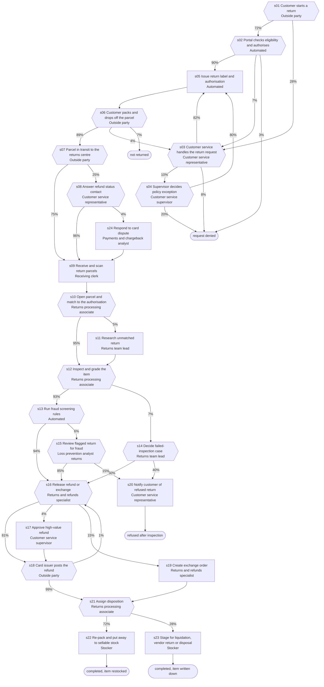

# Online order return and refund at a mid-size retailer

`retail-ecommerce-return` · retail (ecommerce) · customer operations and reverse logistics

When an online shopper sends back an item, the retailer has to authorise the return, give the customer a prepaid label, receive the parcel at its distribution centre, check the item's condition, refund or exchange it and decide whether the item can be sold again. Customer service, warehouse associates, a refunds team and loss prevention each handle part of it, and the carrier and card issuer add their own delays. About a fifth of online sales came back in 2021, so the volume is large, and most of the customer's wait is the time before drop-off, carrier transit and the returns backlog in the warehouse. Errors come from mismatched parcels, inconsistent grading, fraud such as wardrobing or wrong items, and refund status calls while customers wait.

| | |
|---|---|
| Unit of work | one return request for items from one online order |
| Starts when | A customer asks to return items from a delivered online order, through the returns portal or customer service. |
| Done when | The refund is posted to the customer's account or an exchange order is created, and the item is restocked or staged for liquidation, vendor return or disposal; or the request is denied, refused after inspection or never shipped. |
| Organisation | An online apparel and home goods retailer with about $300 million in online sales, its own distribution centre with a returns area, an in-house customer service team and a self-service returns portal linked to the order management system. (1,500 employees, 2019-2022) |
| Volume | 4,500 cases a month (range 3,000 to 7,500) |

## Where it sits

- Starts with **return request** from Online customers (delivered orders) (100% of cases)
- Sends **refund or exchange** to Customers (through card issuers) (outcome: completed, item restocked)
- Sends **refund or exchange** to Customers (through card issuers) (outcome: completed, item written down)
- Sends **returned item back in sellable stock** to Inventory and merchandising (outcome: completed, item restocked)
- Sends **returned item for liquidation, vendor return or disposal** to Liquidators, vendors and donation partners (outcome: completed, item written down)
- Sends **exchange order** to Order fulfilment (outcome: any)
- Sends **refund, inventory adjustment and dispute records** to Finance (accounting and payments) (outcome: any)
- Sends **prepaid return shipment** to Carrier (outcome: any)

## Flow

## Roles

| Role | Department | Layer | FTE on this process | Loaded cost per hour | Evidence |
|---|---|---|---:|---:|---|
| Customer service representative | Customer service | individual contributor | 3 | 26 USD | B [src9], [src10] |
| Customer service supervisor | Customer service | supervisor | 0.2 | 42 USD | B [src9], [src10] |
| Receiving clerk | Distribution centre | individual contributor | 1 | 26 USD | B [src9], [src10] |
| Returns processing associate | Distribution centre | individual contributor | 4.8 | 22 USD | B [src9], [src10], [src3] |
| Returns team lead | Distribution centre | supervisor | 0.7 | 38 USD | B [src9], [src10] |
| Stocker | Distribution centre | individual contributor | 2 | 21 USD | B [src9], [src10], [src3] |
| Returns and refunds specialist | Customer service back office | individual contributor | 1.4 | 27 USD | B [src9], [src10], [src4] |
| Loss prevention analyst (returns) | Loss prevention | individual contributor | 0.4 | 50 USD | B [src9], [src10], [src1] |
| Payments and chargeback analyst | Finance | individual contributor | 0.2 | 32 USD | B [src9], [src10] |

## Steps

Hands-on time and the wait before each step show the most common value. Evidence tier A is a sourced number, B a sourced description, C the author's estimate.

| Step | Who | Kind | Hands-on | Wait before | Control | Evidence |
|---|---|---|---:|---:|---|---|
| **s01 Customer starts a return.** The customer decides to send back one or more items, usually for fit, appearance or damage, and either opens the self-service returns page from the order email or contacts customer service. The customer's own few minutes are not counted as staff time. | Outside party | intake | 0 min | 0 min |  | B [src3], [src8] |
| **s02 Portal checks eligibility and authorises.** The returns portal looks up the order, checks the return window, final-sale flags and item eligibility against the posted policy, and authorises the return automatically or sends the customer to customer service. | Automated | system auto | 0 min | 0 min | Retailer's posted return policy (window, condition, final sale); state disclosure laws such as California Civil Code 1723 require restrictions to be posted | B [src3], [src6] |
| **s03 Customer service handles the return request.** A customer service representative opens the order in the order system, checks the policy, asks for photos when damage is claimed, creates the return authorisation by hand and explains next steps; out-of-policy requests go to a supervisor. | Customer service representative | communication | 9 min | 1.0 h |  | C |
| **s04 Supervisor decides policy exception.** The customer service supervisor reviews the customer's history and order value and decides whether to allow a late or out-of-policy return as goodwill. | Customer service supervisor | approval | 4 min | 4.0 h | Customer service authority matrix: exceptions to the return policy need supervisor approval | C |
| **s05 Issue return label and authorisation.** The returns platform creates the return authorisation number and a prepaid carrier label or QR code and emails them to the customer with packing instructions. | Automated | system auto | 0 min | 1 min |  | B [src5], [src8] |
| **s06 Customer packs and drops off the parcel.** The customer packs the item and drops it at a carrier location or schedules a pickup. Some customers never send the item, and the authorisation expires. | Outside party | external wait | 0 min | 3.0 d |  | C |
| **s07 Parcel in transit to the returns centre.** The carrier collects the parcel and moves it by ground service to the distribution centre; tracking scans update the returns portal so customer service and the customer can follow it. | Outside party | external wait | 0 min | 4.0 d |  | B [src5] |
| **s08 Answer refund status contact.** A customer service representative takes a call, chat or email from a customer asking where the refund is, checks carrier tracking and the returns record, explains the timeline and sometimes escalates. | Customer service representative | communication | 6 min | 30 min |  | C |
| **s09 Receive and scan return parcels.** The receiving clerk unloads return parcels, often in a daily batch, scans each label into the warehouse system so the customer sees it as received, and stages the parcels in the returns area, where they wait for processing. | Receiving clerk | physical | 1.5 min | 2.0 d |  | C |
| **s10 Open parcel and match to the authorisation.** A returns associate opens the parcel at a returns station, scans the authorisation and item barcodes and checks that the item and quantity match what was authorised. | Returns processing associate | physical | 2.5 min | 12.0 h |  | B [src3] |
| **s11 Research unmatched return.** The returns team lead puts the parcel on the problem shelf and searches the order system by name, address or item to find the order, contacting customer service when the customer must be asked. | Returns team lead | lookup | 10 min | 1.0 d |  | C |
| **s12 Inspect and grade the item.** The associate checks the item for wear, odour, stains, removed tags, missing parts and damage, compares it with the product record and grades it as new, open-box, damaged or not acceptable, photographing problems. | Returns processing associate | validation | 3 min | 2.0 h | Return policy condition requirements checked before refund (unworn, tags attached, complete) | B [src3], [src6], [src7] |
| **s13 Run fraud screening rules.** The returns platform or order system applies rules to the customer and return, such as return frequency, value, mismatched item, weight or shipping address, and holds suspicious refunds for review. | Automated | system auto | 0 min | 5 min | Loss prevention policy for return fraud screening | B [src1], [src2] |
| **s14 Decide failed-inspection case.** The returns team lead reviews the photos and order, decides whether to refund in full as goodwill, refund partly, or refuse and send the item back to the customer, and records the reason. | Returns team lead | judgment | 8 min | 1.0 d |  | C |
| **s15 Review flagged return for fraud.** The loss prevention analyst looks at the customer's order and return history, the photos and weights, and linked accounts, and decides to approve, approve with a partial refund or refuse. | Loss prevention analyst (returns) | judgment | 10 min | 1.0 d | Loss prevention policy: refunds held by fraud rules need analyst review | B [src1], [src6] |
| **s16 Release refund or exchange.** In a daily batch the returns and refunds specialist reviews the processed returns in the order system, releases refunds to the original payment method, creates exchanges where the customer chose one and sends larger refunds for approval. | Returns and refunds specialist | data entry | 2 min | 1.0 d | Regulation Z, 12 CFR 1026.12(e): send the credit to the card issuer within 7 business days of accepting a return; card network rules require refunds to the original card | B [src4], [src3] |
| **s17 Approve high-value refund.** The customer service supervisor opens each refund above the approval limit, checks it against the inspection grade, photos and order value, and approves it or holds it for questions. | Customer service supervisor | approval | 4 min | 6.0 h | Refund authority limits: refunds above a set amount need a second approver | C |
| **s18 Card issuer posts the refund.** The payment processor sends the credit to the customer's card issuer, which posts it to the account; the customer sees it after a few days. | Outside party | external wait | 0 min | 3.0 d |  | B [src4] |
| **s19 Create exchange order.** The refunds specialist creates a no-charge replacement order for the new size or item in the order system, which goes to the fulfilment queue, and refunds any price difference. | Returns and refunds specialist | data entry | 4 min | 1.0 h |  | B [src3] |
| **s20 Notify customer of refused return.** A customer service representative emails or calls the customer to explain why the return was refused, offers to ship the item back, and logs the outcome; some customers escalate. | Customer service representative | communication | 6 min | 12.0 h |  | C |
| **s21 Assign disposition.** The returns associate applies the disposition rules to the graded item: back to sellable stock, clean or repair, sell through outlet or liquidator, return to vendor, donate or destroy. | Returns processing associate | judgment | 1 min | 12.0 h |  | B [src3], [src7] |
| **s22 Re-pack and put away to sellable stock.** A stocker re-folds or re-bags and re-labels the item, moves it to its pick location and confirms the put-away in the warehouse system so it can be sold again. | Stocker | physical | 3.5 min | 12.0 h |  | B [src3] |
| **s23 Stage for liquidation, vendor return or disposal.** A stocker moves the item to the liquidation, vendor return or disposal area and posts the inventory adjustment in the warehouse system against the disposition code. | Stocker | physical | 1.5 min | 1.0 d | Internal control over financial reporting: inventory write-downs and adjustments posted against approved disposition codes | B [src7], [src3] |
| **s24 Respond to card dispute.** When a waiting customer disputes the charge with the card issuer, the payments analyst gathers the order, tracking and return records and answers the dispute in the processor portal, then tells the returns team. | Payments and chargeback analyst | drafting | 30 min | 3.0 d | Card network dispute rules (response within the network deadline), accepted in the merchant agreement | C |

## Exceptions

| Exception | Share of cases | What happens |
|---|---:|---|
| Return handled by customer service | 34% | The customer contacts customer service directly or is outside the portal rules, so an agent creates the authorisation by hand. |
| Policy exception requested | 3% | A late or out-of-policy return goes to a supervisor for a goodwill decision. |
| New label needed | 4% | The customer loses the label or lets it expire and asks customer service for a new one. |
| Never shipped | 7% | The customer does not send the item and the authorisation expires. |
| Refund status contact | 23% | The customer calls or chats to ask where the refund is while the parcel is in transit or waiting in the returns backlog. |
| Card dispute | 1% | A waiting customer disputes the charge and the payments analyst must answer it. |
| Unmatched parcel | 4% | The parcel has no authorisation or contains a different item and goes to the problem shelf for research. |
| Failed inspection | 6% | The item is worn, damaged or wrong, so the team lead decides goodwill, partial refund or refusal. |
| Fraud review | 5% | Fraud rules hold the refund and a loss prevention analyst reviews it. |
| Exchange instead of refund | 12% | The customer asked for another size or item, so an exchange order is created. |

## Benchmarks

| Metric | Value | Unit | Population | Evidence |
|---|---|---|---|---|
| cycle_time_days | p50 18, p90 30 | calendar days from return request to refund posted and item dispositioned | Author's estimate for a mid-size online retailer processing returns in its own distribution centre | C [src4], [src5] |
| online_return_rate | 0.208 | share of online sales returned (2021) | 57 US retailers surveyed by NRF and Appriss Retail | A [src1] |
| total_return_rate | 2020 0.106, 2021 0.166 | share of total US retail sales returned | NRF and Appriss Retail retailer surveys | A [src1], [src2] |
| return_fraud_loss_per_100_returned | 2020 5.9, 2021 10.3 | USD lost per 100 USD of returns accepted | NRF and Appriss Retail retailer surveys | A [src1], [src2] |
| fraudulent_share_online_returns | 0.106 | share of online returns deemed fraudulent (2021) | NRF and Appriss Retail retailer survey | A [src1] |
| return_cost_share_of_sales | up_to_turnover 0.05, up_to_gross_sales 0.07 | share of sales | Industry estimates cited by Wikipedia | A [src6], [src7] |
| refund_timing_rule | merchant_business_days 7, issuer_business_days 3 | business days | Card refunds in the United States under Regulation Z | A [src4] |

## Pain points

- Returns wait at the dock and in the returns area for days because outbound orders take priority, especially in January, which delays refunds and triggers status calls. (steps s09, s10, s08; C [src2])
- Return fraud and abuse such as wardrobing and wrong-item returns cost several dollars per hundred returned, and screening catches only part of it. (steps s12, s13, s15; A [src1], [src2])
- Grading is manual and inconsistent between associates, so sellable items are written down and worn items are refunded. (steps s12, s21; C)
- About a third of returns still go through customer service, where authorisations are created by hand and errors start. (steps s03, s04; C)
- Free return shipping, inspection labour, restocking and lost margin make each return costly even when the item is resold. (steps s05, s12, s22, s23; B [src3], [src6], [src7])

## Assumptions

- One case is one return request for one or more items from one order; the warehouse handles the items of one request together.
- Customer and carrier time is modelled as waits with zero staff touch time.
- Refunds are released after inspection in a daily batch; some retailers refund on the first carrier scan, which shortens the customer's wait by four to ten days.
- The disposition and put-away steps run in parallel with the refund in practice; they are listed after it with short waits and named in concurrent_with, so the simulated cycle runs to the end of disposition.
- The cycle_time_days benchmark is the author's estimate assembled from sourced transit and refund-timing limits; no source opened measured it.
- Loaded hourly cost is the BLS May 2021 national median wage for the nearest SOC code times 1.45 (1.30 benefits from BLS ECEC December 2021 for retail trade, about 1.12 overhead by author estimate).
- Channel mix, hold rates, failed-inspection and fraud-review rates, exchange share and handle times are tier C estimates.

## Sources

- [src1] [Retail Returns Increased to $761 Billion in 2021 as a Result of Overall Sales Growth](https://nrf.com/media-center/press-releases/retail-returns-increased-761-billion-2021-result-overall-sales-growth) (National Retail Federation, 2022). 2021: returns averaged 16.6% of total US retail sales; online return rate 20.8%; about $218 billion of online purchases returned; $10.30 lost to return fraud per $100 of returns accepted; 10.6% of online returns ($23.2 billion) deemed fraudulent; survey of 57 retailers by NRF and Appriss Retail.
- [src2] [$428 Billion in Merchandise Returned in 2020](https://nrf.com/media-center/press-releases/428-billion-merchandise-returned-2020) (National Retail Federation, 2021). 2020: returns about 10.6% of total US retail sales; online returns more than doubled from 2019; $5.90 lost to return fraud per $100 returned (5.9% fraudulent); 13.3% of holiday sales expected to be returned; survey of 62 retailers.
- [src3] [Ecommerce Returns: Rates and Best Practices](https://www.shopify.com/blog/ecommerce-returns) (Shopify Enterprise Blog (Elise Dopson and Michael Metcalf), 2026). Return flow: request with reason, rule-based approval, inbound shipment to warehouse or 3PL, inspection and grading, disposition (restock, markdown, refurbish, write-off), refund or exchange, close and inventory update; cost components include return shipping, inspection labour, restocking and lost margin; common reasons fit, not as described, damage, defect, change of mind; bracketing and wardrobing.
- [src4] [12 CFR 1026.12 Special credit card provisions (Regulation Z), paragraph (e)](https://www.law.cornell.edu/cfr/text/12/1026.12) (Legal Information Institute, Cornell Law School, None). A merchant that accepts a return must transmit a credit statement to the card issuer within 7 business days of accepting the return; the issuer must credit the consumer's account within 3 business days of receiving it.
- [src5] [FedEx Ground shipping](https://www.fedex.com/en-us/shipping/ground.html) (FedEx, None). FedEx Ground delivery within the contiguous US takes 1 to 5 business days; discounted return shipments available to account holders.
- [src6] [Product return](https://en.wikipedia.org/wiki/Product_return) (Wikipedia, None). Retailers set conditions such as resellable condition, time limits and receipts; some offer only exchange or store credit or charge restocking fees; online sales may see 25 to 40% returns versus 8 to 10% in store (Pacific Standard 2017); returns can cost up to 5% of annual turnover (Spaceguard 2021); wardrobing described.
- [src7] [Reverse logistics](https://en.wikipedia.org/wiki/Reverse_logistics) (Wikipedia, None). Returned goods are quality-checked before returning to inventory, redirected for remanufacturing or sold in secondary markets; return costs cited at up to 7% of gross sales from industry data; about 20% of online purchases returned versus 8 to 10% in store.
- [src8] [Return merchandise authorization](https://en.wikipedia.org/wiki/Return_merchandise_authorization) (Wikipedia, None). A return merchandise authorization is the seller's approval for a product to be returned for refund, replacement or repair and acts as a gatekeeping point.
- [src9] [May 2021 National Occupational Employment and Wage Estimates, United States](https://www.bls.gov/oes/2021/may/oes_nat.htm) (U.S. Bureau of Labor Statistics, 2022). Median hourly wages: Customer Service Representatives 43-4051 $17.75; First-Line Supervisors of Office and Administrative Support Workers 43-1011 $29.13; Shipping, Receiving and Inventory Clerks 43-5071 $17.74; Laborers and Freight, Stock and Material Movers, Hand 53-7062 $15.02; Stockers and Order Fillers 53-7065 $14.48; First-Line Supervisors of Transportation and Material Moving Workers 53-1047 $26.37; Compliance Officers 13-1041 $34.45; Bookkeeping, Accounting and Auditing Clerks 43-3031 $21.90.
- [src10] [Employer Costs for Employee Compensation - December 2021 (news release)](https://www.bls.gov/news.release/archives/ecec_03182022.htm) (U.S. Bureau of Labor Statistics, 2022). Retail trade: total compensation $22.69 per hour, wages and salaries $17.42 (76.8%), benefits $5.27 (23.2%).

Written by claude-opus on 2026-11-17.
