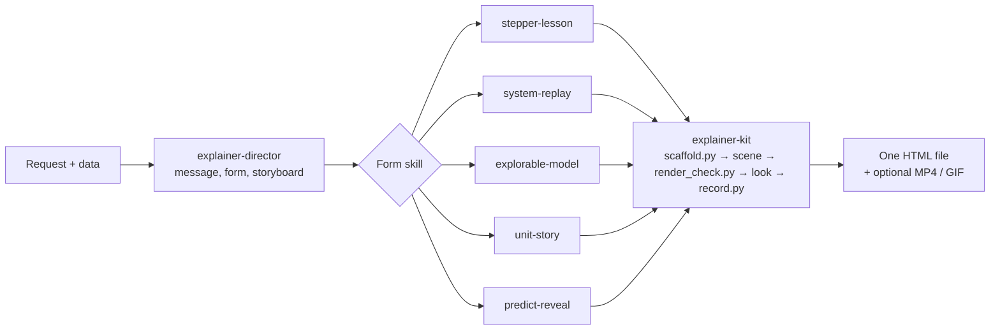

# Visual explainer skills

Seven agent skills that teach a model to turn a finding, a process or a dataset into an animated or
interactive explainer that a newcomer can follow on a phone: a step-by-step lesson, a replay of a real
agent run, a what-if model to play with, a chart where every item is a dot, or a guess-then-reveal.
They grew out of a set of chalkboard-style animations (an agentic finance harness, a RAG explainer and a
lesson on deep work versus parallel agents) and generalise what made those work.

The skills are plain folders in the [Agent Skills](https://docs.claude.com/en/docs/agents-and-tools/agent-skills/overview)
format: a `SKILL.md` with a name and a description that tells the model when to use it, plus scripts and
references it reads only when needed.

## The skills

| Skill | What it does | Use it when the reader must grasp... |
|---|---|---|
| [explainer-director](explainer-director/SKILL.md) | Finds the one message, picks the form, writes a storyboard with one idea per step, and runs an honesty check | Always first |
| [explainer-kit](explainer-kit/SKILL.md) | The engine, four styles, a scaffold script, a render check and a GIF/MP4 recorder | Always, to build and check |
| [stepper-lesson](stepper-lesson/SKILL.md) | Khan Academy style lesson with Next, captions and one or two hands-on steps | How something works, one concept at a time |
| [system-replay](system-replay/SKILL.md) | Replays recorded traces on a scrubbable timeline, or walks through a designed run | What happened between several actors over time |
| [explorable-model](explorable-model/SKILL.md) | A live model the reader steers with a slider, with linked views and the break-even marked | How an outcome depends on a price, threshold or rate |
| [unit-story](unit-story/SKILL.md) | Every item is a dot; dots regroup by model and outcome; small-sample uncertainty shown with intervals and simulated samples | How many items landed where, and how sure we can be |
| [predict-reveal](predict-reveal/SKILL.md) | The reader draws or drags a guess, then the data animates in against it | A number the reader would get wrong |

How they fit together:

## What the kit does for the model

- `scaffold.py` writes a self-contained HTML file with the engine inlined, so the model writes only the
  scene and never retypes boilerplate. `--fragment` produces a claude.ai chat widget instead of a page.
- `kit.js` (window.K): hand-drawn shapes with fixed wobble, draw-in reveals in reading order, travelling
  dots, pulse rings, counters, a stepper whose Back/Next never move, a scrubbable timeline player for
  replays, unit-chart motion that keeps each item's identity, sliders, Wilson intervals, reduced-motion
  support, and a `window.EXPLAINER` hook that the scripts use to drive any explainer.
- `render_check.py` opens the page at 360 px and 560 px, walks every step, saves frames and contact
  sheets, and fails on console errors, sideways scrolling, text outside the drawing, controls that move,
  and blank frames; it warns on overlapping or tiny text and on height changes.
- `record.py` plays every step with its scripted demo taps and writes a sharp MP4 and a GIF.

Four styles: `chalkboard` (the original look), `paper`, `editorial` and `blueprint`. The data colours of
each were checked for colour-blind separation; the original chalkboard pastels failed that check as data
colours, so the kit keeps them for lines and text and uses stronger fills for data.

## Installing

- **Claude Code**: copy the seven folders into `~/.claude/skills/` (all projects) or into a project's
  `.claude/skills/`. Python with Playwright and ffmpeg are needed for the checks and recordings.
- **claude.ai**: zip each folder (the folder itself at the root of the zip) and upload it under
  Settings → Capabilities → Skills. Ask for a "chat widget" to get an inline visual.
- **Other agents**: point the agent's instructions file at this folder and tell it to read
  `explainer-director/SKILL.md` before any visual explainer.

## How they were tested

Five test cases use this repository's own experiment data, chosen so each form gets exercised:

| Case | Notebook | The ask |
|---|---|---|
| guardrail-gates | 10, execution guardrails | A Khan Academy style lesson on why a gate that only checks how a path starts can be tricked |
| handoff-timelines | 07, subagent handoff | A replay of recorded agent timings: why synchronous handoff took 120 s and async 57 s |
| invoice-checks | econ 21, verification costs | An interactive for finance managers: when does checking a cheap model pay off? |
| sql-safety-units | 05, text-to-SQL safety | A LinkedIn visual: 0 of 29 rule breaks does not prove a model is safe |
| forecast-guess | 16, zero-shot forecasting | Something engaging on how hard it is to beat "repeat last week" |

Each case was run twice by the same model from the same prompt and data: once with these skills
installed and once without. The skill files contain no data or wording from the test notebooks. Results
are scored by automatic checks (rendering, layout, the case's key numbers on screen, interactivity) and
by a blind side-by-side review. The case folders are in [evals/](evals/); results are summarised below.

## Results

Three rounds, five cases each, one build per condition per round. After each round the reviewers' complaints
went into the skills and the five were rebuilt; every round compared against the same builds made without the
skills. Blind reviews by a separate model; the score is the sum of five 1-to-5 ratings (message, accuracy,
engagement, craft, fit), so 25 is the maximum.

| Case | Round 1 | Round 2 | Round 3 | Round 3 score, with / without |
|---|---|---|---|---|
| guardrail-gates | Without | Without | Without | 20 / 23 |
| handoff-timelines | With | With | With | 24 / 16 |
| invoice-checks | With | Without | With | 24 / 19 |
| sql-safety-units | Without | Without | Without | 21 / 22 |
| forecast-guess | With | With | With | 23 / 20 |
| **Wins with skills** | 3 of 5 | 2 of 5 | 3 of 5 | 112 / 100 |

The skills won 8 of 15 comparisons, and their summed review score was higher in every round (110 to 105,
109 to 103, 112 to 100). Automatic checks (errors, sideways scrolling, overlapping or tiny text, moving
controls, the case's key numbers on screen) passed 54 of 55 with the skills in each round and 48 of 55 without.

What the rounds showed:

- The skills make phone layout and replays reliable. The replay won all three rounds; the version made without
  the skills put its timeline in a sideways-scrolling box where most of the action happened off screen.
- Giving an explorable's outcome in the reader's units (a monthly bill at a volume the reader picks) won back
  the invoice case in round 3 after it was lost in round 2.
- Two cases lost every round. The guardrail lesson waits for the reader's guess but gives the same feedback
  whatever they pick, and packs four tricks into one auto-playing step, where the other version gives each
  trick its own guess with "Right" or "Not quite". The SQL visual lost by one point to a fixed-size card that
  suits a LinkedIn post and that shows the models still answered ordinary questions, so the clean scores were
  not refusals.

With one build per condition, the split could easily move either way. The reviewer also scored the same
no-skills page differently across rounds (the invoice page got 21, 21, then 19), so one or two points is noise.
Eight more notebooks (08, 12, 27, 28, 29, 31, 33, 41) were built with the skills as a showcase; all pass the
render check.
